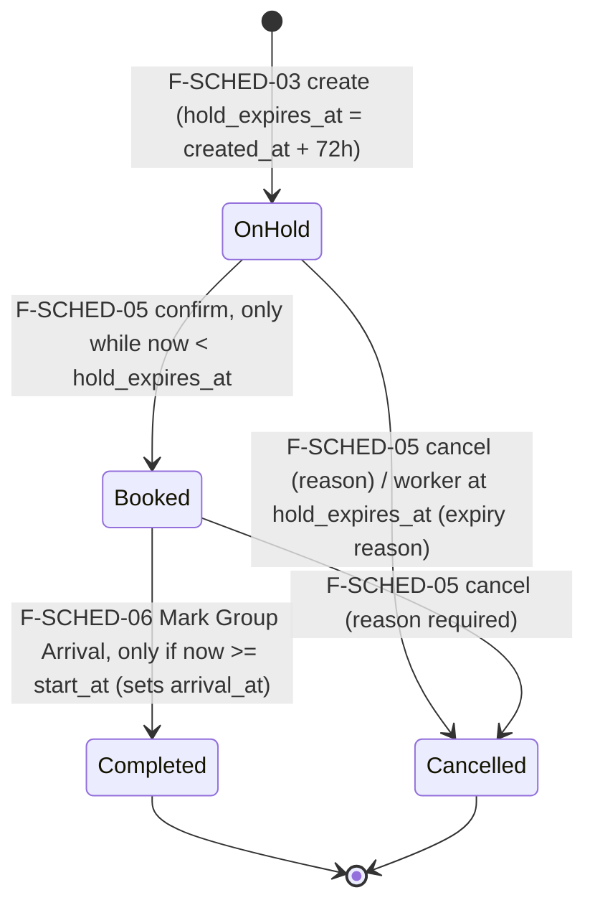

# 04 — BKG (Schedule/Booking) brief for the build

Authoritative source: `docs/spec/specs/spec-BKG.md` (v0.2, 28/09/2026). This file is a working
summary plus findings from reading the spec against `data/`. Where they differ, the spec wins.
Nothing here is a new requirement; items marked **OQ-candidate** must go to the spec owner as open
questions before `/speckit-plan`.

## 1. Scope in one look

Local Provider owns the whole Booking lifecycle after negotiating with an Agency in Chat. The module
also calculates availability (from PRF operating hours + active bookings) and shows a public
Provider schedule and a read-only private Agency schedule, kept in sync, with a Chat auto-message on
every booking event.

Out of scope: Agency creating/changing bookings, Admin lifecycle control, payment, e-contract, quote
negotiation itself, editing operating hours (PRF F-PROFILE-04), blackout/unavailable periods,
manual schedule-block editing, notification center.

| US (all P1) | Functions | Screens |
|---|---|---|
| US-1 View Schedule | F-SCHED-01 public schedule, F-SCHED-02 Agency private schedule | SCH139, SCH140, SCH141, DSH018 |
| US-2 View Calculated Availability | F-SCHED-09 | SCH139, SCH140 |
| US-3 View Bookings | F-SCHED-07 detail + action buttons | BKG135 (LP), BKG138 (Agency) |
| US-4 Create Booking | F-SCHED-03 | BKG134 |
| US-5 Manage Booking | F-SCHED-04 update, F-SCHED-05 status, F-SCHED-06 arrival, F-SCHED-08 sync | BKG144, BKG136 |
| US-6 List Bookings | F-SCHED-10 | BKG133, DSH018 |

All ten functions are Must.

## 2. Lifecycle

- No other transition exists. F-SCHED-05 never sets Completed; BKG144 has no Completed option (AC-BKG-COMPLETE).
- F-SCHED-04 (detail update) is separate from status changes (BR-007); allowed while On hold or
  Booked; changing date/time does **not** reset `hold_expires_at` (OQ #6); new slot is atomically
  re-checked; `group_size ≤ max_participants` on update too (OQ #7).
- Confirm racing the expiry worker at the deadline: exactly one conditional transition wins; the
  expired hold ends Cancelled; no duplicate event or chat message (AC-BKG-EXPIRY).
- Every create/update/status/arrival/auto-expiry event → F-SCHED-08: Agency private schedule
  updated + Chat auto-message + latest-update timestamp (BR-012).

F-SCHED-07 action buttons (Local Provider only; Agency always view-only; HDT/UBND/Guest no access):

| State | Confirm/Book | Update | Cancel | Mark Group Arrival |
|---|---|---|---|---|
| On hold | on | on | on | — |
| Booked, now < start_at | — | on | on | **disabled** (BR-017) |
| Booked, now ≥ start_at | — | on | on | on |
| Completed / Cancelled | all disabled (view only) |||

## 3. Business rules → what the test must prove

| BR | Rule | Test idea |
|---|---|---|
| BR-001 | Only Local Provider controls lifecycle | Agency/Admin/Guest actor calling create/update/status/arrival → denied, nothing written |
| BR-002 | Agency sees only own bookings, no actions | Agency A cannot read Agency B's booking; no mutation allowed |
| BR-003 | New booking starts On hold | create → status = On hold (SC-001) |
| BR-004 | Hold = exactly 72h | `hold_expires_at − created_at = 72h` (SC-002); unchanged after date update |
| BR-005 | On hold blocks the slot immediately | create then F-SCHED-09 → slot occupied; 2nd overlapping create → Slot Unavailable |
| BR-006 | Blocks come only from bookings; hours only from PRF | no availability-edit API exists in BKG (SC-009) |
| BR-007 | Detail update ≠ status change | F-SCHED-04 payload with status is rejected/ignored |
| BR-008 | Agency private schedule read-only, own only | F-SCHED-02 returns only session agency's rows |
| BR-009 | Public schedule hides agency, contact, price, conditions, hold expiry | F-SCHED-01 payload has only start/end/status (SC-010) |
| BR-010 | Arrival only Booked + now ≥ start_at | before start → `Tour Start Time Not Reached`; On hold → `Booking Not Booked`; booking unchanged |
| BR-011 | Completed/Cancelled terminal | any mutation on terminal booking rejected (SC-008) |
| BR-012 | Every event syncs Agency schedule | after each event, Agency view shows new state + `last_updated_at` |
| BR-013 | *(numbering gap in spec: BR-012 → BR-014)* | — |
| BR-014 | HDT/UBND/Guest cannot open F-SCHED-07 | access denied |
| BR-015 | Quote ≠ Booking | creating a quote creates no booking |
| BR-016 | One booking = one slot; arrival completes whole booking | no multi-slot input; no partial progress |
| BR-017 | Button state follows full gating rule | Arrival button disabled while Booked and now < start_at |
| BR-018 | Only active Verified Provider + own unarchived Experience | unverified provider / archived / foreign experience → rejected |
| BR-019 | Create inserts initial history; status change + history in one transaction | create → 1 history row (null → On hold); simulated failure rolls back both |
| BR-020 | `end_at = start_at + duration`; conditions snapshot kept | stored end_at matches; snapshot copied from Experience, changed only via F-SCHED-04 |

Plus: AC-BKG-HOLD, AC-BKG-RACE (two concurrent creates on one interval → at most one commits, loser
leaves no block), AC-BKG-EXPIRY, AC-BKG-HOURS (no operating hours → no available periods, not
"fully available"), AC-BKG-COMPLETE; cancellation reason required (OQ #10); `arrival_at` persisted (OQ #11).

## 4. Spec field → `data/schema.sql`

| Spec (§5.1) | Table.column | Note |
|---|---|---|
| booking_id | bookings.booking_id | uuid |
| agency_id / provider_id / experience_id | bookings.* | FK (experience_id, provider_id) → experiences |
| source_chat_session_id | bookings.source_chat_session_id | optional |
| start_at | bookings.start_at | timestamptz |
| duration | bookings.duration_minutes | |
| end_at | bookings.end_at | set by app = start_at + duration (CHECK) |
| group_size | bookings.group_size | trigger: ≤ experiences.max_participants |
| **agreed_price** | **bookings.agreed_price_total** | name differs; total for group, VND |
| booking_conditions | bookings.conditions_snapshot | jsonb `{notice_period_hours, cancellation_policy{...}}` |
| status | bookings.status | 4 canonical values |
| created_at / updated_at | bookings.* | |
| hold_expires_at | bookings.hold_expires_at | CHECK = created_at + 72h |
| **arrived_at** | **bookings.arrival_at** | name differs; only when Completed |
| status_history_entry | booking_status_history (from_status, to_status, changed_by, changed_at, reason) | reason NOT NULL when to Cancelled |
| operating_hours | provider_operating_hours (weekday 1–7, local_start, local_end) | read-only for BKG (PRF owns) |
| chat auto-message | chat_messages (message_kind = 'Booking Update', sender may be NULL); chat_sessions (source may be 'Booking') | IAC tables |
| agency_contact / provider_profile_link / names | agency_profiles, provider_profiles, experiences, villages | read-only |

Enforced by PostgreSQL itself: hold CHECK, end/duration CHECK, conditions shape, arrival CHECK,
GiST EXCLUDE (no overlapping On hold/Booked per provider), capacity trigger, cancel-reason CHECK.
Must be enforced in application code: Verified provider + unarchived experience (BR-018), status +
history in one transaction (BR-019), operating-hours fit, role/ownership checks.
**If the storage is not PostgreSQL, every DB-enforced rule above becomes application code and
needs its own test** — including AC-BKG-RACE.

## 5. Dependencies and how to treat them in Alpha (decide in plan.md, not here)

| Needs | From | Alpha option |
|---|---|---|
| Storage | shared runtime | `main` stores everything through `JsonDemoRepository` (`src/lib/demo/json-repository.ts`, accessed via `demoRepository()`): CSV seed copied to `.demo-data/runtime.json`, rewritten on every write. Tests run it volatile (`NODE_ENV=test`: loaded from the CSV, never written). See §8 for what this means for BKG rules |
| Actor identity, role, ownership | AUT | AUT is not on `main`. Use the demo session (`src/lib/auth/demo-session.ts`, cookie `hab_demo_account`, `provider` / `agency` / `ubnd` / `hdt` / `guest`), but still test BR-001/002/014 at service level with each role |
| Experiences, max_participants, conditions, operating hours, Verified status | PRF | read through the same repository (PRF code on `main` already does); BKG never writes them |
| Chat auto-message (F-SCHED-08), chat resolution order (OQ #13) | IAC | no IAC module on `main`; `src/lib/demo/commercial-handoff-service.ts` and the `/messages` page already hold the shared conversations, so the 'Booking Update' message can probably go through them. Verify before relying on it; record the choice in plan.md / limitations |
| 72h expiry worker | System | an `expireDueHolds(now)` function with an injected clock, callable by a test and by a timer |

## 6. Findings from reading spec vs seed (raise before planning)

1. **Frozen clock**: seed `generated_at = 2026-09-30T00:00+07:00`. Seed On hold booking (start
   2026-10-11) expires 2026-10-01 08:00. With the real clock (late Oct 2026) it is already
   expired. Tests must inject "now"; never use the wall clock.
2. **OQ-candidate — weekday numbering**: `provider_operating_hours.weekday` is 1–7 but neither
   `data/04-data-model.md` nor the spec says whether 1 = Monday (ISO) or Sunday.
3. **OQ-candidate — seed bookings outside operating hours**: each provider has exactly one weekday
   window (8 rows). Under ISO numbering, two active seed bookings fall outside their provider's
   hours: On hold 2026-10-11 (Sunday; provider 70efa801 works weekday 2) and Booked 2026-10-10
   (Saturday; provider 50f2c8fc works weekday 1). F-SCHED-09 must still show them as occupied;
   F-SCHED-03 would reject creating them today.
4. **OQ-candidate — must the whole interval fit inside operating hours?** FR-003 says "re-checks
   against Provider availability"; it does not say start-only vs start-and-end.
5. **OQ-candidate — notice period at creation**: data docs list "notice period check" as backend
   duty, but FR-003 does not state the rule (start_at ≥ now + notice_period_hours?).
6. **OQ-candidate — timezone**: spec Assumption says storage timezone is undefined; seed uses
   +07:00. Proposal to confirm: compute weekday/hours in Asia/Ho_Chi_Minh, store timestamptz.
7. Seed `role_permissions`: Tour_Agency has no booking-read permission (blocks F-SCHED-02/07 for
   Agency if permissions are enforced from seed).
8. BR numbering skips BR-013 (cosmetic; do not invent one).
9. `usage flow.md` still shows a direct-Booked branch; F-SCHED-03 wins (OQ #20/#21).

## 7. Slicing proposal (the team decides)

All six stories are P1, so the order is a team call. Proposed, because each slice is demonstrable
and the next builds on it:

1. **US-4 Create Booking** + the part of F-SCHED-09 needed for the conflict check
   (BR-003/004/005/018/019/020, AC-BKG-HOLD, AC-BKG-RACE, AC-BKG-HOURS). Demo path: Provider opens
   BKG134 → picks Agency + Experience + time → booking On hold with 72h expiry → slot shows occupied.
2. **US-5 Manage Booking** (+ F-SCHED-08 sync, expiry worker, AC-BKG-EXPIRY, BR-007/010/011/012/017).
3. **US-3 View Bookings** (F-SCHED-07 button matrix, BR-014).
4. **US-6 List Bookings** (F-SCHED-10: order by start, requires_action, empty state, paging).
5. **US-1 / US-2 schedules** (F-SCHED-01/02/09 full calendar, BR-008/009).

For `mvp-alpha` the checklist needs one P1 story per core module running end to end: slice 1.
Confirm with the team whether BKG is a "core module" in the MVP Scope v3.

## 8. Stack and sequencing

- Workshop rule: the second feature reuses the stack and structure of `specs/001-ait-core/plan.md`
  and starts only after AIT's Setup + Foundational phases are on `main`. Check PR #6 state first.
  If AIT is not merged, discuss with the team: wait, or merge its scaffold first. Do not create a
  second scaffold.
- AIT, PRF and EXP are on `main` (state 29 Oct 2026, `ada9e44`), so the scaffold exists: BKG
  reuses the shared Next.js 14 app and does not create a second one.
- Storage is the real decision for BKG. Today every module on `main` uses `JsonDemoRepository`
  (`src/lib/demo/json-repository.ts`); tests use the volatile mode. BKG's core rules are exactly
  what `schema.sql` enforces in PostgreSQL, and the JSON runtime enforces **none** of them. On
  the JSON runtime each rule below needs its own code **and** its own test:

  | Rule PostgreSQL enforces | BKG reference |
  |---|---|
  | GiST `EXCLUDE`: no overlapping On hold/Booked interval per provider | BR-005, AC-BKG-RACE |
  | hold `CHECK`: `hold_expires_at = created_at + 72h` | BR-004, AC-BKG-HOLD |
  | end/duration `CHECK`: `end_at = start_at + duration_minutes` | BR-020 |
  | capacity trigger: `group_size ≤ experiences.max_participants` | create + update (OQ #7) |
  | cancel-reason `CHECK`: reason NOT NULL when `to_status = Cancelled` | OQ #10 |
  | status + `booking_status_history` in one transaction | BR-019 |

  Facts about the repository that matter here: there is no transaction API; each `insert` /
  `update` / `remove` rewrites the whole file on its own, so "status + history" is two separate
  writes; every value is a string (`DemoRow = Record<string, string>`), so time and number
  comparisons must parse explicitly; the file is read once per process (`globalThis` singleton).
- **Risk: read-check-write race.** "Find overlapping bookings, then insert" is safe only while
  no `await` sits between the check and the write in a single process. An `await` in between,
  or two processes on the same file, lets two creates both pass the check (AC-BKG-RACE fails);
  the same applies to confirm vs. expiry (AC-BKG-EXPIRY).
- Proposal only, not done (team decides in plan.md): serialise all BKG writes through one
  in-process queue/mutex around "check + write + history", add a repository method that applies
  several table changes and persists once, and write a test that fires two concurrent creates on
  the same interval. Alternative: PostgreSQL via local install or Docker (uses `schema.sql` +
  `load_seed.sql` as is), or an embedded Postgres such as PGlite (check `btree_gist` support).
  The choice must respect the four course constraints (macOS + Windows, free, loads the seed,
  terminal test runner).

## 9. Pre-flight before `/speckit-plan` (BKG)

- [ ] PR #6 (AIT) state known; scaffold on main or a team decision recorded.
- [ ] Feature number not yet agreed: main has `001-ait`, `001-exp`, `002-prf`; ADM branch uses
      `003`; AUT branch uses `001`–`010`. Agree a number with the team before running
      `start_feature.py`.
- [ ] Feature number aligned with ADM (`003-adm-core`) and AUT (`001`–`010-aut-*` on
      `001-aut-registration`): `main` already has `001-ait-core`, `001-exp-core`, `002-prf-core`, so
      `start_feature.py` on `main` would give `003`, which clashes with ADM.
- [ ] Step 1 read-only field check done; every NOT FOUND resolved (see §4: two name differences).
- [ ] OQ-candidates in §6 sent to the spec owner (Nguyễn Thị Minh Thư) / data owner (Vũ Việt Hoàng);
      blocking ones answered under `## Clarifications` in `docs/spec/specs/spec-BKG.md`.
- [ ] Slice (US) for this feature chosen by the team.
- [ ] Storage decision taken by the team.
