# Hanoi Artisan Bridge — Updated Entity Relationship Diagram (ERD)

Tài liệu này đặc tả ERD mở rộng của hệ thống **Hanoi Artisan Bridge (HAB)**, tích hợp module **Provider Ratings, Customer Reviews, AI Sentiment Analysis & Provider Quality Scoring** nhằm phục vụ thuật toán **AI Tour Matching**.

---

## 1. Biểu đồ Mermaid ERD Cập nhật

```mermaid
erDiagram
    roles ||--o{ user_accounts : assigns
    roles ||--o{ role_permissions : grants
    permissions ||--o{ role_permissions : included_in

    villages ||--o{ ubnd_village_assignments : scopes
    user_accounts ||--o| ubnd_village_assignments : receives
    user_accounts ||--o{ sessions : opens
    user_accounts ||--o{ password_reset_tokens : resets_password
    user_accounts ||--o{ account_status_history : changes

    agency_registration_requests ||--o{ registration_otp_challenges : verifies
    agency_registration_requests ||--o{ registration_resubmission_tokens : authorizes
    agency_registration_requests ||--o{ registration_submission_versions : versions
    registration_submission_versions ||--o{ registration_documents : contains
    stored_files ||--o{ registration_documents : backs
    agency_registration_requests ||--o| agency_profiles : creates
    user_accounts ||--o| agency_profiles : represents
    agency_profiles ||--o{ agency_major_change_requests : proposes
    registration_submission_versions ||--o{ agency_review_records : reviewed_by
    agency_major_change_requests ||--o{ agency_review_records : reviewed_by

    user_accounts ||--o| provider_profiles : represents
    villages ||--o{ provider_profiles : contains
    provider_profiles ||--o{ provider_profile_versions : versions
    provider_profile_versions ||--o{ provider_verification_reviews : reviewed_by
    provider_profile_versions ||--o{ provider_version_media : contains
    stored_files ||--o{ provider_version_media : backs
    provider_profiles ||--o{ provider_operating_hours : configures
    provider_profiles ||--o{ experiences : offers
    provider_profiles ||--o{ ai_description_drafts : drafts_profile_text
    experiences ||--o{ ai_description_drafts : drafts_experience_text
    experiences ||--o{ experience_discount_rules : prices
    stored_files ||--o{ profile_media : backs
    experiences ||--o{ profile_media : illustrates
    agency_profiles ||--o{ profile_media : illustrates
    provider_profiles ||--o{ profile_media : illustrates

    %% -------------------------------------------------------------
    %% BỔ SUNG MỚI: PROVIDER RATINGS, REVIEWS & QUALITY SCORES
    %% -------------------------------------------------------------
    provider_profiles ||--o{ provider_ratings : holds_ratings
    provider_profiles ||--o{ provider_reviews : receives_reviews
    provider_reviews ||--o| review_sentiment_analyses : analyzed_by
    provider_profiles ||--o{ provider_quality_scores : calculates_scores

    %% -------------------------------------------------------------
    %% MATCHING, EXPLORE, BOOKING & CHAT
    %% -------------------------------------------------------------
    agency_profiles ||--o{ matching_sessions : starts
    matching_sessions ||--o{ matching_messages : contains
    matching_sessions ||--o| tour_preference_profiles : derives
    matching_sessions ||--o{ recommendation_results : produces
    experiences ||--o{ recommendation_results : recommends
    agency_profiles ||--o| agency_preference_profiles : owns
    agency_profiles ||--o{ preference_signals : emits
    agency_profiles ||--o{ quote_requests : sends
    experiences ||--o{ quote_requests : receives
    agency_profiles ||--o{ explore_sessions : browses
    explore_sessions ||--o{ explore_interactions : records
    ranking_parameter_versions |o--o{ explore_sessions : served_in
    ranking_parameter_versions ||--o{ ranking_quality_assessments : evaluated_by

    agency_profiles ||--o{ bookings : attends
    provider_profiles ||--o{ bookings : hosts
    experiences ||--o{ bookings : reserves
    bookings ||--o{ booking_status_history : transitions

    agency_profiles ||--o{ chat_sessions : participates
    provider_profiles ||--o{ chat_sessions : participates
    chat_sessions ||--o{ chat_participants : authorizes
    user_accounts ||--o{ chat_participants : joins
    chat_sessions ||--o{ chat_messages : contains
    chat_messages ||--o{ chat_attachments : carries
    stored_files ||--o{ chat_attachments : backs
    user_accounts ||--o{ notifications : receives
    user_accounts ||--o{ audit_logs : acts
    provider_profile_versions ||--o{ provider_version_documents : documented_by
    stored_files ||--o{ provider_version_documents : backs

    matching_sessions ||--o{ chat_sessions : originates
    matching_sessions ||--o{ quote_requests : originates
    experiences ||--o{ chat_sessions : primary_context
    quote_requests ||--o{ chat_sessions : primary_context
    bookings ||--o{ chat_sessions : primary_context
    stored_files ||--o| user_accounts : avatar_of

    provider_ratings {
        uuid rating_id PK
        uuid provider_id FK
        varchar source_platform
        numeric rating_value
        numeric rating_scale
        numeric normalized_score_100
        integer total_reviews
        text source_url
        timestamptz crawled_at
        boolean is_latest
        timestamptz created_at
    }

    provider_reviews {
        uuid review_id PK
        uuid provider_id FK
        varchar source_platform
        varchar external_review_id
        numeric rating_value
        numeric rating_scale
        varchar author_display_name
        varchar original_language
        text cleaned_content
        timestamptz published_at
        timestamptz crawled_at
        text review_url
        timestamptz created_at
        timestamptz updated_at
    }

    review_sentiment_analyses {
        uuid analysis_id PK
        uuid review_id FK
        varchar sentiment
        numeric sentiment_score
        jsonb sentiment_tags
        jsonb aspect_sentiments
        numeric confidence_score
        varchar ai_model_version
        timestamptz analyzed_at
    }

    provider_quality_scores {
        uuid score_id PK
        uuid provider_id FK
        numeric bayesian_rating
        numeric raw_average_rating
        integer total_reviews_count
        numeric volume_score
        numeric sentiment_score
        numeric recency_score
        numeric final_quality_score
        jsonb weight_configuration
        timestamptz calculated_at
        boolean is_current
    }
```

---

## 2. Chi tiết 4 Thực thể Mới được Tích hợp

### 2.1. `provider_ratings` (Điểm đánh giá theo nền tảng nguồn)
- **Mục đích**: Lưu trữ điểm rating trung bình, thang điểm và tổng số lượng review của từng Local Provider theo từng nền tảng công khai (Google Maps, TripAdvisor, Klook, v.v.) qua các đợt crawl khác nhau.
- **Quan hệ**: `provider_profiles (1) -> (N) provider_ratings`.
- **Đặc điểm kiến trúc**:
  - `normalized_score_100`: Tự động chuẩn hóa về thang 100 điểm (`rating_value / rating_scale * 100`).
  - `is_latest`: Cờ boolean đánh dấu bản ghi crawl mới nhất của provider trên nguồn tương ứng, hỗ trợ truy vấn O(1) qua partial index.
  - Phân biệt rõ ràng rating thực tế crawl từ bên ngoài với điểm tổng hợp tính toán nội bộ.

### 2.2. `provider_reviews` (Nội dung đánh giá của khách hàng)
- **Mục đích**: Lưu trữ từng bài đánh giá công khai của khách hàng về Local Provider từ các nền tảng nguồn.
- **Quan hệ**: `provider_profiles (1) -> (N) provider_reviews`.
- **Đặc điểm kiến trúc**:
  - `external_review_id`: Định danh bài viết từ nền tảng gốc, đảm bảo chống trùng lặp (`UNIQUE(provider_id, source_platform, external_review_id)`).
  - `cleaned_content`: Nội dung review đã được làm sạch, loại bỏ mã độc, link ngoài và thông tin định danh cá nhân (PII).
  - Tính bất biến (Immutability): Dữ liệu review gốc được bảo toàn nguyên vẹn, không bị ghi đè bởi quá trình AI phân tích.

### 2.3. `review_sentiment_analyses` (Kết quả phân tích sắc thái AI)
- **Mục đích**: Lưu trữ kết quả trích xuất thực thể, phân loại sắc thái và khía cạnh trải nghiệm do mô hình AI (Google AI / Gemini) thực hiện.
- **Quan hệ**: `provider_reviews (1) -> (1) review_sentiment_analyses` (Quan hệ 1-1, phân tách tuyệt đối dữ liệu gốc và dữ liệu AI sinh).
- **Đặc điểm kiến trúc**:
  - `sentiment`: Phân loại 3 mức `Positive`, `Neutral`, `Negative`.
  - `sentiment_score`: Giá trị liên tục từ -1.000 đến +1.000.
  - `sentiment_tags`: Mảng JSON chứa các khía cạnh dịch vụ được nhắc đến (ví dụ: `artisan_guidance`, `hands_on_quality`, `workshop_space`, `product_quality`, `family_friendly`, `waiting_time`, `service_quality`). Hỗ trợ đánh index GIN để tìm kiếm và lọc tức thì.
  - `ai_model_version`: Truy xuất nguồn gốc phiên bản mô hình AI phân tích.

### 2.4. `provider_quality_scores` (Điểm chất lượng xưởng phục vụ AI Matching)
- **Mục đích**: Lưu trữ và cập nhật định kỳ điểm chất lượng tổng hợp của xưởng thủ công để thuật toán AI Tour Matching đối soát và xếp hạng.
- **Quan hệ**: `provider_profiles (1) -> (N) provider_quality_scores` (với partial index `is_current = true` cho điểm hiện hành).
- **Công thức tính điểm**:
  $$\text{FinalQualityScore} = w_{\text{rating}} \cdot \text{BayesianRating} + w_{\text{vol}} \cdot \text{VolumeScore} + w_{\text{sent}} \cdot \text{SentimentScore} + w_{\text{rec}} \cdot \text{RecencyScore}$$
  - Trọng số tham khảo: `Rating: 50%`, `Volume: 20%`, `Sentiment: 20%`, `Recency: 10%`.
  - Trọng số được lưu dạng JSON động (`weight_configuration`), tuyệt đối không hardcode.

