# 04 — Logical data model

Candidate relational model raised from the conceptual ERD ([`03-erd.mmd`](03-erd.mmd)) and the module
Input/Output + business-rule contracts. Relation and `*_id` names are modelling notation. Attributes are
**copied** from the FIELDS/ENTITIES sources, never invented. Generic type words are used
(`string int decimal date datetime time boolean uuid enum object`). The candidate physical realisation is
in [`06-physical-data-model.md`](06-physical-data-model.md), [`07-data-dictionary.md`](07-data-dictionary.md)
and [`schema.sql`](schema.sql); `schema.sql` and the full seed were loaded and validated on PostgreSQL 16
(all FK / CHECK / UNIQUE / EXCLUDE / trigger constraints pass — see [`05-review.md`](05-review.md)).

This revision applies the review punch-list (see `CHANGELOG_SUMMARY.md`): 47 relations (added
`provider_version_documents`), `business_registration_number` moved onto the Provider **version**, enum
labels aligned to the spec's English value sets and CHECK-enforced, Experience media required in three
categories, and per-message chat context plus a Matching→Chat/Quote link.

## Logical relations

One subsection per relation: columns, declared type, requiredness, key role (PK / FK / UK) and citation,
followed by the real-world natural key.

### `roles`

| Column | Type (as declared) | Required | Key | Citation |
|---|---|---|---|---|
| role_code | enum[ADMIN, Tour_Agency, Local_Provider] | Yes | PK | F-AUTH-15/16 |
| display_name | string | Yes | — | F-AUTH-15/16 |

Natural key: role_code

### `permissions`

| Column | Type (as declared) | Required | Key | Citation |
|---|---|---|---|---|
| permission_code | string | Yes | PK | F-AUTH-15/16 |
| action | string | Yes | — | F-AUTH-15/16 |
| resource | string | Yes | — | F-AUTH-15/16 |

Natural key: permission_code

### `role_permissions`

| Column | Type (as declared) | Required | Key | Citation |
|---|---|---|---|---|
| role_code | string | Yes | PK FK→roles | AUT §6 |
| permission_code | string | Yes | PK FK→permissions | AUT §6 |

Natural key: role_code, permission_code

### `villages`

| Column | Type (as declared) | Required | Key | Citation |
|---|---|---|---|---|
| village_id | uuid | Yes | PK | F-PROFILE-03/04; Q-11 |
| source_code | string | Yes | UK | F-PROFILE-03/04; Q-11 |
| name | string | Yes | — | F-PROFILE-03/04; Q-11 |
| district | string | No | — | F-PROFILE-03/04; Q-11 |
| city_province | string | Yes | — | F-PROFILE-03/04; Q-11 |
| is_active | boolean | Yes | — | F-PROFILE-03/04; Q-11 |

Natural key: source_code

### `user_accounts`

| Column | Type (as declared) | Required | Key | Citation |
|---|---|---|---|---|
| user_id | uuid | Yes | PK | F-AUTH-04/07/19/20/22/24/25 |
| email | string | Yes | — | F-AUTH-04/07/19/20/22/24/25 |
| password_hash | string | Yes | — | F-AUTH-04/07/19/20/22/24/25 |
| role_code | enum[ADMIN, Local_Provider] | Yes | FK→roles | F-AUTH-04/07/19/20/22/24/25 |
| admin_type | enum[HDT, UBND] | No | — | F-AUTH-04/07/19/20/22/24/25 |
| account_status | enum[Pending Approval, Approved, Rejected, Disabled] | Yes | — | F-AUTH-04/07/19/20/22/24/25 |
| full_name | string | Yes | — | F-AUTH-04/07/19/20/22/24/25 |
| title | string | No | — | F-AUTH-04/07/19/20/22/24/25 |
| phone | string | No | — | F-AUTH-04/07/19/20/22/24/25 |
| avatar_file_id | uuid | No | — | F-AUTH-04/07/19/20/22/24/25 |
| must_change_password | boolean | Yes | — | F-AUTH-04/07/19/20/22/24/25 |
| password_changed_at | datetime | No | — | F-AUTH-04/07/19/20/22/24/25 |
| last_login | datetime | No | — | F-AUTH-04/07/19/20/22/24/25 |
| created_at | datetime | Yes | — | F-AUTH-04/07/19/20/22/24/25 |
| updated_at | datetime | Yes | — | F-AUTH-04/07/19/20/22/24/25 |

Natural key: surrogate user_id

### `account_status_history`

| Column | Type (as declared) | Required | Key | Citation |
|---|---|---|---|---|
| history_id | uuid | Yes | PK | F-AUTH-18/22; Q-08 |
| user_id | uuid | Yes | FK→user_accounts | F-AUTH-18/22; Q-08 |
| from_status | string | No | — | F-AUTH-18/22; Q-08 |
| to_status | string | Yes | — | F-AUTH-18/22; Q-08 |
| changed_by | uuid | No | FK→user_accounts | F-AUTH-18/22; Q-08 |
| changed_at | datetime | Yes | — | F-AUTH-18/22; Q-08 |
| reason | string | No | — | F-AUTH-18/22; Q-08 |

Natural key: surrogate history_id

### `ubnd_village_assignments`

| Column | Type (as declared) | Required | Key | Citation |
|---|---|---|---|---|
| ubnd_user_id | uuid | Yes | PK FK→user_accounts | F-AUTH-19/16 |
| village_id | uuid | Yes | FK→villages | F-AUTH-19/16 |
| assigned_by | uuid | Yes | FK→user_accounts | F-AUTH-19/16 |
| assigned_at | datetime | Yes | — | F-AUTH-19/16 |

Natural key: surrogate ubnd_user_id

### `sessions`

| Column | Type (as declared) | Required | Key | Citation |
|---|---|---|---|---|
| session_id | uuid | Yes | PK | F-AUTH-07/09/17 |
| user_id | uuid | Yes | FK→user_accounts | F-AUTH-07/09/17 |
| role_context | string | Yes | — | F-AUTH-07/09/17 |
| token_hash | string | No | — | F-AUTH-07/09/17 |
| expires_at | datetime | Yes | — | F-AUTH-07/09/17 |
| revoked_at | datetime | No | — | F-AUTH-07/09/17 |
| created_at | datetime | Yes | — | F-AUTH-07/09/17 |

Natural key: surrogate session_id

### `password_reset_tokens`

| Column | Type (as declared) | Required | Key | Citation |
|---|---|---|---|---|
| token_id | uuid | Yes | PK | F-AUTH-11/12 |
| user_id | uuid | Yes | FK→user_accounts | F-AUTH-11/12 |
| token_verifier | string | Yes | UK | F-AUTH-11/12 |
| issued_at | datetime | Yes | — | F-AUTH-11/12 |
| expires_at | datetime | Yes | — | F-AUTH-11/12 |
| used_at | datetime | No | — | F-AUTH-11/12 |

Natural key: token_verifier

### `agency_registration_requests`

| Column | Type (as declared) | Required | Key | Citation |
|---|---|---|---|---|
| registration_request_id | uuid | Yes | PK | F-AUTH-02/04/18/26 |
| email | string | Yes | — | F-AUTH-02/04/18/26 |
| pending_password_hash | string | No | — | F-AUTH-02/04/18/26 |
| current_status | enum[Awaiting OTP, Pending Approval, Request More Information, Approved, Rejected] | Yes | — | F-AUTH-02/04/18/26 |
| agency_user_id | uuid | No | FK→user_accounts UK | F-AUTH-02/04/18/26 |
| current_version_no | int | Yes | — | F-AUTH-02/04/18/26 |
| created_at | datetime | Yes | — | F-AUTH-02/04/18/26 |
| updated_at | datetime | Yes | — | F-AUTH-02/04/18/26 |

Natural key: agency_user_id

### `registration_otp_challenges`

| Column | Type (as declared) | Required | Key | Citation |
|---|---|---|---|---|
| challenge_id | uuid | Yes | PK | F-AUTH-23 |
| registration_request_id | uuid | Yes | FK→agency_registration_requests | F-AUTH-23 |
| email | string | Yes | — | F-AUTH-23 |
| otp_verifier | string | Yes | — | F-AUTH-23 |
| issued_at | datetime | Yes | — | F-AUTH-23 |
| expires_at | datetime | Yes | — | F-AUTH-23 |
| used_at | datetime | No | — | F-AUTH-23 |
| invalidated_at | datetime | No | — | F-AUTH-23 |
| attempt_count | int | Yes | — | F-AUTH-23 |
| resend_sequence | int | Yes | — | F-AUTH-23 |

Natural key: surrogate challenge_id

### `registration_resubmission_tokens`

| Column | Type (as declared) | Required | Key | Citation |
|---|---|---|---|---|
| token_id | uuid | Yes | PK | F-AUTH-18/26; BR-016 |
| registration_request_id | uuid | Yes | FK→agency_registration_requests | F-AUTH-18/26; BR-016 |
| token_verifier | string | Yes | UK | F-AUTH-18/26; BR-016 |
| issued_at | datetime | Yes | — | F-AUTH-18/26; BR-016 |
| expires_at | datetime | Yes | — | F-AUTH-18/26; BR-016 |
| used_at | datetime | No | — | F-AUTH-18/26; BR-016 |
| invalidated_at | datetime | No | — | F-AUTH-18/26; BR-016 |

Natural key: token_verifier

### `registration_submission_versions`

| Column | Type (as declared) | Required | Key | Citation |
|---|---|---|---|---|
| registration_request_id | uuid | Yes | PK FK→agency_registration_requests | F-AUTH-02/04/26 |
| version_no | int | Yes | PK | F-AUTH-02/04/26 |
| submitted_at | datetime | Yes | — | F-AUTH-02/04/26 |
| submitted_by | uuid | No | FK→user_accounts | F-AUTH-02/04/26 |
| full_name | string | Yes | — | F-AUTH-02/04/26 |
| company_name | string | Yes | — | F-AUTH-02/04/26 |
| company_type | enum[Travel Agency, Tour Operator, TMC] | Yes | — | F-AUTH-02/04/26 |
| tax_id | string | Yes | — | F-AUTH-02/04/26 |
| location | object (json) | Yes | — | F-AUTH-02/04/26 |
| contact_information | object (json) | Yes | — | F-AUTH-02/04/26 |
| team_size | int | Yes | — | F-AUTH-02/04/26 |
| tour_types | object (json) | Yes | — | F-AUTH-02/04/26 |

Natural key: registration_request_id, version_no

### `stored_files`

| Column | Type (as declared) | Required | Key | Citation |
|---|---|---|---|---|
| file_id | uuid | Yes | PK | F-AUTH-02/26; F-CHAT-05; Q-03 |
| storage_key | string | Yes | UK | F-AUTH-02/26; F-CHAT-05; Q-03 |
| file_name | string | Yes | — | F-AUTH-02/26; F-CHAT-05; Q-03 |
| media_type | string | Yes | — | F-AUTH-02/26; F-CHAT-05; Q-03 |
| file_size_bytes | int | Yes | — | F-AUTH-02/26; F-CHAT-05; Q-03 |
| width_px | int | No | — | F-AUTH-02/26; F-CHAT-05; Q-03 |
| height_px | int | No | — | F-AUTH-02/26; F-CHAT-05; Q-03 |
| uploaded_by | uuid | No | FK→user_accounts | F-AUTH-02/26; F-CHAT-05; Q-03 |
| created_at | datetime | Yes | — | F-AUTH-02/26; F-CHAT-05; Q-03 |

Natural key: storage_key

### `registration_documents`

| Column | Type (as declared) | Required | Key | Citation |
|---|---|---|---|---|
| registration_request_id | uuid | Yes | PK | F-AUTH-02/26; Q-03 |
| version_no | int | Yes | PK | F-AUTH-02/26; Q-03 |
| file_id | uuid | Yes | PK FK→stored_files | F-AUTH-02/26; Q-03 |
| document_type | enum[Business Registration Certificate, Travel Service Business License, Other] | Yes | — | F-AUTH-02/26; Q-03 |
| REFERENCES | registration | No | — | F-AUTH-02/26; Q-03 |

Natural key: registration_request_id, version_no, file_id

### `agency_profiles`

| Column | Type (as declared) | Required | Key | Citation |
|---|---|---|---|---|
| agency_id | uuid | Yes | PK | F-AUTH-04; F-PROFILE-01/02 |
| user_id | uuid | Yes | FK→user_accounts UK | F-AUTH-04; F-PROFILE-01/02 |
| registration_request_id | uuid | Yes | FK→agency_registration_requests UK | F-AUTH-04; F-PROFILE-01/02 |
| company_name | string | Yes | — | F-AUTH-04; F-PROFILE-01/02 |
| company_type | enum[Travel Agency, Tour Operator, TMC] | Yes | — | F-AUTH-04; F-PROFILE-01/02 |
| tax_id | string | Yes | — | F-AUTH-04; F-PROFILE-01/02 |
| location | object (json) | Yes | — | F-AUTH-04; F-PROFILE-01/02 |
| description | string | No | — | F-AUTH-04; F-PROFILE-01/02 |
| contact_info | object (json) | Yes | — | F-AUTH-04; F-PROFILE-01/02 |
| team_size | int | Yes | — | F-AUTH-04; F-PROFILE-01/02 |
| tour_types | object (json) | Yes | — | F-AUTH-04; F-PROFILE-01/02 |
| created_at | datetime | Yes | — | F-AUTH-04; F-PROFILE-01/02 |
| updated_at | datetime | Yes | — | F-AUTH-04; F-PROFILE-01/02 |

Natural key: user_id

### `agency_major_change_requests`

| Column | Type (as declared) | Required | Key | Citation |
|---|---|---|---|---|
| major_change_id | uuid | Yes | PK | F-PROFILE-02; F-AUTH-18; Q-13 |
| agency_id | uuid | Yes | FK→agency_profiles | F-PROFILE-02; F-AUTH-18; Q-13 |
| proposed_company_name | string | No | — | F-PROFILE-02; F-AUTH-18; Q-13 |
| proposed_tax_id | string | No | — | F-PROFILE-02; F-AUTH-18; Q-13 |
| review_status | enum[Pending Review, Request More Information, Approved, Rejected] | Yes | — | F-PROFILE-02; F-AUTH-18; Q-13 |
| submitted_at | datetime | Yes | — | F-PROFILE-02; F-AUTH-18; Q-13 |
| reviewed_at | datetime | No | — | F-PROFILE-02; F-AUTH-18; Q-13 |

Natural key: surrogate major_change_id

### `agency_review_records`

| Column | Type (as declared) | Required | Key | Citation |
|---|---|---|---|---|
| review_id | uuid | Yes | PK | F-AUTH-18/26 |
| registration_request_id | uuid | No | — | F-AUTH-18/26 |
| registration_version_no | int | No | — | F-AUTH-18/26 |
| major_change_id | uuid | No | FK→agency_major_change_requests | F-AUTH-18/26 |
| hdt_user_id | uuid | Yes | FK→user_accounts | F-AUTH-18/26 |
| decision | enum[Approve, Request More Information, Reject] | Yes | — | F-AUTH-18/26 |
| comments | string | No | — | F-AUTH-18/26 |
| decided_at | datetime | Yes | — | F-AUTH-18/26 |
| REFERENCES | registration | No | — | F-AUTH-18/26 |

Natural key: surrogate review_id

### `provider_profiles`

| Column | Type (as declared) | Required | Key | Citation |
|---|---|---|---|---|
| provider_id | uuid | Yes | PK | F-AUTH-20; F-PROFILE-03/04/05 |
| user_id | uuid | Yes | FK→user_accounts UK | F-AUTH-20; F-PROFILE-03/04/05 |
| village_id | uuid | Yes | FK→villages | F-AUTH-20; F-PROFILE-03/04/05 |
| current_version_no | int | No | — | F-AUTH-20; F-PROFILE-03/04/05 |
| published_version_no | int | No | — | F-AUTH-20; F-PROFILE-03/04/05 |
| verification_status | enum[Draft, Pending Verification, Verified, Revision Required] | Yes | — | F-AUTH-20; F-PROFILE-03/04/05 |
| created_at | datetime | Yes | — | F-AUTH-20; F-PROFILE-03/04/05 |
| updated_at | datetime | Yes | — | F-AUTH-20; F-PROFILE-03/04/05 |

Natural key: user_id

### `provider_profile_versions`

| Column | Type (as declared) | Required | Key | Citation |
|---|---|---|---|---|
| provider_id | uuid | Yes | PK FK→provider_profiles | F-PROFILE-04/05; Q-04 |
| version_no | int | Yes | PK | F-PROFILE-04/05; Q-04 |
| version_status | enum[Draft, Pending Verification, Verified, Revision Required, Superseded] | Yes | — | F-PROFILE-04/05; Q-04 |
| business_registration_number | string | No | — | F-PROFILE-04/05; Q-04 |
| business_name | string | No | — | F-PROFILE-04/05; Q-04 |
| craft_type | enum[Ceramics, Silk/Textile, Woodcarving, Food/Culinary, Metalwork, Paper/Painting, Other] | No | — | F-PROFILE-04/05; Q-04 |
| artisan_names | object (json) | No | — | F-PROFILE-04/05; Q-04 |
| location_address | string | No | — | F-PROFILE-04/05; Q-04 |
| description | string | No | — | F-PROFILE-04/05; Q-04 |
| contact_information | object (json) | No | — | F-PROFILE-04/05; Q-04 |
| booking_conditions | object (json) | No | — | F-PROFILE-04/05; Q-04 |
| submitted_at | datetime | No | — | F-PROFILE-04/05; Q-04 |
| published_at | datetime | No | — | F-PROFILE-04/05; Q-04 |

Natural key: provider_id, version_no

### `provider_verification_reviews`

| Column | Type (as declared) | Required | Key | Citation |
|---|---|---|---|---|
| review_id | uuid | Yes | PK | F-PROFILE-05 |
| provider_id | uuid | Yes | FK→provider_profile_versions | F-PROFILE-05 |
| version_no | int | Yes | — | F-PROFILE-05 |
| reviewer_user_id | uuid | Yes | FK→user_accounts | F-PROFILE-05 |
| decision | enum[Approve, Request Revision] | Yes | — | F-PROFILE-05 |
| revision_comments | string | No | — | F-PROFILE-05 |
| reviewed_at | datetime | Yes | — | F-PROFILE-05 |

Natural key: surrogate review_id

### `provider_version_documents`

| Column | Type (as declared) | Required | Key | Citation |
|---|---|---|---|---|
| provider_id | uuid | Yes | PK FK→provider_profile_versions | F-PROFILE-04/05; A3 |
| version_no | int | Yes | PK | F-PROFILE-04/05; A3 |
| file_id | uuid | Yes | PK FK→stored_files | F-PROFILE-04/05; A3 |
| document_type | enum[Business Registration Certificate, Other] | Yes | — | F-PROFILE-04/05; A3 |

Natural key: provider_id, version_no, file_id

### `provider_operating_hours`

| Column | Type (as declared) | Required | Key | Citation |
|---|---|---|---|---|
| operating_hour_id | uuid | Yes | PK | F-PROFILE-04; F-SCHED-09 |
| provider_id | uuid | Yes | FK→provider_profiles UK | F-PROFILE-04; F-SCHED-09 |
| weekday | int | Yes | UK | F-PROFILE-04; F-SCHED-09 |
| local_start | time | Yes | UK | F-PROFILE-04; F-SCHED-09 |
| local_end | time | Yes | UK | F-PROFILE-04; F-SCHED-09 |

Natural key: provider_id, weekday, local_start, local_end

### `experiences`

| Column | Type (as declared) | Required | Key | Citation |
|---|---|---|---|---|
| experience_id | uuid | Yes | PK UK | F-PROFILE-06 |
| provider_id | uuid | Yes | FK→provider_profiles UK | F-PROFILE-06 |
| name | string | Yes | — | F-PROFILE-06 |
| description | string | Yes | — | F-PROFILE-06 |
| category | enum[Workshop/Hands-on, Sightseeing, Culinary/Tasting, Cultural Show, Combo] | Yes | — | F-PROFILE-06 |
| duration_minutes | int | Yes | — | F-PROFILE-06 |
| price_per_person | decimal | Yes | — | F-PROFILE-06 |
| max_participants | int | Yes | — | F-PROFILE-06 |
| notice_period_hours | int | Yes | — | F-PROFILE-06 |
| experience_location_address | string | Yes | — | F-PROFILE-06 |
| cancellation_policy | object (json) | Yes | — | F-PROFILE-06 |
| archived_at | datetime | No | — | F-PROFILE-06 |
| created_at | datetime | Yes | — | F-PROFILE-06 |
| updated_at | datetime | Yes | — | F-PROFILE-06 |

Natural key: experience_id, provider_id

### `experience_discount_rules`

| Column | Type (as declared) | Required | Key | Citation |
|---|---|---|---|---|
| rule_id | uuid | Yes | PK | F-PROFILE-06; PRF Q23 |
| experience_id | uuid | Yes | FK→experiences UK | F-PROFILE-06; PRF Q23 |
| rule_kind | enum[Group Discount, Special Rate] | Yes | UK | F-PROFILE-06; PRF Q23 |
| pax_threshold | int | Yes | UK | F-PROFILE-06; PRF Q23 |
| discount_percentage | decimal | Yes | — | F-PROFILE-06; PRF Q23 |

Natural key: experience_id, rule_kind, pax_threshold

### `profile_media`

| Column | Type (as declared) | Required | Key | Citation |
|---|---|---|---|---|
| profile_media_id | uuid | Yes | PK | F-PROFILE-02/04/06; BR-009 |
| file_id | uuid | Yes | FK→stored_files | F-PROFILE-02/04/06; BR-009 |
| agency_id | uuid | No | FK→agency_profiles | F-PROFILE-02/04/06; BR-009 |
| provider_id | uuid | No | FK→provider_profiles | F-PROFILE-02/04/06; BR-009 |
| experience_id | uuid | No | FK→experiences | F-PROFILE-02/04/06; BR-009 |
| category | enum[Activity, Space, Product] | No | — | F-PROFILE-02/04/06; BR-009 |
| display_order | int | Yes | — | F-PROFILE-02/04/06; BR-009 |

Natural key: surrogate profile_media_id

### `provider_version_media`

| Column | Type (as declared) | Required | Key | Citation |
|---|---|---|---|---|
| provider_id | uuid | Yes | PK FK→provider_profile_versions | F-PROFILE-04/05; Q-04 |
| version_no | int | Yes | PK | F-PROFILE-04/05; Q-04 |
| file_id | uuid | Yes | PK FK→stored_files | F-PROFILE-04/05; Q-04 |
| category | enum[Activity, Space, Product] | Yes | — | F-PROFILE-04/05; Q-04 |
| display_order | int | Yes | — | F-PROFILE-04/05; Q-04 |

Natural key: provider_id, version_no, file_id

### `ai_description_drafts`

| Column | Type (as declared) | Required | Key | Citation |
|---|---|---|---|---|
| draft_id | uuid | Yes | PK | F-PROFILE-07; Q-10 |
| provider_id | uuid | No | FK→provider_profiles | F-PROFILE-07; Q-10 |
| experience_id | uuid | No | FK→experiences | F-PROFILE-07; Q-10 |
| original_description | string | Yes | — | F-PROFILE-07; Q-10 |
| refined_description_draft | string | Yes | — | F-PROFILE-07; Q-10 |
| profile_context | object (json) | No | — | F-PROFILE-07; Q-10 |
| created_at | datetime | Yes | — | F-PROFILE-07; Q-10 |
| accepted_at | datetime | No | — | F-PROFILE-07; Q-10 |

Natural key: surrogate draft_id

### `matching_sessions`

| Column | Type (as declared) | Required | Key | Citation |
|---|---|---|---|---|
| matching_session_id | uuid | Yes | PK | F-MATCH-01/02/09/13 |
| agency_id | uuid | Yes | FK→agency_profiles | F-MATCH-01/02/09/13 |
| conversation_context | object (json) | No | — | F-MATCH-01/02/09/13 |
| started_at | datetime | Yes | — | F-MATCH-01/02/09/13 |
| last_activity_at | datetime | Yes | — | F-MATCH-01/02/09/13 |

Natural key: surrogate matching_session_id

### `matching_messages`

| Column | Type (as declared) | Required | Key | Citation |
|---|---|---|---|---|
| message_id | uuid | Yes | PK | F-MATCH-02/09 |
| matching_session_id | uuid | Yes | FK→matching_sessions | F-MATCH-02/09 |
| sender | enum[Agency, Assistant] | Yes | — | F-MATCH-02/09 |
| text | string | Yes | — | F-MATCH-02/09 |
| sent_at | datetime | Yes | — | F-MATCH-02/09 |

Natural key: surrogate message_id

### `tour_preference_profiles`

| Column | Type (as declared) | Required | Key | Citation |
|---|---|---|---|---|
| matching_session_id | uuid | Yes | PK FK→matching_sessions | F-MATCH-03/04/09 |
| hard_constraints | object (json) | Yes | — | F-MATCH-03/04/09 |
| matching_attributes | object (json) | Yes | — | F-MATCH-03/04/09 |
| inferred_preferences | object (json) | No | — | F-MATCH-03/04/09 |
| preference_weights | object (json) | Yes | — | F-MATCH-03/04/09 |
| is_complete | boolean | Yes | — | F-MATCH-03/04/09 |
| updated_at | datetime | Yes | — | F-MATCH-03/04/09 |

Natural key: surrogate matching_session_id

### `recommendation_results`

| Column | Type (as declared) | Required | Key | Citation |
|---|---|---|---|---|
| result_id | uuid | Yes | PK | F-MATCH-05..08; Q-10 |
| matching_session_id | uuid | Yes | FK→matching_sessions UK | F-MATCH-05..08; Q-10 |
| run_no | int | Yes | UK | F-MATCH-05..08; Q-10 |
| experience_id | uuid | Yes | FK→experiences UK | F-MATCH-05..08; Q-10 |
| rank | int | Yes | UK | F-MATCH-05..08; Q-10 |
| match_score | decimal | Yes | — | F-MATCH-05..08; Q-10 |
| experience_fit_score | decimal | Yes | — | F-MATCH-05..08; Q-10 |
| explanation | string | Yes | — | F-MATCH-05..08; Q-10 |
| created_at | datetime | Yes | — | F-MATCH-05..08; Q-10 |

Natural key: matching_session_id, run_no, rank

### `agency_preference_profiles`

| Column | Type (as declared) | Required | Key | Citation |
|---|---|---|---|---|
| agency_id | uuid | Yes | PK FK→agency_profiles | F-MATCH-10/16; F-EXPLORE-09 |
| preference_weights | object (json) | Yes | — | F-MATCH-10/16; F-EXPLORE-09 |
| updated_at | datetime | Yes | — | F-MATCH-10/16; F-EXPLORE-09 |

Natural key: surrogate agency_id

### `preference_signals`

| Column | Type (as declared) | Required | Key | Citation |
|---|---|---|---|---|
| signal_id | uuid | Yes | PK | F-MATCH-14/15; F-EXPLORE-07..09 |
| agency_id | uuid | Yes | FK→agency_profiles | F-MATCH-14/15; F-EXPLORE-07..09 |
| matching_session_id | uuid | No | FK→matching_sessions | F-MATCH-14/15; F-EXPLORE-07..09 |
| experience_id | uuid | No | FK→experiences | F-MATCH-14/15; F-EXPLORE-07..09 |
| signal_type | enum[Positive Experience Interest, Negative Experience Interest, Price Concern, Availability Concern, Capacity Concern, Route/Distance Concern, Experience Preference, Follow-up Intent] | Yes | — | F-MATCH-14/15; F-EXPLORE-07..09 |
| signal_value | object (json) | Yes | — | F-MATCH-14/15; F-EXPLORE-07..09 |
| confidence_score | decimal | No | — | F-MATCH-14/15; F-EXPLORE-07..09 |
| base_weight | decimal | No | — | F-MATCH-14/15; F-EXPLORE-07..09 |
| captured_at | datetime | Yes | — | F-MATCH-14/15; F-EXPLORE-07..09 |

Natural key: surrogate signal_id

### `quote_requests`

| Column | Type (as declared) | Required | Key | Citation |
|---|---|---|---|---|
| quote_request_id | uuid | Yes | PK | F-MATCH-11; F-EXPLORE-11 |
| agency_id | uuid | Yes | FK→agency_profiles UK | F-MATCH-11; F-EXPLORE-11 |
| experience_id | uuid | Yes | FK→experiences UK | F-MATCH-11; F-EXPLORE-11 |
| source | enum[Matching, Explore] | Yes | — | F-MATCH-11; F-EXPLORE-11 |
| matching_session_id | uuid | No | FK→matching_sessions | F-MATCH-11; F-EXPLORE-11 |
| created_at | datetime | Yes | — | F-MATCH-11; F-EXPLORE-11 |

Natural key: agency_id, experience_id

### `explore_sessions`

| Column | Type (as declared) | Required | Key | Citation |
|---|---|---|---|---|
| session_id | uuid | Yes | PK | F-EXPLORE-05/06 |
| agency_id | uuid | No | FK→agency_profiles | F-EXPLORE-05/06 |
| anonymous_session_ref | string | No | — | F-EXPLORE-05/06 |
| analytics_consent | boolean | Yes | — | F-EXPLORE-05/06 |
| tracking_scope | enum[Personalized, Anonymous Analytics, No Non-essential Tracking] | Yes | — | F-EXPLORE-05/06 |
| started_at | datetime | Yes | — | F-EXPLORE-05/06 |
| ended_at | datetime | No | — | F-EXPLORE-05/06 |

Natural key: surrogate session_id

### `explore_interactions`

| Column | Type (as declared) | Required | Key | Citation |
|---|---|---|---|---|
| interaction_id | uuid | Yes | PK | F-EXPLORE-05..07/13 |
| session_id | uuid | Yes | FK→explore_sessions | F-EXPLORE-05..07/13 |
| experience_id | uuid | No | FK→experiences | F-EXPLORE-05..07/13 |
| provider_id | uuid | No | FK→provider_profiles | F-EXPLORE-05..07/13 |
| action_type | enum[click_card, expand_preview, view_detail, apply_filter, scroll, request_quote, open_chat] | Yes | — | F-EXPLORE-05..07/13 |
| occurred_at | datetime | Yes | — | F-EXPLORE-05..07/13 |
| duration_on_previous_screen | int | No | — | F-EXPLORE-05..07/13 |
| filter_values | object (json) | No | — | F-EXPLORE-05..07/13 |

Natural key: surrogate interaction_id

### `ranking_parameter_versions`

| Column | Type (as declared) | Required | Key | Citation |
|---|---|---|---|---|
| version_id | uuid | Yes | PK | F-EXPLORE-15/17; Q-12 |
| parameter_map | object (json) | Yes | — | F-EXPLORE-15/17; Q-12 |
| tuning_log | string | No | — | F-EXPLORE-15/17; Q-12 |
| version_status | enum[Draft, Active, Retired] | Yes | — | F-EXPLORE-15/17; Q-12 |
| created_at | datetime | Yes | — | F-EXPLORE-15/17; Q-12 |

Natural key: surrogate version_id

### `ranking_quality_assessments`

| Column | Type (as declared) | Required | Key | Citation |
|---|---|---|---|---|
| assessment_id | uuid | Yes | PK | F-EXPLORE-14/16 |
| version_id | uuid | Yes | FK→ranking_parameter_versions | F-EXPLORE-14/16 |
| period_start | date | Yes | — | F-EXPLORE-14/16 |
| period_end | date | Yes | — | F-EXPLORE-14/16 |
| score | decimal | Yes | — | F-EXPLORE-14/16 |
| assessment | enum[Good, Poor] | Yes | — | F-EXPLORE-14/16 |
| kpi_values | object (json) | Yes | — | F-EXPLORE-14/16 |

Natural key: surrogate assessment_id

### `bookings`

| Column | Type (as declared) | Required | Key | Citation |
|---|---|---|---|---|
| booking_id | uuid | Yes | PK | F-SCHED-03..07 |
| agency_id | uuid | Yes | FK→agency_profiles | F-SCHED-03..07 |
| provider_id | uuid | Yes | FK→provider_profiles | F-SCHED-03..07 |
| experience_id | uuid | Yes | FK→experiences | F-SCHED-03..07 |
| source_chat_session_id | uuid | No | — | F-SCHED-03..07 |
| start_at | datetime | Yes | — | F-SCHED-03..07 |
| duration_minutes | int | Yes | — | F-SCHED-03..07 |
| group_size | int | Yes | — | F-SCHED-03..07 |
| agreed_price_total | decimal | Yes | — | F-SCHED-03..07 |
| conditions_snapshot | object (json) | Yes | — | F-SCHED-03..07 |
| status | enum[On hold, Booked, Completed, Cancelled] | Yes | — | F-SCHED-03..07 |
| created_at | datetime | Yes | — | F-SCHED-03..07 |
| updated_at | datetime | Yes | — | F-SCHED-03..07 |
| hold_expires_at | datetime | Yes | — | F-SCHED-03..07 |
| end_at | datetime | Yes | — | F-SCHED-03..07 |
| arrival_at | datetime | No | — | F-SCHED-03..07 |

Natural key: surrogate booking_id

### `booking_status_history`

| Column | Type (as declared) | Required | Key | Citation |
|---|---|---|---|---|
| history_id | uuid | Yes | PK | F-SCHED-05/06/08 |
| booking_id | uuid | Yes | FK→bookings | F-SCHED-05/06/08 |
| from_status | enum[On hold, Booked, Completed, Cancelled] | No | — | F-SCHED-05/06/08 |
| to_status | enum[On hold, Booked, Completed, Cancelled] | Yes | — | F-SCHED-05/06/08 |
| changed_by | uuid | No | FK→user_accounts | F-SCHED-05/06/08 |
| changed_at | datetime | Yes | — | F-SCHED-05/06/08 |
| reason | string | No | — | F-SCHED-05/06/08 |

Natural key: surrogate history_id

### `chat_sessions`

| Column | Type (as declared) | Required | Key | Citation |
|---|---|---|---|---|
| chat_session_id | uuid | Yes | PK | F-CHAT-01/04; F-SCHED-08 |
| agency_id | uuid | Yes | FK→agency_profiles | F-CHAT-01/04; F-SCHED-08 |
| provider_id | uuid | Yes | FK→provider_profiles | F-CHAT-01/04; F-SCHED-08 |
| source | enum[AI Matching, Explore, Provider Profile, Quote Request, Booking] | Yes | — | F-CHAT-01/04; F-SCHED-08 |
| matching_session_id | uuid | No | FK→matching_sessions | F-CHAT-01/04; F-SCHED-08 |
| experience_id | uuid | No | FK→experiences | F-CHAT-01/04; F-SCHED-08 |
| quote_request_id | uuid | No | FK→quote_requests | F-CHAT-01/04; F-SCHED-08 |
| booking_id | uuid | No | FK→bookings | F-CHAT-01/04; F-SCHED-08 |
| status | enum[Active, Closed] | Yes | — | F-CHAT-01/04; F-SCHED-08 |
| started_at | datetime | Yes | — | F-CHAT-01/04; F-SCHED-08 |
| last_message_at | datetime | No | — | F-CHAT-01/04; F-SCHED-08 |
| closed_at | datetime | No | — | F-CHAT-01/04; F-SCHED-08 |
| closed_by | uuid | No | FK→user_accounts | F-CHAT-01/04; F-SCHED-08 |

Natural key: surrogate chat_session_id

### `chat_participants`

| Column | Type (as declared) | Required | Key | Citation |
|---|---|---|---|---|
| chat_session_id | uuid | Yes | PK FK→chat_sessions | F-CHAT-01/03 |
| user_id | uuid | Yes | PK FK→user_accounts | F-CHAT-01/03 |
| last_read_message_id | uuid | No | — | F-CHAT-01/03 |
| unread_count | int | Yes | — | F-CHAT-01/03 |

Natural key: chat_session_id, user_id

### `chat_messages`

| Column | Type (as declared) | Required | Key | Citation |
|---|---|---|---|---|
| message_id | uuid | Yes | PK | F-CHAT-02/03; F-SCHED-08 |
| chat_session_id | uuid | Yes | FK→chat_sessions | F-CHAT-02/03; F-SCHED-08 |
| sender_user_id | uuid | No | FK→user_accounts | F-CHAT-02/03; F-SCHED-08 |
| text | string | No | — | F-CHAT-02/03; F-SCHED-08 |
| message_kind | enum[User Text, Quote Request, Booking Update, Attachment] | Yes | — | F-CHAT-02/03; F-SCHED-08 |
| experience_id | uuid | No | FK→experiences | F-CHAT-02/03; F-SCHED-08 |
| quote_request_id | uuid | No | FK→quote_requests | F-CHAT-02/03; F-SCHED-08 |
| booking_id | uuid | No | FK→bookings | F-CHAT-02/03; F-SCHED-08 |
| sent_at | datetime | Yes | — | F-CHAT-02/03; F-SCHED-08 |

Natural key: surrogate message_id

### `chat_attachments`

| Column | Type (as declared) | Required | Key | Citation |
|---|---|---|---|---|
| attachment_id | uuid | Yes | PK | F-CHAT-05; Q-03 |
| message_id | uuid | Yes | FK→chat_messages UK | F-CHAT-05; Q-03 |
| file_id | uuid | Yes | FK→stored_files UK | F-CHAT-05; Q-03 |
| uploaded_by | uuid | Yes | FK→user_accounts | F-CHAT-05; Q-03 |
| created_at | datetime | Yes | — | F-CHAT-05; Q-03 |

Natural key: message_id, file_id

### `notifications`

| Column | Type (as declared) | Required | Key | Citation |
|---|---|---|---|---|
| notification_id | uuid | Yes | PK | contract §Dashboard |
| recipient_user_id | uuid | Yes | FK→user_accounts | contract §Dashboard |
| event_type | enum[Booking Status Changed, Registration Reviewed, Profile Reviewed, Account Status Changed] | Yes | — | contract §Dashboard |
| source_type | string | Yes | — | contract §Dashboard |
| source_id | uuid | No | — | contract §Dashboard |
| payload | object (json) | Yes | — | contract §Dashboard |
| created_at | datetime | Yes | — | contract §Dashboard |
| read_at | datetime | No | — | contract §Dashboard |
| email_delivery_status | enum[Success, Fail, Not Applicable] | No | — | contract §Dashboard |

Natural key: surrogate notification_id

### `audit_logs`

| Column | Type (as declared) | Required | Key | Citation |
|---|---|---|---|---|
| audit_id | uuid | Yes | PK | AUT §6 |
| actor_user_id | uuid | No | FK→user_accounts | AUT §6 |
| action | string | Yes | — | AUT §6 |
| target_type | string | Yes | — | AUT §6 |
| target_id | uuid | No | — | AUT §6 |
| occurred_at | datetime | Yes | — | AUT §6 |
| change_or_result | object (json) | No | — | AUT §6 |

Natural key: surrogate audit_id

## Type conflicts

| Field | Source A (type / required) | Source B (type / required) | Decision |
|---|---|---|---|
| `account_status` | User Account — enum, required (F-AUTH-07) | Agency Profile — enum, required (PRF §6) | Store on `user_accounts` only; `agency_profiles` derives it (Q-07). |
| `tax_id` | F-AUTH-02 — string, 10 or 13 digits, required | Uniqueness scope not declared | Unique on the current approved Agency (`agency_profiles_tax_uq`); global/historical uniqueness is Q1. |
| `craft_type`, `category`, `signal_type`, `document_type`, `assessment`, `event_type` | Declared as English enums in the spec | Previously stored free/Vietnamese labels, no CHECK | **Fixed**: values normalised to the spec's English sets and enforced by CHECK constraints (B1). |
| `group_size` (Experience) | spec-PRF still calls it a "recommended range" | F-PROFILE-06 IO / schema declare only `max_participants` | No stored Experience column; `group_size` exists only on `bookings`. Left as a spec-side fix (deferred at user's request). |

## Structural findings

| Check | Entity / column | What the spec does not settle | Raised as |
|---|---|---|---|
| (i) EVENT references a mutable THING attribute | `bookings` → `experiences` price/capacity/conditions | Value frozen at transaction time? | **Settled**: `agreed_price_total` + `conditions_snapshot` + start/duration/group frozen at creation (F-SCHED-03). |
| (ii) Row deletable while referenced | `experiences` hard delete | On-delete of dependents | **Fixed (D1)**: owned children (`experience_discount_rules`, `profile_media`, `ai_description_drafts`) `ON DELETE CASCADE`; quote/chat/analytics/booking references stay `RESTRICT`, so an Experience with any such history is archived (`archived_at`), not hard-deleted. |
| (ii) Row deletable while referenced | accounts, villages, files | Retention / on-delete | Q-06: no cascade erasure of evidence; RESTRICT/archive until a retention policy is approved. |
| (iii) Status value reachability | `provider_profile_versions.version_status = 'Superseded'` | Which function sets it? | Q2: set on F-PROFILE-05 approve of a newer version (spec-side). |
| Draft insertability | `provider_profile_versions` required fields | Empty Draft at account creation (F-AUTH-20) | **Fixed (A1)**: required-for-submission fields are nullable while `Draft`, enforced NOT NULL otherwise by `provider_version_required_chk`. |

## Diagram

The SAME relationship set as [`03-erd.mmd`](03-erd.mmd), byte for byte (67 relationships, 47 entities),
with one attribute block per entity (key + representative columns). Per-message chat context
(`chat_messages.experience_id/quote_request_id/booking_id`) is carried in the schema but drawn at the
session level to keep the diagram legible.

```mermaid
erDiagram
    ACCOUNT_STATUS_HISTORY {
        uuid history_id PK
        uuid user_id FK
        string from_status
        string to_status
        uuid changed_by FK
        datetime changed_at
    }
    AGENCY_MAJOR_CHANGE_REQUEST {
        uuid major_change_id PK
        uuid agency_id FK
        string proposed_company_name
        string proposed_tax_id
        string review_status "enum: Pending Review, Request More Information, Approved, Rejected"
    }
    AGENCY_PREFERENCE_PROFILE {
        uuid agency_id PK
        string preference_weights
        datetime updated_at
    }
    AGENCY_PROFILE {
        uuid agency_id PK
        uuid user_id FK
        uuid registration_request_id FK
        string company_name
        string company_type "enum: Travel Agency, Tour Operator, TMC"
        string tax_id
    }
    AGENCY_REGISTRATION_REQUEST {
        uuid registration_request_id PK
        string email
        string pending_password_hash
        string current_status "enum: Awaiting OTP, Pending Approval, Request More Information, Approved…"
        uuid agency_user_id FK
    }
    AGENCY_REVIEW_RECORD {
        uuid review_id PK
        uuid registration_request_id
        int registration_version_no
        uuid major_change_id FK
        uuid hdt_user_id FK
        string decision "enum: Approve, Request More Information, Reject"
    }
    AI_DESCRIPTION_DRAFT {
        uuid draft_id PK
        uuid provider_id FK
        uuid experience_id FK
        string original_description
        string refined_description_draft
        string profile_context
    }
    AUDIT_LOG {
        uuid audit_id PK
        uuid actor_user_id FK
        string action
        string target_type
        uuid target_id
    }
    BOOKING {
        uuid booking_id PK
        uuid agency_id FK
        uuid provider_id FK
        uuid experience_id FK
        uuid source_chat_session_id
        datetime start_at
        int duration_minutes
        string status "enum: On hold, Booked, Completed, Cancelled"
    }
    BOOKING_STATUS_HISTORY {
        uuid history_id PK
        uuid booking_id FK
        string from_status "enum: On hold, Booked, Completed, Cancelled"
        string to_status "enum: On hold, Booked, Completed, Cancelled"
        uuid changed_by FK
        datetime changed_at
    }
    CHAT_ATTACHMENT {
        uuid attachment_id PK
        uuid message_id FK
        uuid file_id FK
        uuid uploaded_by FK
        datetime created_at
    }
    CHAT_MESSAGE {
        uuid message_id PK
        uuid chat_session_id FK
        uuid sender_user_id FK
        string text
        string message_kind "enum: User Text, Quote Request, Booking Update, Attachment"
        uuid experience_id FK
        uuid quote_request_id FK
        uuid booking_id FK
        datetime sent_at
    }
    CHAT_PARTICIPANT {
        uuid chat_session_id PK
        uuid user_id PK
        uuid last_read_message_id
        int unread_count
    }
    CHAT_SESSION {
        uuid chat_session_id PK
        uuid agency_id FK
        uuid provider_id FK
        string source "enum: AI Matching, Explore, Provider Profile, Quote Request…"
        uuid matching_session_id FK
        uuid experience_id FK
        uuid quote_request_id FK
        uuid booking_id FK
        string status "enum: Active, Closed"
        datetime started_at
        uuid closed_by FK
    }
    EXPERIENCE {
        uuid experience_id PK
        uuid provider_id FK
        string name
        string description
        string category "enum: Workshop/Hands-on, Sightseeing, Culinary/Tasting, Cultural Show…"
    }
    EXPERIENCE_DISCOUNT_RULE {
        uuid rule_id PK
        uuid experience_id FK
        string rule_kind UK "enum: Group Discount, Special Rate"
        int pax_threshold UK
        decimal discount_percentage
    }
    EXPLORE_INTERACTION {
        uuid interaction_id PK
        uuid session_id FK
        uuid experience_id FK
        uuid provider_id FK
        string action_type "enum: click_card, expand_preview, view_detail, apply_filter…"
        datetime occurred_at
        int duration_on_previous_screen
    }
    EXPLORE_SESSION {
        uuid session_id PK
        uuid agency_id FK
        string anonymous_session_ref
        boolean analytics_consent
        string tracking_scope "enum: Personalized, Anonymous Analytics, No Non-essential Tracking"
    }
    MATCHING_MESSAGE {
        uuid message_id PK
        uuid matching_session_id FK
        string sender "enum: Agency, Assistant"
        string text
        datetime sent_at
    }
    MATCHING_SESSION {
        uuid matching_session_id PK
        uuid agency_id FK
        string conversation_context
        datetime started_at
        datetime last_activity_at
    }
    NOTIFICATION {
        uuid notification_id PK
        uuid recipient_user_id FK
        string event_type "enum: Booking Status Changed, Registration Reviewed, Profile Reviewed, Account Status Changed"
        string source_type
        uuid source_id
        string email_delivery_status "enum: Success, Fail, Not Applicable"
    }
    PASSWORD_RESET_TOKEN {
        uuid token_id PK
        uuid user_id FK
        string token_verifier UK
        datetime issued_at
        datetime expires_at
        datetime used_at
    }
    PERMISSION {
        string permission_code PK
        string action
        string resource
    }
    PREFERENCE_SIGNAL {
        uuid signal_id PK
        uuid agency_id FK
        uuid matching_session_id FK
        uuid experience_id FK
        string signal_type "enum: Positive Experience Interest, Negative Experience Interest, Price Concern, Availability Concern…"
        string signal_value
        decimal confidence_score
    }
    PROFILE_MEDIA {
        uuid profile_media_id PK
        uuid file_id FK
        uuid agency_id FK
        uuid provider_id FK
        uuid experience_id FK
        string category "enum: Activity, Space, Product"
        int display_order
    }
    PROVIDER_OPERATING_HOURS {
        uuid operating_hour_id PK
        uuid provider_id FK
        int weekday UK
        time local_start UK
        time local_end UK
    }
    PROVIDER_PROFILE {
        uuid provider_id PK
        uuid user_id FK
        uuid village_id FK
        int current_version_no
        int published_version_no
        string verification_status "enum: Draft, Pending Verification, Verified, Revision Required"
    }
    PROVIDER_PROFILE_VERSION {
        uuid provider_id PK
        int version_no PK
        string version_status "enum: Draft, Pending Verification, Verified, Revision Required…"
        string business_registration_number
        string business_name
        string craft_type "enum: Ceramics, Silk/Textile, Woodcarving, Food/Culinary…"
    }
    PROVIDER_VERIFICATION_REVIEW {
        uuid review_id PK
        uuid provider_id FK
        int version_no
        uuid reviewer_user_id FK
        string decision "enum: Approve, Request Revision"
        string revision_comments
    }
    PROVIDER_VERSION_DOCUMENT {
        uuid provider_id PK
        int version_no PK
        uuid file_id PK
        string document_type "enum: Business Registration Certificate, Other"
    }
    PROVIDER_VERSION_MEDIA {
        uuid provider_id PK
        int version_no PK
        uuid file_id PK
        string category "enum: Activity, Space, Product"
        int display_order
    }
    QUOTE_REQUEST {
        uuid quote_request_id PK
        uuid agency_id FK
        uuid experience_id FK
        string source "enum: Matching, Explore"
        uuid matching_session_id FK
        datetime created_at
    }
    RANKING_PARAMETER_VERSION {
        uuid version_id PK
        string parameter_map
        string tuning_log
        string version_status "enum: Draft, Active, Retired"
    }
    RANKING_QUALITY_ASSESSMENT {
        uuid assessment_id PK
        uuid version_id FK
        date period_start
        date period_end
        decimal score
        string assessment "enum: Good, Poor"
    }
    RECOMMENDATION_RESULT {
        uuid result_id PK
        uuid matching_session_id FK
        int run_no UK
        uuid experience_id FK
        int rank UK
        decimal match_score
        decimal experience_fit_score
        string explanation
    }
    REGISTRATION_DOCUMENT {
        uuid registration_request_id PK
        int version_no PK
        uuid file_id PK
        string document_type "enum: Business Registration Certificate, Travel Service Business License, Other"
        string REFERENCES
    }
    REGISTRATION_OTP_CHALLENGE {
        uuid challenge_id PK
        uuid registration_request_id FK
        string email
        string otp_verifier
        datetime issued_at
    }
    REGISTRATION_RESUBMISSION_TOKEN {
        uuid token_id PK
        uuid registration_request_id FK
        string token_verifier UK
        datetime issued_at
        datetime expires_at
        datetime used_at
    }
    REGISTRATION_SUBMISSION_VERSION {
        uuid registration_request_id PK
        int version_no PK
        datetime submitted_at
        uuid submitted_by FK
        string full_name
        string company_name
        string company_type "enum: Travel Agency, Tour Operator, TMC"
    }
    ROLE {
        string role_code PK "enum: ADMIN, Tour_Agency, Local_Provider"
        string display_name
    }
    ROLE_PERMISSION {
        string role_code PK
        string permission_code PK
    }
    SESSION {
        uuid session_id PK
        uuid user_id FK
        string role_context
        string token_hash
        datetime expires_at
    }
    STORED_FILE {
        uuid file_id PK
        string storage_key UK
        string file_name
        string media_type
        int file_size_bytes
        uuid uploaded_by FK
    }
    TOUR_PREFERENCE_PROFILE {
        uuid matching_session_id PK
        string hard_constraints
        string matching_attributes
        string inferred_preferences
    }
    UBND_VILLAGE_ASSIGNMENT {
        uuid ubnd_user_id PK
        uuid village_id FK
        uuid assigned_by FK
        datetime assigned_at
    }
    USER_ACCOUNT {
        uuid user_id PK
        string email
        string password_hash
        string role_code FK "enum: ADMIN, Local_Provider"
        string admin_type "enum: HDT, UBND"
        string account_status "enum: Pending Approval, Approved, Rejected, Disabled"
    }
    VILLAGE {
        uuid village_id PK
        string source_code UK
        string name
        string district
        string city_province
    }
    ROLE ||--o{ USER_ACCOUNT : classifies
    ROLE ||--o{ ROLE_PERMISSION : granted_through
    PERMISSION ||--o{ ROLE_PERMISSION : assigned_through
    USER_ACCOUNT ||--o{ SESSION : opens
    USER_ACCOUNT ||--o{ PASSWORD_RESET_TOKEN : receives
    USER_ACCOUNT ||--o{ ACCOUNT_STATUS_HISTORY : records
    USER_ACCOUNT ||--o{ AUDIT_LOG : performs
    VILLAGE ||--o{ UBND_VILLAGE_ASSIGNMENT : scopes
    USER_ACCOUNT ||--o| UBND_VILLAGE_ASSIGNMENT : holds
    AGENCY_REGISTRATION_REQUEST ||--o{ REGISTRATION_OTP_CHALLENGE : verified_by
    AGENCY_REGISTRATION_REQUEST ||--o{ REGISTRATION_RESUBMISSION_TOKEN : authorizes_edit_with
    AGENCY_REGISTRATION_REQUEST ||--|{ REGISTRATION_SUBMISSION_VERSION : contains
    REGISTRATION_SUBMISSION_VERSION ||--o{ REGISTRATION_DOCUMENT : attaches
    STORED_FILE ||--o{ REGISTRATION_DOCUMENT : backs
    REGISTRATION_SUBMISSION_VERSION ||--o{ AGENCY_REVIEW_RECORD : reviewed_by
    AGENCY_MAJOR_CHANGE_REQUEST ||--o{ AGENCY_REVIEW_RECORD : reviewed_in
    USER_ACCOUNT ||--o{ AGENCY_REVIEW_RECORD : decides
    AGENCY_REGISTRATION_REQUEST ||--o| AGENCY_PROFILE : becomes
    USER_ACCOUNT ||--o| AGENCY_PROFILE : represents
    AGENCY_PROFILE ||--o{ AGENCY_MAJOR_CHANGE_REQUEST : proposes
    USER_ACCOUNT ||--o| PROVIDER_PROFILE : represents
    VILLAGE ||--o{ PROVIDER_PROFILE : includes
    PROVIDER_PROFILE ||--|{ PROVIDER_PROFILE_VERSION : has
    PROVIDER_PROFILE_VERSION ||--o{ PROVIDER_VERIFICATION_REVIEW : reviewed_in
    PROVIDER_PROFILE_VERSION ||--o{ PROVIDER_VERSION_MEDIA : snapshots
    STORED_FILE ||--o{ PROVIDER_VERSION_MEDIA : backs
    USER_ACCOUNT ||--o{ PROVIDER_VERIFICATION_REVIEW : decides
    PROVIDER_PROFILE ||--o{ PROVIDER_OPERATING_HOURS : configures
    PROVIDER_PROFILE ||--o{ EXPERIENCE : offers
    EXPERIENCE ||--o{ EXPERIENCE_DISCOUNT_RULE : prices
    EXPERIENCE ||--o{ PROFILE_MEDIA : illustrated_by
    PROVIDER_PROFILE ||--o{ PROFILE_MEDIA : illustrated_by
    AGENCY_PROFILE ||--o{ PROFILE_MEDIA : illustrated_by
    STORED_FILE ||--o{ PROFILE_MEDIA : backs
    PROVIDER_PROFILE ||--o{ AI_DESCRIPTION_DRAFT : receives
    EXPERIENCE ||--o{ AI_DESCRIPTION_DRAFT : receives
    AGENCY_PROFILE ||--o{ MATCHING_SESSION : starts
    MATCHING_SESSION ||--o{ MATCHING_MESSAGE : contains
    MATCHING_SESSION ||--o| TOUR_PREFERENCE_PROFILE : derives
    MATCHING_SESSION ||--o{ RECOMMENDATION_RESULT : produces
    EXPERIENCE ||--o{ RECOMMENDATION_RESULT : recommended_in
    AGENCY_PROFILE ||--o| AGENCY_PREFERENCE_PROFILE : owns
    AGENCY_PROFILE ||--o{ PREFERENCE_SIGNAL : emits
    AGENCY_PROFILE ||--o{ QUOTE_REQUEST : sends
    EXPERIENCE ||--o{ QUOTE_REQUEST : receives
    AGENCY_PROFILE ||--o{ EXPLORE_SESSION : browses
    EXPLORE_SESSION ||--o{ EXPLORE_INTERACTION : records
    RANKING_PARAMETER_VERSION ||--o{ RANKING_QUALITY_ASSESSMENT : measured_by
    AGENCY_PROFILE ||--o{ BOOKING : attends
    PROVIDER_PROFILE ||--o{ BOOKING : hosts
    EXPERIENCE ||--o{ BOOKING : reserved_in
    BOOKING ||--|{ BOOKING_STATUS_HISTORY : changes_through
    AGENCY_PROFILE ||--o{ CHAT_SESSION : participates_in
    PROVIDER_PROFILE ||--o{ CHAT_SESSION : participates_in
    CHAT_SESSION ||--|{ CHAT_PARTICIPANT : has
    USER_ACCOUNT ||--o{ CHAT_PARTICIPANT : joins
    CHAT_SESSION ||--o{ CHAT_MESSAGE : contains
    CHAT_MESSAGE ||--o{ CHAT_ATTACHMENT : carries
    STORED_FILE ||--o{ CHAT_ATTACHMENT : backs
    USER_ACCOUNT ||--o{ NOTIFICATION : receives
    MATCHING_SESSION ||--o{ CHAT_SESSION : originates
    MATCHING_SESSION ||--o{ QUOTE_REQUEST : originates
    EXPERIENCE ||--o{ CHAT_SESSION : primary_context
    QUOTE_REQUEST ||--o{ CHAT_SESSION : primary_context
    BOOKING ||--o{ CHAT_SESSION : primary_context
    PROVIDER_PROFILE_VERSION ||--o{ PROVIDER_VERSION_DOCUMENT : supported_by
    STORED_FILE ||--o{ PROVIDER_VERSION_DOCUMENT : backs
```

## Open questions

| # | Question | Blocking? | Owner | Default applied | Consequence if the default is wrong |
|---|---|---|---|---|---|
| Q1 | [NEEDS CLARIFICATION: is `tax_id` globally unique across Agencies and historical rejected registrations?] | No | AUT/PRF | Unique on current approved Agency only. | Duplicate legal identities admitted, or valid re-registration blocked. |
| Q2 | [NEEDS CLARIFICATION: which function transitions `provider_profile_versions` to `Superseded`?] | No | PRF | On F-PROFILE-05 approve, the prior published version is superseded in the same transaction. | Two published versions collide. |
| Q3 | [NEEDS CLARIFICATION: object-valued fields (`location`, `contact_information`, snapshots, weight maps) have no primitive decomposition.] | No | all modules | Keep as `object (json)`; decompose at Plan if querying requires it. | Fields needed for filtering are trapped in a blob. |
| Q4 | [NEEDS CLARIFICATION: should a single chat carry more than one Experience/Quote/Booking context?] | No | IAC | Session keeps one primary context; additional contexts attach per `chat_messages` row. | A conversation spanning several quotes cannot be reconstructed. |
