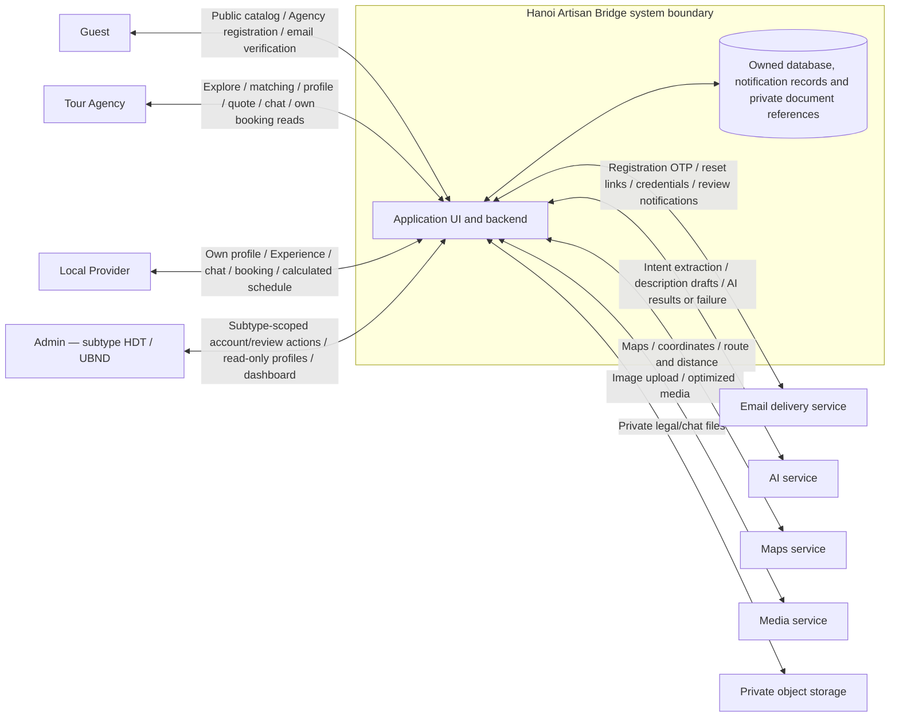

# Context Diagram

Current integration context. Admin is one actor; HDT/UBND are permission subtypes. The system boundary includes application UI/backend and its owned data. External integrations exchange only the data required for their existing functions. The original DOCX is retained as a historical business-context source.

Private legal/chat files are stored in private object storage with permission-checked access; the database stores metadata and storage keys, not file binaries. Registration/review/booking events may create in-app notifications stored in the application database. Storage provider, realtime transport and notification delivery details are Plan decisions. No SMS, VNAT verification, escrow, payment gateway or end-to-end-encryption integration is claimed by this MVP.
