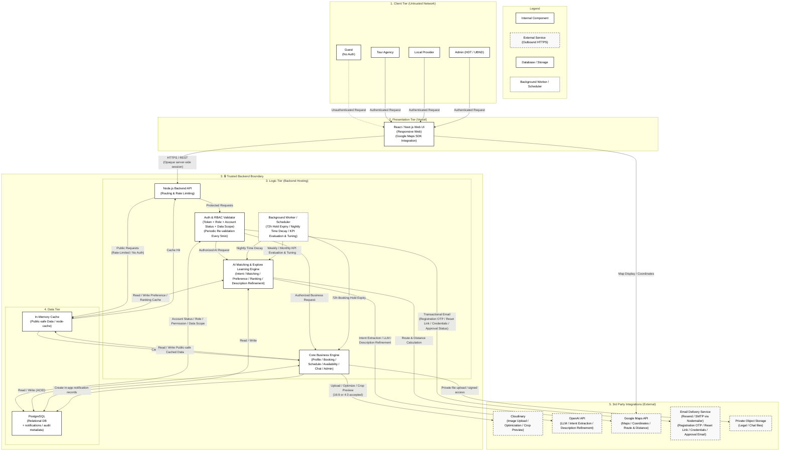

# System Configuration

Proposed implementation architecture for the Plan step; technology choices are not yet an implementation commitment. Engines are logical modules in one backend, not separately deployed microservices. Admin is one actor with HDT/UBND subtypes. Authentication uses an opaque server-side session; lifetime and transport are Plan decisions, not JWT assumptions. Private legal/chat documents use authenticated storage and permission-checked access. SMS, VNAT lookup, escrow and E2EE are not MVP integrations.

