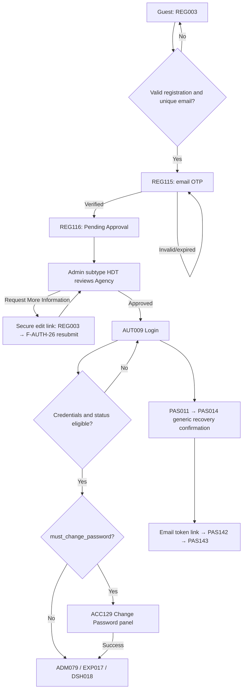
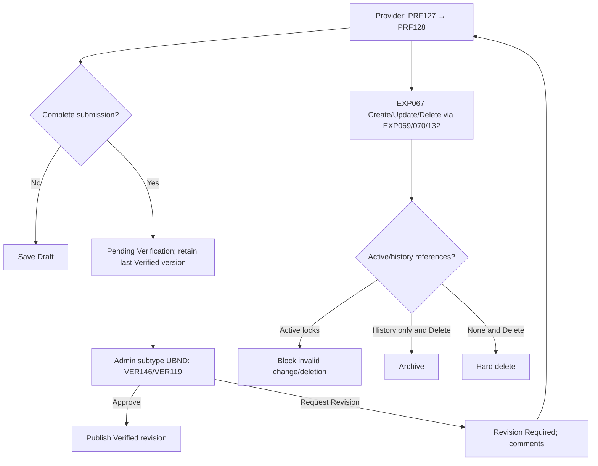
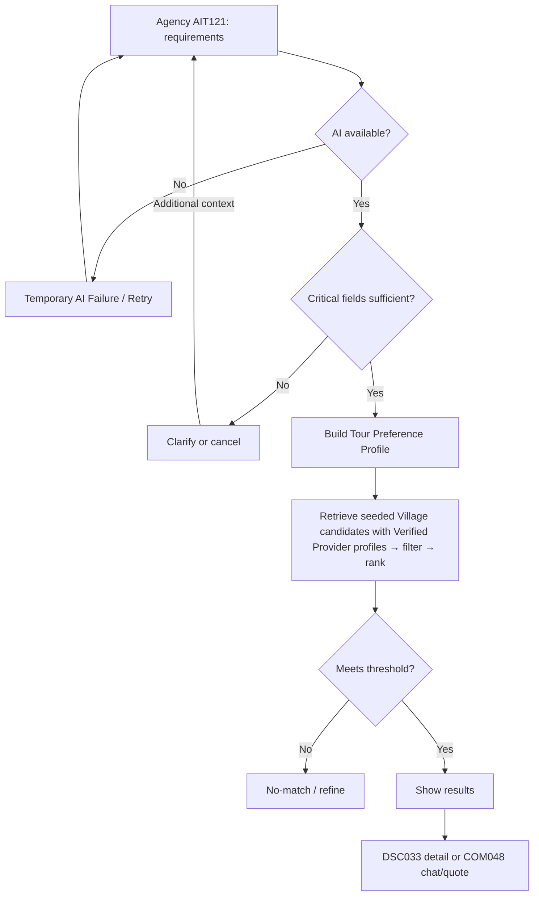
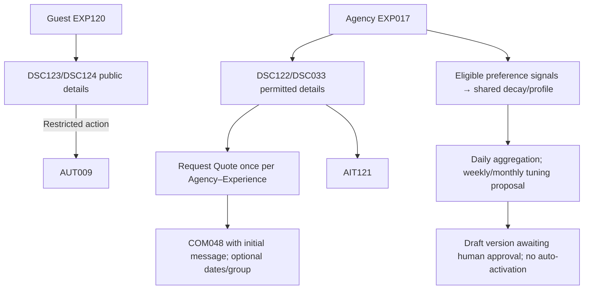
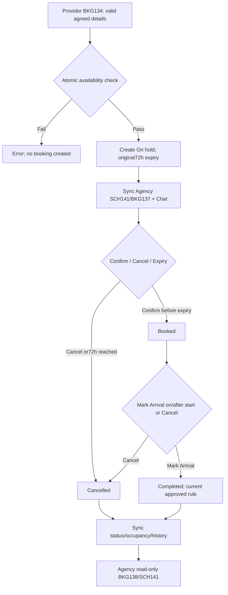
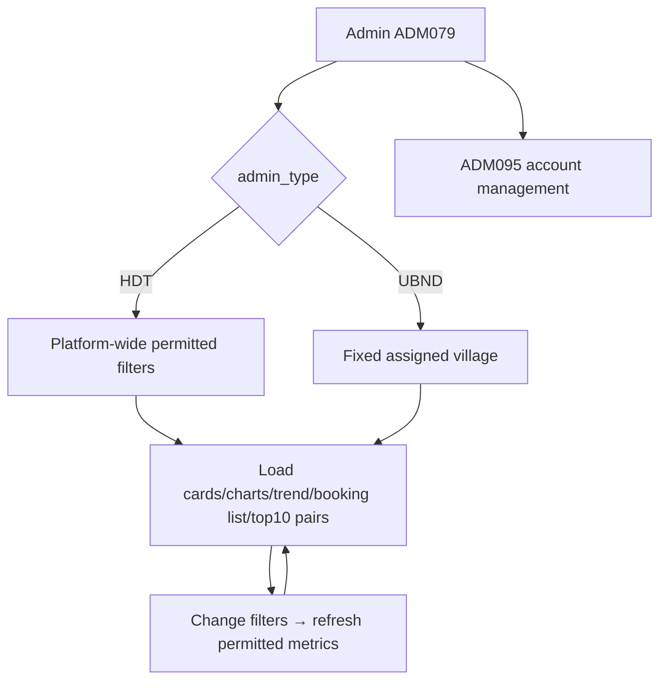
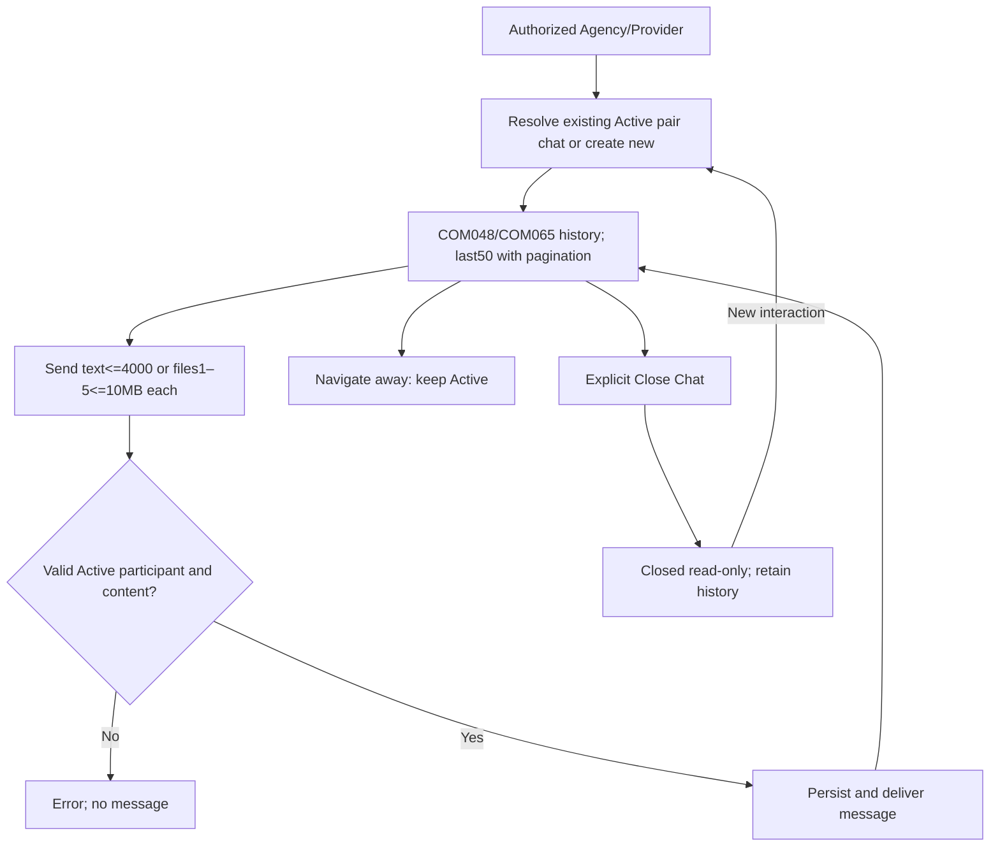

# Usage Flow

Admin is one actor. HDT may create UBND and review Agency; UBND may create Provider and review Provider profiles within its assigned village. No HDT→Create Provider path is specified.

## AUT

## PRF

## AIT

## EXP

## BKG

## ADM

## IAC

