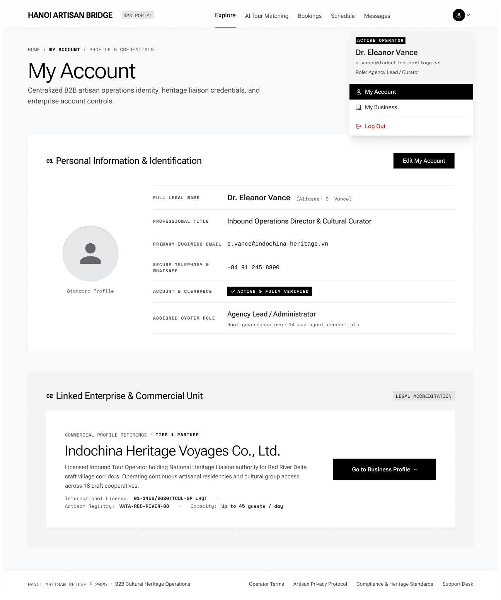

# Screen Spec: ACC129 My Account

| Field | Value |
|---|---|
| Screen ID | `ACC129` |
| Screen name | My Account |
| Actor | All Authenticated Users |
| Priority | Must |
| Belongs to module | `spec-AUT.md` |
| Mockup image | `img/ACC129.png` |
| Status | Draft |

## 1. Purpose

**Shown when:** User opens "My Account" from the avatar/Account Dropdown, from any authenticated screen.

**The user leaves this screen when:** User clicks Edit My Account, Go to Business Profile, Log Out, or navigates away via top nav / breadcrumb.

## 2. Mockup

## 3. Element inventory

| # | Element | Type | Content / data source | Required | Validation |
|---|---|---|---|---|---|
| 1 | Top nav (Explore, AI Tour Matching, Bookings, Schedule, Messages) | Header / Button | static | No | |
| 2 | Avatar + dropdown (open state) | Button | opens Account Dropdown, shown expanded in this mockup | No | |
| 3 | Account Dropdown panel — Active Operator card | Text | current user's name, business email, role, from `spec-ACC.md` §5.1 | No | |
| 4 | Account Dropdown menu items (My Account, My Business, Log Out) | List / Button | shared component; My Account highlighted as current | No | |
| 5 | Breadcrumb (Home / My Account / Profile & Credentials) | Text | navigation trail | No | |
| 6 | Page title "My Account" | Header | static | No | |
| 7 | Description paragraph | Text | static | No | |
| 8 | Section 01 — Personal Information & Identification | Header | static | No | |
| 9 | Edit My Account button | Button | opens ACC130 | No | |
| 10 | Avatar photo (or placeholder) + "Standard Profile" label | Image / Text | user's avatar, defaults to placeholder icon | No | |
| 11 | Full Legal Name field | Text | `User.full_name`, with aliases in parentheses if set | No | |
| 12 | Professional Title field | Text | `User.title` | No | |
| 13 | Primary Business Email field | Text | `User.email` | No | |
| 14 | Secure Telephony & WhatsApp field | Text | `User.phone` | No | |
| 15 | Account & Clearance badge | Text | verification status, e.g. "ACTIVE & FULLY VERIFIED" | No | |
| 16 | Assigned System Role field | Text | role name + scope note (e.g. "Root governance over 14 sub-agent credentials") | No | |
| 17 | Section 02 — Linked Enterprise & Commercial Unit | Header + tag ("LEGAL ACCREDITATION") | static | No | |
| 18 | Commercial profile reference tag (e.g. "TIER 1 PARTNER") | Text | Business/Agency contract tier | No | |
| 19 | Business name | Header | `Business.legal_name` | No | |
| 20 | Business description paragraph | Text | licensing/authority summary | No | |
| 21 | International License / Artisan Registry / Capacity fields | Text | Business credential fields | No | |
| 22 | Go to Business Profile button | Button | opens the linked Business Profile (My Business) | No | |
| 23 | Footer | Footer / Text | static legal/compliance links | No | |

## 4. States

| State | What the user sees | Trigger |
|---|---|---|
| Default | Full profile with Personal Information and Linked Enterprise sections populated | Normal load, user has a linked business |
| Empty (no data) | Section 02 shows "No business linked to this account" with no Go to Business Profile button, if the user account has no associated Business/Village (e.g. some Admin roles) | User type without a linked commercial unit |
| Loading | Skeleton blocks for both sections while account data loads | Screen mount |
| Error | Inline banner "Account details unavailable — Retry" replacing the content area | Fetch failure |
| Success / confirmation | Not applicable directly on this screen — confirmations occur on ACC130 after Save Changes | — |

## 5. Interactions and navigation

| # | Element | User action | System response | Goes to screen |
|---|---|---|---|---|
| 1 | Edit My Account | tap | Opens the editable version of this profile | `ACC130` |
| 2 | Go to Business Profile | tap | Opens the linked Business/Agency profile | `PRF019` (Agency) / `PRF127` (Local Provider) |
| 3 | Avatar / Account Dropdown items | tap | My Business → opens linked business profile; Log Out → opens logout confirmation | `PRF019` / `PRF127` / `AUT026` |
| 4 | Breadcrumb items | tap | Returns to Home | `EXP017` / `DSH018` (per actor) |
| 5 | Top nav item | tap | Navigates to selected module | actor-appropriate screen |

## 6. Screen-level rules

| Rule ID | Rule | Source |
|---|---|---|
| SR-001 | Business information (Section 02) is read-only here; editing it happens only via the linked Business Profile's own edit screen, not through ACC129/ACC130 | Screen List — ACC129 overview: "Business information is managed separately through My Business" |
| SR-002 | Account & Clearance and Assigned System Role are system-issued and not user-editable | Mockup — no edit affordance on these fields |
| SR-003 | Screen content is reference-only and varies by actor (Tour Agency, Local Provider, Admin) — which record backs Section 02 (Agency, Provider, or Village) and which values populate Section 01 differ per actor — but the field titles/labels shown are fixed and identical across all actors | Confirmed |
| SR-004 | The screen layout and field structure shown here (captured from [Actor X]'s view) is a shared template used by multiple actor roles. Role-specific differences (visible fields, permissions, labels) are not exhaustively illustrated by this single mockup and must be validated per actor before implementation. |

## 7. Linked requirements

| FR ID (from the module spec) | What this screen does for it |
|---|---|
| FR-00n | Displays the current user's personal account information, role, and associated business/Village |

## 8. Responsive and accessibility notes

- Smallest supported width: 1024px (desktop-first B2B portal)
- What collapses or stacks on a narrow screen: Section 01's avatar column stacks above the field list instead of beside it
- Text that must remain readable (contrast, minimum size): verification badge text, role/scope note, license and registry numbers

## 9. Open questions

None — resolved: content is reference-only and adapts per actor, but field titles stay fixed across all actors (SR-003).

---

## Completion checklist

- [x] The mockup is a separate cropped image file, named with the Screen ID.
- [x] Every visible element in the mockup appears in the element inventory.
- [x] Every input element has a validation rule or an explicit "none".
- [x] All five states are filled in, or marked "not applicable" with a reason.
- [x] Every navigation target is a Screen ID that exists in the Screen List.
- [x] Every element that displays data names the field it displays, matching the module spec.

---

Template source: DBIZ3, VJCBI College - FTU, Session 4. Built on the DBIZ2 Screen Design
structure (Screen List and Screen Layout), per DBIZ3 Syllabus v3.
