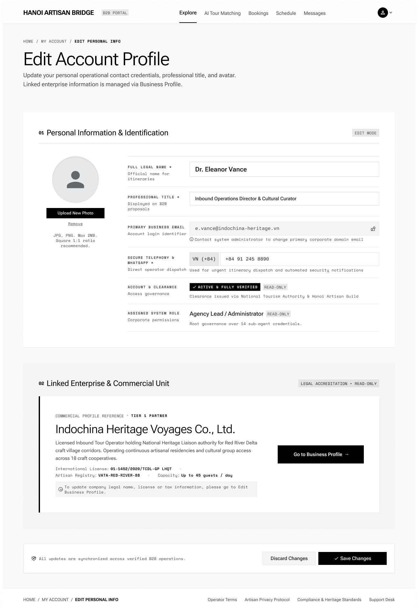

# Screen Spec: ACC130 Edit My Account

| Field | Value |
|---|---|
| Screen ID | `ACC130` |
| Screen name | Edit My Account |
| Actor | All Authenticated Users |
| Priority | Must |
| Belongs to module | `spec-AUT.md` |
| Mockup image | `img/ACC130.png` |
| Status | Revised — pending human approval |

## 1. Purpose

Allows the user to edit permitted personal account information. Business information is managed separately through My Business.

The controls and decisions below define the current screen specification.

## 2. Mockup

## 3. Element inventory

| # | Element | Type | Content / data source | Required | Validation |
|---|---|---|---|---|---|
| 1 | Edit My Account | Heading | Edit My Account | No | Static screen title |
| 2 | User id | System context (not editable) | `user_id` — F-AUTH-25 | Yes | user_id (ID; Required — from session) |
| 3 | Full name | Input | `full_name` — F-AUTH-25 | Yes | full_name (String, max100; Required) |
| 4 | Title | Input | `title` — F-AUTH-25 | Yes | title (String; Required) |
| 5 | Phone | Input | `phone` — F-AUTH-25 | Yes | phone (String, 10–15 digits with optional leading +; Required) |
| 6 | Avatar | File input | `avatar` — F-AUTH-25 | No | avatar (File[JPG/PNG], max2MB; Optional) |
| 7 | Remove avatar | System context (not editable) | `remove_avatar` — F-AUTH-25 | No | remove_avatar (Boolean; Optional) |
| 8 | Assigned role — read-only | Read-only panel | F-AUTH-25 — permitted output fields only | No | Actor-specific field visibility; optional missing values omitted. Never expose tokens, password hashes, session values or internal delivery diagnostics. |
| 9 | Login email — read-only | Read-only panel | F-AUTH-25 — permitted output fields only | No | Actor-specific field visibility; optional missing values omitted. Never expose tokens, password hashes, session values or internal delivery diagnostics. |
| 10 | Linked business — read-only | Read-only panel | F-AUTH-25 — permitted output fields only | No | Actor-specific field visibility; optional missing values omitted. Never expose tokens, password hashes, session values or internal delivery diagnostics. |
| 11 | Save | Button / navigation | Validate permitted personal fields only | No | Enabled only when the linked permission/validation guard succeeds |
| 12 | Discard | Button / navigation | Restore last saved values | No | Enabled only when the linked permission/validation guard succeeds |

## 4. States

| State | What the user sees | Trigger |
|---|---|---|
| Default | Permitted data or a prefilled form; role-specific actions only | Authorized screen load |
| Empty | No records/optional values shown with explanatory text; never infer availability from absent bookings | Successful response with no data |
| Loading | Skeleton/progress; mutation actions disabled while their request is pending | Fetch/upload/save in progress |
| Error | Defined field errors or fetch failure with Retry; no successful transition or partial mutation is shown | Validation, permission or service failure |
| Success / confirmation | Refreshed read-only data or saved result; navigate only after successful linked action | Successful read/mutation |

## 5. Interactions and navigation

| # | Element | User action | System response | Goes to screen |
|---|---|---|---|---|
| 1 | Save | Select | Validate permitted personal fields only | ACC129 |
| 2 | Discard | Select | Restore last saved values | ACC129 |

Shared avatar navigation for authenticated actors: My Account → ACC129; My Business → PRF019 (Agency) / PRF127 (Provider), omitted for Admin without a business; Logout → AUT026. Agency main navigation uses EXP017/AIT121/BKG137/SCH141/COM048; Provider uses DSH018/EXP067/BKG133/SCH139/COM065; Admin uses ADM079/ADM095. Guest has EXP120 and AUT009/REG003, with no AI navigation.

## 6. Screen-level rules

| Rule ID | Rule | Source |
|---|---|---|
| SR-001 | Check action permission and resource scope on every protected request; hiding a button alone is insufficient. Read-only screens have no mutation controls. | AUT FR-016 |
| SR-002 | Validate the inputs and render outputs exactly as the linked module contracts; server/context fields are not freely editable form controls. | Linked FR table |
| SR-003 | Only full_name, title, phone and avatar are edited. Email, role, permissions and linked organization are read-only. Business editing uses separate profile screens. | Function List and shared consistency contract |

## 7. Linked requirements

| Module | FR ID | Function ID | Screen responsibility |
|---|---|---|---|
| AUT | FR-025 | F-AUTH-25 | Edit My Account |

## 8. Responsive and accessibility notes

- Smallest supported width: 1024px (desktop-first B2B portal)
- What collapses or stacks on a narrow screen: avatar/photo controls stack above the field list; Discard/Save Changes buttons stack full-width
- Text that must remain readable (contrast, minimum size): field validation messages, "READ-ONLY" tags, photo constraint note

## 9. Decisions and review

Use the approved Function List and [shared consistency contract](../docs/consistency-contract.md). No new feature is implied by decorative legacy mockup copy. Human approval of this revision is pending; technical Plan choices remain separately identified.

## Completion checklist

- [x] Linked functions have corresponding module FR and IO contracts.
- [x] Inputs name their validation and required/optional condition.
- [x] Default, empty, loading, error and success states are defined.
- [x] Navigation targets use existing Screen IDs.
- [ ] Human approval of the revised specification.
