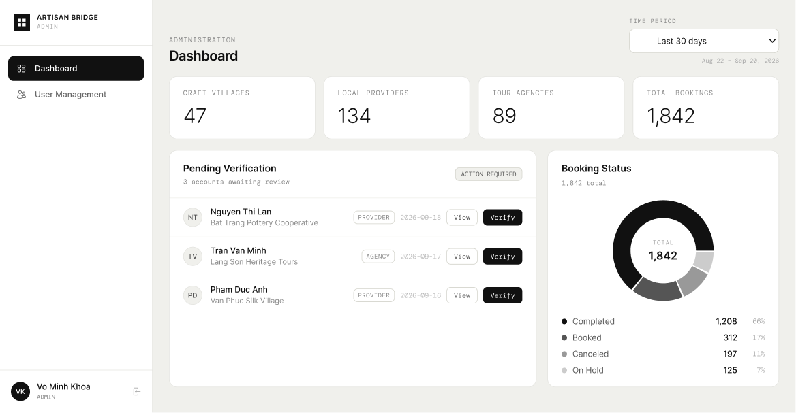

# Screen Spec: ADM079 Admin Dashboard

<!--
DBIZ3 Session 4 template. One file per screen. Keep the DBIZ2 Screen ID unchanged.
The mockup image stays an image; everything around it becomes text.
-->

| Field | Value |
|---|---|
| Screen ID | `ADM079` |
| Screen name | Admin Dashboard |
| Actor | HDT Admin / UBND Admin |
| Priority | Must |
| Belongs to module | `spec-ADM.md` — Module 6: Admin Dashboard |
| Mockup image | `img/ADM079.png` |
| Status | Draft |

## 1. Purpose

**Shown when:** HDT Admin or UBND Admin logs in, or selects "Dashboard" from the sidebar, to get an operational overview of Agencies, Local Providers, bookings, collaborations, account activity, and key platform metrics within the Admin's data scope.

**The user leaves this screen when:** they click "User Management" in the sidebar (→ ADM095), click a Pending Verification row to review an account (→ VER146 / ADM145), open the account dropdown to go to My Account or Logout, or navigate away via the avatar menu.

## 2. Mockup

## 3. Element inventory

| # | Element | Type | Content / data source | Required | Validation |
|---|---|---|---|---|---|
| 1 | Product logo + name | Header / Text | Static text "ARTISAN BRIDGE" | No | — |
| 2 | Role label | Text | Static text "ADMIN" (current session role) | No | — |
| 3 | Nav item — Dashboard | Button | Static label "Dashboard"; shows active/selected state on this screen | No | — |
| 4 | Nav item — User Management | Button | Static label "User Management" | No | — |
| 5 | Account footer (avatar, name, role) | Button / Text | Initials avatar ("VK"), full name ("Vo Minh Khoa"), role ("ADMIN") — field from logged-in user's account record | No | — |
| 6 | Breadcrumb | Text | Static text "ADMINISTRATION" | No | — |
| 7 | Page title | Header | Static text "Dashboard" | No | — |
| 7a | "TIME PERIOD" label | Text | Static text "TIME PERIOD" | No | — |
| 7b | Time period dropdown | Dropdown | Selectable preset list (e.g. "Last 7 days", "Last 30 days", …); selected value shown | Yes | Must be one of the defined preset values; default = "Last 30 days" |
| 7c | Time period range display | Text | Dynamic date range for the selected period, e.g. "Sep 14 – Sep 20, 2026" | Yes | Must match the selected preset's resolved start/end dates |
| 8 | KPI card — Craft Villages | Text (card) | Count field: total Craft Villages in Admin's data scope (e.g. 47) | Yes | Numeric; 0 is a valid value (see States → Empty) |
| 9 | KPI card — Local Providers | Text (card) | Count field: total Local Providers in Admin's data scope (e.g. 134) | Yes | Numeric; 0 is a valid value |
| 10 | KPI card — Tour Agencies | Text (card) | Count field: total Tour Agencies in Admin's data scope (e.g. 89) | Yes | Numeric; 0 is a valid value |
| 11 | KPI card — Total Bookings | Text (card) | Count field: total bookings in Admin's data scope (e.g. 1,842) | Yes | Numeric; 0 is a valid value |
| 12 | Panel title — Pending Verification | Header | Static text "Pending Verification" | No | — |
| 13 | Panel subtitle — awaiting review count | Text | Dynamic text "{N} accounts awaiting review" — N = pending-verification record count | Yes | N is a non-negative integer |
| 14 | Status badge — "ACTION REQUIRED" | Text (badge) | Static text; visibility rule tied to N > 0 | No | Hidden when N = 0 (see States → Empty) |
| 15 | Pending Verification row (repeating) | List item | Avatar initials, account name, organization name, role badge ("PROVIDER"/"AGENCY"), registration date — fields from account record | Yes (per row) | Date shown as `YYYY-MM-DD`; role must be one of the defined role values |
| 15a | Pending Verification list container | Panel / scroll region | Fixed-height box showing the full pending-verification list inline (no "View all" link, no row cap); when the list exceeds the box height, content is cropped and scrolls within the box | No | — |
| 16 | Panel title — Booking Status | Header | Static text "Booking Status" | No | — |
| 17 | Panel subtitle — total count | Text | Dynamic text "{N} total" — N = sum of all booking-status counts | Yes | N is a non-negative integer |
| 18 | Donut chart | Image / Chart | Segmented donut, center label "TOTAL" + total count — rendered from booking-status counts | Yes | Segment values must sum to the displayed total |
| 19 | Legend row — Completed | List item | Status label "Completed", count, percentage — computed from booking data | Yes | Percentage = count / total, rounded |
| 20 | Legend row — Booked | List item | Status label "Booked", count, percentage | Yes | Same as above |
| 21 | Legend row — Canceled | List item | Status label "Canceled", count, percentage | Yes | Same as above |
| 22 | Legend row — On Hold | List item | Status label "On Hold", count, percentage | Yes | Same as above |

## 4. States

| State | What the user sees | Trigger |
|---|---|---|
| Default | Time period dropdown defaults to "Last 30 days" with its resolved date range; the 4 KPI cards and Booking Status are computed for that period and populated; Pending Verification always reflects the current pending-account list regardless of the selected period (SR-007) and shows the **full** list inline (no "View all" link, no row cap) with "ACTION REQUIRED" badge — if the list is longer than the panel's fixed height, the container crops/scrolls rather than truncating the data; Booking Status donut + legend render with live counts, purely informational (not clickable/filterable) | Screen loads successfully with data in Admin's scope |
| Empty (no data) | KPI cards show 0 (not hidden); "ACTION REQUIRED" badge is hidden and Pending Verification shows message "No accounts pending verification"; Booking Status shows message "No bookings yet in your scope" instead of the donut | Admin's data scope has 0 pending accounts and/or 0 bookings |
| Loading | KPI cards, Pending Verification list, and Booking Status panel each show skeleton placeholders; sidebar, header, and Time period dropdown render immediately; changing the Time period selection shows a lightweight inline loading state on the affected KPI/panel areas rather than a full skeleton | Screen is fetching dashboard data (initial load, refresh, or a Time period change) |
| Error | Affected KPI card(s) show "—" with a warning icon; Pending Verification panel shows "Couldn't load pending accounts" with Retry; Booking Status panel shows "Couldn't load booking status" with Retry; unaffected sections still render normally | A given data source fails to load |
| Success / confirmation | Equivalent to Default — this is a read-only display screen with no submit action; after a Retry succeeds, the affected panel transitions directly to Default | Data (re)loads successfully after Loading or Error |

## 5. Interactions and navigation

| # | Element | User action | System response | Goes to screen |
|---|---|---|---|---|
| 1 | Nav item — Dashboard | tap | No-op (already on this screen) | "stays" |
| 1a | Time period dropdown | select | Recalculates and refreshes the 4 KPI cards and Booking Status for the newly selected period (Pending Verification is unaffected — see SR-007); updates the date-range display | "stays" |
| 2 | Nav item — User Management | tap | Navigates to User Management | `ADM095` |
| 3 | Account footer | tap | Opens Account Dropdown (My Account / My Business / Logout) | "stays" (opens overlay) |
| 4 | Pending Verification row | tap | Opens the account's submitted profile for review | `VER146` |
| 5 | KPI cards | tap | Not actionable in mockup | "stays" |
| 6 | Booking Status legend row | tap | Purely informational — no action; the donut/legend is display-only and does not filter or navigate | "stays" |
| 7 | Retry (Error state) | tap | Re-fetches only the failed panel's data | "stays" |

## 6. Screen-level rules

| Rule ID | Rule | Source |
|---|---|---|
| SR-001 | All counts and lists on this screen are filtered to the logged-in Admin's data scope: UBND Admin sees only assigned villages/regions; HDT Admin sees the full platform | Screen List — Screen Overview column for ADM079 |
| SR-002 | "ACTION REQUIRED" badge is shown only while the Pending Verification count is greater than 0 | Inferred from mockup + Empty state |
| SR-003 | Booking Status legend percentages must sum to 100% (rounding handled consistently) | Inferred from mockup |
| SR-004 | Pending Verification panel always renders the full list of pending accounts inline — no pagination, no row cap, no "View all" link to ADM095. If the list exceeds the panel's fixed display height, the panel becomes a cropped/scrollable region | Clarification, 2026-09-23 |
| SR-005 | Booking Status donut and legend are purely informational; no click/tap on a legend row or donut segment triggers filtering or navigation | Clarification, 2026-09-23 |
| SR-007 | The Time period dropdown applies only to the 4 KPI cards and Booking Status donut/legend, which are period-bound aggregates. Pending Verification is exempt — it always shows the current full list of pending accounts regardless of the selected period, since it reflects current account status rather than a time-bound metric (consistent with SR-004) | Clarification, 2026-09-2X |
| SR-006 | The screen layout and field structure shown here (captured from [Actor X]'s view) is a shared template used by multiple actor roles. Role-specific differences (visible fields, permissions, labels) are not exhaustively illustrated by this single mockup and must be validated per actor before implementation. |

## 7. Linked requirements

| FR ID (from the module spec) | What this screen does for it |
|---|---|
| `ADM FR-001` | Provides the role-specific Admin Dashboard view for HDT and UBND within the permitted data scope. |
| `ADM FR-002` | Displays dashboard data loaded and aggregated according to the logged-in Admin's role and scope. |
| `ADM FR-003` | Displays summary KPI cards for Craft Villages, Local Providers, Tour Agencies and Total Bookings. Per clarification, the "active collaborations" metric called for in FR-003's requirement text is realized through the existing Booking data (Total Bookings KPI + Booking Status donut/legend) rather than a separate card — collaboration is defined as Bookings, so no additional element is needed. |
| `ADM FR-004` | Time period dropdown + date-range display apply a time-period filter to the 4 KPI cards and Booking Status donut/legend (SR-007). |
| `ADM FR-007` | Surfaces Agency registration/status information through the Agency count and pending-verification records within the Admin's permitted scope. |
| `ADM FR-008` | Surfaces Local Provider status/verification information through the Provider count and pending-verification records within the Admin's permitted scope. |
| `ADM FR-009` | Displays Booking status metrics through the total Booking KPI and Booking Status donut/legend. |
| `ADM FR-010` | Collaboration-frequency metrics are represented via the same Booking data (Total Bookings KPI + Booking Status donut/legend) — per clarification, collaboration is defined as Bookings, so the existing Booking Status panel already covers this requirement; no separate collaboration card/ranked list is needed on this screen. |
| `AUT FR-018` | Provides the dashboard entry point to pending Tour Agency registrations that require HDT review. |
| `PRF FR-005` | Provides the dashboard entry point to pending Local Provider profiles that require UBND verification. |

*Per clarification: FR-005 (village filter) and FR-006 (Agency/Provider filter) do not apply to ADM079 — filtering lives only in the User Management module (`ADM095`), not on the Dashboard screen. FR-004 (time-period filter) is now satisfied by the Time period dropdown added to the updated mockup.*

## 8. Responsive and accessibility notes

- Scope: **desktop only**. The screen supports desktop viewport sizes across different desktop resolutions; narrow/tablet and mobile layouts are explicitly out of scope.
- Layout behavior: the sidebar, 4 KPI cards, and 2-panel row (Pending Verification / Booking Status) use a single desktop layout that remains usable across supported desktop resolutions, without requiring a separate mobile or narrow-screen layout.
- Text that must remain readable (contrast, minimum size): KPI numbers and donut legend values are the primary at-a-glance data and should meet standard body/heading contrast and minimum size guidance for desktop — *specific values TBD*

## 9. Open questions

| # | Question | Blocking? | Status |
|---|---|---|---|
| 1 | Module ID confirmed: this screen belongs to **Module 6 — Admin Dashboard** (`spec-ADM.md`) | Yes | ✅ Resolved 2026-09-23 |
| 2 | Pending Verification panel always shows the **full list inline** (no row cap, no "View all" link); the panel box crops/scrolls its content when the list is longer than the panel's fixed height | No | ✅ Resolved 2026-09-23 |
| 3 | Booking Status donut/legend is **purely informational** — not interactive, no click-to-filter behavior | No | ✅ Resolved 2026-09-23 |
| 4 | Linked FR IDs from the module spec — `spec-ADM.md` is now available and mapped in Section 7. FR-010 (collaboration) is satisfied by the existing Booking KPI/donut (collaboration = Bookings); FR-005/FR-006 (village, Agency/Provider filters) are out of scope for this screen (filtering lives only in User Management, `ADM095`); FR-004 (time-period filter) is now satisfied by the Time period dropdown in the updated mockup | Yes | ✅ Resolved — all FR IDs mapped, no remaining gaps |
| 5 | Viewport scope confirmed: **desktop only**, supporting multiple desktop resolutions; narrow/tablet and mobile layouts are out of scope | No | ✅ Resolved 2026-09-23 |
| 6 | The Time period dropdown's default value — confirmed as **"Last 30 days"**, matching spec-ADM.md's FR-004 Input/Output contract; mockup updated accordingly | Yes | ✅ Resolved |
| 7 | Does the Time period filter also scope the Pending Verification panel? — **Answer:** No. Pending Verification always reflects the current pending-account list regardless of the selected period | No | ✅ Resolved |

---

## Completion checklist

- [x] The mockup is a separate cropped image file, named with the Screen ID.
- [x] Every visible element in the mockup appears in the element inventory.
- [x] Every input element has a validation rule or an explicit "none". *(Time period dropdown: must be one of the defined preset values — see element #7b; default/full option list still TBD, Open Question 6.)*
- [x] All five states are filled in, or marked "not applicable" with a reason.
- [x] Every navigation target is a Screen ID that exists in the Screen List.
- [x] Every element that displays data names the field it displays, matching the module spec. *(`spec-ADM.md` mapped in Section 7 — all FR IDs now have a corresponding element; Time period default confirmed as "Last 30 days" and scope confirmed to exclude Pending Verification — see Open Questions 6–7.)*

---

Template source: DBIZ3, VJCBI College - FTU, Session 4. Built on the DBIZ2 Screen Design
structure (Screen List and Screen Layout), per DBIZ3 Syllabus v3.
