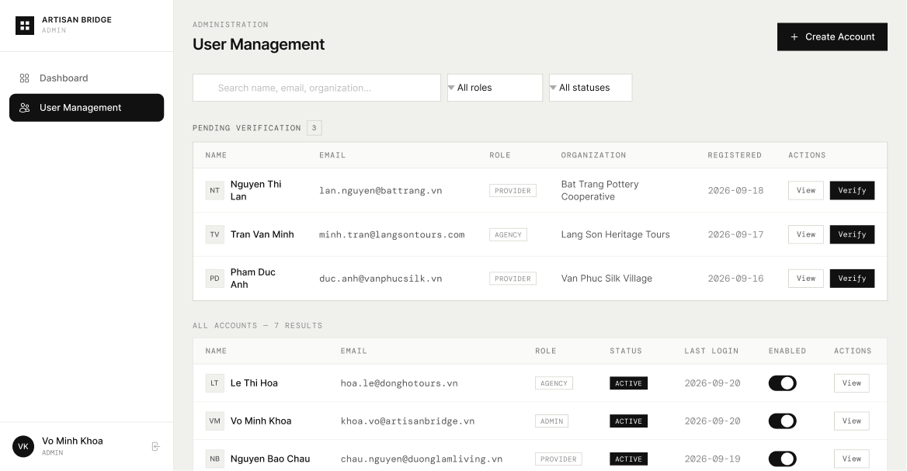

# Screen Spec: ADM095 User Management

| Field | Value |
|---|---|
| Screen ID | `ADM095` |
| Screen name | User Management |
| Actor | HDT Admin / UBND Admin |
| Priority | Must |
| Belongs to module | `spec-ADM.md` — Module 6: Admin Dashboard |
| Mockup image | `img/ADM095.png` |
| Status | Draft |

## 1. Purpose

**Shown when:** HDT Admin or UBND Admin selects "User Management" from the sidebar to manage user accounts — including account creation, enable/disable, viewing, and verification review — within the Admin's data scope. Note: there is no admin-initiated "password reset" function and no role/permission editing on this screen (see Screen-level rules).

**The user leaves this screen when:** they click "+ Create Account" (→ ADM117), click "View" on a row (→ ADM118, or VER119/VER146 from a pending row), click "Verify" on a pending row (opens the verification decision flow), or navigate away via the sidebar or account menu (e.g. to Dashboard).

## 2. Mockup

## 3. Element inventory

| # | Element | Type | Content / data source | Required | Validation |
|---|---|---|---|---|---|
| 1 | Sidebar (logo, role label, nav, account footer) | Header / Text / Button | Same as ADM079; "User Management" shown as the active nav item | No | — |
| 2 | Breadcrumb | Text | Static text "ADMINISTRATION" | No | — |
| 3 | Page title | Header | Static text "User Management" | No | — |
| 4 | "+ Create Account" button | Button (primary) | Opens Create Account modal/flow | No | — |
| 5 | Search input | Input | Placeholder "Search name, email, organization..."; free-text field bound to name/email/organization fields; filters the **All Accounts** table only — does not affect the Pending Verification table | No | No format restriction; free text |
| 6 | Role filter | Dropdown | Default label "All roles"; selectable list of role values (Agency, Provider, Admin, …); filters the **All Accounts** table only | No | Must be one of the defined role values |
| 7 | Status filter | Dropdown | Default label "All statuses"; selectable list of status values (Active, Disabled, Pending, …); filters the **All Accounts** table only | No | Must be one of the defined status values |
| 8 | "Pending Verification" — section header + count badge | Header/Badge | Static text "PENDING VERIFICATION" + dynamic count badge = count of `user.status == pending` | Yes (count) | Count is a non-negative integer, equals row count below |
| 9 | Pending Verification table — column headers | Text | Static labels: Name, Email, Role, Organization, Registered, Actions | No | — |
| 10 | Pending Verification row — Name (+ avatar initials) | Text/Image | Avatar initials + full name — field from account record | Yes | — |
| 11 | Pending Verification row — Email | Text | Email address — field from account record | Yes | Must be a valid email format |
| 12 | Pending Verification row — Role (badge) | Badge | Role value, e.g. "PROVIDER", "AGENCY" | Yes | Must be one of the defined role values |
| 13 | Pending Verification row — Organization | Text | Organization/business name — field from submitted profile | Yes | — |
| 14 | Pending Verification row — Registered | Text | Registration date, e.g. "2026-09-18" | Yes | Date shown as `YYYY-MM-DD` |
| 15 | Pending Verification row — "View" button | Button | Opens View Account Information / submitted-profile details for that user | No | — |
| 16 | Pending Verification row — "Verify" button | Button (primary) | Opens the verification decision flow (approve/reject) for that account | No | — |
| 17 | "All Accounts — {N} results" section header | Header | Static text "ALL ACCOUNTS — {N} RESULTS" — N = current filtered result count (across all pages) | Yes (count) | N is a non-negative integer |
| 18 | All Accounts table — column headers | Text | Static labels: Name, Email, Role, Status, Last Login, Enabled, Actions | No | — |
| 19 | All Accounts row — Name (+ avatar initials) | Text/Image | Avatar initials + full name — field from account record | Yes | — |
| 20 | All Accounts row — Email | Text | Email address — field from account record | Yes | Must be a valid email format |
| 21 | All Accounts row — Role (badge) | Badge | Role value, e.g. "AGENCY", "ADMIN", "PROVIDER" | Yes | Must be one of the defined role values |
| 22 | All Accounts row — Status (badge) | Badge | Status value, e.g. "ACTIVE" (also Disabled, Pending, etc.) | Yes | Must be one of the defined status values |
| 23 | All Accounts row — Last Login | Text | Date, e.g. "2026-09-20" | Yes | `YYYY-MM-DD`; shows "Never" if the account has not logged in |
| 24 | All Accounts row — Enabled toggle | Toggle | On/Off — reflects the account's `enabled`/disabled state | Yes | Boolean; toggling triggers an update immediately, with no confirmation dialog |
| 25 | All Accounts row — "View" button | Button | Opens View Account Information (view-only; no role/permission edit capability) | No | — |
| 26 | All Accounts — pagination controls | Button/Text | Previous/Next buttons + page numbers; current page highlighted; shown only when total accounts > 20 | No | Previous disabled on page 1; Next disabled on the last page |

## 4. States

| State | What the user sees | Trigger |
|---|---|---|
| Default | Pending Verification table lists all accounts awaiting review with working View/Verify actions (not affected by search/filter); All Accounts table lists accounts matching the current search/filter with an accurate result count, showing 20 accounts per page; pagination controls (Previous/Next + page numbers, current page highlighted) appear only when total filtered results exceed 20; Enabled toggles reflect true current state | Both tables load successfully |
| Empty (no data) | Pending Verification: count badge shows 0 and the table is replaced with "No accounts pending verification." All Accounts (no data at all): "No accounts found" with "+ Create Account" still available. All Accounts (search/filter yields no matches): "No accounts match your search" with an option to clear search/filters. Pagination controls are hidden in both empty cases | Admin's scope has 0 accounts, or the current search/filter (applied to All Accounts only) matches nothing |
| Loading | Both tables show skeleton rows (e.g. 3–5 placeholder rows); header, search bar, and filters render immediately; a search/filter in progress (All Accounts only) shows a lightweight inline spinner instead of a full skeleton; an in-flight Enabled toggle shows a disabled/loading state on that row; navigating to another page shows a lightweight inline spinner over the All Accounts table only | Initial screen load, or a search/filter/toggle/pagination request is in flight |
| Error | Failed table shows an inline message "Couldn't load accounts" with Retry (the other table is unaffected); a failed search/filter shows "Search failed, please try again" and retains the previous result set if available; a failed Enabled toggle reverts to its prior state with an inline error/toast; a failed Verify keeps the account in Pending Verification with an inline error/toast | A given data source or action fails |
| Success / confirmation | Toggling Enabled/Disabled succeeds → toggle reflects the new state immediately, optional toast "Account disabled"/"Account enabled"; Verify succeeds → account is removed from Pending Verification (count decrements) and appears updated in All Accounts, toast "Account verified"; returning from ADM117 after creating an account → new row appears in All Accounts, toast "Account created" | An action (toggle, verify, create) completes successfully |

## 5. Interactions and navigation

| # | Element | User action | System response | Goes to screen |
|---|---|---|---|---|
| 1 | "+ Create Account" | tap | Opens account creation flow | `ADM117` |
| 2 | Search input | type | Filters the **All Accounts** table only; Pending Verification is unaffected; result resets to page 1 | stays |
| 3 | Role filter | select | Filters the **All Accounts** table only; result resets to page 1 | stays |
| 4 | Status filter | select | Filters the **All Accounts** table only; result resets to page 1 | stays |
| 5 | Pending Verification row — "View" | tap | Opens account + submitted-profile details for review | `VER119` / `VER146` |
| 6 | Pending Verification row — "Verify" | tap | Opens a separate approve/reject verification decision flow for that account, distinct from the "View" destination | `VER146` (verification decision screen, separate from the View destination `VER119`/`ADM118`) |
| 7 | All Accounts row — Enabled toggle | tap | Updates the account's enabled/disabled state immediately — no confirmation dialog | stays |
| 8 | All Accounts row — "View" | tap | Opens system-level account information (view-only; no role/permission edit capability on this screen or on ADM118) | `ADM118` |
| 9 | Sidebar — Dashboard | tap | Navigates to the admin dashboard | `ADM079` |
| 10 | All Accounts — pagination controls (Previous/Next/page number) | tap | Loads the selected page of All Accounts results (20 per page); disabled Previous/Next produce no action | stays |

## 6. Screen-level rules

| Rule ID | Rule | Source |
|---|---|---|
| SR-001 | Table rows, search results, and filters are scoped to the logged-in Admin's data scope: UBND Admin sees only its assigned villages/regions; HDT Admin sees all accounts | Screen List — Screen Overview for ADM095 |
| SR-002 | HDT Admin can create UBND Admin and Local Provider accounts; UBND Admin can create Local Provider accounts only within its assigned villages/regions (enforced on ADM117, referenced here for the "+ Create Account" entry point) | Screen List — ADM117 overview |
| SR-003 | The "ALL ACCOUNTS — {N} RESULTS" count must always match the total number of matching rows for the active search/filter (i.e. across all pages, not just the current page) | Inferred from mockup |
| SR-004 | This screen has no admin-initiated "password reset" function; no such control is surfaced anywhere on ADM095 | Clarification, 2026-09-23 |
| SR-005 | Search input, Role filter, and Status filter apply only to the **All Accounts** table; the Pending Verification table always shows its full unfiltered set | Clarification, 2026-09-23 |
| SR-006 | Disabling an account via the Enabled toggle takes effect immediately with no confirmation dialog | Clarification, 2026-09-23 |
| SR-007 | All Accounts pagination: 20 accounts per page; pagination controls are shown only when the total filtered result count exceeds 20; the current page is visually highlighted; Previous is disabled on page 1 and Next is disabled on the last page | Clarification, 2026-09-23 |
| SR-008 | There is no role/permission editing function on this screen; ADM118 ("View") is view-only, not an edit screen | Clarification, 2026-09-23 |
| SR-009 | Pending Verification section only lists accounts with status = Pending | Mockup section header + count |
| SR-010 | The screen layout and field structure shown here (captured from [Actor X]'s view) is a shared template used by multiple actor roles. Role-specific differences (visible fields, permissions, labels) are not exhaustively illustrated by this single mockup and must be validated per actor before implementation. |

## 7. Linked requirements

| FR ID (from the module spec) | What this screen does for it |
|---|---|
| `AUT FR-018` | Lists pending Tour Agency registrations and provides View/Verify entry points for HDT review. |
| `AUT FR-019` | Provides the Admin entry point to create a UBND account through the Create Account flow. |
| `AUT FR-020` | Provides the Admin entry point to create a Local Provider account within the permitted UBND/HDT scope. |
| `AUT FR-021` | Displays the Admin-scoped account list and supports search, role/status filtering, result counts and pagination. |
| `AUT FR-022` | Provides the enable/disable account control for authorized Admins without editing business/profile content. |
| `PRF FR-005` | Lists pending Local Provider profiles and provides the entry point to the UBND verification flow. |

*Earlier draft referenced a single umbrella `FR-ADM-01` ("Central list for creating, viewing, enabling/disabling, and verifying users") — the FR IDs above are the confirmed, module-specific breakdown of that requirement. Confirmed against `spec-ADM.md` (Assumptions section): ADM095's account-management/verification logic is explicitly scoped to Authentication (`AUT`) and Profile Management (`PRF`), not to `spec-ADM.md`'s own F-ADMIN-01..10 requirements — so no `ADM FR-xxx` ID belongs in this table.*

## 8. Responsive and accessibility notes

- Smallest supported width: 1024px (desktop-first admin tool; mobile is not the primary use case)
- What collapses or stacks on a narrow screen: the sidebar collapses to an icon-only rail; the two data tables scroll horizontally *(a stacked/card layout as an alternative is not yet confirmed)*
- Text that must remain readable (contrast, minimum size): table text ≥13px; status/role badges and the Enabled toggle state must remain distinguishable at minimum size and meet standard contrast guidance, not by color alone — *specific contrast values TBD*

## 9. Open questions

| # | Question | Blocking? | Status |
|---|---|---|---|
| 1 | Module ID confirmed: this screen belongs to **Module 6 — Admin Dashboard** (`spec-ADM.md`) | Yes | ✅ Resolved 2026-09-23 |
| 2 | There is **no** admin-initiated "password reset" function in the product; nothing is surfaced on ADM095 or elsewhere for it. The earlier Screen List reference to "password reset" does not apply | Yes | ✅ Resolved 2026-09-23 |
| 3 | Search applies **only to "All Accounts"** — Pending Verification is not filtered by search | No | ✅ Resolved 2026-09-23 |
| 4 | Disabling an account does **not** require a confirmation dialog — the toggle takes effect immediately | No | ✅ Resolved 2026-09-23 |
| 5 | Pagination confirmed: **20 accounts per page**; controls shown only when total results exceed 20; current page highlighted; Previous/Next disabled at the respective ends | No | ✅ Resolved 2026-09-23 |
| 6 | There is **no** role/permission editing function on this screen (or via ADM118, which is view-only) | No | ✅ Resolved 2026-09-23 |
| 7 | Linked FR IDs from the module spec — `spec-ADM.md` is now available. It confirms (Assumptions, spec-ADM.md) that ADM095's account-management and verification logic belongs to Authentication / Profile Management, not F-ADMIN-01..10 — so the existing `AUT FR-018..022` / `PRF FR-005` links in Section 7 are correct as-is; no `ADM FR-xxx` IDs apply to this screen | Yes | ✅ Resolved — confirmed against `spec-ADM.md` |
| 8 | "Verify" opens a separate approve/reject decision screen, distinct from the "View" destination. Confirmed as `VER146`. | Yes | ✅ Resolved 2026-09-23 |

---

## Completion checklist

- [x] The mockup is a separate cropped image file, named with the Screen ID.
- [x] Every visible element in the mockup appears in the element inventory.
- [x] Every input element has a validation rule or an explicit "none" (Search: free text, no restriction; Role/Status filters: must match defined values).
- [x] All five states are filled in, or marked "not applicable" with a reason.
- [x] Every navigation target is a Screen ID that exists in the Screen List.
- [x] Every element that displays data names the field it displays, matching the module spec *(confirmed against `spec-ADM.md` — see Open Question 7; ADM095's fields are owned by AUT/PRF, not F-ADMIN, so no ADM-module field mapping applies here)*.
