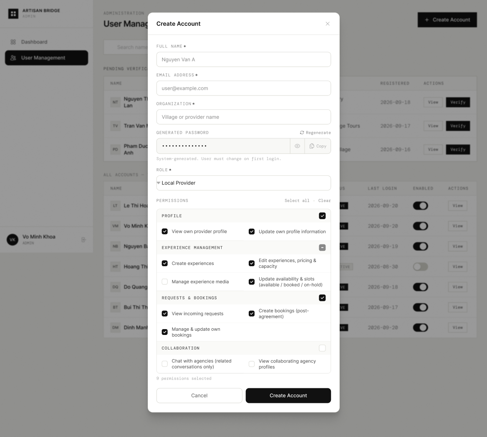

# Screen Spec: ADM117 Create Account

| Field | Value |
|---|---|
| Screen ID | `ADM117` |
| Screen name | Create Account |
| Actor | HDT Admin / UBND Admin |
| Priority | Must |
| Belongs to module | `spec-AUT.md` and `spec-ADM.md` |
| Mockup image | `img/ADM117.png` |
| Status | Draft |

## 1. Purpose

**Shown when:** Admin clicks "Create Account" on the User Management screen.

**The user leaves this screen when:** They click "Create Account" to submit, or "Cancel" / the close (×) icon to dismiss the modal.

## 2. Mockup

## 3. Element inventory

| # | Element | Type | Content / data source | Required | Validation |
|---|---|---|---|---|---|
| 1 | Modal title | Header | "Create Account" | No | — |
| 2 | Close (×) | Button | Dismisses modal | No | — |
| 3 | Full Name | Input | `user.full_name` | Yes | Non-empty |
| 4 | Email Address | Input | `user.email` | Yes | Valid email format, must not already exist |
| 5 | Organization | Input | `user.organization` | Yes | Non-empty |
| 6 | Generated Password | Input (masked) | System-generated password | Yes | Read-only, system generated |
| 7 | Show/hide password (eye icon) | Toggle | Reveals/masks password field | No | — |
| 8 | Regenerate | Button | Generates a new random password | No | — |
| 9 | Copy | Button | Copies password to clipboard | No | — |
| 10 | Password helper text | Text | "System-generated. User must change on first login." | No | — |
| 11 | Role | Dropdown | `user.role`, e.g. "Local Provider" | Yes | Must be one of the roles this Admin is permitted to create |
| 12 | Permissions section header | Text | "Permissions" with "Select all" / "Clear" links | No | — |
| 13 | Permission group: Profile (+ group checkbox) | Checkbox group | View own provider profile, Update own profile information | No | At least a sensible default set is pre-checked per role |
| 14 | Permission group: Experience Management (+ group checkbox, "indeterminate" state shown) | Checkbox group | Create experiences, Edit experiences/pricing/capacity, Manage experience media, Update availability & slots | No | — |
| 15 | Permission group: Requests & Bookings (+ group checkbox) | Checkbox group | View incoming requests, Create bookings, Manage & update own bookings | No | — |
| 16 | Permission group: Collaboration (+ group checkbox, unchecked) | Checkbox group | Chat with agencies, View collaborating agency profiles | No | — |
| 17 | Permissions selected counter | Text | "N permissions selected" | No | — |
| 18 | Cancel | Button (secondary) | Closes modal without saving | No | — |
| 19 | Create Account | Button (primary) | Submits the new account | No | Disabled until all required fields are valid |

### 3.1 Role-specific default permission presets

| Role | Permission Group | Default Permissions |
|---|---|---|
| **Local Provider** | Profile | View & edit own provider profile |
| | Experience Management | Create, edit, delete experiences; upload/manage media; manage availability |
| | Requests & Bookings | View and manage incoming requests; view/manage bookings |
| | Collaboration | Chat with agencies; control agency visibility of provider information |
| | Notifications | View and manage notifications |
| **Craft Village (UBND)** | Village & Provider Data | View & manage assigned village/provider data within assigned territory |
| | Provider Account Management | Create Local Provider accounts; activate/deactivate account status |
| | Verification | Verify/reject Local Providers and their experiences within assigned territory |
| | Bookings & Activity | View bookings and activity data within assigned territory |

Selecting a Role in the dropdown pre-checks the permission groups/items listed for that role above; the Admin may adjust individual checkboxes before saving.

## 4. States

| State | What the user sees | Trigger |
|---|---|---|
| Default | Empty required fields, a freshly generated password, and a default permission set for the selected role | Modal opens |
| Empty (no data) | All text inputs blank with placeholder text visible (as shown); no role selected yet shows no permission groups | Modal just opened before any role is picked |
| Loading | Create Account button shows spinner and is disabled while the request is in flight | User taps Create Account |
| Error | Inline error text under invalid field (e.g. "Email already in use", "Full name is required"); modal stays open | Validation fails client-side or server-side |
| Success / confirmation | Modal closes, toast "Account created for {name}", new row appears in User Management table | Account created successfully |

## 5. Interactions and navigation

| # | Element | User action | System response | Goes to screen |
|---|---|---|---|---|
| 1 | Role dropdown | select | Updates the permission groups shown to match the role's applicable permissions | stays |
| 2 | Regenerate | tap | Replaces the generated password | stays |
| 3 | Copy | tap | Copies password, shows brief "Copied" confirmation | stays |
| 4 | Group checkbox | tap | Selects/deselects all permissions within that group | stays |
| 5 | Cancel / Close (×) | tap | Closes modal, discards input | `ADM095` (returns to underlying screen) |
| 6 | Create Account | tap | Validates and creates the account | `ADM095` (modal closes, table refreshes) |

## 6. Screen-level rules

| Rule ID | Rule | Source |
|---|---|---|
| SR-001 | Role options are limited by Admin scope: HDT can create UBND Admin and Local Provider accounts; UBND can create Local Provider accounts only | Screen List Screen Overview |
| SR-002 | Password is always system-generated; the Admin cannot type a custom password | Mockup — read-only styled password field |
| SR-003 | Permission checkboxes default to a role-appropriate preset, which the Admin may adjust before saving (see §3.1 for the full preset table) | Clarification |
| SR-004 | The generated password is not emailed automatically; the Admin must share it with the new user manually (e.g. via the Copy button) | Clarification |
| SR-005 | The screen layout and field structure shown here (captured from [Actor X]'s view) is a shared template used by multiple actor roles. Role-specific differences (visible fields, permissions, labels) are not exhaustively illustrated by this single mockup and must be validated per actor before implementation. |
## 7. Linked requirements

| FR ID (from the module spec) | What this screen does for it |
|---|---|
| FR-ADM-02 | Enables scoped account creation with explicit permission assignment |

## 8. Responsive and accessibility notes

- Smallest supported width: 1024px (admin tool, modal assumes desktop viewport)
- What collapses or stacks on a narrow screen: two-column permission rows stack to single column; modal becomes full-screen sheet
- Text that must remain readable (contrast, minimum size): form labels ≥12px uppercase, input text ≥14px

## 9. Open questions

| # | Question | Blocking? | Status |
|---|---|---|---|
| 1 | Full list of role-specific default permission presets | Yes | Resolved — see §3.1 |
| 2 | Is email delivery of the generated password automatic, or does the Admin need to share it manually via Copy? | No | Resolved — manual, via the Copy button; see SR-004 |

---

## Completion checklist

- [x] The mockup is a separate cropped image file, named with the Screen ID.
- [x] Every visible element in the mockup appears in the element inventory.
- [x] Every input element has a validation rule or an explicit "none".
- [x] All five states are filled in, or marked "not applicable" with a reason.
- [x] Every navigation target is a Screen ID that exists in the Screen List.
- [x] Every element that displays data names the field it displays, matching the module spec.
