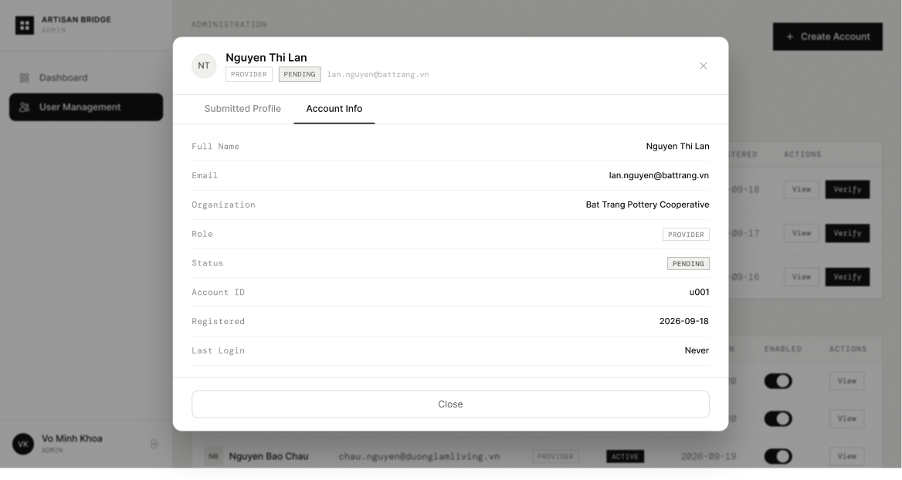

# Screen Spec: ADM118 View Account Information

| Field | Value |
|---|---|
| Screen ID | `ADM118` |
| Screen name | View Account Information |
| Actor | HDT Admin / UBND Admin |
| Priority | Must |
| Belongs to module | `spec-AUT.md` and `spec-ADM.md` |
| Mockup image | `img/ADM118.png` |
| Status | Draft |

## 1. Purpose

**Shown when:** Admin clicks "View" on any row in User Management (ADM095), then is on the "Account Info" tab of the resulting modal.

**The user leaves this screen when:** They click "Close", the (×) icon, or switch to the "Submitted Profile" tab.

## 2. Mockup

## 3. Element inventory

| # | Element | Type | Content / data source | Required | Validation |
|---|---|---|---|---|---|
| 1 | Avatar initials | Image/Text | Initials from `user.full_name` | No | — |
| 2 | User name | Text | `user.full_name` | No | — |
| 3 | Role badge | Badge | `user.role` e.g. PROVIDER | No | — |
| 4 | Status badge | Badge | `user.status` e.g. PENDING | No | — |
| 5 | Email | Text | `user.email` | No | — |
| 6 | Close (×) | Button | Dismisses modal | No | — |
| 7 | Tab: Submitted Profile | Tab | Switches to Submitted Profile view | No | — |
| 8 | Tab: Account Info (active) | Tab | Currently selected system-level info view | No | — |
| 9 | Full Name row | Text | `user.full_name` | No | — |
| 10 | Email row | Text | `user.email` | No | — |
| 11 | Organization row | Text | `user.organization` | No | — |
| 12 | Role row | Badge | `user.role` | No | — |
| 13 | Status row | Badge | `user.status` | No | — |
| 14 | Account ID row | Text | `user.account_id` | No | — |
| 15 | Registered row | Text (date) | `user.registered_date` | No | — |
| 16 | Last Login row | Text | `user.last_login`, shows "Never" if unset | No | — |
| 17 | Close (footer) | Button | Dismisses modal | No | — |

## 4. States

| State | What the user sees | Trigger |
|---|---|---|
| Default | All system-level fields populated as shown | Modal opens for a user with account activity |
| Empty (no data) | "Last Login" shows "Never"; Organization shows "—" if not yet linked | New account that has not logged in / has no organization yet |
| Loading | Modal shows a skeleton in place of the info rows while fetching | Modal just opened, before data returns |
| Error | Banner inside modal "Could not load account information. Retry." | Account data fetch fails |
| Success / confirmation | Not applicable — this is a view-only screen with no submit action | N/A |

## 5. Interactions and navigation

| # | Element | User action | System response | Goes to screen |
|---|---|---|---|---|
| 1 | Tab: Submitted Profile | tap | Switches modal content to submitted profile view | `ADM145` |
| 2 | Close (× or footer button) | tap | Closes modal, returns to underlying table | `ADM095` |

## 6. Screen-level rules

| Rule ID | Rule | Source |
|---|---|---|
| SR-001 | This is a view-only modal; no fields are editable here | Screen Overview column |
| SR-002 | No Verify / Approve actions appear here — those live only in the Verification-flow equivalents (VER119/VER146) | Comparing this mockup (Close only) with the Verify mockups (Approve & Verify) |
| SR-003 | The screen layout and field structure shown here (captured from [Actor X]'s view) is a shared template used by multiple actor roles. Role-specific differences (visible fields, permissions, labels) are not exhaustively illustrated by this single mockup and must be validated per actor before implementation. |

## 7. Linked requirements

| FR ID (from the module spec) | What this screen does for it |
|---|---|
| FR-ADM-03 | Gives Admins quick read access to system-level account metadata |

## 8. Responsive and accessibility notes

- Smallest supported width: 1024px (admin tool)
- What collapses or stacks on a narrow screen: modal becomes full-screen sheet; info rows remain single column
- Text that must remain readable (contrast, minimum size): label text ≥12px, value text ≥14px

## 9. Open questions

| # | Question | Blocking? | Status |
|---|---|---|---|
| 1 | Should Admins be able to trigger "Reset Password" or "Disable" from this modal, per the User Management module description? | Yes | Resolved — no; this modal only shows a Close action. Reset password and enable/disable are handled elsewhere (e.g. the Enabled toggle on the User Management table for disable; a separate reset-password action is out of scope for this modal) |

---

## Completion checklist

- [x] The mockup is a separate cropped image file, named with the Screen ID.
- [x] Every visible element in the mockup appears in the element inventory.
- [x] Every input element has a validation rule or an explicit "none".
- [x] All five states are filled in, or marked "not applicable" with a reason.
- [x] Every navigation target is a Screen ID that exists in the Screen List.
- [x] Every element that displays data names the field it displays, matching the module spec.
