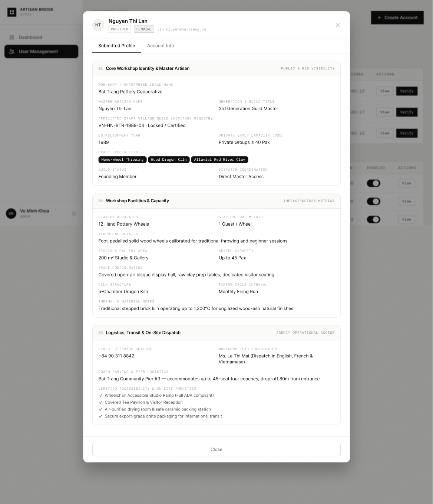

# Screen Spec: ADM145 View Submitted Profile

| Field | Value |
|---|---|
| Screen ID | `ADM145` |
| Screen name | View Submitted Profile |
| Actor | HDT Admin / UBND Admin |
| Priority | Must |
| Belongs to module | `spec-AUT.md` and `spec-ADM.md` |
| Mockup image | `img/ADM145.png` |
| Status | Draft |

## 1. Purpose

**Shown when:** Admin clicks "View" on a row in User Management (ADM095) and is on the "Submitted Profile" tab of the resulting modal.

**The user leaves this screen when:** They click "Close", or switch to the "Account Info" tab.

## 2. Mockup

## 3. Element inventory

| # | Element | Type | Content / data source | Required | Validation |
|---|---|---|---|---|---|
| 1 | Avatar initials | Image/Text | Initials from `user.full_name` | No | — |
| 2 | User name | Text | `user.full_name` | No | — |
| 3 | Role badge | Badge | `user.role` e.g. PROVIDER | No | — |
| 4 | Status badge | Badge | `user.status` e.g. PENDING | No | — |
| 5 | Email | Text | `user.email` | No | — |
| 6 | Close (×) | Button | Dismisses modal | No | — |
| 7 | Tab: Submitted Profile (active) | Tab | Currently selected view | No | — |
| 8 | Tab: Account Info | Tab | Switches to system-level info | No | — |
| 9 | Section 01 "Core Workshop Identity & Master Artisan" (+ visibility tag) | Card section | Workshop/enterprise legal name, master artisan name, generation/guild title, affiliated craft village guild, establishment year, private group capacity, craft specialty tags, guild status, dispatch coordination | No | — |
| 10 | Section 02 "Workshop Facilities & Capacity" (+ metrics tag) | Card section | Station apparatus, station load metric, technical details, studio/gallery area, seated capacity, space configuration, kiln structure, firing cycle interval, thermal/material notes | No | — |
| 11 | Section 03 "Logistics, Transit & On-Site Dispatch" (+ access tag) | Card section | Direct dispatch hotline, workshop lead coordinator, coach parking & pier logistics, verified accessibility & on-site amenities checklist | No | — |
| 12 | Close (footer) | Button | Dismisses modal | No | — |

### 3.1 Field set when the submitted profile belongs to a Tour Agency

The rows above show the Local Provider variant of this screen (workshop/business fields). When the account under review is a Tour Agency, the Submitted Profile tab instead shows:

| # | Element | Type | Content / data source | Required | Validation |
|---|---|---|---|---|---|
| A1 | Section 01 "Corporate Legal Information" (+ "Mandatory" tag) | Card section | Enterprise / Travel Agency Legal Name, Operator License No., Corporate Tax ID (TIN/MST), Tour Operator License (uploaded file name) | No | — |
| A2 | Section 02 "Authorized Delegate & Route Scope" (+ "Contact Liaison" tag) | Card section | Authorized Agency Representative name, Work Email (for OTP), Direct Mobile/WhatsApp, Primary Guest Segmentation tags | No | — |
| A3 | Section 03 "Initial Tour Preferences & Focus" (+ "Operational Scope" tag) | Card section | Primary Craft Focus / Village Clusters tags, Average Group Size, Tour Frequency, Preferred Tour Formats | No | — |

These fields mirror what the Agency entered during registration (REG003), carried through for Admin review here.

## 4. States

| State | What the user sees | Trigger |
|---|---|---|
| Default | All three profile sections fully populated, as shown | Modal opens for a submitted profile |
| Empty (no data) | Individual fields not yet submitted show "Not provided"; a section with no data at all shows "No information submitted for this section" | Provider has submitted only part of the required profile |
| Loading | Skeleton placeholders in place of section content | Modal just opened, before data returns |
| Error | Banner inside modal "Could not load submitted profile. Retry." | Profile data fetch fails |
| Success / confirmation | Not applicable — this is a view-only screen with no submit action | N/A |

## 5. Interactions and navigation

| # | Element | User action | System response | Goes to screen |
|---|---|---|---|---|
| 1 | Tab: Account Info | tap | Switches modal content to system-level account info | `ADM118` |
| 2 | Close (× or footer button) | tap | Closes modal, returns to underlying table | `ADM095` |

## 6. Screen-level rules

| Rule ID | Rule | Source |
|---|---|---|
| SR-001 | This is a view-only modal; no fields are editable here | Screen Overview column |
| SR-002 | No Approve & Verify action appears here — this is the general-view variant, distinct from the verification-flow equivalent (VER146) | Comparing this mockup (Close only) with the Verify mockup (Approve & Verify) |
| SR-003 | The submitted profile layout is specific to the Local Provider actor's business fields; Agency-submitted profiles show a different field set (see §3.1) | Content shown is provider-specific (workshop, kiln, artisan); Agency variant confirmed via clarification |
| SR-004 | The screen layout and field structure shown here (captured from [Actor X]'s view) is a shared template used by multiple actor roles. Role-specific differences (visible fields, permissions, labels) are not exhaustively illustrated by this single mockup and must be validated per actor before implementation. |

## 7. Linked requirements

| FR ID (from the module spec) | What this screen does for it |
|---|---|
| F-PROFILE-05 | Displays the same submitted Local Provider profile/business information that F-PROFILE-05 (Profile Management module) reviews. This screen is a general, view-only variant reachable from any account row in ADM095; F-PROFILE-05 itself is the UBND-actor review flow with Approve/Request Revision actions, which is a distinct screen from this one (see §9) |

Note: this mapping is to a Profile Management function rather than an Authentication (`spec-AUT.md`) FR, since no FR in this module's own §5 list covers viewing a submitted profile. Flagged in §9 for confirmation that this view-only screen should remain in this module while the actionable review screen lives in Profile Management.

## 8. Responsive and accessibility notes

- Smallest supported width: 1024px (admin tool)
- What collapses or stacks on a narrow screen: modal becomes full-screen sheet; two-column field rows within a section stack to single column
- Text that must remain readable (contrast, minimum size): section labels ≥11px uppercase, body values ≥14px

## 9. Open questions

| # | Question | Blocking? | Status |
|---|---|---|---|
| 1 | Field set for a submitted Agency profile (this mockup only shows a Local Provider example) | Yes | Resolved — see §3.1 |
| 2 | This screen (and its verify-flow counterpart VER146) has no matching FR-ID in the module spec's §5 requirements table, and viewing/verifying Local Provider business content is arguably outside this module's stated scope (§1). | Yes | Partially resolved — a new function, F-PROFILE-05 (Review & Verify Local Provider Profile), has been added under Profile Management and covers the reviewable version of this content. This view-only screen (ADM145) can stay in this module as a general-purpose "view" companion to ADM118, citing F-PROFILE-05 for its data. Still open: VER146, which shares this same Local Provider field layout but exposes Reject/Verify actions under HDT/F-AUTH-18 rather than F-PROFILE-05's Approve/Request Revision under UBND — see the new flag in `screen-spec-VER146.md` §9. |

---

## Completion checklist

- [x] The mockup is a separate cropped image file, named with the Screen ID.
- [x] Every visible element in the mockup appears in the element inventory.
- [x] Every input element has a validation rule or an explicit "none".
- [x] All five states are filled in, or marked "not applicable" with a reason.
- [x] Every navigation target is a Screen ID that exists in the Screen List.
- [x] Every element that displays data names the field it displays, matching the module spec.
