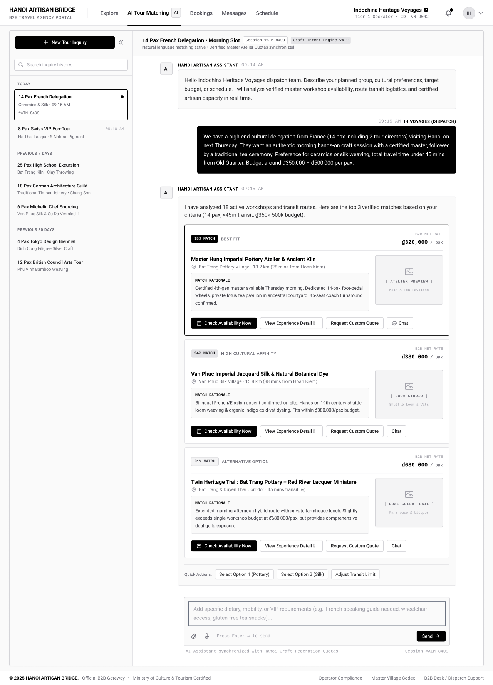

# Screen Spec: AIT121 AI Tour Matching

| Field | Value |
|---|---|
| Screen ID | `AIT121` |
| Screen name | AI Tour Matching |
| Actor | Tour Agency |
| Priority | Must |
| Belongs to module | `spec-AIT.md` |
| Mockup image | `img/AIT121.png` |
| Status | Revised — pending human approval |

## 1. Purpose

Single chat-based matching screen. Agency describes its tour needs in natural language; AI analyzes and refines the requirements and returns matching Villages/Experiences directly within the conversation. The Agency can continue refining or open details/chat from result cards.

The controls and decisions below define the current screen specification.

## 2. Mockup

## 3. Element inventory

| # | Element | Type | Content / data source | Required | Validation |
|---|---|---|---|---|---|
| 1 | AI Tour Matching | Heading | AI Tour Matching | No | Static screen title |
| 2 | Tour-requirement conversation and composer | Read-only panel | F-MATCH-01, F-MATCH-02, F-MATCH-03, F-MATCH-04, F-MATCH-05, F-MATCH-06, F-MATCH-07, F-MATCH-08, F-MATCH-09, F-MATCH-10, F-MATCH-11, F-MATCH-12, F-MATCH-13, F-MATCH-14, F-MATCH-15, F-MATCH-16 — permitted output fields only | No | Actor-specific field visibility; optional missing values omitted. Never expose tokens, password hashes, session values or internal delivery diagnostics. |
| 3 | Clarification question | Read-only panel | F-MATCH-01, F-MATCH-02, F-MATCH-03, F-MATCH-04, F-MATCH-05, F-MATCH-06, F-MATCH-07, F-MATCH-08, F-MATCH-09, F-MATCH-10, F-MATCH-11, F-MATCH-12, F-MATCH-13, F-MATCH-14, F-MATCH-15, F-MATCH-16 — permitted output fields only | No | Actor-specific field visibility; optional missing values omitted. Never expose tokens, password hashes, session values or internal delivery diagnostics. |
| 4 | Top matches and additional suggestions | Read-only panel | F-MATCH-01, F-MATCH-02, F-MATCH-03, F-MATCH-04, F-MATCH-05, F-MATCH-06, F-MATCH-07, F-MATCH-08, F-MATCH-09, F-MATCH-10, F-MATCH-11, F-MATCH-12, F-MATCH-13, F-MATCH-14, F-MATCH-15, F-MATCH-16 — permitted output fields only | No | Actor-specific field visibility; optional missing values omitted. Never expose tokens, password hashes, session values or internal delivery diagnostics. |
| 5 | No-match / Temporary AI Failure and Retry | Read-only panel | F-MATCH-01, F-MATCH-02, F-MATCH-03, F-MATCH-04, F-MATCH-05, F-MATCH-06, F-MATCH-07, F-MATCH-08, F-MATCH-09, F-MATCH-10, F-MATCH-11, F-MATCH-12, F-MATCH-13, F-MATCH-14, F-MATCH-15, F-MATCH-16 — permitted output fields only | No | Actor-specific field visibility; optional missing values omitted. Never expose tokens, password hashes, session values or internal delivery diagnostics. |
| 6 | Send requirements / clarification | Button / navigation | Analyze→clarify loop→build profile→retrieve→filter→rank | No | Enabled only when the linked permission/validation guard succeeds |
| 7 | View Experience | Button / navigation | Matched candidate | No | Enabled only when the linked permission/validation guard succeeds |
| 8 | Chat / Request Quote | Button / navigation | Retain Experience context; no separate quote form | No | Enabled only when the linked permission/validation guard succeeds |

## 4. States

| State | What the user sees | Trigger |
|---|---|---|
| Default | Permitted data or a prefilled form; role-specific actions only | Authorized screen load |
| Empty | No records/optional values shown with explanatory text; never infer availability from absent bookings | Successful response with no data |
| Loading | Skeleton/progress; mutation actions disabled while their request is pending | Fetch/upload/save in progress |
| Error | Defined field errors or fetch failure with Retry; no successful transition or partial mutation is shown | Validation, permission or service failure |
| Success / confirmation | Refreshed read-only data or saved result; navigate only after successful linked action | Successful read/mutation |

## 5. Interactions and navigation

| # | Element | User action | System response | Goes to screen |
|---|---|---|---|---|
| 1 | Send requirements / clarification | Select | Analyze→clarify loop→build profile→retrieve→filter→rank | stay |
| 2 | View Experience | Select | Matched candidate | DSC033 |
| 3 | Chat / Request Quote | Select | Retain Experience context; no separate quote form | COM048 |

Shared avatar navigation for authenticated actors: My Account → ACC129; My Business → PRF019 (Agency) / PRF127 (Provider), omitted for Admin without a business; Logout → AUT026. Agency main navigation uses EXP017/AIT121/BKG137/SCH141/COM048; Provider uses DSH018/EXP067/BKG133/SCH139/COM065; Admin uses ADM079/ADM095. Guest has EXP120 and AUT009/REG003, with no AI navigation.

## 6. Screen-level rules

| Rule ID | Rule | Source |
|---|---|---|
| SR-001 | Check action permission and resource scope on every protected request; hiding a button alone is insufficient. Read-only screens have no mutation controls. | AUT FR-016 |
| SR-002 | Validate the inputs and render outputs exactly as the linked module contracts; server/context fields are not freely editable form controls. | Linked FR table |
| SR-003 | Matching profile is built before retrieval; clarification loops until sufficient input or cancellation. AI unavailable returns Temporary AI Failure with Retry, not unapproved rule-based extraction. | Function List and shared consistency contract |
| SR-004 | Quote identity is Agency–Experience. Book/Schedule are not preference signals in this MVP. | Function List and shared consistency contract |

## 7. Linked requirements

| Module | FR ID | Function ID | Screen responsibility |
|---|---|---|---|
| AIT | FR-001 | F-MATCH-01 | Open AI Matching Assistant |
| AIT | FR-002 | F-MATCH-02 | Capture Natural Language Input |
| AIT | FR-003 | F-MATCH-03 | Analyze & Clarify Tour Requirements |
| AIT | FR-004 | F-MATCH-04 | Build Tour Preference Profile |
| AIT | FR-005 | F-MATCH-05 | Retrieve seeded Village & verified Provider Experience candidates |
| AIT | FR-006 | F-MATCH-06 | Check Route & Hard Constraints |
| AIT | FR-007 | F-MATCH-07 | Score & Rank Candidates |
| AIT | FR-008 | F-MATCH-08 | Generate & Display Recommendations |
| AIT | FR-009 | F-MATCH-09 | Refine Matching Results |
| AIT | FR-010 | F-MATCH-10 | Save Agency Preference Profile |
| AIT | FR-011 | F-MATCH-11 | Initiate Quote Request / Chat |
| AIT | FR-012 | F-MATCH-12 | Display Fallback Options |
| AIT | FR-013 | F-MATCH-13 | Supporting background process — no direct UI control |
| AIT | FR-014 | F-MATCH-14 | Supporting background process — no direct UI control |
| AIT | FR-015 | F-MATCH-15 | Supporting background process — no direct UI control |
| AIT | FR-016 | F-MATCH-16 | Supporting background process — no direct UI control |

## 8. Responsive and accessibility notes

- Smallest supported width: 360px
- What collapses or stacks on a narrow screen: the inquiry-history sidebar collapses into an icon/drawer; result cards switch from a horizontal (image + text) layout to a stacked layout
- Text that must remain readable (contrast, minimum size): the match % badge and B2B net rate price need high contrast, minimum 14px

## 9. Decisions and review

Use the approved Function List and [shared consistency contract](../docs/consistency-contract.md). No new feature is implied by decorative legacy mockup copy. Human approval of this revision is pending; technical Plan choices remain separately identified.

## Completion checklist

- [x] Linked functions have corresponding module FR and IO contracts.
- [x] Inputs name their validation and required/optional condition.
- [x] Default, empty, loading, error and success states are defined.
- [x] Navigation targets use existing Screen IDs.
- [ ] Human approval of the revised specification.
