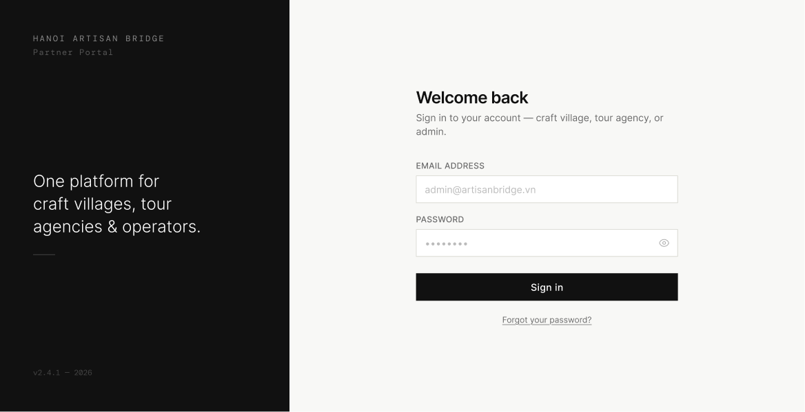

# Screen Spec: AUT009 Login

| Field | Value |
|---|---|
| Screen ID | `AUT009` |
| Screen name | Login |
| Actor | All Actors |
| Priority | Must |
| Belongs to module | `spec-AUT.md` |
| Mockup image | `img/AUT009.png` |
| Status | Draft |

## 1. Purpose

**Shown when:** A user navigates directly to the login URL, or a Guest is redirected here when attempting a restricted action.

**The user leaves this screen when:** They successfully sign in (redirected to their role's home screen), or tap "Forgot your password?" to start password recovery.

## 2. Mockup

## 3. Element inventory

| # | Element | Type | Content / data source | Required | Validation |
|---|---|---|---|---|---|
| 1 | Left panel branding | Text/Image | "HANOI ARTISAN BRIDGE", "Partner Portal", tagline "One platform for craft villages, tour agencies & operators.", version stamp | No | — |
| 2 | Heading | Text | "Welcome back" | No | — |
| 3 | Subheading | Text | "Sign in to your account — craft village, tour agency, or admin." | No | — |
| 4 | Email Address | Input | Login email | Yes | Valid email format, must match a registered account |
| 5 | Password | Input (masked) | Login password | Yes | Non-empty |
| 6 | Show/hide password (eye icon) | Toggle | Reveals/masks password field | No | — |
| 7 | Sign in | Button (primary) | Submits credentials | No | Disabled until both fields are filled |
| 8 | Forgot your password? | Link | Starts password recovery | No | — |

## 4. States

| State | What the user sees | Trigger |
|---|---|---|
| Default | Empty email/password fields with placeholder text, Sign in enabled once both are filled | Screen load |
| Empty (no data) | Same as default — this screen has no persisted data to be "empty" of | N/A (applies default) |
| Loading | Sign in button shows spinner and is disabled while authenticating | User taps Sign in |
| Error | Inline error text under field(s) for invalid format; banner above the form "Incorrect email or password" for bad credentials. If the Agency account status is Pending, an inline error within the form reads: "Your account is pending approval. Please wait for your account to be reviewed." If the Agency account status is Rejected, an inline error within the form reads: "Your account has been rejected. Please contact the administrator for more information." No separate error page or modal is shown for either case. | Client validation fails, credentials are rejected, or the Agency account status is Pending/Rejected |
| Success / confirmation | Redirect to the user's role-specific home screen (no confirmation screen shown) | Sign in succeeds |

## 5. Interactions and navigation

| # | Element | User action | System response | Goes to screen |
|---|---|---|---|---|
| 1 | Email / Password | type | Live format validation | stays |
| 2 | Eye icon | tap | Toggles password visibility | stays |
| 3 | Sign in | tap | Validates and authenticates | Tour Agency → `EXP017`; Local Provider → `DSH018`; HDT/UBND Admin → `ADM079`; Guest is not applicable (Guests do not log in) |
| 4 | Forgot your password? | tap | Navigates to password recovery | `PAS011` |

## 6. Screen-level rules

| Rule ID | Rule | Source |
|---|---|---|
| SR-001 | This is a single shared login screen for Tour Agency, Local Provider, UBND, and HDT — the destination screen after login depends on the account's role | Screen List Screen Overview |
| SR-002 | A Guest attempting a restricted action is redirected here; on successful login they land on the restricted destination they originally requested, not always the default home screen | Screen List Screen Overview |
| SR-003 | Sign in stays disabled until both Email Address and Password have values | Mockup — placeholder-only fields imply required inputs |
| SR-004 | A Pending or Rejected Agency account gets a specific inline error message instead of a generic auth failure message (see States §4) | Clarification |
| SR-005 | Session length is controlled entirely by system authentication policy; it is not user-configurable and there is no "Remember me" option in the UI | Clarification |
| SR-006 | The screen layout and field structure shown here (captured from [Actor X]'s view) is a shared template used by multiple actor roles. Role-specific differences (visible fields, permissions, labels) are not exhaustively illustrated by this single mockup and must be validated per actor before implementation. |

## 7. Linked requirements

| FR ID (from the module spec) | What this screen does for it |
|---|---|
| FR-AUT-01 | Provides the single authentication entry point for all authenticated actors |

## 8. Responsive and accessibility notes

- Smallest supported width: 360px
- What collapses or stacks on a narrow screen: the dark left branding panel stacks above the form instead of sitting beside it
- Text that must remain readable (contrast, minimum size): form labels ≥12px uppercase, white-on-dark branding text maintains 4.5:1 contrast

## 9. Open questions

| # | Question | Blocking? | Status |
|---|---|---|---|
| 1 | Exact messaging shown when a pending/rejected Agency account attempts to log in | Yes | Resolved — see States §4 and SR-004 |
| 2 | Is there a "Remember me" or session-length control? | No | Resolved — none exists; see SR-005 |

---

## Completion checklist

- [x] The mockup is a separate cropped image file, named with the Screen ID.
- [x] Every visible element in the mockup appears in the element inventory.
- [x] Every input element has a validation rule or an explicit "none".
- [x] All five states are filled in, or marked "not applicable" with a reason.
- [x] Every navigation target is a Screen ID that exists in the Screen List.
- [x] Every element that displays data names the field it displays, matching the module spec.
