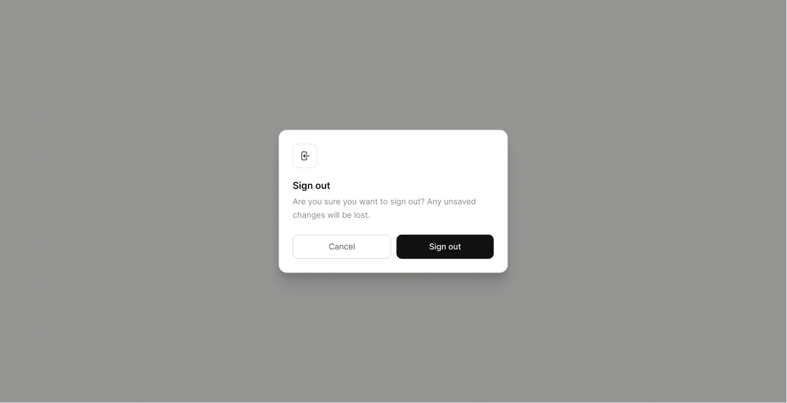

# Screen Spec: AUT026 Logout Confirmation

| Field | Value |
|---|---|
| Screen ID | `AUT026` |
| Screen name | Logout Confirmation |
| Actor | All Actors |
| Priority | Must |
| Belongs to module | `spec-AUTH.md` |
| Mockup image | `img/AUT026.png` |
| Status | Draft |

## 1. Purpose

**Shown when:** The user explicitly initiates logout by clicking any "Log out" button or logout icon in the app (e.g. from the Account Dropdown, or the logout icon in the Admin sidebar footer). It is displayed as a modal/overlay on top of whatever screen the user was on — the underlying screen does not need its own mockup for this dialog to apply.

**The user leaves this screen when:** They confirm ("Sign out") or dismiss ("Cancel") the dialog.

## 2. Mockup

## 3. Element inventory

| # | Element | Type | Content / data source | Required | Validation |
|---|---|---|---|---|---|
| 1 | Dialog overlay | Modal | Dims the underlying screen | No | — |
| 2 | Icon | Image | Logout/sign-out glyph | No | — |
| 3 | Dialog title | Text | "Sign out" | No | — |
| 4 | Dialog body text | Text | "Are you sure you want to sign out? Any unsaved changes will be lost." | No | — |
| 5 | Cancel | Button (secondary) | Dismisses dialog | No | — |
| 6 | Sign out | Button (primary) | Confirms logout | No | — |

## 4. States

| State | What the user sees | Trigger |
|---|---|---|
| Default | Dialog as shown with both actions enabled | Dialog opens from Log Out click |
| Empty (no data) | Not applicable — dialog has no data-dependent content | N/A |
| Loading | Sign out button shows spinner and is disabled while the session is being ended | User taps Sign out |
| Error | Inline text under the buttons "Could not sign out, please try again" | Logout request fails server-side |
| Success / confirmation | Dialog closes, user is redirected to Login | Logout succeeds |

## 5. Interactions and navigation

| # | Element | User action | System response | Goes to screen |
|---|---|---|---|---|
| 1 | Cancel | tap | Closes dialog, no change to session | previous screen (stays) |
| 2 | Sign out | tap | Ends session, clears local auth state | `AUT009` |
| 3 | Click outside dialog / Esc key | tap/key | Same as Cancel | previous screen (stays) |

## 6. Screen-level rules

| Rule ID | Rule | Source |
|---|---|---|
| SR-001 | Warns the user that unsaved changes will be lost, implying no auto-save happens on logout | Mockup body text |
| SR-002 | This confirmation is shared across all actors and entry points that trigger logout | Screen List actor: "All Actors" |
| SR-003 | The dialog renders as a modal/overlay reused from any screen with a logout trigger; it is not a standalone page | Clarification |

## 7. Linked requirements

| FR ID (from the module spec) | What this screen does for it |
|---|---|
| FR-AUT-02 | Prevents accidental loss of session/unsaved work on logout |

## 8. Responsive and accessibility notes

- Smallest supported width: 360px
- What collapses or stacks on a narrow screen: dialog becomes near full-width with side margins; buttons remain side by side unless width is under ~320px, then they stack
- Text that must remain readable (contrast, minimum size): body text ≥14px, sufficient contrast against the dimmed overlay

## 9. Open questions

| # | Question | Blocking? | Status |
|---|---|---|---|
| 1 | Which forms/screens actually have unsaved-state that this warning applies to? | No | Open — copy is generic and applies regardless; specific screens TBD |

---

## Completion checklist

- [x] The mockup is a separate cropped image file, named with the Screen ID.
- [x] Every visible element in the mockup appears in the element inventory.
- [x] Every input element has a validation rule or an explicit "none".
- [x] All five states are filled in, or marked "not applicable" with a reason.
- [x] Every navigation target is a Screen ID that exists in the Screen List.
- [x] Every element that displays data names the field it displays, matching the module spec.
