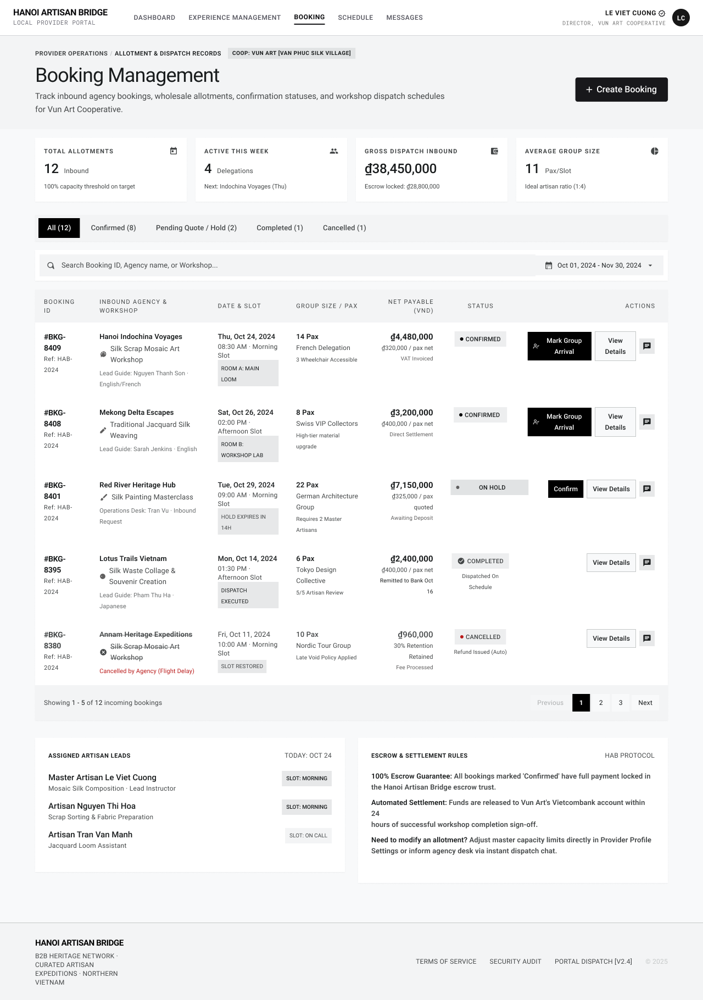

# Screen Spec: BKG133 Booking Management

| Field | Value |
|---|---|
| Screen ID | `BKG133` |
| Screen name | Booking Management |
| Actor | Local Provider |
| Priority | Must |
| Belongs to module | `spec-SCH.md` |
| Mockup image | `img/BKG133.png` |
| Status | Draft |

## 1. Purpose

**Shown when:** The Local Provider selects "Booking" from the main navigation after logging into the Local Provider Portal; this is the main entry point for viewing and managing all inbound Tour Agency bookings.

**The user leaves this screen when:** They click "Create Booking" (→ BKG134), click "View Details" or a Booking ID on a row (→ BKG135), click "Mark Group Arrival" (→ BKG136 modal), click "Confirm" on an on-hold booking, click the chat icon (→ COM048 Chat), or navigate away via the top nav (Dashboard, Experience Management, Schedule, Messages) or avatar menu.

## 2. Mockup

## 3. Element inventory

| # | Element | Type | Content / data source | Required | Validation |
|---|---|---|---|---|---|
| 1 | Top nav bar | Header | Logo "Hanoi Artisan Bridge" + "Local Provider Portal" subtitle; links Dashboard / Experience Management / Booking (active) / Schedule / Messages | Yes | Active tab reflects current route |
| 2 | User menu | Header | Current user name (from ACC129), role + business name (`Director, Vun Art Cooperative`), verified badge, avatar initials | Yes | — |
| 3 | Breadcrumb | Text | "Provider Operations / Allotment & Dispatch Records" + Village/Cooperative badge (`COOP: VUN ART [VAN PHUC SILK VILLAGE]`, from Provider Profile PRF127) | No | — |
| 4 | Page title | Header | "Booking Management" | Yes | — |
| 5 | Page description | Text | Static subtitle describing the screen purpose | No | — |
| 6 | Create Booking button | Button | Label "+ Create Booking" | Yes | Enabled whenever provider has at least one published Experience |
| 7 | Stat card: Total Allotments | Card | Count of inbound bookings (12) + helper text ("100% capacity threshold on target") | Yes | Computed, read-only |
| 8 | Stat card: Active This Week | Card | Count of delegations active this week (4) + next delegation name/day | Yes | Computed, read-only |
| 9 | Stat card: Gross Dispatch Inbound | Card | Total payable across bookings in currency (₫38,450,000) + escrow-locked amount | Yes | Computed, read-only |
| 10 | Stat card: Average Group Size | Card | Average pax per slot (11) + ideal artisan ratio note | Yes | Computed, read-only |
| 11 | Status filter tabs | Toggle/List | All (12) / Confirmed (8) / Pending Quote / Hold (2) / Completed (1) / Cancelled (1) | Yes | Exactly one tab active; counts must sum to All |
| 12 | Search input | Input | Placeholder "Search Booking ID, Agency name, or Workshop..." | No | Free text, live-filters table |
| 13 | Date range picker | Input | Displays selected range (Oct 01, 2024 – Nov 30, 2024) | No | Start date ≤ end date |
| 14 | Booking table header | Header | Columns: Booking ID, Inbound Agency & Workshop, Date & Slot, Group Size/Pax, Net Payable (VND), Status, Actions | Yes | — |
| 15 | Table row (repeating) | List item | Booking ID (`#BKG-nnnn`) + internal ref code; Agency name, workshop icon + name, lead guide/language; Date, time slot label, room/hold-expiry chip; Pax count + segment tag (e.g. "3 Wheelchair Accessible"); Net payable amount + settlement note (VAT invoiced / direct settlement / awaiting deposit); Status badge (Confirmed / On Hold / Completed / Cancelled) with cancellation reason where applicable | Yes | Status badge color-coded per state; amounts right-aligned currency |
| 16 | Row action: Mark Group Arrival | Button | Shown on Confirmed rows only | No | Disabled once already marked arrived |
| 17 | Row action: Confirm | Button | Shown on On Hold rows only | No | Disabled after hold expiry window passes |
| 18 | Row action: View Details | Button | All rows | Yes | Navigates to BKG135 |
| 19 | Row action: Chat icon | Icon button | All rows | No | Opens COM048 Chat scoped to that booking's agency thread |
| 20 | Pagination | Component | "Showing 1–5 of 12 incoming bookings", Previous / page numbers (1,2,3) / Next | Yes | Current page highlighted; Previous disabled on page 1 |
| 21 | Panel: Assigned Artisan Leads | Card | Date label ("Today: Oct 24"), list of artisans with role and slot assignment | No | Read-only; sourced only from today's Confirmed bookings (not On Hold, Completed, or Cancelled) |
| 22 | Panel: Escrow & Settlement Rules | Card | Static protocol text (100% Escrow Guarantee, Automated Settlement, "Need to modify an allotment?" pointer) | No | Static content, editable only by Admin |
| 23 | Footer | Footer | Company info, Terms of Service / Security Audit / Portal Dispatch version links, copyright | No | — |

## 4. States

| State | What the user sees | Trigger |
|---|---|---|
| Default | Table populated with all bookings for the current filter/date range, stat cards computed from live data | Screen load with existing bookings |
| Empty (no data) | Stat cards show zero values; table area shows an empty-state message (e.g. "No bookings yet for this period") with a prompt to Create Booking; filter tabs show (0) | Provider has no bookings, or the active filter/search/date range returns no matches |
| Loading | Stat cards and table rows show skeleton placeholders; filter tabs and Create Booking button remain visible but table area is inert | Screen mount, or after changing filter/date range/search while data is fetched |
| Error | Table area replaced by an inline error message ("Couldn't load bookings") with a Retry action; stat cards show "—" | API/network failure fetching bookings |
| Success / confirmation | Toast/banner confirming an action just completed (e.g. "Booking confirmed" after clicking Confirm), row status updates in place | After Confirm or Mark Group Arrival succeeds |

## 5. Interactions and navigation

| # | Element | User action | System response | Goes to screen |
|---|---|---|---|---|
| 1 | Create Booking button | tap | Opens booking creation flow | `BKG134` |
| 2 | Booking ID / View Details | tap | Loads full booking record | `BKG135` |
| 3 | Mark Group Arrival | tap | Opens confirmation modal | `BKG136` (modal, stays on BKG133 behind it) |
| 4 | Confirm (on-hold row) | tap | Moves booking from On Hold → Confirmed in place; stat cards and tab counts update | stays on `BKG133` |
| 5 | Chat icon | tap | Opens the chat thread for that booking's agency | `COM048` |
| 6 | Filter tab | tap | Table re-filters to the selected status | stays on `BKG133` |
| 7 | Search input | type | Table filters live by Booking ID / Agency / Workshop match | stays on `BKG133` |
| 8 | Date range picker | tap → pick dates | Table and stat cards recompute for the new range | stays on `BKG133` |
| 9 | Pagination controls | tap | Loads the corresponding page of results | stays on `BKG133` |
| 10 | Top nav links | tap | Navigates to the selected module | `DSH018` / `EXP067` / `SCH139` / Messages |
| 11 | Village badge | tap | Opens the provider's own Village profile | `VIL030` |

## 6. Screen-level rules

| Rule ID | Rule | Source |
|---|---|---|
| SR-001 | Status can only move forward (On Hold → Confirmed → Completed, or → Cancelled); this list view never allows reverting a status | Booking status lifecycle (see BKG144) |
| SR-002 | "Mark Group Arrival" is only available once, on Confirmed bookings whose date has arrived | Inferred from BKG136 |
| SR-003 | On-hold bookings display a countdown from a 72-hour hold window ("Hold Expires In 14H" being a point within that window); once the 72-hour window lapses, the hold auto-releases and the row moves toward Cancelled | Inferred from mockup; Clarification (Module 5): hold window is 72 hours |
| SR-004 | Filter tab counts and pagination total must always reconcile (sum of tab counts = All count) | Data integrity |

## 7. Linked requirements

| FR ID (from the module spec) | What this screen does for it |
|---|---|
| FR-003 | Provides the entry point ("+ Create Booking") into the Create Booking flow (F-SCHED-03) |
| FR-005 | Surfaces the "Confirm" row action that transitions an On Hold booking to Confirmed (F-SCHED-05) |
| FR-006 | Surfaces the "Mark Group Arrival" row action that leads into completing a Confirmed booking (F-SCHED-06) |
| FR-007 | Lists the Local Provider's own bookings and routes to full Booking Detail via "View Details" (F-SCHED-07) |

## 8. Responsive and accessibility notes

- Smallest supported width: 360px
- What collapses or stacks on a narrow screen: the four stat cards stack to a single column; the table becomes horizontally scrollable or collapses to stacked cards per booking; the two bottom panels (Artisan Leads, Escrow Rules) stack vertically
- Text that must remain readable (contrast, minimum size): status badges must retain sufficient contrast at small size; currency amounts must not truncate

## 9. Open questions

| # | Question | Blocking? | Status |
|---|---|---|---|
| 1 | [NEEDS CLARIFICATION: What is the exact hold-expiry duration and what happens automatically when it lapses — auto-cancel or auto-release the slot back to Schedule?] **Resolved:** The hold window is 72 hours; on lapse the hold auto-releases and the booking moves toward Cancelled. | Yes | Resolved |
| 2 | [NEEDS CLARIFICATION: Which FR IDs in spec-BKG.md map to this screen?] Pending — to be filled in once `spec-BKG.md` is finalized. | Yes | Open |
| 3 | [NEEDS CLARIFICATION: Is the "Assigned Artisan Leads" panel editable from here or read-only, sourced from today's confirmed bookings only?] **Resolved:** Read-only, sourced only from today's Confirmed bookings. | No | Resolved |

---

## Completion checklist

- [x] The mockup is a separate cropped image file, named with the Screen ID.
- [x] Every visible element in the mockup appears in the element inventory.
- [x] Every input element has a validation rule or an explicit "none".
- [x] All five states are filled in, or marked "not applicable" with a reason.
- [x] Every navigation target is a Screen ID that exists in the Screen List.
- [x] Every element that displays data names the field it displays, matching the module spec.
