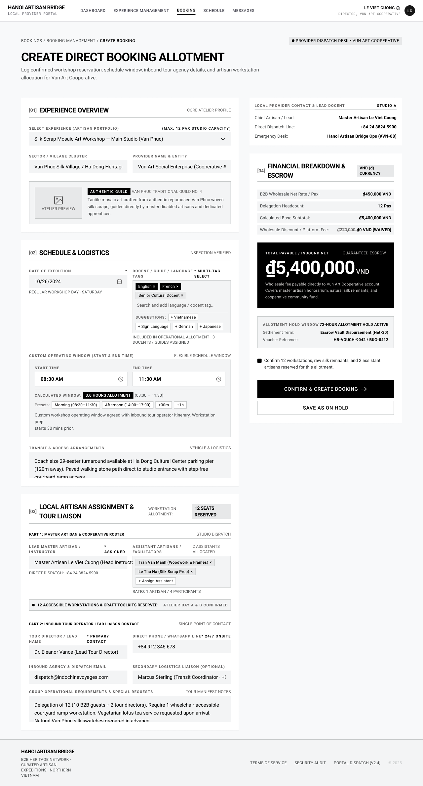

# Screen Spec: BKG134 Create Booking

| Field | Value |
|---|---|
| Screen ID | `BKG134` |
| Screen name | Create Booking |
| Actor | Local Provider |
| Priority | Must |
| Belongs to module | `spec-BKG.md` |
| Mockup image | `img/BKG134.png` |
| Status | Draft |

## 1. Purpose

**Shown when:** The Local Provider clicks "+ Create Booking" from BKG133 (Booking Management), after the Agency and Local Provider have agreed terms through Chat (COM048).

**The user leaves this screen when:** They click "Confirm & Create Booking" (booking is created and they land on its detail), click "Save as On Hold" (booking is saved with On Hold status), or click "Cancel"/breadcrumb to abandon the form.

## 2. Mockup

## 3. Element inventory

| # | Element | Type | Content / data source | Required | Validation |
|---|---|---|---|---|---|
| 1 | Breadcrumb | Text | "Bookings / Booking Management / Create Booking" | Yes | Reflects navigation path |
| 2 | Context badge | Text | "Provider Dispatch Desk • Vun Art Cooperative" | No | — |
| 3 | Page title | Header | "Create Direct Booking Allotment" | Yes | — |
| 4 | Page description | Text | Static instructional subtitle | No | — |
| 5 | Section [01] Experience Overview | Header | Section label + "Core Atelier Profile" tag | Yes | — |
| 6 | Select Experience dropdown | Input (select) | Lists provider's published Experiences (from EXP067); shows selected Experience name and studio + max pax capacity | Yes | Must select one Experience before submit |
| 7 | Sector / Village Cluster | Text (read-only) | Auto-filled from selected Experience's location | No | Read-only, derived |
| 8 | Provider Name & Entity | Text (read-only) | Auto-filled from Provider Profile (PRF127) | No | Read-only, derived |
| 9 | Atelier preview image | Image | Thumbnail of the Experience; placeholder icon if none | No | — |
| 10 | Experience summary card | Text | Guild badge ("Authentic Guild"), village guild reference, short description pulled from Experience | No | Read-only, derived |
| 11 | Section [02] Schedule & Logistics | Header | Section label + "Inspection Verified" tag | Yes | — |
| 12 | Date of Execution | Input (date) | Selected date (10/26/2024) + weekday helper text | Yes | Must be a valid future date; should respect provider's Schedule (SCH139) availability |
| 13 | Docent / Guide / Language multi-tag select | Input (multi-select) | Selected tags (English, French, Senior Cultural Docent); search box; suggestion chips (Vietnamese, Sign Language, German, Japanese); helper text "3 Docents/Guides assigned" | Yes | At least one docent/guide/language tag required |
| 14 | Custom Operating Window – Start Time | Input (time) | Selected start time (08:30 AM) | Yes | Must be before End Time |
| 15 | Custom Operating Window – End Time | Input (time) | Selected end time (11:30 AM) | Yes | Must be after Start Time |
| 16 | Calculated Window display | Text (computed) | "3.0 Hours Allotment (08:30–11:30)" | No | Auto-computed from start/end |
| 17 | Preset time buttons | Button group | Morning (08:30–11:30), Afternoon (14:00–17:00), +30m, +1h | No | Clicking a preset overwrites Start/End Time |
| 18 | Operating window notes | Textarea | Free text describing workstation prep timing | No | Optional, no character limit specified |
| 19 | Transit & Access Arrangements | Textarea | Free text describing coach size, parking, walking path, accessibility | No | Optional |
| 20 | Section [03] Local Artisan Assignment & Tour Liaison | Header | Section label + "Workstation Allotment: 12 Seats Reserved" | Yes | — |
| 21 | Lead Master Artisan / Instructor | Input (select, required) | Selected artisan name + role ("Assigned" tag) | Yes | Must select exactly one lead artisan |
| 22 | Direct Dispatch phone (lead artisan) | Text (read-only) | Auto-filled contact number | No | Read-only, derived |
| 23 | Assistant Artisans / Facilitators | Input (multi-select with chips) | Selected assistants (Tran Van Manh, Le Thu Ha) with remove (×); "+ Assign Assistant" control; "2 Assistants Allocated" counter | No | Each chip removable; counter must match chip count |
| 24 | Ratio helper text | Text | "Ratio: 1 Artisan / 4 Participants" | No | Computed from headcount vs. artisans assigned |
| 25 | Workstation confirmation banner | Text/badge | "12 Accessible Workstations & Craft Toolkits Reserved — Atelier Bay A & B Confirmed" | No | Read-only status |
| 26 | Tour Director / Lead Name | Input (text, required) | Value: "Dr. Eleanor Vance (Lead Tour Director)" | Yes | Non-empty |
| 27 | Direct Phone / WhatsApp Line | Input (text, required) | Value: "+84 912 345 678" | Yes | Valid phone format only; no existence check |
| 28 | Inbound Agency & Dispatch Email | Input (email) | Value: "dispatch@indochinavoyages.com" | Yes | Valid email format only; no existence check against the Agency's registered account |
| 29 | Secondary Logistics Liaison | Input (text, optional) | Value: "Marcus Sterling (Transit Coordinator...)" | No | — |
| 30 | Group Operational Requirements & Special Requests | Textarea | Free text: accessibility, dietary, prep notes | No | Optional |
| 31 | Panel: Local Provider Contact & Lead Docent | Card | Studio label (Studio A); Chief Artisan, Direct Dispatch Line, Emergency Desk | No | Read-only, derived from Provider Profile |
| 32 | Section [04] Financial Breakdown & Escrow | Header | Section label + currency tag "VND (₫)" | Yes | — |
| 33 | B2B Wholesale Net Rate / Pax | Text (computed) | ₫450,000 VND | No | Read-only, derived from Experience pricing |
| 34 | Delegation Headcount | Input (number) | 12 Pax | Yes | Must be > 0 and ≤ Experience max capacity |
| 35 | Calculated Base Subtotal | Text (computed) | ₫5,400,000 VND | No | Auto = Rate × Headcount |
| 36 | Wholesale Discount / Platform Fee | Text (computed) | Struck-through ₫270,000 → ₫0 VND [Waived] | No | Read-only, business rule |
| 37 | Total Payable / Inbound Net | Text (computed, highlighted) | ₫5,400,000 VND + explanatory note | No | Auto-computed; must equal Subtotal − Discount |
| 38 | Allotment Hold Window | Text | "72-Hour Allotment Hold Active", Settlement Term, Voucher Reference | No | Read-only, system-generated on save |
| 39 | Confirmation checkbox | Toggle/Checkbox | "Confirm 12 workstations, raw silk remnants, and 2 assistant artisans reserved for this allotment." | Yes | Must be checked before "Confirm & Create Booking" is enabled |
| 40 | Confirm & Create Booking button | Button | Primary CTA | Yes | Disabled until all required fields valid and checkbox checked |
| 41 | Save as On Hold button | Button | Secondary CTA | No | Allows partial save without full validation of the confirmation checkbox |
| 42 | Footer | Footer | Company info, links, copyright | No | — |

## 4. States

| State | What the user sees | Trigger |
|---|---|---|
| Default | Empty form ready for input; the provider manually enters/selects all fields (this screen is not auto-populated from a Chat quote, even when opened after a Chat negotiation) | Screen load |
| Empty (no data) | If the provider has no published Experiences, the Select Experience dropdown is empty with a message ("No Experiences yet") and a link to Add Experience (EXP069); form cannot be submitted | Provider has zero Experiences |
| Loading | Financial Breakdown values show placeholders while rate is fetched after Experience selection; Confirm button disabled | Immediately after selecting an Experience, before pricing loads |
| Error | Inline field-level errors under invalid inputs (e.g. "End time must be after start time", "Headcount exceeds studio capacity"); Confirm button stays disabled; a banner error if the submit API call fails | Validation failure on submit, or save/API failure |
| Success / confirmation | Toast "Booking created" and redirect to the new booking's detail screen; or, for Save as On Hold, toast "Saved as On Hold" and redirect to BKG133 with the new row visible under Pending Quote / Hold | After successful Confirm & Create Booking or Save as On Hold |

## 5. Interactions and navigation

| # | Element | User action | System response | Goes to screen |
|---|---|---|---|---|
| 1 | Select Experience dropdown | select | Auto-fills Sector/Village, Provider Name, Atelier preview, and Financial rate | stays on `BKG134` |
| 2 | Preset time buttons | tap | Overwrites Start/End Time fields and recalculates window | stays on `BKG134` |
| 3 | + Assign Assistant | tap | Opens artisan picker, adds a chip on selection | stays on `BKG134` |
| 4 | Delegation Headcount | type | Recalculates Base Subtotal and Total Payable | stays on `BKG134` |
| 5 | Confirmation checkbox | tap | Enables/disables Confirm & Create Booking button | stays on `BKG134` |
| 6 | Confirm & Create Booking | tap | Validates all required fields, creates the booking record with status Confirmed | `BKG135` (new booking's detail) |
| 7 | Save as On Hold | tap | Saves the booking with status On Hold | `BKG133` |
| 8 | Breadcrumb "Booking Management" | tap | Discards unsaved changes (with confirmation) and returns | `BKG133` |

## 6. Screen-level rules

| Rule ID | Rule | Source |
|---|---|---|
| SR-001 | Confirm & Create Booking stays disabled until every required field (Experience, Date, Docent/Language, Start/End Time, Lead Artisan, Tour Director Name, Phone, Agency Email, Headcount, confirmation checkbox) is valid | Standard form gating |
| SR-002 | Delegation Headcount cannot exceed the selected Experience's max studio capacity shown in section [01] | Mockup: "MAX: 12 PAX STUDIO CAPACITY" |
| SR-003 | Total Payable is always system-calculated (Rate × Headcount − waived discount); the field is not directly editable | Financial integrity |
| SR-004 | Creating a booking here immediately reserves the corresponding time slot in the provider's Schedule (SCH139) as Booked or On Hold | Cross-screen consistency with SCH139 |
| SR-005 | This form is always manually filled in by the provider; it is never auto-populated from an accepted Chat quote, even when opened right after a negotiation | Clarification (Module 5) |
| SR-006 | Email and phone fields are validated for format only; no check is made against the Agency's registered account | Clarification (Module 5) |
| SR-007 | No time slot is reserved in Schedule (SCH139) until the provider submits this form via "Confirm & Create Booking" or "Save as On Hold" (see SR-004); if the provider abandons the form beforehand, any previously Confirmed slot in Schedule stays Confirmed and unaffected | Clarification (Module 5) |

## 7. Linked requirements

| FR ID (from the module spec) | What this screen does for it |
|---|---|
| FR-003 | Allows the Local Provider to formalize a booking after Chat negotiation, capturing Experience, date/time, group info, capacity, agreed price and conditions (financial breakdown is derived here, not a separate FR) |
| FR-008 | Triggers the schedule block + Agency-schedule sync that must follow booking creation |
| FR-009 | Backs the "no silently conflicting booking" rule (SR checks against existing On hold/Booked/availability) |

## 8. Responsive and accessibility notes

- Smallest supported width: 360px
- What collapses or stacks on a narrow screen: the two-column layout (form left, Financial Breakdown + Provider Contact right) stacks to a single column with the financial summary moving below the form sections
- Text that must remain readable (contrast, minimum size): the large Total Payable figure and struck-through discount value must remain legible and unambiguous at small sizes

## 9. Open questions

| # | Question | Blocking? | Status |
|---|---|---|---|
| 1 | [NEEDS CLARIFICATION: Can this screen be pre-populated automatically from an accepted Chat quote request, or must the provider re-enter all fields manually?] **Resolved:** The provider must re-enter all fields manually; the form is never auto-populated from Chat. | Yes | Resolved |
| 2 | [NEEDS CLARIFICATION: What validation applies to phone/email fields — format only, or existence check against the Agency's registered account?] **Resolved:** Format validation only; no existence check. | No | Resolved |
| 3 | [NEEDS CLARIFICATION: What happens to a previously Confirmed slot in Schedule if the provider abandons this form after partially reserving it?] **Resolved:** The previously Confirmed slot remains Confirmed; abandoning the form does not change or release the existing booking. | Yes | Resolved |

---

## Completion checklist

- [x] The mockup is a separate cropped image file, named with the Screen ID.
- [x] Every visible element in the mockup appears in the element inventory.
- [x] Every input element has a validation rule or an explicit "none".
- [x] All five states are filled in, or marked "not applicable" with a reason.
- [x] Every navigation target is a Screen ID that exists in the Screen List.
- [x] Every element that displays data names the field it displays, matching the module spec.
