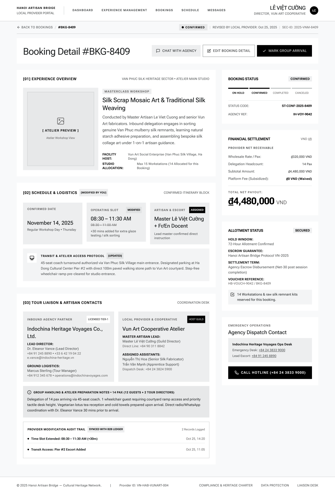

# Screen Spec: BKG135 Booking Detail

| Field | Value |
|---|---|
| Screen ID | `BKG135` |
| Screen name | Booking Detail |
| Actor | Local Provider |
| Priority | Must |
| Belongs to module | `spec-BKG.md` |
| Mockup image | `img/BKG135.png` |
| Status | Draft |

## 1. Purpose

**Shown when:** The Local Provider clicks a Booking ID or "View Details" from BKG133 (Booking Management), or lands here right after creating a booking (BKG134).

**The user leaves this screen when:** They click "Back to Bookings" (→ BKG133), "Chat with Agency" (→ COM048), "Edit Booking Detail" (→ BKG144), or "Mark Group Arrival" (→ BKG136 modal).

## 2. Mockup

## 3. Element inventory

| # | Element | Type | Content / data source | Required | Validation |
|---|---|---|---|---|---|
| 1 | Top nav bar | Header | Logo, nav links (Dashboard / Experience Management / Bookings active / Schedule / Messages), user identity | Yes | — |
| 2 | Back to Bookings link | Link | "← Back to Bookings" | Yes | Navigates to BKG133 |
| 3 | Booking ID label | Text | "#BKG-8409" | Yes | — |
| 4 | Status badge | Badge | "Confirmed" | Yes | Reflects booking status enum |
| 5 | Revision note | Text | "Revised by Local Provider: Oct 25, 2025" | No | Shown only if booking was edited |
| 6 | Security ID | Text | "SEC-ID: 2025-VNM-8409" | No | Read-only system identifier |
| 7 | Page title | Header | "Booking Detail #BKG-8409" | Yes | — |
| 8 | Chat with Agency button | Button | Icon + label | Yes | Enabled for any booking with an associated agency thread |
| 9 | Edit Booking Detail button | Button | Icon + label | Yes | Permission-gated: visible/enabled only for the account that created the booking |
| 10 | Mark Group Arrival button | Button | Icon + label | Yes | Enabled only on Confirmed bookings not yet marked arrived, only for the account that created the booking, **and only on/after the Experience's scheduled start time (BR-010/FR-006)**; before start time the button is visibly disabled |
| 11 | Section [01] Experience Overview | Header | Section label + location tag "Van Phuc Silk Heritage Sector • Atelier Main Studio" | Yes | — |
| 12 | Atelier preview image | Image | Placeholder / actual Experience photo | No | — |
| 13 | Experience type tag | Badge | "Masterclass Workshop" | No | — |
| 14 | Experience title | Text | "Silk Scrap Mosaic Art & Traditional Silk Weaving" | Yes | Matches selected Experience |
| 15 | Experience description | Text | Full description paragraph | No | — |
| 16 | Facility Host | Text | "Vun Art Social Enterprise (Van Phuc Silk Village, Ha Dong)" | No | Read-only |
| 17 | Studio Allocation | Text | "Max 15 Workstations (14 Allocated for this Booking)" | No | Read-only |
| 18 | Panel: Booking Status | Card | Stepper (On Hold / Confirmed / Completed / Canceled) with current stage highlighted; Status Code; Agency Ref | Yes | Stepper reflects only the permitted predefined transitions (not a strict forward-only progression — Cancelled is reachable directly from On Hold or Confirmed) |
| 18a | Hold Countdown Timer | Component | Time remaining until auto-cancellation (hh:mm), nested inside Panel: Booking Status | Conditional | **Not visible in mockup** (mockup captures Confirmed state). Only rendered when Status = On Hold; hidden for Confirmed/Completed/Canceled |
| 19 | Panel: Financial Settlement | Card | Wholesale Rate/Pax, Delegation Headcount, Subtotal, Platform Fee, Total Net Payout (large highlighted figure) | Yes | Total = Rate × Headcount − Fee |
| 20 | Section [02] Schedule & Logistics | Header | "[Modified by You]" tag if edited; "Confirmed Itinerary Block" | Yes | — |
| 21 | Confirmed Date card | Card | Date + weekday helper text | Yes | — |
| 22 | Operating Slot card | Card | Time range, "Modified" tag with struck-through prior value if changed | Yes | — |
| 23 | Artisan & Escort card | Card | Assigned artisan(s) + docent language, "Assigned" tag | Yes | — |
| 24 | Transit & Atelier Access Protocol | Text block | "[Updated]" tag; free text on coach/parking/access | No | — |
| 25 | Section [03] Tour Liaison & Artisan Contacts | Header | "Coordination Desk" tag | Yes | — |
| 26 | Inbound Agency Partner card | Card | Agency name, tier badge ("Licensed Tier-1"), Lead Director name/phone/email, Ground Logistics contact | No | Read-only |
| 27 | Local Provider & Cooperative card | Card | "Host Guild" badge, Master Artisan Lead name + direct line, Assigned Assistants list | No | Read-only |
| 28 | Group Handling & Atelier Preparation Notes | Text block | Pax breakdown + free-text operational notes (accessibility, dietary, coordination timing) | No | — |
| 29 | Provider Modification Audit Trail | List | "Synced with B2B Ledger" tag, count of records logged, timestamped entries (e.g. "Time Slot Extended... Oct 25, 14:20") | No | Read-only, append-only log; visible on this Local Provider screen only — the full trail is not shown on the Agency's view (BKG138) |
| 30 | Panel: Allotment Status | Card | "Secured" badge, Hold Window, Escrow Guarantee, Settlement Term, Voucher Reference, workstation reservation confirmation | No | Read-only |
| 31 | Panel: Emergency Operations / Agency Dispatch Contact | Card | Ops desk name, Emergency Desk link, Lead Escort link, "Call Hotline" button | No | Links are tel:/mailto: |
| 32 | Footer | Footer | Company info, Provider ID, links, copyright | No | — |

## 4. States

| State | What the user sees | Trigger |
|---|---|---|
| Default | Fully populated read-only detail for a Confirmed booking as shown in the mockup | Booking exists and loads successfully |
| Empty (no data) | Not applicable — this screen is only reachable from an existing booking record, so there is no "no data" variant; if an optional sub-section (e.g. audit trail) has no entries, it shows "No modifications yet" instead of the list | N/A — reached only via a valid booking ID |
| Loading | Section skeletons for Experience Overview, Schedule & Logistics, Financial Settlement while the booking record loads; action buttons disabled | Screen mount before data returns |
| Error | Full-page error message ("Booking not found" or "Couldn't load this booking") with a link back to Booking Management, if the booking ID is invalid or the fetch fails | Invalid/deleted booking ID, or network/API failure |
| Success / confirmation | Toast confirming a just-completed action (e.g. "Group arrival confirmed") and the Booking Status stepper/badge updates in place | After returning from BKG136 having confirmed arrival, or after saving an edit in BKG144 |
| On Hold | Same layout as Default, plus a Hold Countdown Timer inside the Booking Status panel showing time remaining before the 72h hold auto-expires (color escalates: normal → yellow <24h → red <6h) | Status = On Hold (F-SCHED-03/08) |

## 5. Interactions and navigation

| # | Element | User action | System response | Goes to screen |
|---|---|---|---|---|
| 1 | Back to Bookings | tap | Returns to the list | `BKG133` |
| 2 | Chat with Agency | tap | Opens the chat thread scoped to this booking's agency | `COM048` |
| 3 | Edit Booking Detail | tap | Opens the editable version of this record | `BKG144` |
| 4 | Mark Group Arrival | tap | Opens confirmation modal | `BKG136` |
| 5 | Call Hotline button | tap | Initiates a phone call to the emergency ops desk | stays on `BKG135` (device dialer) |
| 6 | Emergency/Lead Escort links | tap | Initiates a phone call | stays on `BKG135` (device dialer) |

## 6. Screen-level rules

| Rule ID | Rule | Source |
|---|---|---|
| SR-001 | The Booking Status stepper reflects only the permitted predefined transitions (On Hold → Confirmed → Completed; On Hold or Confirmed → Cancelled); it never shows a completed stage before an earlier one, and never reverts | Booking lifecycle rule (see BKG144); module spec Open Question 22 (wording aligned) |
| SR-002 | "Mark Group Arrival" is only shown/enabled while status is Confirmed, the confirmed date/time has not already been marked arrived, **and the current time is on/after the Booking's scheduled start time**; tapping before start time is not possible from the UI | Mockup + BKG136; BR-010, FR-006/FR-007 (module spec BA feedback: action button must reflect its own gating rule, not status alone) |
| SR-003 | Any change made in BKG144 must appear here immediately, tagged "Modified by You"/"[Updated]" with the prior value struck through, and logged in the audit trail | Mockup: Schedule & Logistics, Transit sections |
| SR-004 | Financial figures on this screen are always read-only; they can only change via an edit that alters Headcount or Rate in BKG144 | Consistency with BKG144 |
| SR-005 | Edit Booking Detail and Mark Group Arrival are only visible/enabled for the account that originally created the booking, not any staff member of the cooperative | Clarification (Module 5) |
| SR-006 | The Provider Modification Audit Trail is provider-only; it is not shown to the Tour Agency. On the Agency's view (BKG138) only the newest update is surfaced (see SR-002/BKG138) | Clarification (Module 5) |
| SR-007 | The Hold Countdown Timer is only rendered when Booking Status = On Hold; it disappears once the booking moves to Confirmed, Completed, or Canceled. The mockup for this spec shows a Confirmed booking, so the timer is not visible there — its presence/behavior in the On Hold state is a text-only requirement pending a dedicated On Hold mockup | F-SCHED-03/08 (72h Hold expiry) |

## 7. Linked requirements

| FR ID (from the module spec) | What this screen does for it |
|---|---|
| FR-007 | Displays booking details, status, Experience, arrival schedule, and relevant collaboration information for the Local Provider |
| FR-008 | Reflects the sync/audit trail resulting from create/update/status/arrival events, and is the entry point to actions (Edit, Mark Group Arrival) that trigger them |

## 8. Responsive and accessibility notes

- Smallest supported width: 360px
- What collapses or stacks on a narrow screen: the two-column layout (main content left, status/financial/emergency panels right) stacks to a single column with the right-hand panels moving below the main sections
- Text that must remain readable (contrast, minimum size): status stepper and "Modified"/"Updated" tags must remain distinguishable at small size and for color-blind users (not color alone)

## 9. Open questions

| # | Question | Blocking? | Status |
|---|---|---|---|
| 1 | [NEEDS CLARIFICATION: Who besides the provider's own director can see/act on the Edit and Mark Group Arrival buttons — any staff, or only the account that created the booking?] **Resolved:** Only the account that created the booking. | Yes | Resolved |
| 2 | [NEEDS CLARIFICATION: Is the audit trail visible to the Tour Agency on their view of this booking (BKG138), or provider-only?] **Resolved:** Provider-only; the Tour Agency only sees the newest update (via the update banner on BKG138), not the full trail. | No | Resolved |

---

## Completion checklist

- [x] The mockup is a separate cropped image file, named with the Screen ID.
- [x] Every visible element in the mockup appears in the element inventory.
- [x] Every input element has a validation rule or an explicit "none".
- [x] All five states are filled in, or marked "not applicable" with a reason.
- [x] Every navigation target is a Screen ID that exists in the Screen List.
- [x] Every element that displays data names the field it displays, matching the module spec.
