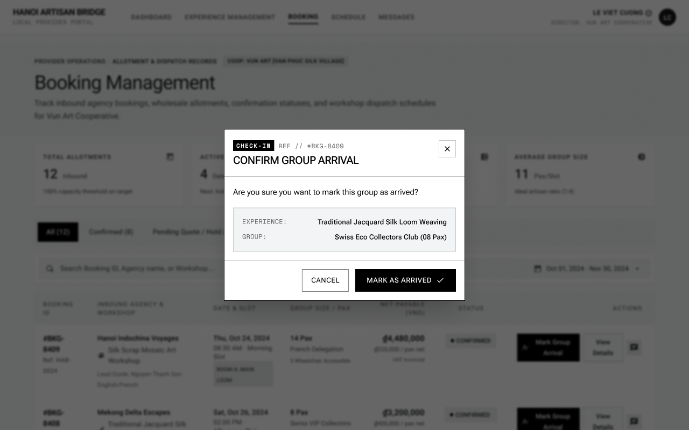

# Screen Spec: BKG136 Confirm Group Arrival

| Field | Value |
|---|---|
| Screen ID | `BKG136` |
| Screen name | Confirm Group Arrival |
| Actor | Local Provider |
| Priority | Must |
| Belongs to module | `spec-BKG.md` |
| Mockup image | `img/BKG136.png` |
| Status | Revised — pending human approval |

## 1. Purpose

Allows the Local Provider to confirm group arrival and update the booking progress/status.

The controls and decisions below define the current screen specification.

## 2. Mockup

## 3. Element inventory

| # | Element | Type | Content / data source | Required | Validation |
|---|---|---|---|---|---|
| 1 | Confirm Group Arrival | Heading | Confirm Group Arrival | No | Static screen title |
| 2 | Booking id | System context (not editable) | `booking_id` — F-SCHED-06 | Yes | booking_id (ID; Required — status must be Booked and start date reached) |
| 3 | Selected booking and scheduled start | Read-only panel | F-SCHED-06 — permitted output fields only | No | Actor-specific field visibility; optional missing values omitted. Never expose tokens, password hashes, session values or internal delivery diagnostics. |
| 4 | Confirm group arrival explanation | Read-only panel | F-SCHED-06 — permitted output fields only | No | Actor-specific field visibility; optional missing values omitted. Never expose tokens, password hashes, session values or internal delivery diagnostics. |
| 5 | Confirm Group Arrival | Button / navigation | Single occurrence; Booked→Completed through F-SCHED-06 only | No | Enabled only when the linked permission/validation guard succeeds |
| 6 | Cancel | Button / navigation | No mutation | No | Enabled only when the linked permission/validation guard succeeds |

## 4. States

| State | What the user sees | Trigger |
|---|---|---|
| Default | Permitted data or a prefilled form; role-specific actions only | Authorized screen load |
| Empty | No records/optional values shown with explanatory text; never infer availability from absent bookings | Successful response with no data |
| Loading | Skeleton/progress; mutation actions disabled while their request is pending | Fetch/upload/save in progress |
| Error | Defined field errors or fetch failure with Retry; no successful transition or partial mutation is shown | Validation, permission or service failure |
| Success / confirmation | Refreshed read-only data or saved result; navigate only after successful linked action | Successful read/mutation |

## 5. Interactions and navigation

| # | Element | User action | System response | Goes to screen |
|---|---|---|---|---|
| 1 | Confirm Group Arrival | Select | Single occurrence; Booked→Completed through F-SCHED-06 only | BKG135 |
| 2 | Cancel | Select | No mutation | BKG135 |

Shared avatar navigation for authenticated actors: My Account → ACC129; My Business → PRF019 (Agency) / PRF127 (Provider), omitted for Admin without a business; Logout → AUT026. Agency main navigation uses EXP017/AIT121/BKG137/SCH141/COM048; Provider uses DSH018/EXP067/BKG133/SCH139/COM065; Admin uses ADM079/ADM095. Guest has EXP120 and AUT009/REG003, with no AI navigation.

## 6. Screen-level rules

| Rule ID | Rule | Source |
|---|---|---|
| SR-001 | Check action permission and resource scope on every protected request; hiding a button alone is insufficient. Read-only screens have no mutation controls. | AUT FR-016 |
| SR-002 | Validate the inputs and render outputs exactly as the linked module contracts; server/context fields are not freely editable form controls. | Linked FR table |
| SR-003 | Preserve the current approved rule: arrival on/after start_at changes Booked→Completed for one occurrence. Separating arrival and service completion is deferred, not silently introduced. | Function List and shared consistency contract |

## 7. Linked requirements

| Module | FR ID | Function ID | Screen responsibility |
|---|---|---|---|
| BKG | FR-006 | F-SCHED-06 | Mark Group Arrival |

## 8. Responsive and accessibility notes

- Smallest supported width: 360px
- What collapses or stacks on a narrow screen: modal becomes full-width/near-full-height with the same vertical stacking of elements; Cancel and Mark as Arrived buttons may stack full-width instead of side by side
- Text that must remain readable (contrast, minimum size): the confirmation question and info card values must remain legible; the dimmed overlay must retain enough contrast against the modal so the modal edges are clear

## 9. Decisions and review

Use the approved Function List and [shared consistency contract](../docs/consistency-contract.md). No new feature is implied by decorative legacy mockup copy. Human approval of this revision is pending; technical Plan choices remain separately identified.

## Completion checklist

- [x] Linked functions have corresponding module FR and IO contracts.
- [x] Inputs name their validation and required/optional condition.
- [x] Default, empty, loading, error and success states are defined.
- [x] Navigation targets use existing Screen IDs.
- [ ] Human approval of the revised specification.
