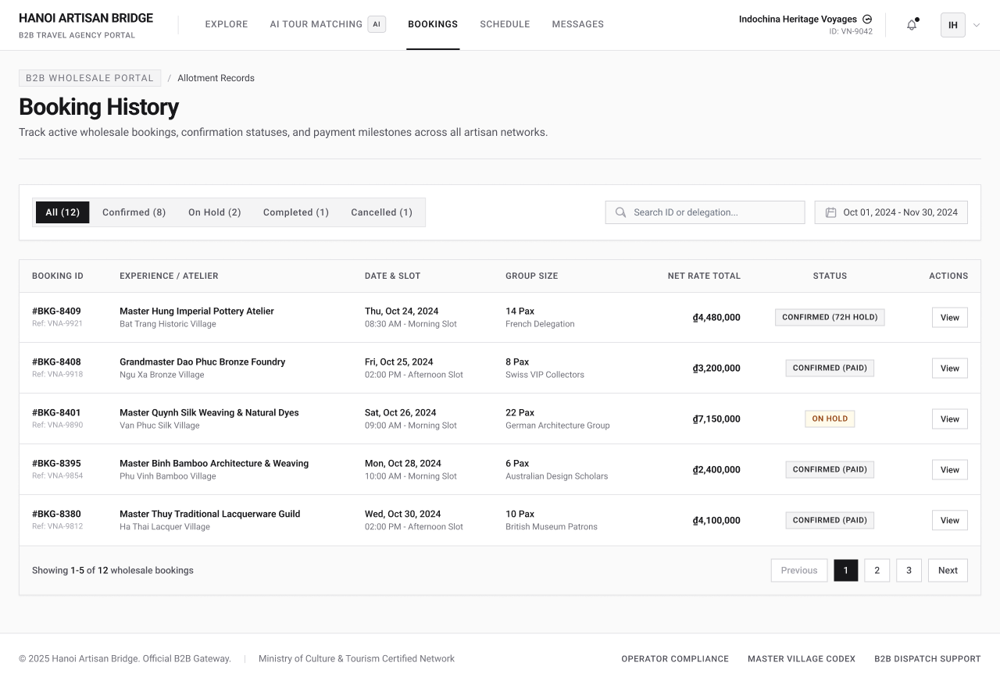

# Screen Spec: BKG137 Booking History

| Field | Value |
|---|---|
| Screen ID | `BKG137` |
| Screen name | Booking History |
| Actor | Tour Agency |
| Priority | Must |
| Belongs to module | `spec-BKG.md` |
| Mockup image | `img/BKG137.png` |
| Status | Revised — pending human approval |

## 1. Purpose

Lists the Agency's bookings by status, On hold, Booked, Completed and Cancelled.

The controls and decisions below define the current screen specification.

## 2. Mockup

## 3. Element inventory

| # | Element | Type | Content / data source | Required | Validation |
|---|---|---|---|---|---|
| 1 | Booking History | Heading | Booking History | No | Static screen title |
| 2 | Own Agency bookings: On hold, Booked, Completed, Cancelled | Read-only panel | F-SCHED-02 — permitted output fields only | No | Actor-specific field visibility; optional missing values omitted. Never expose tokens, password hashes, session values or internal delivery diagnostics. |
| 3 | Status/date filters | Read-only panel | F-SCHED-02 — permitted output fields only | No | Actor-specific field visibility; optional missing values omitted. Never expose tokens, password hashes, session values or internal delivery diagnostics. |
| 4 | Booking detail | Button / navigation | Own Agency read-only record | No | Enabled only when the linked permission/validation guard succeeds |
| 5 | Schedule | Button / navigation | Own schedule | No | Enabled only when the linked permission/validation guard succeeds |

## 4. States

| State | What the user sees | Trigger |
|---|---|---|
| Default | Permitted data or a prefilled form; role-specific actions only | Authorized screen load |
| Empty | No records/optional values shown with explanatory text; never infer availability from absent bookings | Successful response with no data |
| Loading | Skeleton/progress; mutation actions disabled while their request is pending | Fetch/upload/save in progress |
| Error | Defined field errors or fetch failure with Retry; no successful transition or partial mutation is shown | Validation, permission or service failure |
| Success / confirmation | Refreshed read-only data or saved result; navigate only after successful linked action | Successful read/mutation |

## 5. Interactions and navigation

| # | Element | User action | System response | Goes to screen |
|---|---|---|---|---|
| 1 | Booking detail | Select | Own Agency read-only record | BKG138 |
| 2 | Schedule | Select | Own schedule | SCH141 |

Shared avatar navigation for authenticated actors: My Account → ACC129; My Business → PRF019 (Agency) / PRF127 (Provider), omitted for Admin without a business; Logout → AUT026. Agency main navigation uses EXP017/AIT121/BKG137/SCH141/COM048; Provider uses DSH018/EXP067/BKG133/SCH139/COM065; Admin uses ADM079/ADM095. Guest has EXP120 and AUT009/REG003, with no AI navigation.

## 6. Screen-level rules

| Rule ID | Rule | Source |
|---|---|---|
| SR-001 | Check action permission and resource scope on every protected request; hiding a button alone is insufficient. Read-only screens have no mutation controls. | AUT FR-016 |
| SR-002 | Validate the inputs and render outputs exactly as the linked module contracts; server/context fields are not freely editable form controls. | Linked FR table |

## 7. Linked requirements

| Module | FR ID | Function ID | Screen responsibility |
|---|---|---|---|
| BKG | FR-002 | F-SCHED-02 | Display Private Schedule |

## 8. Responsive and accessibility notes

- Smallest supported width: 360px
- What collapses or stacks on a narrow screen: the table becomes horizontally scrollable or collapses to stacked cards per booking; search and date range stack above the filter tabs
- Text that must remain readable (contrast, minimum size): status badges must retain sufficient contrast at small size

## 9. Decisions and review

Use the approved Function List and [shared consistency contract](../docs/consistency-contract.md). No new feature is implied by decorative legacy mockup copy. Human approval of this revision is pending; technical Plan choices remain separately identified.

## Completion checklist

- [x] Linked functions have corresponding module FR and IO contracts.
- [x] Inputs name their validation and required/optional condition.
- [x] Default, empty, loading, error and success states are defined.
- [x] Navigation targets use existing Screen IDs.
- [ ] Human approval of the revised specification.
