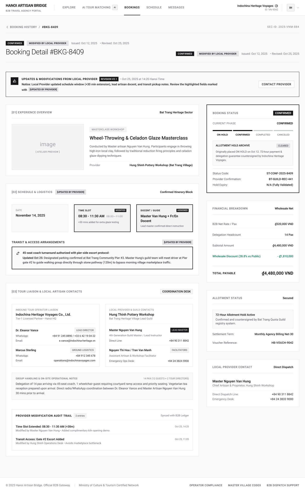

# Screen Spec: BKG138 Booking Detail

| Field | Value |
|---|---|
| Screen ID | `BKG138` |
| Screen name | Booking Detail |
| Actor | Tour Agency |
| Priority | Must |
| Belongs to module | `spec-SCH.md` |
| Mockup image | `img/BKG138.png` |
| Status | Draft |

## 1. Purpose

**Shown when:** The Tour Agency user clicks "View" on a row in BKG137 (Booking History).

**The user leaves this screen when:** They click "Booking History" breadcrumb (→ BKG137) or "Contact Provider" (→ COM065 Chat).

## 2. Mockup

## 3. Element inventory

| # | Element | Type | Content / data source | Required | Validation |
|---|---|---|---|---|---|
| 1 | Top nav bar | Header | Logo, nav links, Agency identity (name + Portal ID + avatar) | Yes | — |
| 2 | Breadcrumb | Link | "< Booking History / #BKG-8409" | Yes | Navigates to BKG137 |
| 3 | Security ID | Text | "SEC-ID: 2025-VNM-884" | No | Read-only system identifier |
| 4 | Status badges (top strip) | Badge group | "Confirmed", "Modified by Local Provider", Issued/Revised dates | Yes | Reflects current booking state |
| 5 | Page title | Header | "Booking Detail #BKG-8409" | Yes | — |
| 6 | Status badges (duplicate, header row) | Badge group | Same as #4, repeated near the title | Yes | Must always match #4 |
| 7 | Update banner | Alert banner | "Updates & Modifications from Local Provider", revision tag ("Revision V2.1"), timestamp, notice text describing what changed, list of "[Updated by Provider]" fields | No | Shown only on the Agency's first view of this screen after the provider has modified the booking; clears automatically after that first view |
| 8 | Contact Provider button | Button | Inside the update banner | No | Opens chat with the provider |
| 9 | Section [01] Experience Overview | Header | Section label + "Bat Trang Heritage Sector" | Yes | — |
| 10 | Atelier preview image | Image | Placeholder / actual Experience photo | No | — |
| 11 | Experience type tag | Badge | "Masterclass Workshop" | No | — |
| 12 | Experience title | Text | "Wheel-Throwing & Celadon Glaze Masterclass" | Yes | Matches selected Experience |
| 13 | Experience description | Text | Full description paragraph | No | — |
| 14 | Provider name | Text | "Hung Shinh Pottery Workshop (Bat Trang Village)" | No | Read-only |
| 15 | Panel: Booking Status | Card | "Confirmed" badge, Current Phase label, stepper (On Hold / Confirmed / Completed / Canceled), Allotment Hold Archive note, Status Code, Provider Confirmation code, Hold Expiry | Yes | Stepper reflects forward-only lifecycle; must match provider's view |
| 16 | Section [02] Schedule & Logistics | Header | "[Updated by Provider]" tag; "Confirmed Itinerary Block" | Yes | — |
| 17 | Date card | Card | Confirmed date | Yes | — |
| 18 | Time Slot card | Card | Time range with "Modified" tag and struck-through prior value | Yes | — |
| 19 | Docent/Guide card | Card | Assigned docent name + "Assigned" tag | Yes | — |
| 20 | Transit & Access Arrangements | Text block | "[Updated by Provider]" tag; free text on coach/parking/access, with an "Updated Oct 25" inline note | No | — |
| 21 | Panel: Financial Breakdown | Card | "Wholesale Net" tag; B2B Net Rate/Pax, Delegation Headcount, Subtotal, Wholesale Discount (highlighted green, with %), Total Payable (large highlighted figure) | Yes | Total = Subtotal − Discount |
| 22 | Panel: Allotment Status | Card | "Secured" badge, 72-Hour Allotment Hold note, Settlement Term, Voucher Reference | No | Read-only |
| 23 | Section [03] Tour Liaison & Local Artisan Contacts | Header | "Coordination Desk" tag | Yes | — |
| 24 | Inbound Tour Operator Liaison card | Card | Agency name, tier badge, Lead Director (name, WhatsApp, email, role tag), Ground Logistics contact (name, WhatsApp, email, role tag) | No | Read-only, this is the Agency's own info |
| 25 | Local Provider & Guild Contacts card | Card | Provider name, village lead guild label, Lead Master Artisan (name, phone, role tag), Facilitators (names, emergency ops phone, role tag) | No | Read-only |
| 26 | Group Handling & On-site Operational Notes | Text block | Pax breakdown + free-text notes | No | — |
| 27 | Panel: Local Provider Contact | Card | "Direct Dispatch" tag, Master Artisan name/role, Direct Dispatch Line, Emergency Desk | No | Read-only |
| 28 | Provider Modification Audit Trail | List | "2 entries" tag, "Synced with B2B Ledger" note, timestamped entries with description of who modified and why | No | Read-only, append-only log |
| 29 | Footer | Footer | Company info, links, copyright | No | — |

## 4. States

| State | What the user sees | Trigger |
|---|---|---|
| Default | Fully populated read-only detail for a Confirmed booking, no pending provider updates (update banner hidden) | Booking exists, loads successfully, and no unseen modifications |
| Empty (no data) | Not applicable — this screen is only reachable from an existing booking record in BKG137 | N/A |
| Loading | Section skeletons for Experience Overview, Schedule & Logistics, Financial Breakdown while the booking record loads | Screen mount before data returns |
| Error | Full-page error message ("Booking not found" or "Couldn't load this booking") with a link back to Booking History | Invalid booking ID, or network/API failure |
| Success / confirmation | The "Updates & Modifications from Local Provider" banner appears with changed fields tagged "[Updated by Provider]", as shown in the mockup | Local Provider has edited this booking (e.g. via BKG144) since the Agency last viewed it |

## 5. Interactions and navigation

| # | Element | User action | System response | Goes to screen |
|---|---|---|---|---|
| 1 | Breadcrumb "Booking History" | tap | Returns to the list | `BKG137` |
| 2 | Contact Provider button | tap | Opens the chat thread with this booking's Local Provider | `COM065` |
| 3 | Village/Provider name links | tap | Opens the provider's public profile (if linked in the actual build) | `PRF127` (if applicable) |

## 6. Screen-level rules

| Rule ID | Rule | Source |
|---|---|---|
| SR-001 | This is a read-only view for the Agency — there are no edit or status-change controls; all changes originate from the Local Provider (BKG144) | Mockup: no Edit/Status controls present, only Contact Provider |
| SR-002 | The update banner and "[Updated by Provider]" tags clear automatically after the Agency's first view of the screen following the change — no explicit "acknowledge" action is required | Clarification (Module 5) |
| SR-005 | The Agency cannot dispute or reject a provider-made modification from this screen; any concern about a change can only be raised via Chat with the provider | Clarification (Module 5) |
| SR-003 | The Booking Status stepper only ever advances left to right and must always match the Local Provider's view of the same booking (BKG135) | Cross-screen consistency |
| SR-004 | Financial figures here (wholesale rate, discount, total payable) must reconcile with the Local Provider's Net Payable figure on BKG135 for the same booking | Data integrity across both portals |

## 7. Linked requirements

| FR ID (from the module spec) | What this screen does for it |
|---|---|
| FR-007 | Displays full Booking Detail in read-only mode for the Tour Agency (F-SCHED-07) |
| FR-008 | Surfaces the synchronized provider-initiated modifications via the update banner and "[Updated by Provider]" tags (F-SCHED-08) |

## 8. Responsive and accessibility notes

- Smallest supported width: 360px
- What collapses or stacks on a narrow screen: the two-column layout (main content left, status/financial/contact panels right) stacks to a single column
- Text that must remain readable (contrast, minimum size): "[Updated by Provider]" tags and the update banner must remain visually distinct (not color alone) so changes are not missed by colorblind users

## 9. Open questions

| # | Question | Blocking? | Status |
|---|---|---|---|
| 1 | [NEEDS CLARIFICATION: What triggers the update banner to disappear — a timer, an explicit "acknowledge" action, or simply the first view after the change?] **Resolved:** Simply the first view after the change; no timer or explicit acknowledge action. | Yes | Resolved |
| 2 | [NEEDS CLARIFICATION: Can the Agency dispute or reject a provider-made modification from this screen, or only discuss it via Chat?] **Resolved:** Only via Chat; no dispute/reject action exists on this screen. | Yes | Resolved |

---

## Completion checklist

- [x] The mockup is a separate cropped image file, named with the Screen ID.
- [x] Every visible element in the mockup appears in the element inventory.
- [x] Every input element has a validation rule or an explicit "none".
- [x] All five states are filled in, or marked "not applicable" with a reason.
- [x] Every navigation target is a Screen ID that exists in the Screen List.
- [x] Every element that displays data names the field it displays, matching the module spec.
