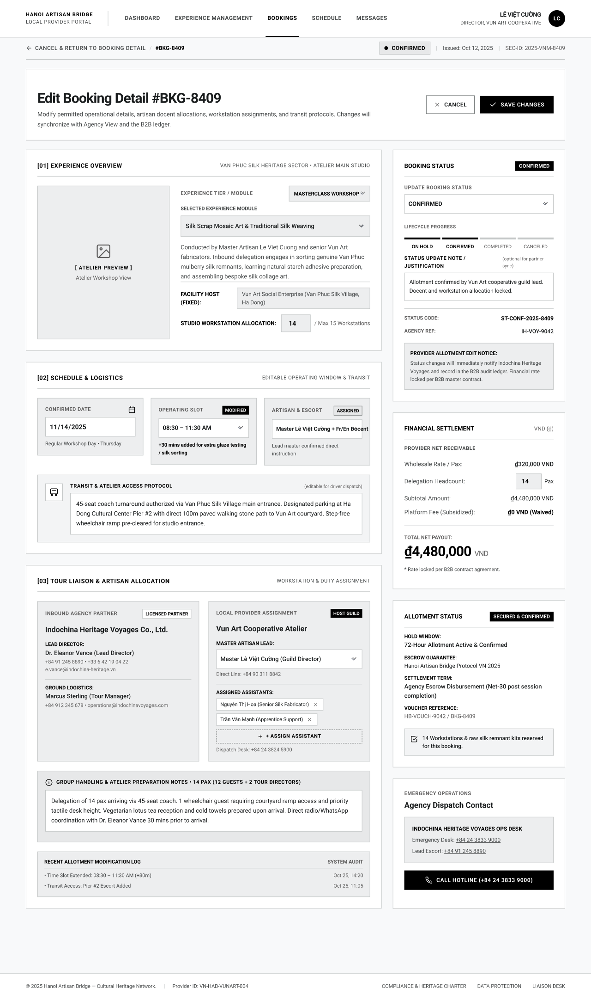

# Screen Spec: BKG144 Edit Booking Detail

| Field | Value |
|---|---|
| Screen ID | `BKG144` |
| Screen name | Edit Booking Detail |
| Actor | Local Provider |
| Priority | Must |
| Belongs to module | `spec-BKG.md` |
| Mockup image | `img/BKG144.png` |
| Status | Draft |

## 1. Purpose

**Shown when:** An authorized Local Provider user — specifically, only the account with the Director role — clicks "Edit Booking Detail" from BKG135 (Booking Detail).

**The user leaves this screen when:** They click "Save Changes" (changes persist, returns to BKG135 with updates reflected) or "Cancel" / "Cancel & Return to Booking Detail" (discards changes, returns to BKG135).

## 2. Mockup

## 3. Element inventory

| # | Element | Type | Content / data source | Required | Validation |
|---|---|---|---|---|---|
| 1 | Top nav bar | Header | Logo, nav links (Dashboard / Experience Management / Bookings active / Schedule / Messages), user identity | Yes | — |
| 2 | Breadcrumb | Link | "← Cancel & Return to Booking Detail / #BKG-8409" | Yes | Acts as Cancel; navigates to BKG135 |
| 3 | Status badge strip | Badge group | "Confirmed", Issued date, SEC-ID | Yes | Read-only, mirrors BKG135 |
| 4 | Page title | Header | "Edit Booking Detail #BKG-8409" | Yes | — |
| 5 | Page description | Text | Static instructional subtitle re: sync with Agency View and B2B ledger | No | — |
| 6 | Cancel button | Button | Secondary, top-right | Yes | Discards changes, returns to BKG135 |
| 7 | Save Changes button | Button | Primary, top-right | Yes | Enabled once at least one field is validly changed; disabled if any field invalid |
| 8 | Section [01] Experience Overview | Header | Section label + location tag | Yes | — |
| 9 | Atelier preview image | Image | Existing Experience photo | No | Read-only |
| 10 | Experience Tier / Module dropdown | Input (select) | "Masterclass Workshop" | Yes | Must select a valid tier |
| 11 | Selected Experience Module dropdown | Input (select) | "Silk Scrap Mosaic Art & Traditional Silk Weaving" | Yes | Must be one of provider's published Experiences |
| 12 | Experience description (read-only) | Text | Auto-derived from selected Experience | No | Read-only |
| 13 | Facility Host (fixed) | Text (read-only) | "Vun Art Social Enterprise (Van Phuc Silk Village, Ha Dong)" | No | Not editable ("FIXED" label) |
| 14 | Studio Workstation Allocation | Input (number) | 14 / Max 15 Workstations | Yes | Must be ≥ headcount and ≤ studio max (15) |
| 15 | Section [02] Schedule & Logistics | Header | Section label + "Editable Operating Window & Transit" | Yes | — |
| 16 | Confirmed Date | Input (date) | 11/14/2025 + weekday helper text | Yes | Valid date |
| 17 | Operating Slot | Input (time range) | "08:30 – 11:30 AM" with "Modified" tag and note "+30 mins added for extra glaze testing / silk sorting" | Yes | End time after start time |
| 18 | Artisan & Escort | Input (select) | "Master Lê Việt Cường + Fr/En Docent", "Assigned" tag, helper note | Yes | Must select a valid artisan |
| 19 | Transit & Atelier Access Protocol | Textarea | Editable free text (marked "editable for driver dispatch") | No | Optional |
| 20 | Section [03] Tour Liaison & Artisan Allocation | Header | Section label + "Workstation & Duty Assignment" | Yes | — |
| 21 | Inbound Agency Partner card | Card (read-only) | Agency name, tier badge, Lead Director, Ground Logistics contact | No | Read-only |
| 22 | Local Provider Assignment card | Card | "Host Guild" badge; Master Artisan Lead dropdown (Master Lê Việt Cường); Direct Line (read-only); Assigned Assistants list with remove (×) per chip; "+ Assign Assistant" control; Dispatch Desk phone (read-only) | Yes (Lead) | Lead Artisan required; assistants optional, each chip removable |
| 23 | Group Handling & Atelier Preparation Notes | Textarea | Editable free text, pax breakdown heading | No | Optional |
| 24 | Recent Allotment Modification Log | List | "System Audit" tag, timestamped read-only entries | No | Read-only, append-only |
| 25 | Panel: Booking Status | Card | "Confirmed" badge (top); Update Booking Status dropdown; Lifecycle Progress stepper (On Hold / Confirmed / Completed / Canceled); Status Update Note/Justification textarea (optional); Status Code; Agency Ref; Provider Allotment Edit Notice text | Yes (status dropdown) | Status can move only through permitted predefined transitions (module spec Open Question 22); never reverts to a previous status |
| 26 | Panel: Financial Settlement | Card | Wholesale Rate/Pax (read-only); Delegation Headcount input (editable, 14 Pax); Subtotal Amount (computed); Platform Fee (read-only); Total Net Payout (computed, highlighted); footnote "Rate locked per B2B master contract" | Yes (headcount) | Headcount must be ≤ Studio Workstation Allocation; Subtotal/Total auto-recompute |
| 27 | Panel: Allotment Status | Card | "Secured & Confirmed" badge; Hold Window, Escrow Guarantee, Settlement Term, Voucher Reference; workstation reservation confirmation checkbox note | No | Read-only |
| 28 | Panel: Emergency Operations / Agency Dispatch Contact | Card | Ops desk name, Emergency Desk / Lead Escort links, "Call Hotline" button | No | Read-only, links are tel:/mailto: |
| 29 | Footer | Footer | Company info, Provider ID, links, copyright | No | — |

## 4. States

| State | What the user sees | Trigger |
|---|---|---|
| Default | Form pre-filled with the booking's current values, all editable fields enabled, Save Changes disabled until a change is made | Screen load with existing booking data |
| Empty (no data) | Not applicable — this screen only opens for an existing, fully-populated booking | N/A |
| Loading | Form fields show as skeletons/disabled while the current booking record loads; Save Changes and Cancel disabled until load completes | Screen mount before data returns |
| Error | Inline field-level errors under invalid inputs (e.g. "Headcount exceeds workstation allocation", "Status cannot move backward"); a banner error if the save API call fails, form remains editable for correction | Validation failure on Save, or save/API failure |
| Success / confirmation | Toast "Changes saved" and redirect to BKG135 showing the updated fields tagged as modified, with a new audit trail entry | Save Changes succeeds |

## 5. Interactions and navigation

| # | Element | User action | System response | Goes to screen |
|---|---|---|---|---|
| 1 | Selected Experience Module dropdown | select | Updates description and Facility Host display | stays on `BKG144` |
| 2 | Studio Workstation Allocation | type | Validates against studio max and current headcount | stays on `BKG144` |
| 3 | Operating Slot | edit | Recalculates window and flags "Modified" | stays on `BKG144` |
| 4 | + Assign Assistant | tap | Opens artisan picker, adds a removable chip | stays on `BKG144` |
| 5 | Update Booking Status dropdown | select | Changes the target status; Lifecycle Progress stepper updates preview | stays on `BKG144` |
| 6 | Delegation Headcount | type | Recalculates Subtotal Amount and Total Net Payout | stays on `BKG144` |
| 7 | Save Changes | tap | Validates all fields, persists changes, appends an audit trail entry, notifies the Agency | `BKG135` |
| 8 | Cancel / breadcrumb | tap | Discards unsaved changes (with confirmation if dirty) | `BKG135` |
| 9 | Call Hotline button | tap | Initiates a phone call | stays on `BKG144` (device dialer) |

## 6. Screen-level rules

| Rule ID | Rule | Source |
|---|---|---|
| SR-001 | Status can move only through permitted predefined transitions (On Hold → Confirmed → Completed; On Hold or Confirmed → Cancelled) and cannot revert to a previous status | Module spec Open Question 22 (Closed): wording changed from "forward-only" to "only permitted predefined transitions" specifically to allow direct cancellation |
| SR-002 | Delegation Headcount cannot exceed Studio Workstation Allocation, and Studio Workstation Allocation cannot exceed the studio's max capacity (15) | Mockup: "/ Max 15 Workstations" |
| SR-003 | Facility Host is always fixed/non-editable, tied to the provider's own profile | Mockup label "(FIXED)" |
| SR-004 | Any saved change must immediately sync to the Agency's view (BKG138) and the B2B audit ledger, and must be flagged there as provider-modified | Mockup page description: "Changes will synchronize with Agency View and the B2B ledger" |
| SR-005 | Financial totals (Subtotal, Total Net Payout) are always system-calculated from Rate × Headcount and are never directly editable | Financial integrity |
| SR-006 | Only the account with the Director role can access this screen and save changes — no other staff account under the cooperative | Clarification (Module 5) |
| SR-007 | Save Changes applies immediately with no extra confirmation step, even when the status is being advanced (e.g. Confirmed → Completed) | Clarification (Module 5) |
| SR-008 | If the Confirmed Date or Operating Slot is changed, the original reserved slot in Schedule (SCH139) is released and the new Date/Operating Slot is reserved in its place, subject to availability | Clarification (Module 5) |

## 7. Linked requirements

| FR ID (from the module spec) | What this screen does for it |
|---|---|
| FR-004 | Allows the Local Provider to update non-status booking details (date/time, artisan, headcount, notes) and synchronize affected schedules |
| FR-005 | Allows the Local Provider to perform only permitted booking status transitions (via the Update Booking Status dropdown) and synchronize resulting schedule changes |
| FR-008 | Propagates provider edits (both field changes and status changes) to the Agency's booking view and the B2B ledger |

## 8. Responsive and accessibility notes

- Smallest supported width: 360px
- What collapses or stacks on a narrow screen: the two-column layout (form left, status/financial/emergency panels right) stacks to a single column; the assistant-artisan chip list wraps
- Text that must remain readable (contrast, minimum size): "Modified"/"Assigned" tags and the status stepper must remain distinguishable at small size and not rely on color alone

## 9. Open questions

| # | Question | Blocking? | Status |
|---|---|---|---|
| 1 | [NEEDS CLARIFICATION: Which roles/users are "authorized" to edit a booking — only the Director, or any staff account under the cooperative?] **Resolved:** Only the Director. | Yes | Resolved |
| 2 | [NEEDS CLARIFICATION: Is there a confirmation step before Save Changes when the status is being advanced (e.g. Confirmed → Completed), given the change is irreversible?] **Resolved:** No, no additional confirmation step. | Yes | Resolved |
| 3 | [NEEDS CLARIFICATION: What happens to the reserved Schedule (SCH139) slot if the Date or Operating Slot is changed here?] **Resolved:** The original reserved slot is released and the new Date/Operating Slot is reserved, subject to availability. | Yes | Resolved |

---

## Completion checklist

- [x] The mockup is a separate cropped image file, named with the Screen ID.
- [x] Every visible element in the mockup appears in the element inventory.
- [x] Every input element has a validation rule or an explicit "none".
- [x] All five states are filled in, or marked "not applicable" with a reason.
- [x] Every navigation target is a Screen ID that exists in the Screen List.
- [x] Every element that displays data names the field it displays, matching the module spec.
