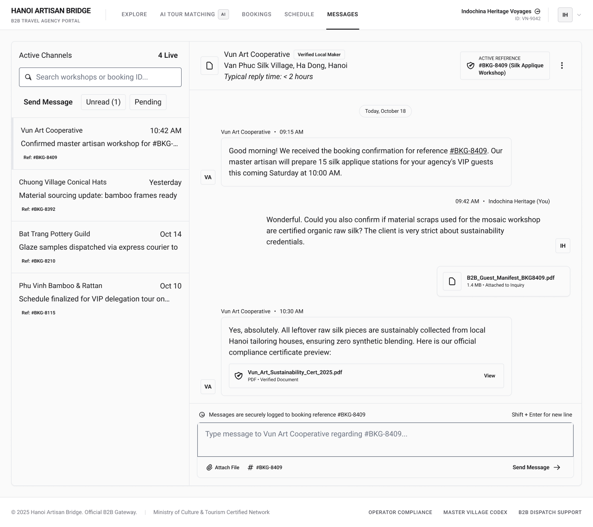

# Screen Spec: COM048 Chat (Tour Agency)

| Field | Value |
|---|---|
| Screen ID | `COM048` |
| Screen name | Chat (Tour Agency) |
| Actor | Tour Agency |
| Priority | Should |
| Belongs to module | ⚠️ Conflicting across drafts — see Open Question 1 (`spec-COM.md`, `spec-M04-EXPLORE.md`, or `spec-MOD3.md`) |
| Mockup image | `img/COM048.png` |
| Status | Draft |

## 1. Purpose

**Shown when:** The Tour Agency user opens Messages from the top nav, taps a channel row, or arrives via a "Request Quote" / "Chat with Provider" / "Direct Chat with Master" action from an Experience, Village/Provider page, or AI Tour Matching, to negotiate and clarify Experience/booking details in real time with a Local Provider / Craft Village partner.

**The user leaves this screen when:** They navigate away via the top nav (Explore, AI Tour Matching, Bookings, Schedule), open the Account Dropdown from the avatar, tap the Active Reference chip to open the related booking, tap "Attach File" to open Attach Document, or click through to a linked Provider Profile.

## 2. Mockup

## 3. Element inventory

| # | Element | Type | Content / data source | Required | Validation |
|---|---|---|---|---|---|
| 1 | App name / logo ("HANOI ARTISAN BRIDGE") | Header / Text | static text | No | — |
| 2 | Portal subtitle ("B2B TRAVEL AGENCY PORTAL") | Text | static text | No | — |
| 3 | Nav item "EXPLORE" | Button | static label | No | — |
| 4 | Nav item "AI TOUR MATCHING" + AI badge | Button | static label + feature badge | No | — |
| 5 | Nav item "BOOKINGS" | Button | static label | No | — |
| 6 | Nav item "SCHEDULE" | Button | static label | No | — |
| 7 | Nav item "MESSAGES" (active/underlined) | Button | static label, current-screen state | No | — |
| 8 | Account name + chevron (e.g. "Indochina Heritage Voyages") | Text / Button | `user.companyName` | No | — |
| 9 | Account ID (e.g. "ID: VN-9042") | Text | `user.accountId` | No | — |
| 10 | Avatar (initials) | Image / Button | `user.avatarInitials` | No | — |
| 11 | Panel title "Active Channels" | Header | static text | No | Count of channels with recent activity |
| 12 | Live count (e.g. "4 Live") | Text | count of channels with an open conversation | No | — |
| 13 | Search input ("Search workshops or booking ID...") | Input | search query string | No | Filters channel list client-side; no minimum character requirement |
| 14 | Filter tab "Send Message" (active) | Toggle | filter state | No | Only one filter active at a time |
| 15 | Filter tab "Unread (N)" | Toggle | count of unread channels | No | — |
| 16 | Filter tab "Pending" | Toggle | filter state | No | — |
| 17 | Channel list item (×N) | List item | `channel.partnerName`, `channel.lastMessageTime`, `channel.previewText` (truncated), `channel.bookingRef` ("Ref: #BKG-XXXX") | Yes (per item) | Selected item shows active/highlighted state |
| 18 | Chat header — partner name | Text | `channel.partnerName` | Yes | — |
| 19 | Badge "Verified Local Maker" | Text (badge) | `partner.verificationStatus` | No | — |
| 20 | Partner location (village + address) | Text | `partner.village` + `partner.address` | No | — |
| 21 | Reply-time note ("Typical reply time: < 2 hours") | Text | `partner.avgReplyTime` | No | — |
| 22 | Document/kebab icon beside partner header | Image / Button | static icon | No | — |
| 23 | Active Reference chip (booking/quote ref + Experience name) | Card / Text / Button | `channel.activeBookingRef`, `booking.experienceName` | Yes | Links the thread to a single booking/quote context |
| 24 | Overflow menu (⋮) | Button | Opens thread-level options — exact contents unresolved, see Open Question 2 | No | — |
| 25 | Date divider (e.g. "Today, October 18") | Text | `message.date` (grouped) | No | Auto-generated per day boundary |
| 26 | Incoming message bubble (Provider) | Text | avatar initials, `message.sender`, `message.timestamp`, `message.content` | Yes (per message) | Left-aligned |
| 27 | Outgoing message bubble (Agency, "You") | Text | avatar initials, `message.timestamp`, `message.content` | Yes (per message) | Right-aligned |
| 28 | Attached document/certificate card (in a message) | List item / Button / Card | `attachment.fileName`, `attachment.size`, optional tag ("Attached to Inquiry", "Verified Document") | No | Shown only when a message includes an attachment; opens/downloads or previews on tap |
| 29 | Footer note ("Messages are securely logged to booking reference #BKG-XXXX") | Text | static + `channel.activeBookingRef` | Yes | — |
| 30 | Helper text "Shift + Enter for new line" | Text | static text | Yes | — |
| 31 | Message composer textarea (placeholder "Type message to [Provider] regarding #BKG-XXXX...") | Input | draft message text | Yes, to send | Non-empty OR at least one attachment present; cannot send empty/whitespace-only |
| 32 | "Attach File" control | Button | Paperclip icon + "Attach File" | No | Opens the Attach Document flow, scoped to the active booking reference |
| 33 | Reference tag/chip in composer (e.g. "#BKG-XXXX") | Text (tag) / Button | `channel.activeBookingRef` | Yes | Read-only, mirrors Active Reference |
| 34 | "Send Message" button | Button | "Send Message →" | Yes | Disabled until the composer has text or a file is attached |
| 35 | Footer | Footer | Brand/copyright line, ministry note, links (Operator Compliance, Master Village Codex, B2B Dispatch Support) | Yes | — |

## 4. States

| State | What the user sees | Trigger |
|---|---|---|
| Default | Channel list populated; the most recently active channel is open in the right panel with its full thread and Active Reference chip | Agency has at least one existing conversation |
| Empty (no data) | Channel list shows a message such as "No conversations yet — start one from an Experience or Booking"; right panel shows a blank "Select a conversation" placeholder | New Agency account, or all channels filtered out by search/tab with none matching |
| Loading | Skeleton rows in the channel list and skeleton bubbles/thread in the right panel; input temporarily disabled while sending | Channel list or thread history is being fetched, or a message is being sent |
| Error | Channel list: banner "Unable to load conversations. Retry."; thread panel: inline banner "Unable to load messages" / "This conversation failed to load."; on send failure, the affected message bubble shows a red "Message failed to send — Retry" state | Network/API failure on list fetch, thread fetch, or message send |
| Success / confirmation | Sent message appears immediately with a "Sending…" indicator, then a delivered indicator once confirmed; composer clears; attached files show an upload-progress state, then the attached-file card | Message and/or attachment successfully sent |

## 5. Interactions and navigation

| # | Element | User action | System response | Goes to screen |
|---|---|---|---|---|
| 1 | Channel list item | tap | Loads that channel's thread into the right panel | stays (`COM048`) |
| 2 | Search input | type | Filters the channel list live by partner name or booking ID | stays |
| 3 | Filter tabs | tap | Filters channel list to that status | stays |
| 4 | Nav items (Explore / AI Tour Matching / Bookings / Schedule) | tap | Navigates to the corresponding module | Agency Explore / AI Tour Matching / Bookings / Schedule |
| 5 | Account name / avatar | tap | Opens the Account Dropdown | Account Dropdown (shared component) |
| 6 | Active Reference chip / booking ref chip | tap | Opens the booking this thread is scoped to | `BKG138` |
| 7 | Thread header (provider name) | tap | Opens the provider's profile | `DSC122` |
| 8 | Overflow menu (⋮) | tap | Opens thread options menu | see Open Question 2 |
| 9 | Attached file/document card | tap | Opens/downloads the file, or opens a preview (new tab) | stays |
| 10 | "Attach File" | tap | Opens the Attach Document modal, scoped to the active booking reference | `COM125` |
| 11 | Composer textarea | type | Updates the draft; enables Send Message when non-empty | stays |
| 12 | "Send Message" button | tap | Sends the message, appends it to the thread, clears the composer | stays |
| 13 | Footer links | tap | Navigates to the respective support/compliance page | external, no Screen ID |

## 6. Screen-level rules

| Rule ID | Rule | Source |
|---|---|---|
| SR-001 | "Send Message" stays disabled until the composer has text or at least one file is attached | Mockup, composer state |
| SR-002 | "Attach File" always opens `COM125` scoped to the channel's active booking reference | Mockup, Active Reference chip |
| SR-003 | Only one channel's thread can be open in the right panel at a time | Mockup layout |
| SR-004 | The Active Reference chip reflects the most recent booking/quote reference tied to the open channel | Mockup |
| SR-005 | Messages are grouped under date dividers | Mockup |
| SR-006 | Each chat channel is tied 1:1 to a booking/quote reference; an Agency cannot message a provider without an existing quote or booking context | Screen List / COM048 overview |
| SR-007 | The "Request Quote" action opens this screen and auto-sends the initial quote-request message; it can fire only once per Experience per Agency | Screen List, Quote Request row |
| SR-008 | Attachment type/size limits are governed by `COM125` | Screen List, COM125 |

## 7. Linked requirements

| FR ID (from the module spec) | What this screen does for it |
|---|---|
| `IAC FR-001` | Opens or reuses an authorized Chat session between the Tour Agency and Local Provider while retaining the relevant Experience/Booking/Quote context. |
| `IAC FR-002` | Allows the Tour Agency to send supported text messages and displays messages stored in the conversation history. |
| `IAC FR-003` | Displays the Tour Agency's Chat list, authorized message history, latest-message information, unread state and paginated history. |
| `IAC FR-005` | Provides the Attach File entry point and displays documents attached to the active Chat conversation. |

## 8. Responsive and accessibility notes

⚠️ **Draft conflict — not resolved, see Open Question 3.** One draft describes this as a desktop-first B2B portal not optimized below tablet; two other drafts describe it as responsive down to mobile. Both are recorded below pending clarification.

- Smallest supported width: **conflicting** — either 1024px (desktop-first B2B portal, not optimized below tablet landscape) or 360px (fully responsive to mobile)
- What collapses or stacks on a narrow screen: the left "Active Channels" panel collapses to an icon rail / slide-over drawer, or (in the mobile-first version) the two-pane layout collapses to a single pane — the channel list becomes a full-screen list, and selecting a channel pushes to a full-screen thread view with a back affordance; the Active Reference chip moves below the partner name
- Text that must remain readable (contrast, minimum size): message body text at minimum 14px with WCAG AA contrast against bubble background; timestamps and metadata may drop to 12px but must retain AA contrast (one draft additionally flags the "Typical reply time" microcopy as currently low-contrast and needing a fix)

## 9. Open questions

| # | Question | Blocking? | Status |
|---|---|---|---|
| 1 | The three source drafts disagree on "Belongs to module": `spec-COM.md`, `spec-M04-EXPLORE.md`, and `spec-MOD3.md` (Module 3: AI Tour Matching) were each given independently. Which module spec is authoritative for this screen? | Yes | Open |
| 2 | What options does the overflow/kebab menu (⋮) expose? Drafts disagree — one says generic "mute, export thread", another specifies exactly "View Shared Files" and "Report Conversation", a third flags it as unresolved. | Yes | Open |
| 3 | Is this screen desktop-first (min width 1024px, not optimized for mobile) or fully responsive down to 360px? Drafts directly conflict on this. | Yes | Open |
| 4 | Is message delivery real-time (WebSocket) or polled — affects how "Loading"/"Sending" states should be designed? | No | Open |
| 5 | Is there a per-message edit/delete or "message read" indicator not shown in the mockup? — **Answer (from one draft):** No. The chat does not support per-message edit/delete or read indicators; messages can only be sent and viewed. | No | Resolved (per one draft; confirm against final module spec) |
| 6 | Character limit, if any, on the composer textarea? — **Answer (from one draft):** No specific character limit is defined. | No | Resolved (per one draft; confirm against final module spec) |

---

## Completion checklist

- [x] The mockup is a separate cropped image file, named with the Screen ID.
- [x] Every visible element in the mockup appears in the element inventory.
- [x] Every input element has a validation rule or an explicit "none".
- [x] All five states are filled in, or marked "not applicable" with a reason.
- [ ] Every navigation target is a Screen ID that exists in the Screen List. *(kebab/overflow menu target still pending clarification — see Open Question 2)*
- [ ] Every element that displays data names the field it displays, matching the module spec. *(pending resolution of Open Question 1 — which module spec is authoritative)*

---

Template source: DBIZ3, VJCBI College - FTU, Session 4. Built on the DBIZ2 Screen Design
structure (Screen List and Screen Layout), per DBIZ3 Syllabus v3.

> **Merge note:** This file consolidates three independently drafted versions of the COM048 spec (`screen-spec-COM048.md`, `screen-spec-COM048(1).md`, `screen-spec-COM048(2).md`) found in the uploaded archive. Content was combined where drafts agreed or were complementary; genuine disagreements between drafts were preserved and flagged above as Open Questions rather than silently resolved.
