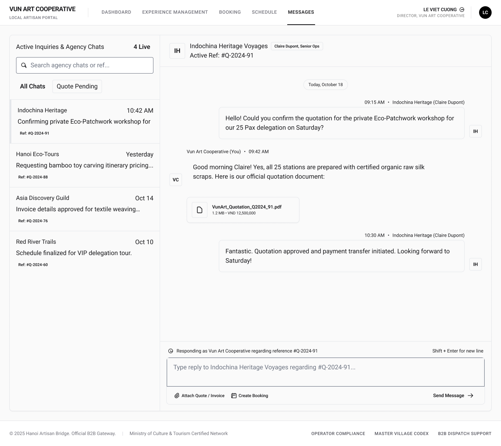

# Screen Spec: COM065 Chat (Local Provider)

| Field | Value |
|---|---|
| Screen ID | `COM065` |
| Screen name | Chat (Local Provider) |
| Actor | Local Provider |
| Priority | Should |
| Belongs to module | `spec-IAC.md` (In-app Chat — owns this screen's FRs: `IAC FR-001/002/003/004/005`). Unlike `COM048`, this screen is **not** listed under `spec-AIT.md` §7 "Screens involved" (AI Tour Matching's flow only reaches the Tour Agency side of Chat), and the `spec-M04-EXPLORE.md` attribution used in one draft doesn't hold up under review — that draft cites no Explore-specific field or FR anywhere in its own body (contrast `DSC033`, which genuinely cites `EXP FR-*` throughout). Treated as an inherited mislabel from the original 3-way "belongs to module" conflict, not a real second owner. |
| Mockup image | `img/COM065.png` |
| Status | Draft |

## 1. Purpose

**Shown when:** The Local Provider user opens Messages (or taps a channel row) after an Agency initiates contact — e.g. via a "Request Quote" action — or clicks into an existing agency conversation, to negotiate and clarify Experience/booking details in real time with a Tour Agency partner.

**The user leaves this screen when:** They navigate away via the top nav (Dashboard, Experience Management, Booking, Schedule), open the Account Dropdown from the avatar, tap "Create Booking" to hand off to Create Booking (`BKG134`), or tap "Attach Quote / Invoice" to open Attach Document (`COM126`).

## 2. Mockup

## 3. Element inventory

| # | Element | Type | Content / data source | Required | Validation |
|---|---|---|---|---|---|
| 1 | App name "VUN ART COOPERATIVE" | Header / Text | `partner.businessName` | No | — |
| 2 | Portal subtitle "LOCAL ARTISAN PORTAL" | Text | static text | No | — |
| 3 | Nav item "DASHBOARD" | Button | static label | No | — |
| 4 | Nav item "EXPERIENCE MANAGEMENT" | Button | static label | No | — |
| 5 | Nav item "BOOKING" | Button | static label | No | — |
| 6 | Nav item "SCHEDULE" | Button | static label | No | — |
| 7 | Nav item "MESSAGES" (active/underlined) | Button | static label, current-screen state | No | — |
| 8 | User name "LE VIET CUONG" + chevron | Text / Button | `user.fullName` | No | — |
| 9 | Role/business line "DIRECTOR, VUN ART COOPERATIVE" | Text | `user.role`, `user.businessName` | No | — |
| 10 | Avatar "LC" | Image / Button | `user.avatarInitials` | No | — |
| 11 | Panel title "Active Inquiries & Agency Chats" | Header | static text | No | — |
| 12 | Live count "4 Live" | Text | count of channels with an open conversation | No | — |
| 13 | Search input "Search agency chats or ref..." | Input | search query string | No | — |
| 14 | Filter tab "All Chats" (active) | Toggle | filter state | No | — |
| 15 | Filter tab "Quote Pending" | Toggle | filter state | No | — |
| 16 | Channel row — Indochina Heritage | List item | `channel.partnerName`, `channel.lastMessageTime`, `channel.previewText`, `channel.quoteRef` | No | — |
| 17 | Channel row — Hanoi Eco-Tours | List item | same fields as #16 | No | — |
| 18 | Channel row — Asia Discovery Guild | List item | same fields as #16 | No | — |
| 19 | Channel row — Red River Trails | List item | same fields as #16 | No | — |
| 20 | Chat header partner name "Indochina Heritage Voyages" | Text | `channel.partnerName` | No | — |
| 21 | Badge "Claire Dupont, Senior Ops" | Text (badge) | `partner.contactName`, `partner.contactRole` | No | — |
| 22 | Active reference "Active Ref: #Q-2024-91" | Text | `channel.activeQuoteRef` | No | — |
| 23 | Partner avatar "IH" (thread header) | Image | `partner.avatarInitials` | No | — |
| 24 | Date divider "Today, October 18" | Text | `message.date` (grouped) | No | — |
| 25 | Incoming message bubble, Indochina Heritage (Claire Dupont) 09:15 AM | Text | `message.content`, `message.sender`, `message.timestamp` | No | — |
| 26 | Sender avatar "IH" | Image | `partner.avatarInitials` | No | — |
| 27 | Outgoing message bubble, Vun Art Cooperative (You) 09:42 AM | Text | `message.content` | No | — |
| 28 | Own avatar "VC" | Image | `user.avatarInitials` | No | — |
| 29 | Attached file card "VunArt_Quotation_Q2024_91.pdf" (1.2 MB, "VND 12,500,000") | List item / Button | `attachment.fileName`, `attachment.size`, `attachment.amount` | No | — |
| 30 | Incoming message bubble, Indochina Heritage (Claire Dupont) 10:30 AM | Text | `message.content` | No | — |
| 31 | Footer note "Responding as Vun Art Cooperative regarding reference #Q-2024-91" | Text | static + `channel.activeQuoteRef` | No | — |
| 32 | Helper text "Shift + Enter for new line" | Text | static text | No | — |
| 33 | Message composer textarea (placeholder "Type reply to Indochina Heritage Voyages regarding #Q-2024-91...") | Input | draft message text | Yes, to send | Non-empty OR at least one attachment present; max 2,000 characters (`spec-IAC.md` §10 Q1) |
| 34 | "Attach Quote / Invoice" control | Button | — | No | — |
| 35 | "Create Booking" control | Button | — | No | — |
| 36 | "Send Message" button | Button | — | No | Disabled until #33 is non-empty or a file is attached |
| 37 | Footer copyright line | Text | static text | No | — |
| 38 | Footer links (Operator Compliance, Master Village Codex, B2B Dispatch Support) | Button / Text | static labels | No | — |

## 4. States

| State | What the user sees | Trigger |
|---|---|---|
| Default | Inquiry/chat list populated; the most recently active channel is open in the right panel with its full thread | Normal load, existing conversations present |
| Empty (no data) | "Active Inquiries & Agency Chats" list is empty (e.g. "No inquiries yet — Agencies will reach out after viewing your Experiences"); right panel shows a placeholder | New Local Provider account, or all channels filtered out with none matching |
| Loading | Skeleton rows in the channel list and a skeleton thread in the right panel | Initial screen load, or switching to a channel whose messages have not yet been fetched |
| Error | Inline banner in the thread panel ("Unable to load messages. Retry"); "Send Message" shows a failed/retry state if a send fails | Network or API failure on fetch or on send |
| Success / confirmation | Sent message (or attached quote) appears instantly at the bottom of the thread; composer clears; a successful "Create Booking" action shows a confirmation toast before navigating to Create Booking | Message, attachment, or booking action completed successfully |

## 5. Interactions and navigation

| # | Element | User action | System response | Goes to screen |
|---|---|---|---|---|
| 1 | Channel row (#16–19) | tap | Closes the currently open Chat session (per `IAC FR-004`) and loads the selected channel's thread into the right panel | stays (`COM065`) |
| 2 | Search input (#13) | type | Filters the channel list live by partner name or reference | stays |
| 3 | Filter tabs (#14–15) | tap | Filters channel list to that status | stays |
| 4 | Nav items (#3–6) | tap | Closes the currently open Chat session (per `IAC FR-004`) and navigates to the corresponding module | `DSH018` / `EXP067` / `BKG133` / `SCH139` |
| 5 | User name / avatar (#8, #10) | tap | Opens the Account Dropdown | Account Dropdown (shared component) |
| 6 | Attached file card (#29) | tap | Opens/downloads the file, or opens a preview | stays |
| 7 | "Attach Quote / Invoice" (#34) | tap | Opens the Attach Document modal, scoped to the active reference | `COM126` |
| 8 | "Create Booking" (#35) | tap | Opens Create Booking pre-filled with this Agency and Experience | `BKG134` |
| 9 | Composer textarea (#33) | type | Updates the draft; enables Send Message when non-empty | stays |
| 10 | "Send Message" button (#36) | tap | Sends the message, appends it to the thread, clears the composer | stays |
| 11 | Footer links (#38) | tap | Navigates to the respective support/compliance page | external, no Screen ID |

## 6. Screen-level rules

| Rule ID | Rule | Source |
|---|---|---|
| SR-001 | "Send Message" stays disabled until the composer has text or at least one file is attached | Mockup, composer state |
| SR-002 | "Attach Quote / Invoice" always opens `COM126` scoped to the channel's active reference | Mockup |
| SR-003 | "Create Booking" is always enabled/actionable from the Chat composer, regardless of negotiation status; it is not gated by an explicit agreement signal | Clarified answer, open question #1 |
| SR-004 | Only one channel's thread can be open in the right panel at a time | Mockup layout |
| SR-005 | Messages are grouped under date dividers | Mockup |
| SR-006 | The active Chat session is closed (`IAC FR-004`) whenever the Provider navigates away via the top nav or switches to a different channel row — there is no dedicated "End Chat" button; closing is a side effect of leaving the thread | Clarification |
| SR-007 | Each chat channel is tied 1:1 to a booking/quote reference; a Provider only sees threads initiated by an Agency against a specific inquiry | Screen List, COM065 overview |
| SR-008 | Attachment type/size limits are governed by `COM126` | Screen List, COM126 |
| SR-009 | This screen has no decline/close action for an inquiry — only messaging. If a Provider declines informally within the chat, the channel and thread continue as normal with no state change | Clarified answer, open question #2 |

## 7. Linked requirements

| FR ID (from the module spec) | What this screen does for it |
|---|---|
| `IAC FR-001` | Opens or reuses an authorized Chat session between the Local Provider and Tour Agency while retaining the relevant Experience/Booking/quote context. |
| `IAC FR-002` | Lets the Local Provider send supported text messages via the composer; each is stored in conversation history. |
| `IAC FR-003` | Displays the Provider's Chat list (Active Inquiries & Agency Chats), authorized message history, latest-message preview/timestamp, and paginated history. |
| `IAC FR-005` | Provides the Attach Quote / Invoice entry point (hands off to `COM126`) and displays documents attached to the active Chat conversation. |
| FR-BKG-01 | Initiating booking creation directly from Chat negotiation (control is always available, not gated by an agreement signal). *Not an IAC FR — this is a Schedule/Booking module requirement Chat merely provides the entry point for; the exact ID is still a placeholder pending the Schedule/Booking module spec.* |

`IAC FR-004` (close an active Chat session) is implemented implicitly, not as a dedicated "End Chat" button: navigating away via the top nav (#3–6) or switching to another channel row (#16–19) closes the current Chat session (SR-006).

## 8. Responsive and accessibility notes

- Smallest supported width: 1024px (desktop-first B2B portal; not optimized below tablet landscape)
- What collapses or stacks on a narrow screen: the left "Active Inquiries & Agency Chats" panel collapses to an icon rail or a slide-over drawer; "Attach Quote / Invoice" and "Create Booking" controls stack vertically under the composer
- Text that must remain readable (contrast, minimum size): message body text at minimum 14px with WCAG AA contrast against bubble background; the reference ID and quotation amount (VND) must stay legible/high-contrast at small sizes since they carry commercial significance; timestamps and other metadata may drop to 12px but must retain AA contrast

## 9. Open questions

| # | Question | Blocking? | Status |
|---|---|---|---|
| 1 | Does "Create Booking" remain visible/enabled before a quote has been explicitly agreed, or only after an agreement signal? — **Answer:** Always enabled — no agreement-signal precondition gates the control. | No | Resolved |
| 2 | Can a Provider decline/close an inquiry from this screen, and if so what happens to the channel? — **Answer:** No decline/close action exists on this screen — only chat. If the Provider declines informally within the conversation, the chat continues normally with no change to the channel state. | No | Resolved |
| 3 | Confirm the exact FR IDs and owning module — placeholders/conflicting module names (`spec-COM.md`, `spec-M04-EXPLORE.md`, `spec-MOD3.md`) were used across drafts. — **Answer:** Resolved by `spec-IAC.md`: `IAC FR-001` (open/reuse session), `IAC FR-002` (send message), `IAC FR-003` (Chat list/history), `IAC FR-005` (attach document). `FR-BKG-01` is not an IAC FR — it belongs to Schedule/Booking and remains a placeholder pending that module spec. `spec-M04-EXPLORE.md`/`spec-MOD3.md` are not owners for this screen (see header note). | No | Resolved |
| 4 | `spec-IAC.md` FR-004 requires that an authorized participant can close an active Chat session — how is that triggered on this screen? — **Answer:** Implicitly, not via a dedicated button: tapping a nav item (#3–6) or a different channel row (#16–19) closes the currently open Chat session (SR-006). Reopening the same channel later reuses the same session with its history intact, per `spec-IAC.md` §10 Q14/Q15. | No | Resolved |

---

## Completion checklist

- [x] The mockup is a separate cropped image file, named with the Screen ID.
- [x] Every visible element in the mockup appears in the element inventory.
- [x] Every input element has a validation rule or an explicit "none".
- [x] All five states are filled in, or marked "not applicable" with a reason.
- [x] Every navigation target is a Screen ID that exists in the Screen List.
- [x] Every element that displays data names the field it displays, matching the module spec.

---

Template source: DBIZ3, VJCBI College - FTU, Session 4. Built on the DBIZ2 Screen Design
structure (Screen List and Screen Layout), per DBIZ3 Syllabus v3.
