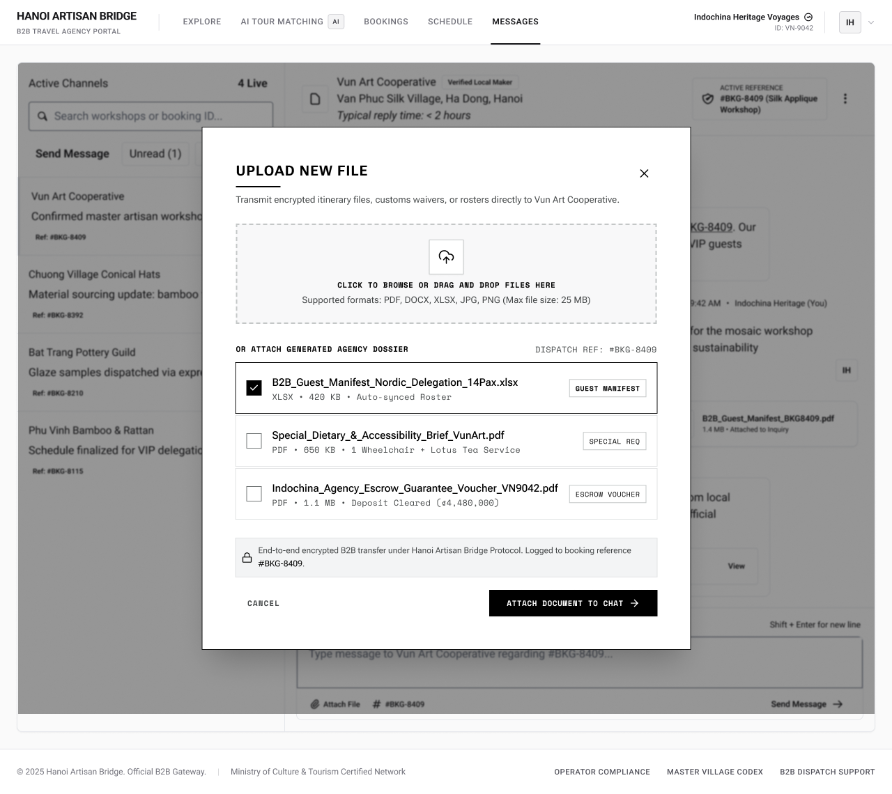

# Screen Spec: COM125 Attach Document (Tour Agency)

| Field | Value |
|---|---|
| Screen ID | `COM125` |
| Screen name | Attach Document (Tour Agency) |
| Actor | Tour Agency |
| Priority | Should |
| Belongs to module | `spec-IAC.md` |
| Mockup image | `img/COM125.png` |
| Status | Draft |

## 1. Purpose

**Shown when:** The Tour Agency user taps "Attach File" in the Chat composer (`COM048`), opening this modal over the current chat thread.

**The user leaves this screen when:** They tap the close (×) icon or "Cancel" to dismiss without attaching, or tap "Attach Document to Chat" to confirm and return to the thread with the file(s) appended.

## 2. Mockup

## 3. Element inventory

| # | Element | Type | Content / data source | Required | Validation |
|---|---|---|---|---|---|
| 1 | Modal title "UPLOAD NEW FILE" | Header | static text | No | — |
| 2 | Close (×) button | Button | — | No | — |
| 3 | Description "Transmit encrypted itinerary files, customs waivers, or rosters directly to Vun Art Cooperative." | Text | static text + `channel.partnerName` | No | — |
| 4 | Dropzone "CLICK TO BROWSE OR DRAG AND DROP FILES HERE" | Input (file upload) | user-selected local file | Conditionally required (required only if no generated dossier item is selected instead) | File type and size checked against #5 |
| 5 | Format/size note "Supported formats: PDF, DOCX, XLSX, JPG, PNG (Max file size: 25 MB)" | Text | static validation copy | No | — |
| 6 | Section label "OR ATTACH GENERATED AGENCY DOSSIER" | Header | static text | No | — |
| 7 | Dispatch reference tag "DISPATCH REF: #BKG-8409" | Text | `channel.activeBookingRef` | No | — |
| 8 | Dossier item 1 — "B2B_Guest_Manifest_Nordic_Delegation_14Pax.xlsx" (checked) | Toggle / List item | `doc.fileName`, `doc.type` = XLSX, `doc.size` = 420 KB, `doc.tag` = "GUEST MANIFEST" | No | — |
| 9 | Dossier item 2 — "Special_Dietary_&_Accessibility_Brief_VunArt.pdf" | Toggle / List item | `doc.fileName`, `doc.type` = PDF, `doc.size` = 650 KB, `doc.tag` = "SPECIAL REQ" | No | — |
| 10 | Dossier item 3 — "Indochina_Agency_Escrow_Guarantee_Voucher_VN9042.pdf" | Toggle / List item | `doc.fileName`, `doc.type` = PDF, `doc.size` = 1.1 MB, `doc.tag` = "ESCROW VOUCHER" | No | — |
| 11 | Security note (lock icon) "End-to-end encrypted B2B transfer under Hanoi Artisan Bridge Protocol. Logged to booking reference #BKG-8409." | Text | static + `channel.activeBookingRef` | No | — |
| 12 | "CANCEL" button | Button | — | No | — |
| 13 | "ATTACH DOCUMENT TO CHAT" button | Button | — | No | Disabled until at least one file is uploaded or selected (#4, #8–#10) |

## 4. States

| State | What the user sees | Trigger |
|---|---|---|
| Default | Modal open, dropzone empty, "B2B_Guest_Manifest_Nordic_Delegation_14Pax.xlsx" pre-selected as the most relevant generated document | User taps "Attach File" on `COM048` |
| Empty (no data) | Dropzone as normal, but the "OR ATTACH GENERATED AGENCY DOSSIER" section shows "No generated documents available for this booking" instead of a list | Active booking has no auto-generated dossier items yet |
| Loading | Spinner over the dropzone while a dragged/browsed file uploads; "Attach Document to Chat" shows a loading spinner after tap | File upload or attach action in progress |
| Error | Inline error text under the dropzone (e.g. "File exceeds 25 MB limit" or "Unsupported file type"); failed upload keeps the modal open with the offending file removed | Uploaded file fails format or size validation, or the attach request fails |
| Success / confirmation | Modal closes; chat thread (`COM048`) shows a new attached-file message bubble; brief toast "Document attached" | File(s) successfully attached |

## 5. Interactions and navigation

| # | Element | User action | System response | Goes to screen |
|---|---|---|---|---|
| 1 | Dropzone (#4) | click / drag-and-drop | Opens the OS file picker, or accepts the dropped file, and validates it | stays (`COM125`) |
| 2 | Dossier item checkbox (#8–10) | tap | Selects/deselects that file for attaching | stays |
| 3 | Close (×) (#2) | tap | Closes the modal, discards any selection | returns to `COM048` |
| 4 | "CANCEL" (#12) | tap | Closes the modal, discards any selection | returns to `COM048` |
| 5 | "ATTACH DOCUMENT TO CHAT" (#13) | tap | Attaches the selected/uploaded file(s) as a message on the active thread, closes the modal | returns to `COM048` |

## 6. Screen-level rules

| Rule ID | Rule | Source |
|---|---|---|
| SR-001 | "Attach Document to Chat" stays disabled until at least one file is uploaded or selected from the generated dossier list; multiple dossier items may be selected simultaneously (checkboxes, not radio buttons) | Mockup, button state; clarified answer, open question #1 |
| SR-002 | Only PDF, DOCX, XLSX, JPG, PNG files up to 25 MB are accepted | Mockup, format/size note |
| SR-003 | The modal is scoped to the active booking reference shown as "DISPATCH REF" | Mockup |
| SR-004 | Attaching closes the modal and returns focus to the Chat composer on `COM048` | Mockup, flow |

## 7. Linked requirements

| FR ID (from the module spec) | What this screen does for it |
|---|---|
| `IAC FR-005` | Allows an authorized Chat participant (Tour Agency) to upload or select one or more supported documents and attach them to an active Chat session. |

## 8. Responsive and accessibility notes

- Smallest supported width: 1024px (inherits the desktop-first constraint of its parent screen, `COM048`)
- What collapses or stacks on a narrow screen: the modal becomes full-screen instead of a centered dialog; dossier item rows stack their tag below the filename instead of beside it
- Text that must remain readable (contrast, minimum size): filename text at minimum 14px; tag labels (e.g. "GUEST MANIFEST") must retain WCAG AA contrast against their pill background

## 9. Open questions

| # | Question | Blocking? | Status |
|---|---|---|---|
| 1 | Can more than one dossier item be selected at once, or is selection single-choice as shown (only one checked)? — **Answer:** More than one dossier item can be selected at once (multi-select checkboxes); the mockup's single pre-checked item is only the default state, not a single-choice constraint. | No | Resolved |
| 2 | Confirm the exact FR ID(s) in `spec-COM.md` — placeholder used above. — **Answer:** Resolved by `spec-IAC.md`: `IAC FR-005` (attach document to Chat), consistent with `spec-IAC.md` BR-009 (PDF/DOCX/XLSX/JPG/PNG, 25 MB max — matches SR-002 below) and BR-010 (multi-select — matches SR-001/Open Question 1 below). | No | Resolved |

---

## Completion checklist

- [x] The mockup is a separate cropped image file, named with the Screen ID.
- [x] Every visible element in the mockup appears in the element inventory.
- [x] Every input element has a validation rule or an explicit "none".
- [x] All five states are filled in, or marked "not applicable" with a reason.
- [x] Every navigation target is a Screen ID that exists in the Screen List.
- [x] Every element that displays data names the field it displays, matching the module spec.
