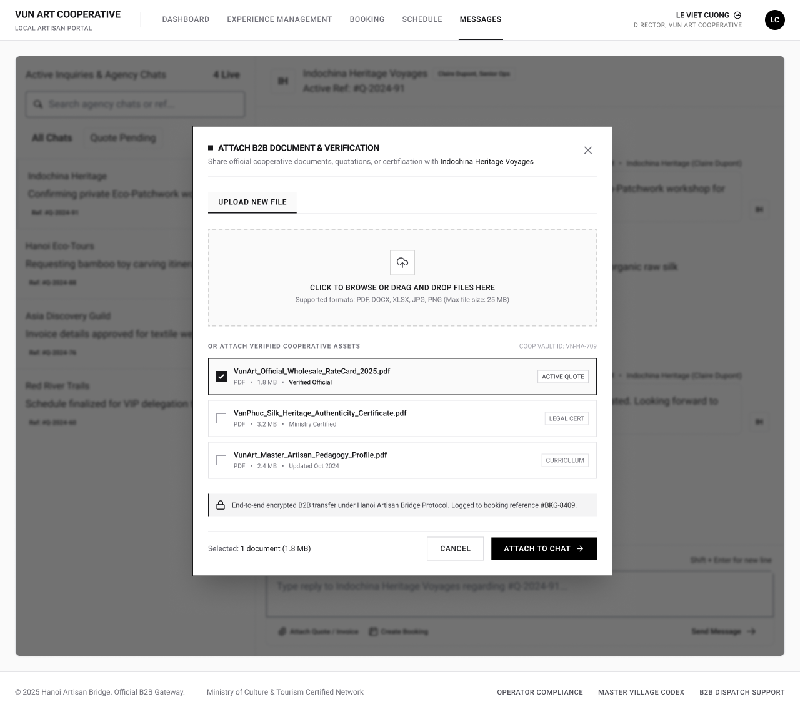

# Screen Spec: COM126 Attach Document (Local Provider)

| Field | Value |
|---|---|
| Screen ID | `COM126` |
| Screen name | Attach Document (Local Provider) |
| Actor | Local Provider |
| Priority | Should |
| Belongs to module | `spec-COM.md` |
| Mockup image | `img/COM126.png` |
| Status | Draft |

## 1. Purpose

**Shown when:** The Local Provider user taps "Attach Quote / Invoice" in the Chat composer (`COM065`), opening this modal over the current chat thread.

**The user leaves this screen when:** They tap the close (×) icon or "Cancel" to dismiss without attaching, or tap "Attach to Chat" to confirm and return to the thread with the file appended.

## 2. Mockup

## 3. Element inventory

| # | Element | Type | Content / data source | Required | Validation |
|---|---|---|---|---|---|
| 1 | Modal icon (small square) | Image | static icon | No | — |
| 2 | Modal title "ATTACH B2B DOCUMENT & VERIFICATION" | Header | static text | No | — |
| 3 | Close (×) button | Button | — | No | — |
| 4 | Description "Share official cooperative documents, quotations, or certification with Indochina Heritage Voyages" | Text | static text + `channel.partnerName` | No | — |
| 5 | Tab "UPLOAD NEW FILE" (active) | Toggle | active tab state | No | — |
| 6 | Dropzone "CLICK TO BROWSE OR DRAG AND DROP FILES HERE" | Input (file upload) | user-selected local file | Conditionally required (required only if no vault asset is selected instead) | File type and size checked against #7 |
| 7 | Format/size note "Supported formats: PDF, DOCX, XLSX, JPG, PNG (Max file size: 25 MB)" | Text | static validation copy | No | — |
| 8 | Section label "OR ATTACH VERIFIED COOPERATIVE ASSETS" | Header | static text | No | — |
| 9 | Vault reference tag "COOP VAULT ID: VN-HA-709" | Text | `provider.vaultId` | No | — |
| 10 | Vault item 1 — "VunArt_Official_Wholesale_RateCard_2025.pdf" (checked) | Toggle / List item | `doc.fileName`, `doc.type` = PDF, `doc.size` = 1.8 MB, `doc.status` = "Verified Official", `doc.tag` = "ACTIVE QUOTE" | No | — |
| 11 | Vault item 2 — "VanPhuc_Silk_Heritage_Authenticity_Certificate.pdf" | Toggle / List item | `doc.fileName`, `doc.type` = PDF, `doc.size` = 3.2 MB, `doc.status` = "Ministry Certified", `doc.tag` = "LEGAL CERT" | No | — |
| 12 | Vault item 3 — "VunArt_Master_Artisan_Pedagogy_Profile.pdf" | Toggle / List item | `doc.fileName`, `doc.type` = PDF, `doc.size` = 2.4 MB, `doc.status` = "Updated Oct 2024", `doc.tag` = "CURRICULUM" | No | — |
| 13 | Security note (lock icon) "End-to-end encrypted B2B transfer under Hanoi Artisan Bridge Protocol. Logged to booking reference #BKG-8409." | Text | static + `channel.activeBookingRef` | No | — |
| 14 | Selection summary "Selected: 1 document (1.8 MB)" | Text | dynamic count and total size of selected items | No | — |
| 15 | "CANCEL" button | Button | — | No | — |
| 16 | "ATTACH TO CHAT" button | Button | — | No | Disabled until at least one file is uploaded or selected (#6, #10–#12) |

## 4. States

| State | What the user sees | Trigger |
|---|---|---|
| Default | Modal open on the "Upload New File" tab, dropzone empty, "VunArt_Official_Wholesale_RateCard_2025.pdf" pre-selected as the most relevant vault asset, selection summary reflecting it | User taps "Attach Quote / Invoice" on `COM065` |
| Empty (no data) | Dropzone as normal, but "OR ATTACH VERIFIED COOPERATIVE ASSETS" shows "No verified assets in your vault yet" instead of a list; selection summary reads "Selected: 0 documents" | Provider's Coop Vault has no verified assets uploaded |
| Loading | Spinner over the dropzone while a dragged/browsed file uploads; "Attach to Chat" shows a loading spinner after tap | File upload or attach action in progress |
| Error | Inline error text under the dropzone (e.g. "File exceeds 25 MB limit" or "Unsupported file type"); failed upload keeps the modal open with the offending file removed | Uploaded file fails format or size validation, or the attach request fails |
| Success / confirmation | Modal closes; chat thread (`COM065`) shows a new attached-file message bubble; brief toast "Document attached" | File(s) successfully attached |

## 5. Interactions and navigation

| # | Element | User action | System response | Goes to screen |
|---|---|---|---|---|
| 1 | Dropzone (#6) | click / drag-and-drop | Opens the OS file picker, or accepts the dropped file, and validates it | stays (`COM126`) |
| 2 | Tab "UPLOAD NEW FILE" (#5) | tap | No-op / stays selected — this is the only tab in the modal, confirmed no other tabs exist | stays |
| 3 | Vault item checkbox (#10–12) | tap | Selects/deselects that asset for attaching; updates the selection summary (#14) | stays |
| 4 | Close (×) (#3) | tap | Closes the modal, discards any selection | returns to `COM065` |
| 5 | "CANCEL" (#15) | tap | Closes the modal, discards any selection | returns to `COM065` |
| 6 | "ATTACH TO CHAT" (#16) | tap | Attaches the selected/uploaded file(s) as a message on the active thread, closes the modal | returns to `COM065` |

## 6. Screen-level rules

| Rule ID | Rule | Source |
|---|---|---|
| SR-001 | "Attach to Chat" stays disabled until at least one file is uploaded or selected from the verified vault list; multiple vault assets may be selected simultaneously (checkboxes, not radio buttons) | Mockup, button state; clarified answer, open question #2 |
| SR-002 | Only PDF, DOCX, XLSX, JPG, PNG files up to 25 MB are accepted | Mockup, format/size note |
| SR-003 | The modal is scoped to the active booking/quote reference logged in the security note | Mockup |
| SR-004 | The selection summary always reflects the live count and combined size of currently selected/uploaded files | Mockup |
| SR-005 | Attaching closes the modal and returns focus to the Chat composer on `COM065` | Mockup, flow |

## 7. Linked requirements

| FR ID (from the module spec) | What this screen does for it |
|---|---|
| `IAC FR-005` | Allows the Local Provider to upload or select one or more supported documents and attach them to the active Chat conversation. |
## 8. Responsive and accessibility notes

- Smallest supported width: 1024px (inherits the desktop-first constraint of its parent screen, `COM065`)
- What collapses or stacks on a narrow screen: the modal becomes full-screen instead of a centered dialog; vault item rows stack their status/tag below the filename instead of beside it
- Text that must remain readable (contrast, minimum size): filename text at minimum 14px; status/tag labels (e.g. "ACTIVE QUOTE") must retain WCAG AA contrast against their pill background

## 9. Open questions

| # | Question | Blocking? | Status |
|---|---|---|---|
| 1 | The single visible tab "UPLOAD NEW FILE" implies other tabs may exist (e.g. a separate "Vault" tab) — confirm full tab set. — **Answer:** No other tabs exist. "UPLOAD NEW FILE" is the only tab available. | No | Resolved |
| 2 | Can more than one vault asset be selected at once, or is selection single-choice as shown (only one checked)? — **Answer:** More than one vault asset can be selected at once (multi-select checkboxes); the mockup's single pre-checked item and "Selected: 1 document" summary reflect only the default state. | No | Resolved |
| 3 | Confirm the exact FR ID(s) in `spec-COM.md` — FR IDs confirmed: IAC FR-001/002/003/005 as applicable. | No | Resolved — pending module spec (`spec-COM.md`) |

---

## Completion checklist

- [x] The mockup is a separate cropped image file, named with the Screen ID.
- [x] Every visible element in the mockup appears in the element inventory.
- [x] Every input element has a validation rule or an explicit "none".
- [x] All five states are filled in, or marked "not applicable" with a reason.
- [x] Every navigation target is a Screen ID that exists in the Screen List.
- [x] Every element that displays data names the field it displays, matching the module spec.
