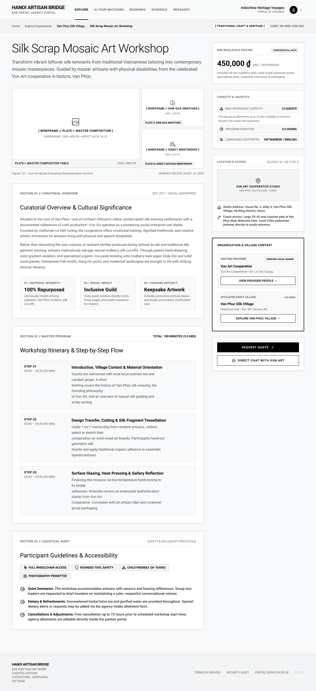

# Screen Spec: DSC033 Experience Detail

| Field | Value |
|---|---|
| Screen ID | `DSC033` |
| Screen name | Experience Detail |
| Actor | Tour Agency |
| Priority | Must |
| Belongs to module | `spec-EXP.md` (Explore — owns this screen's FRs, §7) **and** `spec-AIT.md` (AI Tour Matching — reaches this screen via AIT121's "View Experience Detail" action, listed in its own §7 "Screens involved"). Two source drafts previously described this screen under one module each; both are consolidated below rather than kept as separate copies. |
| Mockup image | `img/DSC033.png` |
| Status | Draft |

## 1. Purpose

**Shown when:** A Tour Agency clicks "View Details" on an Experience card from `EXP017`, `VIL030`, `DSC122`, or an AI Tour Matching result (`AIT121`'s "View Experience Detail" action), to view full details and take action (Chat, Request Quote).

**The user leaves this screen when:** they request a quote (opens Chat), start a direct chat, navigate to the Provider or Village, use the breadcrumb to go back, or open the Account Dropdown.

## 2. Mockup

## 3. Element inventory

| # | Element | Type | Content / data source | Required | Validation |
|---|---|---|---|---|---|
| 1 | Top nav bar | Header | Logo, Explore (active) / AI Tour Matching / Bookings / Schedule / Messages | Yes | — |
| 2 | Account info (top right) | Text/Button | Agency name, "Portal ID: #xxxx"; avatar opens Account Dropdown | Yes | — |
| 3 | Breadcrumb | Text/Button | "Home / Explore Experiences / [Village name] / [Experience name]" — each segment a link, non-clickable last crumb | Yes | — |
| 4 | Category tag + Experience code | Tag | Category label (e.g. "Traditional Craft & Heritage"), internal code (e.g. `VN-HND-VUN-042`) | Yes | — |
| 5 | Experience title | Header | Experience name, from `spec-EXP.md` §5.1 | Yes | — |
| 6 | Subtitle / short description | Text | 2–3 sentence intro summary | Yes | — |
| 7 | Image gallery (Plate I/II/III) | Image | Main plate (large) + 2 supporting plates, source/audit caption | Yes | Minimum 1 image, 3 recommended; falls back to placeholder set if no photos uploaded |
| 8 | Curatorial Overview section | Text | Eyebrow (est. year, org type) + heading + 2 cultural-context paragraphs | Yes | — |
| 9 | Impact stat card (×3) | Card | numbered label, title, short description (e.g. Material Integrity / Social Impact / Finished Artifact) | No | — |
| 10 | Workshop Itinerary section | List | heading + total duration; step rows (step number, time range, title, description) | Yes | Sum of step durations must equal the declared total/program duration |
| 11 | Participant Guidelines & Accessibility section | Tag/List | accessibility badges (e.g. Wheelchair Access, Child Friendly, tool safety, photography); bulleted rules (bold label + description: quiet demeanor, dietary, cancellation/adjustment policy) | Yes | — |
| 12 | B2B Wholesale Pricing card | Card | "Confidential Rate" badge, price per person, inclusions note. Governed by the pricing display rule (SR-004): Provider enters only the Listed Price; an authorized Admin may apply a discount and the system auto-calculates the final price. (a) Listed Price, no discount → show Listed Price. (b) Listed Price + discount → show original Listed Price struck through plus discounted final price. (c) No Listed Price → show "Contact for Quote" | Yes | Rendered only to authenticated, verified Tour Agencies (Guests see the public equivalent `DSC124` with pricing locked); price fields never directly editable by the Provider beyond Listed Price |
| 13 | Capacity & Logistics card | Card | Max capacity + private-group note, program duration, languages supported | Yes | — |
| 14 | Location & Access card | Card/Image | coordinates, map pin/placeholder, studio name/address, coach-access instructions | Yes | — |
| 15 | Organization & Village Context card | Card/Button | Hosting Provider sub-section (name, "Verified Local Maker" badge, director/contact line, "View Provider Profile →" button); Affiliated Craft Village sub-section (name, region tag, founding note, "Explore Village →" button) | Yes | — |
| 16 | "Request Quote" button | Button | "Request Quote >" (primary CTA); opens/creates a chat thread with the Experience's hosting Provider (same thread as "Direct Chat") and auto-sends the initial quote-request message | Yes | Disabled/relabeled "Quote Requested" while a quote thread for this Experience is Pending/In Negotiation; re-enables to its default state if that thread is later Declined or Closed; sendable once per Experience while active (Request Quote – Action) |
| 17 | "Direct Chat with [Provider]" button | Button | Opens/continues the same chat thread with the hosting Provider, without an auto-message | Yes | — |
| 18 | Footer | Footer | Brand/copyright, Terms of Service, Security Audit link, portal version | Yes | — |

## 4. States

| State | What the user sees | Trigger |
|---|---|---|
| Default | Fully populated Experience page: images, price, itinerary, accessibility, provider/village context, CTAs, as shown | Experience data resolves for a verified/published listing |
| Empty (no data) | Not applicable in the strict sense — this screen only renders once a specific Experience record is loaded. Optional/secondary blocks (gallery beyond the fallback set, stat cards, provider/village context) are omitted or show "No information provided" if the Provider hasn't filled them in; required fields (name, price, capacity) still render | Provider has not fully filled in the Experience |
| Loading | Skeleton blocks for gallery, pricing card, itinerary rows, and the Organization & Village Context card; header/breadcrumb render immediately | Experience data is being fetched |
| Error | Full-page message "This experience is no longer available." with a link back to Explore (unpublished/deleted); or an inline retry banner "Could not load Experience information." / "We couldn't load this experience." on a transient fetch failure, with action buttons (Request Quote, Chat) disabled | Experience is unpublished/deleted, or the fetch fails |
| Success / confirmation | After "Request Quote": a toast/banner "Quote request sent to [Provider]" appears, then the Agency is taken into the chat thread with the initial message already sent; the button becomes disabled and relabeled "Quote Requested" if the Agency returns to this page | Agency successfully submits a Request Quote |

## 5. Interactions and navigation

| # | Element | User action | System response | Goes to screen |
|---|---|---|---|---|
| 1 | Breadcrumb — "Home" | tap | Returns to the Agency home/landing screen | `EXP017` |
| 2 | Breadcrumb — "Explore Experiences" | tap | Returns to the Explore list | `EXP017` |
| 3 | Breadcrumb — Village name | tap | Opens the Village profile | `VIL030` |
| 4 | "Request Quote" | tap | Opens/creates a chat thread with the Experience's hosting Provider (the same thread targeted by "Direct Chat") and auto-sends the initial quote-request message; disabled on repeat use while the resulting thread is active, re-enabling if that thread is later Declined or Closed | `COM048` |
| 5 | "Direct Chat with [Provider]" | tap | Opens/continues the same chat thread with the hosting Provider, without an auto-message | `COM048` |
| 6 | "View Provider Profile →" (Organization & Village Context card) | tap | Opens the owning Provider's profile | `DSC122` |
| 7 | "Explore Village →" (Organization & Village Context card) | tap | Opens the Village profile | `VIL030` |
| 8 | Gallery image | tap | Opens an enlarged lightbox view | stays on `DSC033` |
| 9 | Location & Access map | tap | Expands the map / opens directions | stays (opens overlay) |
| 10 | Avatar dropdown | tap | Opens Account Dropdown | stays (opens overlay) |

## 6. Screen-level rules

| Rule ID | Rule | Source |
|---|---|---|
| SR-001 | "Request Quote" can be triggered only once per Agency per Experience while a quote thread is active (Pending/In Negotiation); it re-enables and returns to its default label if that prior thread is later Declined or Closed, allowing a new quote request | Screen List, Request Quote — Action row: "can trigger the request only once"; clarified answer (resolved Open Question, see §9) |
| SR-002 | B2B wholesale pricing is visible only to authenticated, verified Tour Agencies; Guests see the public equivalent (`DSC124`) with pricing locked | Screen List, DSC033 vs DSC124 overview |
| SR-003 | Provider and Village context cards always link to `DSC122` and `VIL030` respectively | Screen List, DSC033 overview |
| SR-004 | Displayed max capacity must stay consistent with data the Provider entered in `EXP069`/`EXP070` | Business inference |
| SR-005 | Sum of Workshop Itinerary step durations must equal the declared Program Duration | Mockup |
| SR-006 | Pricing display rule: Provider enters only the Listed Price. An authorized Admin may apply a discount, with the system auto-calculating the final price. (a) Listed Price, no discount → show Listed Price with a "Confidential Rate" badge. (b) Listed Price + discount → show the original Listed Price struck through plus the discounted final price. (c) No Listed Price → show "Contact for Quote". Provider cannot directly enter or override the discounted/final price | Clarification |
| SR-007 | "View Provider Profile" and "Explore Village" are explicit buttons inside the Organization & Village Context card, not inline text links | Mockup (updated) |

## 7. Linked requirements

| FR ID (from the module spec) | What this screen does for it |
|---|---|
| `EXP FR-003` | Displays the full Experience detail information permitted to an authenticated Tour Agency. |
| `EXP FR-006` | Provides the Experience-detail surface on which visit duration and defined section-engagement signals can be recorded. |
| `EXP FR-007` | Provides strong-intent Experience actions such as Request Quote and Chat for interaction logging. |
| `EXP FR-011` | Provides the Request Quote action from the selected Experience context. |
| `EXP FR-012` | Provides the Direct Chat action that opens the Local Provider conversation for the selected Experience. |

`spec-AIT.md` lists `DSC033` under its own §7 "Screens involved" (this is the target of AIT121's "View Experience Detail" action), but defines no AIT-specific FR for this screen's own data or behavior — AIT121's FR-008 ("Display top recommendations... with concise match explanations") governs what AIT121 shows before hand-off; once the Agency is on DSC033, the FRs above (all `EXP FR-*`) are what actually define this screen.

## 8. Responsive and accessibility notes

- Smallest supported width: 360px
- What collapses or stacks on a narrow screen: the two-column layout (content + sidebar) stacks to a single column, with the sidebar (Pricing/Capacity/Location/Organization & Village Context) moving below the main content; the image gallery switches from a grid to a horizontal-swipe carousel / stacks vertically
- Text that must remain readable (contrast, minimum size): itinerary step time ranges, net/pax price, and the "Confidential Rate" badge must remain legible and not truncated at minimum 14px; accessibility tags (wheelchair, child friendly...) need the same high contrast

## 9. Open questions

| # | Question | Blocking? | Status |
|---|---|---|---|
| 1 | Does "Request Quote" always target the same provider chat as "Direct Chat", or can an Experience have a different negotiation contact than its hosting Provider? — **Answer:** "Request Quote" always targets the same provider chat as "Direct Chat". | No | Resolved |
| 2 | What happens to the "Request Quote" button state if the prior quote thread was declined or closed — does it re-enable? — **Answer:** Yes. "Request Quote" re-enables when the previous quote thread is Declined or Closed, allowing the Agency to submit a new quote request. | No | Resolved |
| 3 | Which module spec owns this screen — `spec-EXP.md` or `spec-AIT.md`? — **Answer:** Both, for different reasons: `spec-EXP.md` owns the screen's FRs (§7 above), since all linked FR IDs are `EXP FR-*`; `spec-AIT.md` reaches the screen as a navigation target from `AIT121` and lists it in its own §7 "Screens involved," but defines no FRs of its own for it. Resolved by consolidating both drafts into this single file rather than keeping them separate. | No | Resolved |

---

## Completion checklist

- [x] The mockup is a separate cropped image file, named with the Screen ID.
- [x] Every visible element in the mockup appears in the element inventory.
- [x] Every input element has a validation rule or an explicit "none".
- [x] All five states are filled in, or marked "not applicable" with a reason.
- [x] Every navigation target is a Screen ID that exists in the Screen List.
- [x] Every element that displays data names the field it displays, matching the module spec. *(Matched against `spec-EXP.md` §5.1, the screen's actual owning FR source; `spec-AIT.md` defines no fields of its own for this screen.)*

---

Template source: DBIZ3, VJCBI College - FTU, Session 4. Built on the DBIZ2 Screen Design
structure (Screen List and Screen Layout), per DBIZ3 Syllabus v3.
