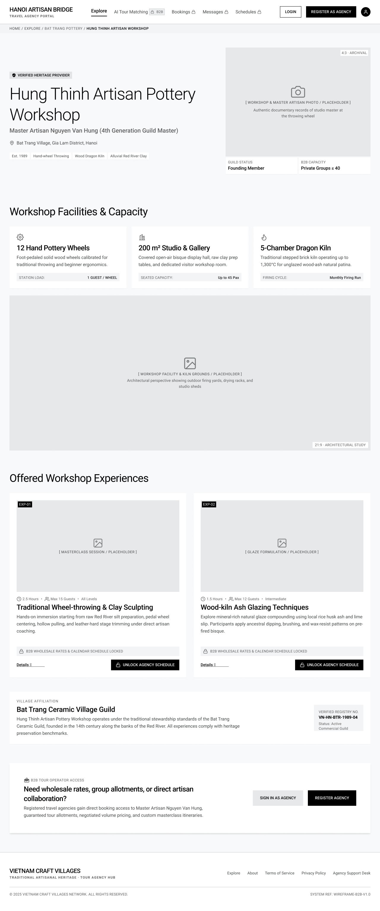

# Screen Spec: DSC123

> File này gộp 2 bản draft khác nhau của DSC123 (tham chiếu module spec khác nhau, một vài chi tiết khác nhau). Cả 2 bản được giữ nguyên bên dưới để đối chiếu.

---

# module-spec-EXP

# Screen Spec: DSC123 Public Provider Profile

| Field | Value |
|---|---|
| Screen ID | `DSC123` |
| Screen name | Public Provider Profile |
| Actor | Guest |
| Priority | Must |
| Belongs to module | `module-spec-EXP` |
| Mockup image | `img/DSC123.png` |
| Status | Draft |

## 1. Purpose

**Shown when:** A Guest clicks through to a Provider from `EXP120`, a public Village link, or a shared public URL.

**The user leaves this screen when:** they click Login/Register (go to `AUT009`/`REG003`), open a public Experience Detail, or trigger any locked B2B action, which redirects to `AUT009`.

## 2. Mockup

## 3. Element inventory

| # | Element | Type | Content / data source | Required | Validation |
|---|---|---|---|---|---|
| 1 | Header nav | Header | Logo, Explore (active)/AI Tour Matching 🔒/Bookings 🔒/Messages 🔒/Schedules 🔒, Login button, Register as Agency button, guest avatar | Yes | — |
| 2 | Breadcrumb | Text | "Home / Explore / [Village] / [Provider name]" | Yes | Non-clickable last crumb |
| 3 | Verified badge | Tag | "✓ Verified Heritage Provider" | No | Shown only for verified providers |
| 4 | Title | Header | Provider/workshop name | Yes | — |
| 5 | Subtitle | Text | Master artisan name + generation/title | Yes | — |
| 6 | Location line | Text | Village + district + city, with pin icon | Yes | — |
| 7 | Tag chips | Tag | e.g. "Est. YYYY", craft technique tags | No | — |
| 8 | Hero image | Image | Single static workshop/master photo placeholder, aspect ratio note, caption | Yes | No carousel/multi-slide gallery for Guests |
| 9 | Meta row | Text | "Guild Status" value, "B2B Capacity" value | No | Not rendered for Guests — visible only to authenticated users with B2B permissions (see `DSC122`); omitted entirely from this screen, not merely masked |
| 10 | Facilities & Capacity card (×3) | Card | icon, title, description, stat label/value | Yes (per card) | Same public-safe facility data as `DSC122` |
| 11 | Facility grounds image | Image | Single placeholder photo + caption (no gallery/thumbnails) | No | — |
| 12 | "Offered Workshop Experiences" section header | Text | Static | Yes | — |
| 13 | Experience card (×N, Instant-Confirm tier only) | Card | tier tag, image, duration/guests/level meta, title, description, "🔒 B2B Wholesale Rates & Calendar Schedule Locked" note, greyed "Details" link, "🔒 Unlock Agency Schedule" button | Yes (per card) | Bespoke/on-request tier items are fully hidden from Guests |
| 14 | Village Affiliation section | Text | Guild/village name heading, description paragraph, verified registry number badge | Yes | — |
| 15 | B2B Tour Operator Access banner | Card | icon + "Need wholesale rates, group allotments, or direct artisan collaboration?" heading, body copy, "Sign In as Agency" button, "Register Agency" button | Yes | — |
| 16 | Footer | Footer | Brand, tagline, links, copyright, system ref | Yes | — |

## 4. States

| State | What the user sees | Trigger |
|---|---|---|
| Default | Fully populated public provider page with locked pricing, as shown | Provider data and at least one public-eligible experience resolve |
| Empty (no data) | "Offered Workshop Experiences" section shows "No public experiences available. Sign in as an agency to view full inventory." | Provider has zero Instant-Confirm tier experiences published |
| Loading | Skeleton blocks for hero image, facility cards, and experience cards; header/breadcrumb render immediately | Provider data is being fetched |
| Error | Full-section banner: "We couldn't load this provider's profile." with a "Retry" button; or full-page "This provider is no longer available." | Provider data fetch fails or provider ID is invalid |
| Success / confirmation | Not applicable — screen is view-only for Guests; no submission occurs here | — |

## 5. Interactions and navigation

| # | Element | User action | System response | Goes to screen |
|---|---|---|---|---|
| 1 | Login button | tap | — | `AUT009` |
| 2 | Register as Agency button | tap | — | `REG003` |
| 3 | Experience card "Details" | tap | Opens the public experience detail, still with pricing/schedule locked | `DSC124` |
| 4 | Experience card "Unlock Agency Schedule" | tap | — | `AUT009` |
| 5 | "Sign In as Agency" (bottom banner) | tap | — | `AUT009` |
| 6 | "Register Agency" (bottom banner) | tap | — | `REG003` |

## 6. Screen-level rules

| Rule ID | Rule | Source |
|---|---|---|
| SR-001 | No chat entry point is exposed to Guests; the "Direct Chat with Master" button from `DSC122` does not render here | Mockup comparison, DSC122 vs DSC123 |
| SR-002 | Bespoke/on-request tier experiences are fully hidden from Guests; only Instant-Confirm tier experiences appear, and always with pricing masked | Mockup comparison; Screen List, DSC123 overview |
| SR-003 | The gallery shows a single static image only; the multi-slide carousel with thumbnails is an authenticated-only enhancement (`DSC122`) | Mockup comparison |
| SR-004 | "Guild Status" and "B2B Capacity" are never rendered for Guests — visible only to authenticated users with B2B permissions | Clarified answer, open question #2 |

## 7. Linked requirements

| FR ID (from the module spec) | What this screen does for it |
|---|---|
| — | [NEEDS CLARIFICATION: module spec `module-spec-EXP` with FR IDs not yet available] |

## 8. Responsive and accessibility notes

- Smallest supported width: 360px
- What collapses or stacks on a narrow screen: the 3-column Facilities grid stacks to 1 column; the 2-column Experience card row stacks to 1 column; the bottom CTA banner buttons stack vertically
- Text that must remain readable: the "🔒 B2B Wholesale Rates & Calendar Schedule Locked" microcopy must remain legible and distinguishable from the greyed-out "Details" link it sits beside

## 9. Open questions

| # | Question | Blocking? | Status |
|---|---|---|---|
| 1 | Does the greyed "Details" link on a locked experience card still navigate to `DSC124`, or is it fully disabled? — **Answer:** Yes. The greyed "Details" link remains navigable and opens `DSC124`; the locked state only indicates restricted access. | No | Resolved |
| 2 | Should the "Guild Status" / "B2B Capacity" meta row be shown to Guests at all, since "B2B Capacity" arguably reveals competitive scale information? — **Answer:** No. "Guild Status" and "B2B Capacity" are not shown to Guests. These fields are visible only to authenticated users with the appropriate B2B permissions. | No | Resolved |

---

## Completion checklist

- [x] The mockup is a separate cropped image file, named with the Screen ID.
- [x] Every visible element in the mockup appears in the element inventory.
- [x] Every input element has a validation rule or an explicit "none".
- [x] All five states are filled in, or marked "not applicable" with a reason.
- [x] Every navigation target is a Screen ID that exists in the Screen List.
- [x] Every element that displays data names the field it displays, matching the module spec.

---

Template source: DBIZ3, VJCBI College - FTU, Session 4. Built on the DBIZ2 Screen Design
structure (Screen List and Screen Layout), per DBIZ3 Syllabus v3.

---

# PRF

# Screen Spec: DSC123 Public Provider Profile

| Field | Value |
|---|---|
| Screen ID | `DSC123` |
| Screen name | Public Provider Profile |
| Actor | Guest |
| Priority | Must |
| Belongs to module | `module-spec-PRF` |
| Mockup image | `img/DSC123.png` |
| Status | Draft |

## 1. Purpose

**Shown when:** A non-authenticated Guest opens a Local Provider from Public Explore or a shared link, to see only basic, publicly permitted Provider information.

**The user leaves this screen when:** The Guest logs in / registers, taps a locked action (redirected to Login), or navigates back to Public Explore.

## 2. Mockup

## 3. Element inventory

| # | Element | Type | Content / data source | Required | Validation |
|---|---|---|---|---|---|
| 1 | Global nav (Explore active; AI Tour Matching / Bookings / Messages / Schedule shown locked) | Header | Static links with lock icons | Yes | Locked items redirect to Login on tap |
| 2 | "LOGIN" button | Button | — | Yes | — |
| 3 | "REGISTER AS AGENCY" button | Button | — | Yes | — |
| 4 | Generic avatar icon | Header | Not personalized (no session) | Yes | — |
| 5 | Breadcrumb (Home / Explore / Village / Provider) | Navigation | Same as DSC122 | Yes | — |
| 6 | Verified badge | Text | `verification_status = Verified` | Yes | — |
| 7 | Provider title | Header | `business_name` | Yes | — |
| 8 | Master artisan / subtitle | Text | `artisan_names` | No | — |
| 9 | Location line | Text | `location` | Yes | — |
| 10 | Specialty tag chips | Tag list | craft specialty tags | No | — |
| 11 | Hero image | Image | Primary `profile_images` item | Yes | — |
| 12 | Guild Status / B2B Capacity info row | Text | Provider profile fields | No | — |
| 13 | "Workshop Facilities & Capacity" section (3 cards) | Card | Same fields as DSC122 | No | — |
| 14 | Single facility/grounds image (no carousel controls, no thumbnail strip) | Image | One `profile_images` item | Yes | Reduced gallery — no slide count, arrows or thumbnails shown to Guest |
| 15 | "Offered Workshop Experiences" section, 2 cards only | Card | `Experience` entity: name, images, duration, capacity, level, description | Yes | Bespoke/on-request Experience type is hidden entirely from Guest |
| 16 | Locked pricing banner ("B2B wholesale rates & calendar schedule locked") | Text/Icon | Static | Yes | — |
| 17 | "Details" link (greyed, lock icon) | Link | — | Yes | Restricted; redirects toward Login/Public Experience Detail |
| 18 | "Unlock Agency Schedule" button | Button | — | Yes | Redirects to Login |
| 19 | "Village Affiliation" section | Card | Same as DSC122 | Yes | — |
| 20 | Registry number box | Text | `Village` registry data | No | — |
| 21 | "B2B Tour Operator Access" promo box | Card | Static marketing copy | Yes | — |
| 22 | "Sign In as Agency" button | Button | — | Yes | — |
| 23 | "Register Agency" button | Button | — | Yes | — |
| 24 | Footer nav & legal links | Footer | Static | Yes | — |

## 4. States

| State | What the user sees | Trigger |
|---|---|---|
| Default | Public profile with locked pricing/schedule affordances, as in the mockup | Provider exists and is Verified |
| Empty (no data) | Experience section shows "No public Experiences available" placeholder; facility cards hidden if none configured | Provider has no Published Experiences with public visibility |
| Loading | Skeleton blocks for header, hero image, and the 2 Experience cards | Screen just opened |
| Error | Full-page error ("This profile is unavailable") with link back to Public Explore | Provider not found or not Verified |
| Success / confirmation | N/A on this screen — Guest actions redirect to Login/Registration before any confirmation is possible | — |

## 5. Interactions and navigation

| # | Element | User action | System response | Goes to screen |
|---|---|---|---|---|
| 1 | "LOGIN" | tap | Opens shared login | `AUT009` |
| 2 | "REGISTER AS AGENCY" | tap | Opens Agency registration | `REG003` |
| 3 | Locked nav item (AI Tour Matching, Bookings, Messages, Schedule) | tap | Redirects to Login | `AUT009` |
| 4 | "Details" link (locked) | tap | Opens the public Experience detail, still restricted | `DSC124` |
| 5 | "Unlock Agency Schedule" | tap | Redirects to Login | `AUT009` |
| 6 | "Sign In as Agency" / "Register Agency" (promo box) | tap | Opens Login / Registration | `AUT009` / `REG003` |
| 7 | Breadcrumb Village segment | tap | Opens the affiliated Village profile; this link works for Guests | `VIL030` |

## 6. Screen-level rules

| Rule ID | Rule | Source |
|---|---|---|
| SR-001 | Price, availability, contact details, and other competitive information must never be exposed to a Guest. | BR-004, Screen List (EXP120/DSC123 overview) |
| SR-002 | Any restricted action redirects the Guest to Login rather than performing the action. | Screen List (EXP120 overview: "restricted actions redirect to Login") |
| SR-003 | Bespoke/on-request Experiences are not shown to Guests at all (not just price-locked). | Inferred from mockup (only 2 of 3 cards shown) |
| SR-004 | Guest Provider information is always presented through this dedicated DSC123 screen. Explore may provide an entry point or preview, but selecting a Provider opens DSC123 rather than showing full Provider info inline. | Module spec Q10 (Closed) |

## 7. Linked requirements

| FR ID (from the module spec) | What this screen does for it |
|---|---|
| FR-003 | Renders Local Provider profile information filtered to the Guest (public/basic) visibility rule set. |

## 8. Responsive and accessibility notes

- Smallest supported width: 360px
- What collapses or stacks on a narrow screen: same stacking behavior as DSC122; the two locked-CTA buttons in the header stack under the logo on narrow widths.
- Text that must remain readable (contrast, minimum size): lock icon + "locked" copy must remain legible at reduced contrast (greyed state) while still meeting minimum accessible contrast for disabled-looking but tappable elements.

## 9. Open questions

| # | Question | Blocking? | Status |
|---|---|---|---|
| 1 | No remaining ambiguity. Guest Provider information is shown through the dedicated DSC123 – Public Provider Profile screen. Explore may provide the entry point/preview, but selecting a Provider opens DSC123. | No | Closed |
| 2 | Yes, the breadcrumb Village link works for Guests, opening VIL030 directly. | No | Closed |

---

## Completion checklist

- [x] The mockup is a separate cropped image file, named with the Screen ID.
- [x] Every visible element in the mockup appears in the element inventory.
- [x] Every input element has a validation rule or an explicit "none" (screen is view-only; no inputs).
- [x] All five states are filled in, or marked "not applicable" with a reason.
- [x] Every navigation target is a Screen ID that exists in the Screen List.
- [x] Every element that displays data names the field it displays, matching the module spec.

