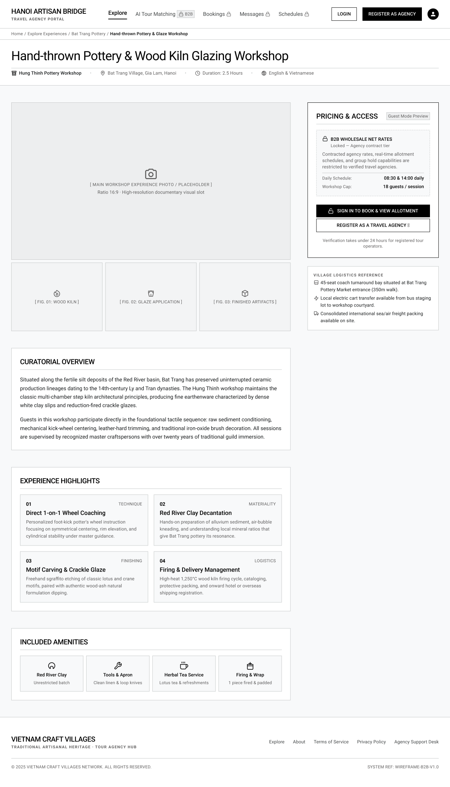

# Screen Spec: DSC124 Public Experience Detail

| Field | Value |
|---|---|
| Screen ID | `DSC124` |
| Screen name | Public Experience Detail |
| Actor | Guest |
| Priority | Must |
| Belongs to module | `spec-M04-EXPLORE.md` |
| Mockup image | `img/DSC124.png` |
| Status | Draft |

## 1. Purpose

**Shown when:** A Guest clicks "View Details"/"Details" on an Experience card from `EXP120` or `DSC123`.

**The user leaves this screen when:** they click Login/Register (go to `AUT009`/`REG003`), or use the breadcrumb to return to Explore or the Provider profile.

## 2. Mockup

## 3. Element inventory

| # | Element | Type | Content / data source | Required | Validation |
|---|---|---|---|---|---|
| 1 | Header nav | Header | Logo, Explore (active)/AI Tour Matching 🔒/Bookings 🔒/Messages 🔒/Schedules 🔒, Login button, Register as Agency button, guest avatar | Yes | — |
| 2 | Breadcrumb | Text | "Home / Explore Experiences / [Village/Provider] / [Experience name]" | Yes | Non-clickable last crumb |
| 3 | Title | Header | Experience name | Yes | — |
| 4 | Meta row | Text | Provider name (icon), location (icon), duration (icon, e.g. "2.5 Hours"), language(s) (icon) | Yes | — |
| 5 | Main photo | Image | 16:9 placeholder | Yes | Falls back to placeholder if not uploaded |
| 6 | Figure thumbnail (×3) | Image | small captioned images (e.g. process/material/output) | No | — |
| 7 | Pricing & Access card | Card | "Guest Mode Preview" badge, "🔒 B2B Wholesale Net Rates — Locked" note + description, Daily Schedule value, Workshop Cap value, "🔒 Sign In to Book & View Allotment" button, "Register as a Travel Agency" button, verification-time helper text | Yes | No numeric price ever rendered |
| 8 | Village Logistics Reference card | List | bulleted logistics notes (coach parking, shuttle, freight) | No | — |
| 9 | Curatorial Overview section | Text | heading + 2 paragraphs | Yes | — |
| 10 | Experience Highlights section | Card | 4 numbered cards, each with category tag, title, description | Yes | — |
| 11 | Included Amenities section | List | 4 icon items, each with title + short value | No | — |
| 12 | Footer | Footer | Brand, tagline, links, copyright, system ref | Yes | — |

## 4. States

| State | What the user sees | Trigger |
|---|---|---|
| Default | Fully populated public experience page with locked pricing, as shown | Experience data resolves for a verified/published listing |
| Empty (no data) | Not applicable — this screen only renders once a specific published Experience is loaded | — |
| Loading | Skeleton blocks for main photo, thumbnails, and the Pricing & Access card; header/breadcrumb render immediately | Experience data is being fetched |
| Error | Full-page message: "This experience is not currently available." with a link back to Explore; or a retry banner on a transient fetch failure | Experience is unpublished/removed, or the fetch fails |
| Success / confirmation | Not applicable — no submission occurs on this screen; Sign In/Register redirect to their own screens | — |

## 5. Interactions and navigation

| # | Element | User action | System response | Goes to screen |
|---|---|---|---|---|
| 1 | Breadcrumb provider link | tap | — | `DSC123` |
| 2 | "Sign In to Book & View Allotment" | tap | — | `AUT009` |
| 3 | "Register as a Travel Agency" | tap | — | `REG003` |
| 4 | Main photo / figure thumbnails | tap | Opens an enlarged lightbox view | stays on `DSC124` |

## 6. Screen-level rules

| Rule ID | Rule | Source |
|---|---|---|
| SR-001 | No pricing, schedule, or booking action is ever rendered for Guests; only a locked-state CTA pair (Sign In / Register) is shown | Screen List, DSC124 overview |
| SR-002 | Content sections (Curatorial Overview, Highlights, Amenities) mirror the authenticated view's public-safe fields only; no B2B-only fields (net rate, guaranteed capacity) appear | Screen List, DSC033 vs DSC124 overview |
| SR-003 | This screen never renders for a Bespoke/on-request tier Experience; only Instant-Confirm tier Experiences are eligible for the public catalog, consistent with `DSC123` SR-002 | Clarified answer, open question #2 |

## 7. Linked requirements

| FR ID (from the module spec) | What this screen does for it |
|---|---|
| — | [NEEDS CLARIFICATION: module spec `spec-M04-EXPLORE.md` with FR IDs not yet available] |

## 8. Responsive and accessibility notes

- Smallest supported width: 360px
- What collapses or stacks on a narrow screen: the two-column layout (content + sidebar) stacks to a single column, sidebar cards moving below the Curatorial Overview; the 4-card Highlights grid stacks to 1 column
- Text that must remain readable: the "Locked — Agency contract tier" microcopy inside the Pricing & Access card must remain legible against its light background

## 9. Open questions

| # | Question | Blocking? | Status |
|---|---|---|---|
| 1 | Is "Daily Schedule" (e.g. "08:30 & 14:00 daily") considered competitive/restricted information, or is it acceptable to show to Guests as shown in the mockup? — **Answer:** Acceptable to show to Guests. | No | Resolved |
| 2 | Does this screen ever render for a Bespoke/on-request tier Experience, or are those excluded from the public catalog entirely (consistent with `DSC123` SR-002)? — **Answer:** Bespoke/on-request Experiences are excluded from the public catalog and this screen entirely. They are not rendered for Guests or public browsing. | No | Resolved |

---

## Completion checklist

- [x] The mockup is a separate cropped image file, named with the Screen ID.
- [x] Every visible element in the mockup appears in the element inventory.
- [x] Every input element has a validation rule or an explicit "none".
- [x] All five states are filled in, or marked "not applicable" with a reason.
- [x] Every navigation target is a Screen ID that exists in the Screen List.
- [x] Every element that displays data names the field it displays, matching the module spec.

---

Template source: DBIZ3, VJCBI College - FTU, Session 4. Built on the DBIZ2 Screen Design
structure (Screen List and Screen Layout), per DBIZ3 Syllabus v3.
