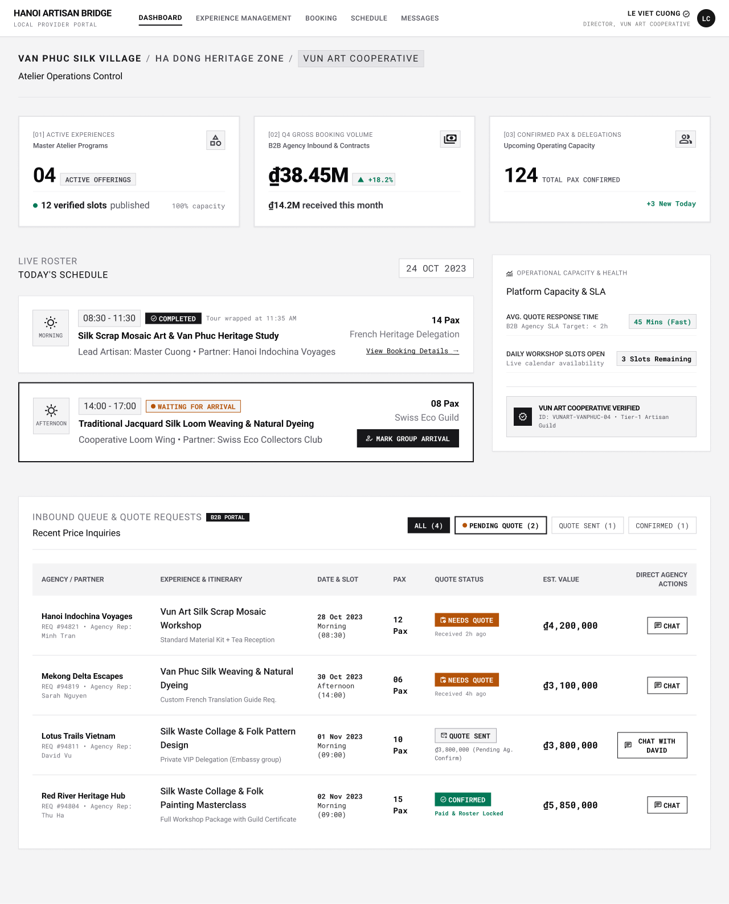

# Screen Spec: DSH018 Local Provider Dashboard

| Field | Value |
|---|---|
| Screen ID | `DSH018` |
| Screen name | Local Provider Dashboard |
| Actor | Local Provider |
| Priority | Must |
| Belongs to module | `spec-PRF.md` |
| Mockup image | `img/DSH018.png` |
| Status | Draft |

## 1. Purpose

**Shown when:** A Local Provider logs in; this is the main entry point of the Local Provider Portal, giving an overview of Experiences, bookings, schedule, conversations, and pending actions.

**The user leaves this screen when:** The Provider taps a nav item, a "View Booking Details" link, a quote row's Chat action, or "Mark Group Arrival."

## 2. Mockup

## 3. Element inventory

| # | Element | Type | Content / data source | Required | Validation |
|---|---|---|---|---|---|
| 1 | Global nav (Dashboard, Experience Management, Booking, Schedule, Messages) | Header | Static links | Yes | — |
| 2 | User identity block | Header | Logged-in Provider user name, title, avatar | Yes | — |
| 3 | Scope breadcrumb (Village / Heritage Zone / Cooperative) | Navigation | `Village` + Provider org name | Yes | — |
| 4 | Page subtitle "Atelier Operations Control" | Text | Static | No | — |
| 5 | Stat card: Active Experiences | Card | Count of Published `Experience` records belonging to this Provider (FR-006 data) | Yes | — |
| 6 | Stat card: Gross Booking Volume | Card | Aggregated booking value (Booking module, out of PRO scope) | Yes | — |
| 7 | Stat card: Confirmed Pax & Delegations | Card | Aggregated confirmed pax (Booking module, out of PRO scope) | Yes | — |
| 8 | "Today's Schedule" date selector | Input | Date | Yes | Valid calendar date |
| 9 | Schedule entry card (Morning, Completed) | Card | Booking/Schedule module data | Yes | — |
| 10 | Schedule entry card (Afternoon, Waiting for Arrival) | Card | Booking/Schedule module data | Yes | — |
| 11 | "Mark Group Arrival" button | Button | Triggers arrival confirmation | Yes | Only enabled while status = Waiting for Arrival |
| 12 | "View Booking Details" link | Link | Navigates to booking detail | Yes | — |
| 13 | "Platform Capacity & SLA" panel | Card | Quote response SLA metric, open slot count | No | — |
| 14 | Verified guild badge box | Card | `Local Provider Profile.verification_status` = Verified, registry ID | Yes | — |
| 15 | "Inbound Queue & Quote Requests" section with status filter tabs | Tabs | All / Pending / Sent / Confirmed counts | Yes | — |
| 16 | Quote requests table | List | Agency/partner, Experience & itinerary, date & slot, pax, quote status, est. value | Yes | — |
| 17 | Row action button (Chat / Chat with [Name]) | Button | Opens Chat thread | Yes | — |

## 4. States

| State | What the user sees | Trigger |
|---|---|---|
| Default | Populated stat cards, today's schedule with 2 sessions, and a 4-row quote request table, as in the mockup | Provider has active data for today |
| Empty (no data) | Stat cards show 0 with neutral styling; "Today's Schedule" shows "No sessions scheduled today"; quote table shows "No inbound requests yet" | New Provider or a day with no bookings/quotes |
| Loading | Skeleton placeholders for the 3 stat cards, the 2 schedule cards, and the quote table rows | Dashboard just opened |
| Error | Inline error banner per widget that failed to load (e.g. "Couldn't load today's schedule — Retry") rather than a full-page error, so unaffected widgets still render | One or more data sources (Booking, Schedule, Messages) fail to respond |
| Pending Verification | A banner is shown on the dashboard (in addition to PRF127) indicating the profile is under review; editing remains available via PRF128, but the profile cannot be listed until approved | `Local Provider Profile.verification_status = Pending Verification` |
| Revision Required | A banner is shown on the dashboard (in addition to PRF127) with the revision feedback and an "Edit Profile" action to address the required changes and resubmit | `Local Provider Profile.verification_status = Revision Required` |
| Success / confirmation | Toast "Group arrival confirmed" and the Afternoon card's status badge updates from "Waiting for Arrival" to the next stage | After "Mark Group Arrival" is confirmed |

## 5. Interactions and navigation

| # | Element | User action | System response | Goes to screen |
|---|---|---|---|---|
| 1 | Nav: Experience Management | tap | Opens Experience list | `EXP067` |
| 2 | Nav: Booking | tap | Opens Booking Management | `BKG133` |
| 3 | Nav: Schedule | tap | Opens Provider Schedule | `SCH139` |
| 4 | Nav: Messages | tap | Opens Chat | `COM065` |
| 5 | "View Booking Details" | tap | Opens that booking | `BKG135` |
| 6 | "Mark Group Arrival" | tap | Confirms arrival and advances booking status | `BKG136` (action, stays / returns here) |
| 7 | Quote table "Chat" / "Chat with [Name]" | tap | Opens the Chat thread for that quote request | `COM065` |
| 8 | Filter tabs (All/Pending/Sent/Confirmed) | tap | Filters the quote table | stays |
| 9 | Date selector | change | Reloads the Today's Schedule cards for the selected date | stays |
| 10 | Avatar | tap | Opens account dropdown | Account Dropdown (—) |

## 6. Screen-level rules

| Rule ID | Rule | Source |
|---|---|---|
| SR-001 | Only data belonging to the logged-in Provider (and its scope: Village/Cooperative) is shown. | BR-002 |
| SR-002 | The verified guild badge reflects the Provider's own `verification_status`; if the status is Pending Verification or Revision Required, the dashboard surfaces that state prominently via a banner (shown here, in addition to PRF127) rather than the Verified badge. | BR-006, BR-007 |

## 7. Linked requirements

| FR ID (from the module spec) | What this screen does for it |
|---|---|
| FR-006 | Surfaces a count of the Provider's own Active/Published Experiences as an at-a-glance widget; deep management happens on EXP067. |

No FR in the Profile Management module governs booking volume, schedule, or the quote-request queue directly — Booking Management and Schedule are explicitly out of scope for this module (see module spec §1 "Out of scope"). Those widgets are cross-module and should be traced against the Booking/Schedule module specs, not `spec-PRF.md`.

## 8. Responsive and accessibility notes

- Smallest supported width: 360px
- What collapses or stacks on a narrow screen: the 3 stat cards stack to a single column; the "Today's Schedule" / "Platform Capacity & SLA" two-column layout stacks; the quote table becomes horizontally scrollable within its own container.
- Text that must remain readable (contrast, minimum size): status badges ("Completed," "Waiting for Arrival," "Needs Quote," "Confirmed") must be distinguishable by more than color alone (icon + label, as shown).

## 9. Open questions

| # | Question | Blocking? | Status |
|---|---|---|---|
| 1 | `[NEEDS CLARIFICATION: which FR/module owns the Dashboard's booking-volume and quote-queue widgets — is DSH018 formally in scope of a Booking module spec, and should this file's FR table instead point there?]` | Yes | Open |
| 2 | A banner is shown here on the dashboard (not only on PRF127) when `verification_status` is Pending Verification or Revision Required. | No | Closed |

---

## Completion checklist

- [x] The mockup is a separate cropped image file, named with the Screen ID.
- [x] Every visible element in the mockup appears in the element inventory.
- [x] Every input element has a validation rule or an explicit "none."
- [x] All five states are filled in, or marked "not applicable" with a reason.
- [x] Every navigation target is a Screen ID that exists in the Screen List.
- [x] Every element that displays data names the field it displays, matching the module spec.
