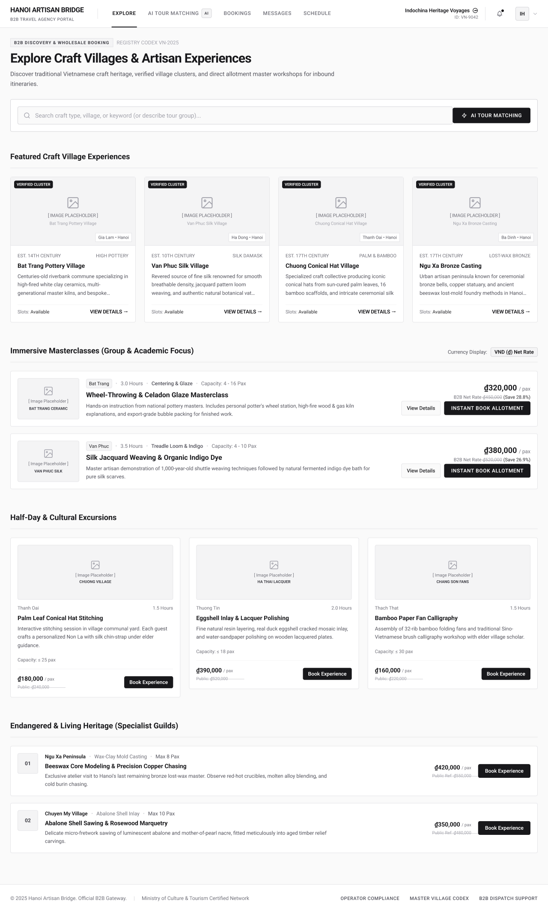

# Screen Spec: EXP017 Explore

| Field | Value |
|---|---|
| Screen ID | `EXP017` |
| Screen name | Explore |
| Actor | Tour Agency |
| Priority | Must |
| Belongs to module | `spec-EXP.md` |
| Mockup image | `img/EXP017.png` |
| Status | Revised — pending human approval |

## 1. Purpose

Main discovery screen after Agency login. Displays verified Village/Experience cards through browsing sections. The search bar opens AI Tour Matching directly. User behavior within the session is recorded to update preferences and re-rank recommendations.

The controls and decisions below define the current screen specification.

## 2. Mockup

## 3. Element inventory

| # | Element | Type | Content / data source | Required | Validation |
|---|---|---|---|---|---|
| 1 | Explore | Heading | Explore | No | Static screen title |
| 2 | Experience cards and pagination | Read-only panel | F-EXPLORE-01, F-EXPLORE-02, F-EXPLORE-03, F-EXPLORE-04, F-EXPLORE-05, F-EXPLORE-06, F-EXPLORE-07, F-EXPLORE-08, F-EXPLORE-09, F-EXPLORE-10, F-EXPLORE-11, F-EXPLORE-12, F-EXPLORE-13, F-EXPLORE-14, F-EXPLORE-15, F-EXPLORE-16, F-EXPLORE-17 — permitted output fields only | No | Actor-specific field visibility; optional missing values omitted. Never expose tokens, password hashes, session values or internal delivery diagnostics. |
| 3 | Permitted filters | Read-only panel | F-EXPLORE-01, F-EXPLORE-02, F-EXPLORE-03, F-EXPLORE-04, F-EXPLORE-05, F-EXPLORE-06, F-EXPLORE-07, F-EXPLORE-08, F-EXPLORE-09, F-EXPLORE-10, F-EXPLORE-11, F-EXPLORE-12, F-EXPLORE-13, F-EXPLORE-14, F-EXPLORE-15, F-EXPLORE-16, F-EXPLORE-17 — permitted output fields only | No | Actor-specific field visibility; optional missing values omitted. Never expose tokens, password hashes, session values or internal delivery diagnostics. |
| 4 | Results refreshed indicator | Read-only panel | F-EXPLORE-01, F-EXPLORE-02, F-EXPLORE-03, F-EXPLORE-04, F-EXPLORE-05, F-EXPLORE-06, F-EXPLORE-07, F-EXPLORE-08, F-EXPLORE-09, F-EXPLORE-10, F-EXPLORE-11, F-EXPLORE-12, F-EXPLORE-13, F-EXPLORE-14, F-EXPLORE-15, F-EXPLORE-16, F-EXPLORE-17 — permitted output fields only | No | Actor-specific field visibility; optional missing values omitted. Never expose tokens, password hashes, session values or internal delivery diagnostics. |
| 5 | Provider detail | Button / navigation | Permitted profile | No | Enabled only when the linked permission/validation guard succeeds |
| 6 | Experience detail | Button / navigation | Permitted Experience | No | Enabled only when the linked permission/validation guard succeeds |
| 7 | AI Matching | Button / navigation | Agency only | No | Enabled only when the linked permission/validation guard succeeds |
| 8 | Bookings | Button / navigation | Own bookings | No | Enabled only when the linked permission/validation guard succeeds |
| 9 | Schedule | Button / navigation | Own schedule | No | Enabled only when the linked permission/validation guard succeeds |
| 10 | Messages | Button / navigation | Agency chat | No | Enabled only when the linked permission/validation guard succeeds |

## 4. States

| State | What the user sees | Trigger |
|---|---|---|
| Default | Permitted data or a prefilled form; role-specific actions only | Authorized screen load |
| Empty | No records/optional values shown with explanatory text; never infer availability from absent bookings | Successful response with no data |
| Loading | Skeleton/progress; mutation actions disabled while their request is pending | Fetch/upload/save in progress |
| Error | Defined field errors or fetch failure with Retry; no successful transition or partial mutation is shown | Validation, permission or service failure |
| Success / confirmation | Refreshed read-only data or saved result; navigate only after successful linked action | Successful read/mutation |

## 5. Interactions and navigation

| # | Element | User action | System response | Goes to screen |
|---|---|---|---|---|
| 1 | Provider detail | Select | Permitted profile | DSC122 |
| 2 | Experience detail | Select | Permitted Experience | DSC033 |
| 3 | AI Matching | Select | Agency only | AIT121 |
| 4 | Bookings | Select | Own bookings | BKG137 |
| 5 | Schedule | Select | Own schedule | SCH141 |
| 6 | Messages | Select | Agency chat | COM048 |

Shared avatar navigation for authenticated actors: My Account → ACC129; My Business → PRF019 (Agency) / PRF127 (Provider), omitted for Admin without a business; Logout → AUT026. Agency main navigation uses EXP017/AIT121/BKG137/SCH141/COM048; Provider uses DSH018/EXP067/BKG133/SCH139/COM065; Admin uses ADM079/ADM095. Guest has EXP120 and AUT009/REG003, with no AI navigation.

## 6. Screen-level rules

| Rule ID | Rule | Source |
|---|---|---|
| SR-001 | Check action permission and resource scope on every protected request; hiding a button alone is insufficient. Read-only screens have no mutation controls. | AUT FR-016 |
| SR-002 | Validate the inputs and render outputs exactly as the linked module contracts; server/context fields are not freely editable form controls. | Linked FR table |

## 7. Linked requirements

| Module | FR ID | Function ID | Screen responsibility |
|---|---|---|---|
| EXP | FR-001 | F-EXPLORE-01 | Load Initial Experience/Activity Listing |
| EXP | FR-002 | F-EXPLORE-02 | Display Experience/Activity Card |
| EXP | FR-003 | F-EXPLORE-03 | Display Full Experience & Provider Profile |
| EXP | FR-004 | F-EXPLORE-04 | Display Related Activities & Provider Suggestions |
| EXP | FR-005 | F-EXPLORE-05 | Record Click & View Events on Experience Cards |
| EXP | FR-006 | F-EXPLORE-06 | Record Time Spent on Experience Detail Page |
| EXP | FR-007 | F-EXPLORE-07 | Record Quote Request & Chat Actions from Experience |
| EXP | FR-008 | F-EXPLORE-08 | Detect Browse Patterns & Activity Preferences |
| EXP | FR-009 | F-EXPLORE-09 | Adjust Activity/Experience Preference Weights in Real-time |
| EXP | FR-010 | F-EXPLORE-10 | Regenerate Experience Ranking Based on Updated Preferences |
| EXP | FR-011 | F-EXPLORE-11 | Request Quote from Experience Card/Detail |
| EXP | FR-012 | F-EXPLORE-12 | Open Chat with Local Provider from Experience |
| EXP | FR-013 | F-EXPLORE-13 | Supporting background process — no direct UI control |
| EXP | FR-014 | F-EXPLORE-14 | Supporting background process — no direct UI control |
| EXP | FR-015 | F-EXPLORE-15 | Supporting configuration/evaluation process — no direct UI control |
| EXP | FR-016 | F-EXPLORE-16 | Supporting background process — no direct UI control |
| EXP | FR-017 | F-EXPLORE-17 | Supporting configuration process — no direct UI control |

## 8. Responsive and accessibility notes

- Smallest supported width: Desktop only. No mobile or narrow-screen layout is in scope for this screen.
- What collapses or stacks on a narrow screen: Not applicable; narrow/mobile behavior is out of scope. Desktop layouts should preserve the hierarchy shown in the mockup across supported desktop viewport sizes.
- Text that must remain readable (contrast, minimum size): Body text, prices, availability, navigation labels, card titles and CTA labels must remain legible at normal desktop zoom. Interactive controls require a visible hover/focus state and sufficient contrast against the white/light-gray background.
- Keyboard accessibility: Search field, navigation items, card links/buttons, notification control, account dropdown, booking actions and footer links must be keyboard reachable in logical top-to-bottom order.
- Screen-reader/accessibility labels: Icon-only controls such as notification bell and account/avatar controls require accessible names; image placeholders require meaningful alternative text when a real image is available.
- Dynamic content: Price, capacity, availability and recommendation ordering must be exposed as readable text, not communicated by color alone.

## 9. Decisions and review

Use the approved Function List and [shared consistency contract](../docs/consistency-contract.md). No new feature is implied by decorative legacy mockup copy. Human approval of this revision is pending; technical Plan choices remain separately identified.

## Completion checklist

- [x] Linked functions have corresponding module FR and IO contracts.
- [x] Inputs name their validation and required/optional condition.
- [x] Default, empty, loading, error and success states are defined.
- [x] Navigation targets use existing Screen IDs.
- [ ] Human approval of the revised specification.
