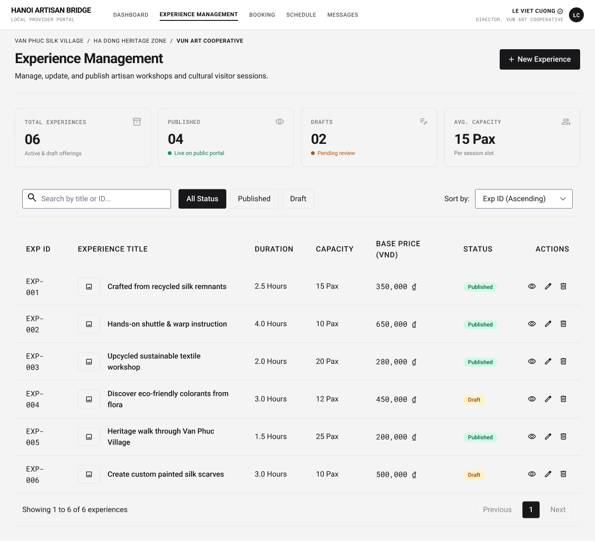

# Screen Spec: EXP067 Experience Management

| Field | Value |
|---|---|
| Screen ID | `EXP067` |
| Screen name | Experience Management |
| Actor | Local Provider |
| Priority | Must |
| Belongs to module | `spec-PRF.md` |
| Mockup image | `img/EXP067.png` |
| Status | Draft |

## 1. Purpose

**Shown when:** A Local Provider opens "Experience Management" from the portal nav to see, search, filter and manage the list of Experiences it owns.

**The user leaves this screen when:** The Provider creates a new Experience, opens/edits/deletes an existing one, or navigates elsewhere via the top nav.

## 2. Mockup

## 3. Element inventory

| # | Element | Type | Content / data source | Required | Validation |
|---|---|---|---|---|---|
| 1 | Global nav (Dashboard, Experience Management active, Booking, Schedule, Messages) | Header | Static links | Yes | — |
| 2 | Scope breadcrumb (Village / Heritage Zone / Cooperative) | Navigation | Same as DSH018 | Yes | — |
| 3 | Page title "Experience Management" | Header | Static | Yes | — |
| 4 | Page subtitle | Text | Static | No | — |
| 5 | "+ New Experience" button | Button | — | Yes | — |
| 6 | Stat card: Total Experiences | Card | Count of all `Experience` rows for this Provider | Yes | — |
| 7 | Stat card: Published | Card | Count where status = Published/live | Yes | — |
| 8 | Stat card: Drafts | Card | Count where status = Draft | Yes | — |
| 9 | Stat card: Avg. Capacity | Card | Average `max_participants` across Experiences | No | — |
| 10 | Search input | Input | Free text | No | Filters by title or Exp ID |
| 11 | Status filter buttons (All Status / Published / Draft) | Toggle | — | Yes | Single-select |
| 12 | Sort dropdown | Input | e.g. Exp ID Ascending | No | — |
| 13 | Experience table | List | `Experience` rows: exp_id, title, thumbnail, duration, capacity, base price, status | Yes | — |
| 14 | Row action: view (eye icon) | Button | — | Yes | — |
| 15 | Row action: edit (pencil icon) | Button | — | Yes | — |
| 16 | Row action: delete (trash icon) | Button | — | Yes | — |
| 17 | Pagination controls | Navigation | "Showing X to Y of Z experiences", Previous/Next, page number | Yes | Disabled at first/last page |

## 4. States

| State | What the user sees | Trigger |
|---|---|---|
| Default | Populated table of 6 Experiences with stats, filters and pagination, as in the mockup | Provider has one or more Experiences |
| Empty (no data) | Stat cards show 0; table area replaced with "You haven't created any Experiences yet" message and a repeated "+ New Experience" call to action | Provider has zero Experiences, or the active filter matches none ("No Experiences match your search") |
| Loading | Skeleton rows in place of the table, stat cards show loading placeholders | Screen just opened or filter/sort/search re-query in progress |
| Error | Inline error banner above the table ("Couldn't load your Experiences — Retry") | List fetch fails |
| Success / confirmation | Toast confirming the triggering action ("Experience published," "Draft saved," "Experience deleted") and the table/stat counts update immediately | After returning from Add/Edit/Delete flows |

## 5. Interactions and navigation

| # | Element | User action | System response | Goes to screen |
|---|---|---|---|---|
| 1 | "+ New Experience" | tap | Opens the creation form | `EXP069` |
| 2 | Row title / view icon | tap | Opens the Experience in read-only owner view | `EXP068` |
| 3 | Row edit icon | tap | Opens the Experience in edit mode | `EXP070` |
| 4 | Row delete icon | tap | For a Published Experience, opens delete confirmation. For a Draft Experience, deletion skips the confirmation screen and is performed immediately | `EXP132` (Published only) |
| 5 | Search input | type | Filters table by title/ID as the user types | stays |
| 6 | Status filter buttons | tap | Filters table by status | stays |
| 7 | Sort dropdown | select | Re-orders the table | stays |
| 8 | Pagination Previous/Next | tap | Loads the adjacent page of results | stays |

## 6. Screen-level rules

| Rule ID | Rule | Source |
|---|---|---|
| SR-001 | A Local Provider can view/edit/delete only its own Experiences. | BR-002 |
| SR-002 | Deleting a Published Experience is only possible from this list via the confirmation screen (EXP132); it is never a one-tap action. Deleting a Draft Experience skips the confirmation screen, since a Draft has no bookings. | Screen List (EXP132 overview), BR pattern; module spec (Closed) |

## 7. Linked requirements

| FR ID (from the module spec) | What this screen does for it |
|---|---|
| FR-006 | Lists, searches, filters and provides the entry points to create, view, edit and delete the Provider's own Experiences. |

## 8. Responsive and accessibility notes

- Smallest supported width: 360px
- What collapses or stacks on a narrow screen: the 4 stat cards stack 2x2 then 1-per-row; the table becomes a stacked card list (one Experience per card) with the same action icons.
- Text that must remain readable (contrast, minimum size): Published/Draft status pills need a contrast-safe color pair (green/amber tones shown) and must not rely on color alone — label text is always present.

## 9. Open questions

| # | Question | Blocking? | Status |
|---|---|---|---|
| 1 | Draft deletion skips the confirmation screen. | No | Closed |

---

## Completion checklist

- [x] The mockup is a separate cropped image file, named with the Screen ID.
- [x] Every visible element in the mockup appears in the element inventory.
- [x] Every input element has a validation rule or an explicit "none."
- [x] All five states are filled in, or marked "not applicable" with a reason.
- [x] Every navigation target is a Screen ID that exists in the Screen List.
- [x] Every element that displays data names the field it displays, matching the module spec.
