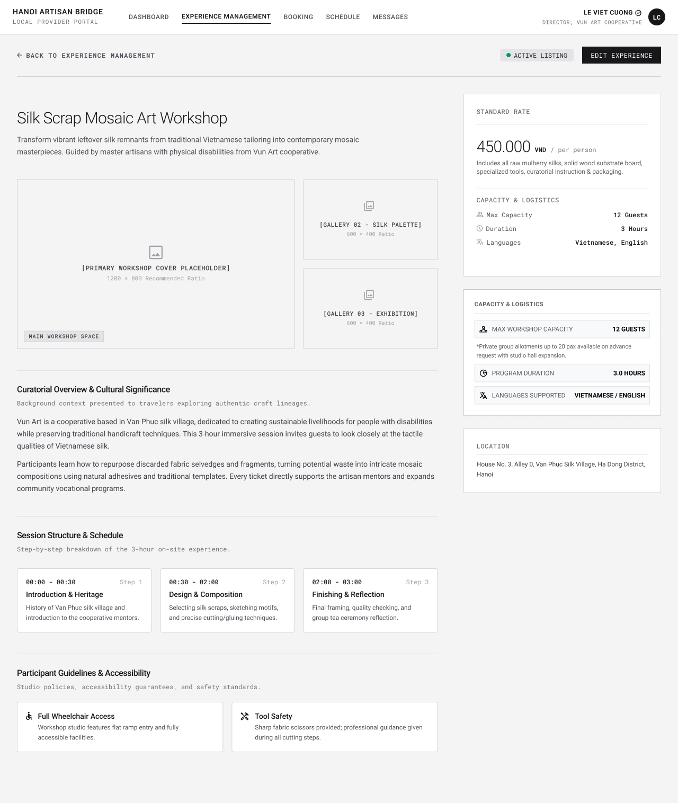

# Screen Spec: EXP068 Experience Detail – Owner View

| Field | Value |
|---|---|
| Screen ID | `EXP068` |
| Screen name | Experience Detail – Owner View |
| Actor | Local Provider |
| Priority | Must |
| Belongs to module | `spec-PRF.md` |
| Mockup image | `img/EXP068.png` |
| Status | Draft |

## 1. Purpose

**Shown when:** A Local Provider opens one of its own Experiences from Experience Management (view icon or title) to review the full saved content before editing or managing it.

**The user leaves this screen when:** The Provider taps "Edit Experience," "Back to Experience Management," a top-nav link, or closes the image lightbox.

## 2. Mockup

## 3. Element inventory

| # | Element | Type | Content / data source | Required | Validation |
|---|---|---|---|---|---|
| 1 | "← Back to Experience Management" link | Link | — | Yes | — |
| 2 | Status badge ("Active Listing") | Text | `Experience.status` (Published/Draft) | Yes | — |
| 3 | "Edit Experience" button | Button | — | Yes | — |
| 4 | Experience title | Header | `Experience.name` | Yes | — |
| 5 | Short description | Text | `Experience.description` (lead line) | Yes | — |
| 6 | Primary cover image | Image | `Experience Image` (category: Space/Location or cover) | Yes | Min 3 image categories required per BR-009; tappable, opens the lightbox (BR-016) |
| 7 | Secondary gallery images (x2) | Image | `Experience Image` items | Yes | Tappable, opens the lightbox (BR-016) |
| 7a | Image lightbox (overlay) | Modal/Image | Full-size rendering of the tapped `Experience Image`, plus prev/next controls over the same gallery set | Yes (when open) | Opened only from a gallery image tap; closes via close (×), backdrop tap, or Esc |
| 8 | "Standard Rate" card | Card | `price_per_person` + inclusions text | Yes | — |
| 9 | "Capacity & Logistics" card (max capacity, duration, languages) | Card | `max_participants`, `duration`, languages | Yes | — |
| 10 | Duplicate "Capacity & Logistics" card (with allotment note) | Card | Same fields, plus a free-text allotment note | No | — |
| 11 | "Location" card | Card | `Experience` location field | Yes | — |
| 12 | "Curatorial Overview & Cultural Significance" section | Text | `description` (long form) | Yes | — |
| 13 | "Session Structure & Schedule" — 3 step cards | List | Structured run-of-show (time range, step title, description) | Yes | — |
| 14 | "Participant Guidelines & Accessibility" — 2 policy cards | List | `booking_conditions` / accessibility policy entries | No | — |

## 4. States

| State | What the user sees | Trigger |
|---|---|---|
| Default | Full read-only Experience detail as in the mockup | Experience record exists and belongs to this Provider |
| Empty (no data) | N/A — an Experience can only exist here once it has been saved with all required fields (BR-009, BR-010), so there is no valid empty state for a saved record | — |
| Loading | Skeleton for title, images, and the three info cards while the record loads | Screen just opened |
| Lightbox open | The tapped image renders full-size over a dimmed backdrop, with prev/next arrows to browse the rest of the gallery and a close (×) control | A gallery image (cover or secondary) is tapped |
| Error | Full-page error ("This Experience is unavailable") with a link back to Experience Management | Experience not found, deleted, or does not belong to this Provider |
| Success / confirmation | N/A on this screen — success feedback ("Changes published") is shown when returning here from EXP070 after a save | — |

## 5. Interactions and navigation

| # | Element | User action | System response | Goes to screen |
|---|---|---|---|---|
| 1 | "Back to Experience Management" | tap | Returns to the list | `EXP067` |
| 2 | "Edit Experience" | tap | Opens this Experience pre-filled in edit mode | `EXP070` |
| 3 | Gallery image (cover or secondary) | tap | Opens the lightbox with that image full-size, browsable to the rest of the gallery via prev/next | stays (lightbox overlay) |
| 4 | Lightbox prev/next arrows | tap | Cycles to the adjacent image in the same gallery | stays (lightbox overlay) |
| 5 | Lightbox close (×) / backdrop / Esc | tap or key | Dismisses the lightbox, returns to the normal detail view | stays |

## 6. Screen-level rules

| Rule ID | Rule | Source |
|---|---|---|
| SR-001 | Only the owning Local Provider can open this view for a given Experience. | BR-002 |
| SR-002 | This screen is read-only; all field edits happen on EXP070. | BR-002 pattern (consistent with view/edit split elsewhere in the module) |
| SR-003 | Tapping any gallery image opens a lightbox (full-size view with prev/next through the gallery); it is not a Repin Location entry point — EXP131 has been discarded from scope entirely. | BR-016; module spec Open Question 28 |

## 7. Linked requirements

| FR ID (from the module spec) | What this screen does for it |
|---|---|
| FR-006 | Displays the full saved state of a Provider-owned Experience (the read half of create/update/delete). |

## 8. Responsive and accessibility notes

- Smallest supported width: 360px
- What collapses or stacks on a narrow screen: the right-hand rate/capacity/location cards move below the main content column; the 3-image gallery stacks to a single column; the lightbox becomes full-screen with swipe-to-navigate.
- Text that must remain readable (contrast, minimum size): the strikethrough-free price ("450.000 VND / per person") must remain the dominant visual weight on the page; lightbox close/prev/next controls need a minimum 44×44px touch target.

## 9. Open questions

| # | Question | Blocking? | Status |
|---|---|---|---|
| 1 | Is there an image lightbox/enlarge interaction on this screen? — **Answer:** Yes. Tapping a gallery image opens a lightbox showing it full-size, with navigation to browse the rest of the gallery. Not a Repin Location entry point — EXP131 has been discarded from scope. | No | Closed (BR-016) |

---

## Completion checklist

- [x] The mockup is a separate cropped image file, named with the Screen ID.
- [x] Every visible element in the mockup appears in the element inventory.
- [x] Every input element has a validation rule or an explicit "none" (screen is view-only).
- [x] All five states are filled in, or marked "not applicable" with a reason.
- [x] Every navigation target is a Screen ID that exists in the Screen List.
- [x] Every element that displays data names the field it displays, matching the module spec.
