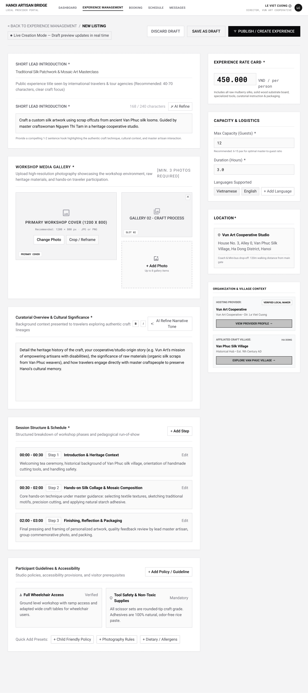

# Screen Spec: EXP069 Add Experience

| Field | Value |
|---|---|
| Screen ID | `EXP069` |
| Screen name | Add Experience |
| Actor | Local Provider |
| Priority | Must |
| Belongs to module | `spec-PRF.md` |
| Mockup image | `img/EXP069.png` |
| Status | Revised — pending human approval |

## 1. Purpose

Creates a new Experience with required information such as description, images, price, capacity, availability, and booking conditions.

The controls and decisions below define the current screen specification.

## 2. Mockup

## 3. Element inventory

| # | Element | Type | Content / data source | Required | Validation |
|---|---|---|---|---|---|
| 1 | Add Experience | Heading | Add Experience | No | Static screen title |
| 2 | Provider id | System context (not editable) | `provider_id` — F-PROFILE-06 | Yes | provider_id (ID; Required) |
| 3 | Operation | System context (not editable) | `operation` — F-PROFILE-06 | Yes | operation (Enum[Create, Update, Delete]; Required) |
| 4 | Experience id | System context (not editable) | `experience_id` — F-PROFILE-06 | Conditional | experience_id ( ID; Required for Update/Delete; omitted for Create ) |
| 5 | Name | Input | `name` — F-PROFILE-06 | Conditional | name ( String; Required for Create; Optional for Update; omitted for Delete ) |
| 6 | Description | Input | `description` — F-PROFILE-06 | Conditional | description ( Text; Required for Create; Optional for Update; omitted for Delete ) |
| 7 | Category | Select | `category` — F-PROFILE-06 | Conditional | category ( Enum[Workshop/Hands-on, Sightseeing, Culinary/Tasting, Cultural Show, Combo]; Required for Create; Optional for Update; omitted for Delete ) |
| 8 | Duration | Input | `duration` — F-PROFILE-06 | Conditional | duration ( Integer > 0, minutes; Required for Create; Optional for Update; omitted for Delete ) |
| 9 | Images | File input | `images` — F-PROFILE-06 | Conditional | images ( Array<Image: JPG/JPEG/PNG/WEBP, max 10MB, min 1280×720>; Required for Create; Optional for Update; omitted for Delete ) |
| 10 | Price per person | Input | `price_per_person` — F-PROFILE-06 | Conditional | price_per_person ( Decimal > 0, VND; Required for Create; Optional for Update; omitted for Delete ) |
| 11 | Max participants | Input | `max_participants` — F-PROFILE-06 | Conditional | max_participants ( Integer > 0; Required for Create; Optional for Update; omitted for Delete ) |
| 12 | Notice period | Input | `notice_period` — F-PROFILE-06 | Conditional | notice_period ( Integer >= 0, hours; Required for Create; Optional for Update; omitted for Delete ) |
| 13 | Cancellation policy | Structured input | `cancellation_policy` — F-PROFILE-06 | Conditional | cancellation_policy ( Object{rules: Array<Object{threshold_hours, fee_percentage}>, notes: Text Optional}; Required for Create; Optional for Update; omitted for Delete ) |
| 14 | Experience location address | Input | `experience_location_address` — F-PROFILE-06 | Conditional | experience_location_address (String; Required for Create; Optional for Update; omitted for Delete) |
| 15 | Group discounts | Structured input | `group_discounts` — F-PROFILE-06 | No | group_discounts (Array<Object{pax_threshold: Integer > 0, discount_percentage: Decimal 0–100}>; Optional — existing PRF Q23 rule schema) |
| 16 | Special rates | Structured input | `special_rates` — F-PROFILE-06 | No | special_rates (Array<Object{pax_threshold: Integer > 0, discount_percentage: Decimal 0–100}>; Optional — existing PRF Q23 rule schema) |
| 17 | Description draft preview: Accept / Edit / Regenerate / Discard | Read-only panel | F-PROFILE-06, F-PROFILE-07 — permitted output fields only | No | Actor-specific field visibility; optional missing values omitted. Never expose tokens, password hashes, session values or internal delivery diagnostics. |
| 18 | Create Experience | Button / navigation | Enforce Create required fields and three image categories; no Draft/Publish operation | No | Enabled only when the linked permission/validation guard succeeds |
| 19 | Discard | Button / navigation | No mutation | No | Enabled only when the linked permission/validation guard succeeds |
| 20 | AI Refine | Button / navigation | Explicit Accept/Edit required | No | Enabled only when the linked permission/validation guard succeeds |

## 4. States

| State | What the user sees | Trigger |
|---|---|---|
| Default | Permitted data or a prefilled form; role-specific actions only | Authorized screen load |
| Empty | No records/optional values shown with explanatory text; never infer availability from absent bookings | Successful response with no data |
| Loading | Skeleton/progress; mutation actions disabled while their request is pending | Fetch/upload/save in progress |
| Error | Defined field errors or fetch failure with Retry; no successful transition or partial mutation is shown | Validation, permission or service failure |
| Success / confirmation | Refreshed read-only data or saved result; navigate only after successful linked action | Successful read/mutation |

## 5. Interactions and navigation

| # | Element | User action | System response | Goes to screen |
|---|---|---|---|---|
| 1 | Create Experience | Select | Enforce Create required fields and three image categories; no Draft/Publish operation | EXP068 |
| 2 | Discard | Select | No mutation | EXP067 |
| 3 | AI Refine | Select | Explicit Accept/Edit required | stay |

Shared avatar navigation for authenticated actors: My Account → ACC129; My Business → PRF019 (Agency) / PRF127 (Provider), omitted for Admin without a business; Logout → AUT026. Agency main navigation uses EXP017/AIT121/BKG137/SCH141/COM048; Provider uses DSH018/EXP067/BKG133/SCH139/COM065; Admin uses ADM079/ADM095. Guest has EXP120 and AUT009/REG003, with no AI navigation.

## 6. Screen-level rules

| Rule ID | Rule | Source |
|---|---|---|
| SR-001 | Check action permission and resource scope on every protected request; hiding a button alone is insufficient. Read-only screens have no mutation controls. | AUT FR-016 |
| SR-002 | Validate the inputs and render outputs exactly as the linked module contracts; server/context fields are not freely editable form controls. | Linked FR table |
| SR-003 | Create requires all F-PROFILE-06 Create fields. No Save Draft/Publish operation. Description is a single saved field; any lead preview is derived and is not a second competing description value. | Function List and shared consistency contract |
| SR-004 | group_discounts and special_rates are optional existing pricing data; leave empty when absent. | Function List and shared consistency contract |

## 7. Linked requirements

| Module | FR ID | Function ID | Screen responsibility |
|---|---|---|---|
| PRF | FR-006 | F-PROFILE-06 | Manage Experiences, Pricing, Images & Booking Conditions |
| PRF | FR-007 | F-PROFILE-07 | Generate Standardized Description |

## 8. Responsive and accessibility notes

- Smallest supported width: 360px
- What collapses or stacks on a narrow screen: the right-hand sidebar (Rate Card, Capacity & Logistics, Location, Organization & Village Context) moves below the main form on narrow screens; the media gallery grid drops to a single column.
- Text that must remain readable (contrast, minimum size): character counters and the "[MIN. 3 PHOTOS REQUIRED]" helper must stay visible near their field even after the form stacks.

## 9. Decisions and review

Use the approved Function List and [shared consistency contract](../docs/consistency-contract.md). No new feature is implied by decorative legacy mockup copy. Human approval of this revision is pending; technical Plan choices remain separately identified.

## Completion checklist

- [x] Linked functions have corresponding module FR and IO contracts.
- [x] Inputs name their validation and required/optional condition.
- [x] Default, empty, loading, error and success states are defined.
- [x] Navigation targets use existing Screen IDs.
- [ ] Human approval of the revised specification.
