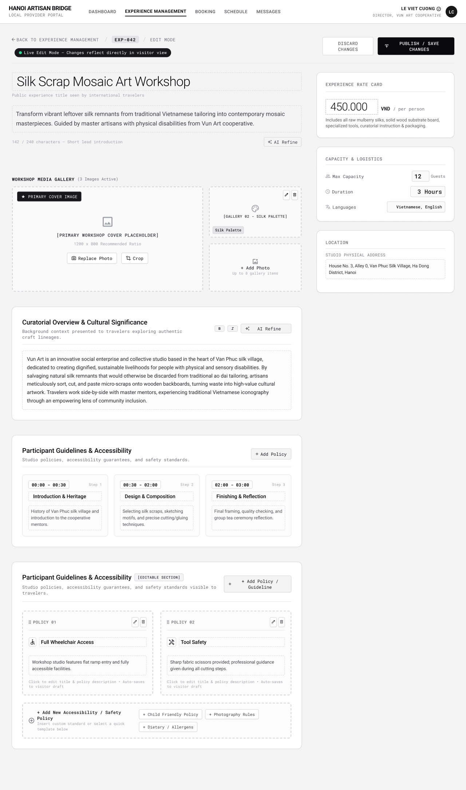

# Screen Spec: EXP070 Edit Experience

| Field | Value |
|---|---|
| Screen ID | `EXP070` |
| Screen name | Edit Experience |
| Actor | Local Provider |
| Priority | Must |
| Belongs to module | `spec-PRF.md` |
| Mockup image | `img/EXP070.png` |
| Status | Draft |

## 1. Purpose

**Shown when:** A Local Provider taps the edit (pencil) icon on EXP067, or "Edit Experience" on EXP068, to update its own Experience. Reuses the field structure of Add Experience (EXP069), pre-filled with saved data, plus inline AI Refine on the Description field.

**The user leaves this screen when:** The Provider discards changes or publishes/saves changes.

## 2. Mockup

## 3. Element inventory

| # | Element | Type | Content / data source | Required | Validation |
|---|---|---|---|---|---|
| 1 | "Back to Experience Management / EXP-042 / Edit Mode" breadcrumb | Navigation | `experience_id` | Yes | — |
| 2 | "Live Edit Mode" status text | Text | Static | No | — |
| 3 | "Discard Changes" button | Button | — | Yes | Confirms if unsaved edits exist |
| 4 | "Publish / Save Changes" button | Button | — | Yes | Enforces BR-009/BR-010 |
| 5 | Experience Title field (pre-filled) | Input | `name` | Yes | Non-empty |
| 6 | Short lead introduction textarea + char counter (pre-filled) | Input | `description` (lead) | Yes | Max 240 chars |
| 7 | "AI Refine" button | Button | Triggers FR-007 draft | No | BR-012/BR-013 |
| 8 | "Workshop Media Gallery (N Images Active)" — primary cover (tagged, editable) | Image upload | `Experience Image` | Yes | BR-008 |
| 9 | Gallery tile with edit/delete icons | Image upload | `Experience Image` | Yes | Cannot drop below the 3 required categories (BR-009) |
| 10 | "+ Add Photo" slot | Image upload | `Experience Image` | No | BR-008 |
| 11 | "Curatorial Overview & Cultural Significance" textarea (pre-filled) + B/I toolbar + AI Refine | Input | `description` (long form) | Yes | — |
| 12 | Session Structure & Schedule — 3 pre-filled step cards | List | Run-of-show | Yes | — |
| 13 | "Participant Guidelines & Accessibility [Editable Section]" — policy cards with edit/delete/drag handle | List/Input | `booking_conditions` entries | No | — |
| 14 | "+ Add New Accessibility / Safety Policy" row + quick-add chips | Button | Adds a new policy card | No | — |
| 15 | "Experience Rate Card" — price input (pre-filled) | Input | `price_per_person` | Yes | Decimal > 0 |
| 16 | "Capacity & Logistics" — Max Capacity input (pre-filled) | Input | `max_participants` | Yes | Integer > 0 |
| 17 | Duration input (pre-filled) | Input | `duration` | Yes | Number > 0. Stored in minutes; displayed in hours on the UI — the system converts the stored value to hours for display and converts the entered hours back to minutes when saving |
| 18 | Languages chips (pre-filled, editable) | Tag list | Languages | No | — |
| 19 | "Location" — address textarea (pre-filled, editable) | Input | Location field | Yes | — |
| 20 | Cancellation Policy selector (pre-filled, editable) | Input | `cancellation_policy`, captured as structured predefined rules (not free text) | Yes | Must select one of the predefined cancellation policy rules |

Note: Group discounts / special rates are out of scope for MVP and are not entered or managed on this screen.

## 4. States

| State | What the user sees | Trigger |
|---|---|---|
| Default | Fully pre-filled form matching the saved Experience, as in the mockup | Experience record loaded successfully |
| Empty (no data) | N/A — this screen only opens against an existing saved record, which by definition already satisfies the required-field rules | — |
| Loading | Skeleton form while the existing Experience data is fetched; "Publish/Save Changes" shows a spinner and disables while saving | Screen opens; user submits |
| Error | Inline field-level errors on save (same rule set as EXP069); a full-page error if the Experience was deleted or reassigned since the list was loaded | Validation fails; fetch fails |
| Success / confirmation | Toast "Changes published" / "Changes saved" | Save succeeds → redirect to `EXP068` |

## 5. Interactions and navigation

| # | Element | User action | System response | Goes to screen |
|---|---|---|---|---|
| 1 | "Discard Changes" | tap | Confirms, then reverts to the last saved version | `EXP068` |
| 2 | "Publish / Save Changes" | tap | Validates and saves; edits go live immediately without a new verification cycle | `EXP068` |
| 3 | "AI Refine" (either field) | tap | Same inline draft flow as EXP069 | stays (inline) |
| 4 | Gallery tile edit/delete icons | tap | Replaces or removes that image, subject to the 3-category minimum | stays |
| 5 | "+ Add New Accessibility / Safety Policy" / quick-add chips | tap | Adds a policy card | stays |

## 6. Screen-level rules

| Rule ID | Rule | Source |
|---|---|---|
| SR-001 | Only the owning Local Provider can edit this Experience. | BR-002 |
| SR-002 | Saved edits publish immediately; they do not trigger a full Provider-profile re-verification cycle. | Module spec Open Question 26 (Closed: "Goes live immediately") |
| SR-003 | The 3-required-image-category and price/capacity/notice-period rules apply on every save, not only at creation. | BR-009, BR-010 |
| SR-004 | AI-refined drafts never auto-replace saved text. | BR-011, BR-012, BR-013 |

## 7. Linked requirements

| FR ID (from the module spec) | What this screen does for it |
|---|---|
| FR-006 | Updates an existing Experience owned by this Provider (pricing, capacity, images, booking conditions). |
| FR-007 | Provides inline AI-refined description drafting for the Description field. |

## 8. Responsive and accessibility notes

- Smallest supported width: 360px
- What collapses or stacks on a narrow screen: same as EXP069 — sidebar cards move below the main form; gallery grid drops to one column; policy cards stack full width.
- Text that must remain readable (contrast, minimum size): the drag-handle and edit/delete icons on policy/gallery cards need a minimum touch target of 44×44px on narrow layouts.

## 9. Open questions

| # | Question | Blocking? | Status |
|---|---|---|---|
| 1 | `[NEEDS CLARIFICATION: can the last remaining image in a required category be deleted before a replacement is uploaded, or must the UI block deletion until a substitute exists?]` | Yes | Open |
| 2 | `[NEEDS CLARIFICATION: what happens if an Experience being edited is referenced by active bookings — are price/capacity/date-sensitive fields locked, per the module spec's edge case list?]` | Yes | Open |

---

## Completion checklist

- [x] The mockup is a separate cropped image file, named with the Screen ID.
- [x] Every visible element in the mockup appears in the element inventory.
- [x] Every input element has a validation rule or an explicit "none."
- [x] All five states are filled in, or marked "not applicable" with a reason.
- [x] Every navigation target is a Screen ID that exists in the Screen List.
- [x] Every element that displays data names the field it displays, matching the module spec.
