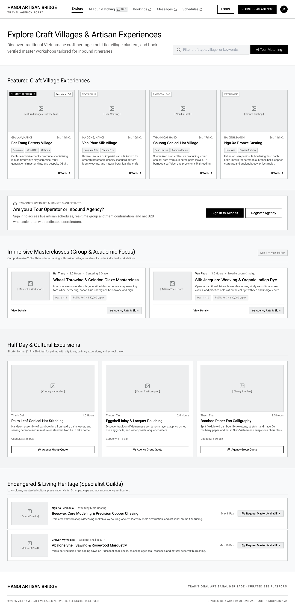

# Screen Spec: EXP120 Public Explore

| Field | Value |
|---|---|
| Screen ID | `EXP120` |
| Screen name | Public Explore |
| Actor | Guest |
| Priority | Must |
| Belongs to module | `spec-M04-EXPLORE.md` |
| Mockup image | `img/EXP120.png` |
| Status | Draft |

## 1. Purpose

**Shown when:** An unauthenticated visitor (Guest) opens the platform's public landing/discovery page, either directly or via a shared link.

**The user leaves this screen when:** they click Login or Register as Agency (go to `AUT009` / `REG003`), open a Village or Experience card (go to `DSC123` / `DSC124`), or trigger any restricted action (search, AI Tour Matching, quote/chat/availability buttons), which redirects them to `AUT009`.

## 2. Mockup

## 3. Element inventory

| # | Element | Type | Content / data source | Required | Validation |
|---|---|---|---|---|---|
| 1 | Logo + tagline | Header/Text | Static brand text "HANOI ARTISAN BRIDGE / TRAVEL AGENCY PORTAL" | Yes | — |
| 2 | Primary nav | Header | Explore (active), AI Tour Matching 🔒, Bookings 🔒, Messages 🔒, Schedules 🔒 | Yes | Locked items are disabled links, not hidden |
| 3 | Login button | Button | Static label "LOGIN" | Yes | — |
| 4 | Register as Agency button | Button | Static label "REGISTER AS AGENCY" | Yes | — |
| 5 | Account icon | Button | Guest avatar placeholder | Yes | — |
| 6 | Page title | Text | "Explore Craft Villages & Artisan Experiences" | Yes | — |
| 7 | Page subtitle | Text | Static description copy | No | — |
| 8 | Search input | Input | Placeholder "Filter craft type, village, or keywords…" | No | Guest input is accepted but any submit action redirects to login rather than executing a search |
| 9 | AI Tour Matching button | Button | Static label, adjacent to search input | Yes | — |
| 10 | "Featured Craft Village Experiences" section header | Text | Static | Yes | — |
| 11 | Village card (×4) | Card/List | badge (e.g. "Cluster Highlight" / craft-type tag), distance/region tag, image, region + est. year, village name, craft tags, 2-line description, "Details →" link | Yes (per card) | Only published/verified villages render |
| 12 | B2B CTA banner | Card | Icon + "B2B CONTRACT RATES & PRIVATE MASTER SLOTS" eyebrow, "Are you a Tour Operator or Inbound Agency?" heading, body copy, "Sign In to Access" button, "Register Agency" button | Yes | — |
| 13 | "Immersive Masterclasses" section header | Text | Static + pax-range badge ("Min 4 – Max 15 Pax") | Yes | — |
| 14 | Masterclass row (×2) | Card | image, village/duration/technique/capacity meta, title, description, pax range, "Public Ref: ~ X đ/pax" note, "View Details" link, "🔒 Agency Rate & Slots" button | Yes (per card) | Net/agency rate never rendered to Guest |
| 15 | "Half-Day & Cultural Excursions" section header | Text | Static | Yes | — |
| 16 | Excursion card (×3) | Card | image, village, duration, title, description, capacity, "🔒 Agency Group Quote" button | Yes (per card) | — |
| 17 | "Endangered & Living Heritage" section header | Text | Static | Yes | — |
| 18 | Heritage guild row (×2) | List | image, village/craft-type, "Max N Pax", title, description, "🔒 Request Master Availability" button | Yes (per row) | Only Guest-safe fields shown; no price |
| 19 | Footer | Footer | Brand name, tagline, copyright, system ref | Yes | — |

## 4. States

| State | What the user sees | Trigger |
|---|---|---|
| Default | Fully populated sections as shown in the mockup, with all restricted fields masked behind lock icons | Page loads with published village/experience data |
| Empty (no data) | Section header remains; card area replaced with "No craft villages or experiences are published yet. Please check back soon." | Backend returns zero published Villages/Experiences |
| Loading | Skeleton placeholders (grey blocks) in place of each card image/text row; search bar and nav render immediately | Initial page load, before card data resolves |
| Error | Section-level banner: "We couldn't load experiences right now." with a "Retry" button; page chrome (header/footer) still renders | Card/village data fetch fails |
| Success / confirmation | Not applicable — this is a browse-only screen with no submission action | — |

## 5. Interactions and navigation

| # | Element | User action | System response | Goes to screen |
|---|---|---|---|---|
| 1 | Login button | tap | — | `AUT009` |
| 2 | Register as Agency button | tap | — | `REG003` |
| 3 | Account icon | tap | — | `AUT009` |
| 4 | Search input | type + submit | Redirects silently (no inline hint) instead of searching | `AUT009` |
| 5 | AI Tour Matching (nav or button) | tap | — | `AUT009` |
| 6 | Village card / "Details →" | tap | Opens the Village Profile screen, with B2B-only fields (B2B Rate, Max Capacity) masked for the unauthenticated Guest | `VIL030` (Guest-masked view) |
| 7 | Masterclass / Excursion / Heritage "View Details" | tap | Opens public experience detail | `DSC124` |
| 8 | Any 🔒 locked action button | tap | — | `AUT009` |
| 9 | "Sign In to Access" (CTA banner) | tap | — | `AUT009` |
| 10 | "Register Agency" (CTA banner) | tap | — | `REG003` |

## 6. Screen-level rules

| Rule ID | Rule | Source |
|---|---|---|
| SR-001 | Price, availability, and contact details are never rendered for Guests; hidden fields show a lock icon plus a CTA to log in | Screen List, EXP120 overview |
| SR-002 | Any restricted action (search, chat, quote, schedule) redirects an unauthenticated user to `AUT009` | Screen List, EXP120 overview |
| SR-003 | Village card navigation goes to `VIL030` itself (rendered with B2B-only fields masked for Guests), not a separate public village page; Provider and Experience card navigation stays within the fully public scope (`DSC123`/`DSC124`), never the unmasked authenticated views (`DSC122`/`DSC033`) | Clarified answer, open question #1 |
| SR-004 | The search-box redirect to `AUT009` on submit is silent — no inline hint or message is shown explaining that login is required | Clarified answer, open question #2 |

## 7. Linked requirements

| FR ID (from the module spec) | What this screen does for it |
|---|---|
| — | [NEEDS CLARIFICATION: module spec `spec-M04-EXPLORE.md` with FR IDs not yet available] |

## 8. Responsive and accessibility notes

- Smallest supported width: 360px
- What collapses or stacks on a narrow screen: primary nav collapses to a menu icon; the 4-column Featured Village grid stacks to 1 column; Masterclass rows stack image above text; Excursion/Heritage cards stack to 1 column
- Text that must remain readable: lock-icon CTA labels and "Details →" links need sufficient contrast against the light-grey card background (currently placeholder greyscale)

## 9. Open questions

| # | Question | Blocking? | Status |
|---|---|---|---|
| 1 | Is there a dedicated public Village page, or do Village cards route straight to `DSC123` Public Provider Profile? — **Answer:** Village cards route straight to `VIL030`. There is no separate public Village page — Guests reach the same Village Profile screen, with B2B-only fields (B2B Rate, Max Capacity) masked. | No | Resolved |
| 2 | Does typing in the search box before submit show any inline hint that login is required, or is the redirect silent? — **Answer:** The redirect is silent — no inline hint is shown. | No | Resolved |

---

## Completion checklist

- [x] The mockup is a separate cropped image file, named with the Screen ID.
- [x] Every visible element in the mockup appears in the element inventory.
- [x] Every input element has a validation rule or an explicit "none".
- [x] All five states are filled in, or marked "not applicable" with a reason.
- [x] Every navigation target is a Screen ID that exists in the Screen List.
- [x] Every element that displays data names the field it displays, matching the module spec.

---

Template source: DBIZ3, VJCBI College - FTU, Session 4. Built on the DBIZ2 Screen Design
structure (Screen List and Screen Layout), per DBIZ3 Syllabus v3.
