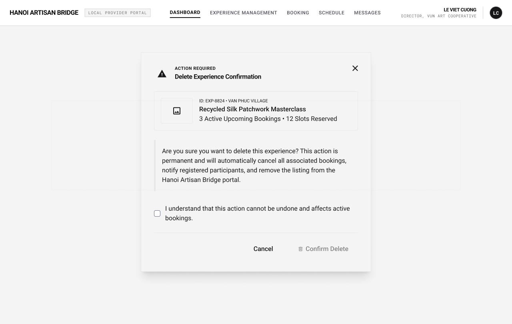

# Screen Spec: EXP132 Delete Experience Confirmation

| Field | Value |
|---|---|
| Screen ID | `EXP132` |
| Screen name | Delete Experience Confirmation |
| Actor | Local Provider |
| Priority | Must |
| Belongs to module | `spec-PRF.md` |
| Mockup image | `img/EXP132.png` |
| Status | Draft |

## 1. Purpose

**Shown when:** A Local Provider taps the delete (trash) icon for one of its own Experiences on EXP067, to confirm a permanent, cascading deletion.

**The user leaves this screen when:** The Provider cancels/closes the modal, or confirms and the deletion completes.

## 2. Mockup

## 3. Element inventory

| # | Element | Type | Content / data source | Required | Validation |
|---|---|---|---|---|---|
| 1 | Modal backdrop (dims the Dashboard behind it) | — | — | Yes | — |
| 2 | Warning icon + "Action Required" label | Text | Static | Yes | — |
| 3 | Modal title "Delete Experience Confirmation" | Header | Static | Yes | — |
| 4 | Close (×) button | Button | — | Yes | — |
| 5 | Experience preview card (thumbnail, ID, Village, title, active bookings/slots reserved) | Card | `Experience` entity: `experience_id`, `village`, `name`, active booking count, reserved slot count | Yes | — |
| 6 | Warning message text | Text | Static; when the Experience has active bookings, explains that deletion is blocked and the Provider must resolve/cancel the active bookings first. When only historical/completed bookings exist, explains that the Experience and its public listing will be permanently removed and that historical booking records are retained and unaffected | Yes | — |
| 7 | Confirmation checkbox | Toggle | "I understand that this action cannot be undone." (shown only when deletion is permitted, i.e. no active bookings) | Yes | Must be checked before "Confirm Delete" is enabled |
| 8 | "Cancel" button | Button | — | Yes | — |
| 9 | "Confirm Delete" button | Button | — | Yes | Disabled until the checkbox is checked; disabled entirely (not offered) if the Experience has active bookings |

## 4. States

| State | What the user sees | Trigger |
|---|---|---|
| Default | Modal open, populated with the selected Experience's summary and an unchecked confirmation checkbox, "Confirm Delete" disabled | Delete icon tapped on `EXP067`, Experience has no active bookings |
| Blocked | Modal shows the active-bookings warning explaining deletion is blocked, with no confirmation checkbox and no enabled "Confirm Delete" — only "Cancel"/Close is available | Delete icon tapped on `EXP067` for an Experience with active bookings |
| Empty (no data) | N/A — the modal can only be opened against an existing selected Experience | — |
| Loading | "Confirm Delete" shows a spinner and the modal is non-dismissible while the delete request is in flight | Confirm Delete tapped |
| Error | Inline error banner inside the modal ("Couldn't delete this Experience — Retry") and "Confirm Delete" re-enables | Delete request fails |
| Success / confirmation | Modal closes; the caller screen (`EXP067`) shows a toast ("Experience deleted") and the row disappears from the table with stat counts updated | Delete succeeds |

## 5. Interactions and navigation

| # | Element | User action | System response | Goes to screen |
|---|---|---|---|---|
| 1 | Close (×) | tap | Dismisses the modal, no changes made | `EXP067` (stays behind modal) |
| 2 | "Cancel" | tap | Dismisses the modal, no changes made | `EXP067` (stays behind modal) |
| 3 | Confirmation checkbox | tap | Toggles the checkbox and enables/disables "Confirm Delete" | stays |
| 4 | "Confirm Delete" | tap | Only available when the Experience has no active bookings; permanently deletes the Experience. Historical/completed booking records are retained and unaffected | `EXP067` |

## 6. Screen-level rules

| Rule ID | Rule | Source |
|---|---|---|
| SR-001 | Only the owning Local Provider can delete its own Experience. | BR-002 |
| SR-002 | "Confirm Delete" stays disabled until the person explicitly acknowledges the checkbox. | Mockup behavior |
| SR-003 | Deletion is blocked when the Experience has active bookings. The Provider must resolve/cancel active bookings before deleting the Experience. | Module spec (Closed) |
| SR-004 | An Experience with only historical/completed bookings can still be deleted; historical booking records are retained and are not affected by the deletion. | Module spec (Closed) |

## 7. Linked requirements

| FR ID (from the module spec) | What this screen does for it |
|---|---|
| FR-006 | Confirms and executes the deletion of a Provider-owned Experience. |

## 8. Responsive and accessibility notes

- Smallest supported width: 360px
- What collapses or stacks on a narrow screen: the modal becomes full-screen (or near-full-width) rather than a centered dialog; footer buttons stack full-width.
- Text that must remain readable (contrast, minimum size): the warning text's left accent bar must remain visually distinct at all widths; "Confirm Delete" disabled state must be clearly distinguishable from its enabled state, not by color alone.

## 9. Open questions

| # | Question | Blocking? | Status |
|---|---|---|---|
| 1 | Deletion is blocked when the Experience has active bookings. The Provider must resolve/cancel active bookings before deleting the Experience. | Yes | Closed |
| 2 | Yes. An Experience with only historical/completed bookings can still be deleted. Historical booking records are retained and are not affected by the deletion. | No | Closed |

---

## Completion checklist

- [x] The mockup is a separate cropped image file, named with the Screen ID.
- [x] Every visible element in the mockup appears in the element inventory.
- [x] Every input element has a validation rule or an explicit "none."
- [x] All five states are filled in, or marked "not applicable" with a reason.
- [x] Every navigation target is a Screen ID that exists in the Screen List.
- [x] Every element that displays data names the field it displays, matching the module spec.
