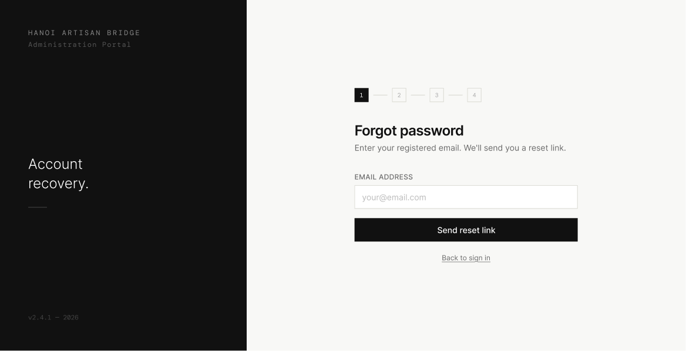

# Screen Spec: PAS011 Enter Registered Email

| Field | Value |
|---|---|
| Screen ID | `PAS011` |
| Screen name | Enter Registered Email |
| Actor | All Actors |
| Priority | Must |
| Belongs to module | `spec-AUT.md` |
| Mockup image | `img/PAS011.png` |
| Status | Draft |

## 1. Purpose

**Shown when:** The user clicks "Forgot your password?" on the Login screen.

**The user leaves this screen when:** They submit a valid email ("Send reset link") or click "Back to sign in".

## 2. Mockup

## 3. Element inventory

| # | Element | Type | Content / data source | Required | Validation |
|---|---|---|---|---|---|
| 1 | Left panel branding | Text | "HANOI ARTISAN BRIDGE", "Administration Portal", tagline "Account recovery.", version stamp | No | — |
| 2 | Step indicator (1–4) | Stepper | Step 1 "Enter email" active | No | — |
| 3 | Heading | Text | "Forgot password" | No | — |
| 4 | Subheading | Text | "Enter your registered email. We'll send you a reset link." | No | — |
| 5 | Email Address | Input | Registered account email | Yes | Valid email format |
| 6 | Send reset link | Button (primary) | Submits the request | No | Disabled until a valid email is entered |
| 7 | Back to sign in | Link | Returns to login | No | — |

## 4. States

| State | What the user sees | Trigger |
|---|---|---|
| Default | Empty email input with placeholder, Send reset link disabled | Screen load |
| Empty (no data) | Same as default — no persisted data on this screen | N/A |
| Loading | Send reset link button shows spinner and is disabled while the request is sent | User taps Send reset link |
| Error | Inline error under the field for invalid email format. If the email is not associated with any registered account, the system shows a generic error and does not confirm or deny whether the email exists: "We couldn't process your request. Please check your email address and try again." | Client validation fails, or the email is not a registered account (handled generically to prevent account/email enumeration) |
| Success / confirmation | Navigates to Check Your Email | Request submitted successfully |

## 5. Interactions and navigation

| # | Element | User action | System response | Goes to screen |
|---|---|---|---|---|
| 1 | Email Address | type | Live format validation | stays |
| 2 | Send reset link | tap | Validates and sends reset email | `PAS014` |
| 3 | Back to sign in | tap | Returns to login | `AUT009` |

## 6. Screen-level rules

| Rule ID | Rule | Source |
|---|---|---|
| SR-001 | Send reset link stays disabled until the email field passes format validation | Mockup — placeholder-only field implies required input |
| SR-002 | For account-enumeration security, an unregistered email shows the generic error "We couldn't process your request. Please check your email address and try again." rather than disclosing whether the email is registered | Clarification |
| SR-003 | The screen layout and field structure shown here (captured from [Actor X]'s view) is a shared template used by multiple actor roles. Role-specific differences (visible fields, permissions, labels) are not exhaustively illustrated by this single mockup and must be validated per actor before implementation. |
## 7. Linked requirements

| FR ID (from the module spec) | What this screen does for it |
|---|---|
| FR-PAS-01 | Starting point for self-service password recovery |

## 8. Responsive and accessibility notes

- Smallest supported width: 360px
- What collapses or stacks on a narrow screen: dark branding panel stacks above the form; step indicator remains horizontal but may shrink
- Text that must remain readable (contrast, minimum size): step numbers ≥12px, form text ≥14px

## 9. Open questions

| # | Question | Blocking? | Status |
|---|---|---|---|
| 1 | Confirm the exact security messaging policy for unregistered emails | Yes | Resolved — see States §4 and SR-002 |

---

## Completion checklist

- [x] The mockup is a separate cropped image file, named with the Screen ID.
- [x] Every visible element in the mockup appears in the element inventory.
- [x] Every input element has a validation rule or an explicit "none".
- [x] All five states are filled in, or marked "not applicable" with a reason.
- [x] Every navigation target is a Screen ID that exists in the Screen List.
- [x] Every element that displays data names the field it displays, matching the module spec.
