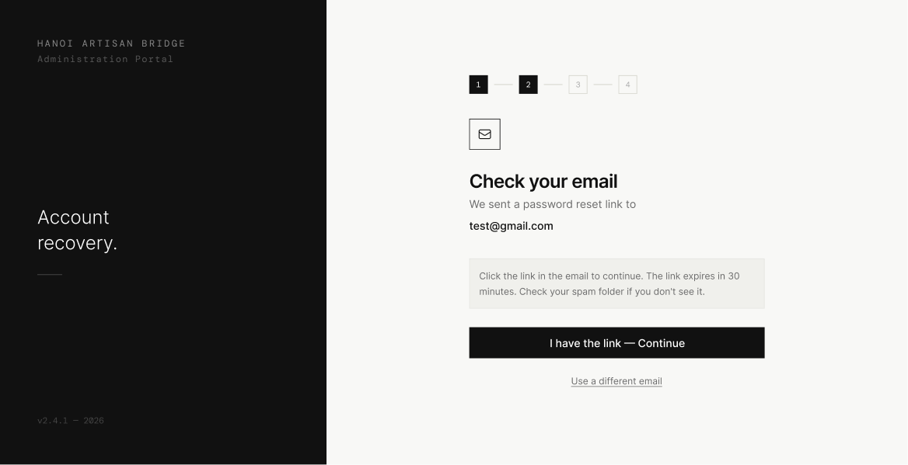

# Screen Spec: PAS014 Check Your Email

| Field | Value |
|---|---|
| Screen ID | `PAS014` |
| Screen name | Check Your Email |
| Actor | All Actors |
| Priority | Must |
| Belongs to module | `spec-PASSWORD.md` |
| Mockup image | `img/PAS014.png` |
| Status | Draft |

## 1. Purpose

**Shown when:** The user successfully submits their email on the Enter Registered Email screen.

**The user leaves this screen when:** They click the reset link in their email (external, lands on PAS142), click "I have the link — Continue", or click "Use a different email".

## 2. Mockup

## 3. Element inventory

| # | Element | Type | Content / data source | Required | Validation |
|---|---|---|---|---|---|
| 1 | Left panel branding | Text | "HANOI ARTISAN BRIDGE", "Administration Portal", tagline "Account recovery.", version stamp | No | — |
| 2 | Step indicator (1–4) | Stepper | Step 2 "Check email" active | No | — |
| 3 | Icon | Image | Envelope/mail glyph | No | — |
| 4 | Heading | Text | "Check your email" | No | — |
| 5 | Subheading | Text | "We sent a password reset link to" | No | — |
| 6 | Submitted email | Text | The email the user entered on PAS011 | No | — |
| 7 | Info box | Text | "Click the link in the email to continue. The link expires in 30 minutes. Check your spam folder if you don't see it." | No | — |
| 8 | I have the link — Continue | Button (primary) | Proceeds as if the reset link was opened | No | — |
| 9 | Use a different email | Link | Returns to email entry | No | — |

## 4. States

| State | What the user sees | Trigger |
|---|---|---|
| Default | Confirmation screen with the submitted email address shown, as in mockup | Screen load right after PAS011 submission |
| Empty (no data) | Not applicable — the submitted email is always present, having come from the prior screen | N/A |
| Loading | Not applicable on initial load; if "Resend"/"Continue" triggers a request, that button shows a spinner while pending | User taps a button that triggers a network call |
| Error | Banner "Could not resend the email, please try again" if resend fails | Resend action fails server-side |
| Success / confirmation | This screen is itself a confirmation state; "I have the link — Continue" proceeds to Set New Password | User has clicked the emailed link or the Continue button |

## 5. Interactions and navigation

| # | Element | User action | System response | Goes to screen |
|---|---|---|---|---|
| 1 | I have the link — Continue | tap | Advances the flow (in a real flow, this is normally reached by clicking the emailed link with a reset token) | `PAS142` |
| 2 | Use a different email | tap | Returns to email entry to correct/resubmit | `PAS011` |

## 6. Screen-level rules

| Rule ID | Rule | Source |
|---|---|---|
| SR-001 | The reset link is time-limited (30 minutes per the info box) | Mockup body text |
| SR-002 | The real trigger to reach PAS142 is normally the emailed link (with a token), not the in-app Continue button — the Continue button on this mockup is a convenience/demo path | Screen List describes PAS142 as reached via "reset link from email" |

## 7. Linked requirements

| FR ID (from the module spec) | What this screen does for it |
|---|---|
| FR-PAS-02 | Confirms the reset email was sent and sets expectations on next steps |

## 8. Responsive and accessibility notes

- Smallest supported width: 360px
- What collapses or stacks on a narrow screen: dark branding panel stacks above the content
- Text that must remain readable (contrast, minimum size): info box text ≥13px, sufficient contrast on light gray background

## 9. Open questions

| # | Question | Blocking? | Status |
|---|---|---|---|
| 1 | Is there a visible "Resend Link" action on this screen, per the original Screen List description, or only "I have the link — Continue" / "Use a different email" as shown in this mockup? | Yes | Resolved — no "Resend Link" action on this screen; only "I have the link — Continue" and "Use a different email" (per element inventory §3) |

---

## Completion checklist

- [x] The mockup is a separate cropped image file, named with the Screen ID.
- [x] Every visible element in the mockup appears in the element inventory.
- [x] Every input element has a validation rule or an explicit "none".
- [x] All five states are filled in, or marked "not applicable" with a reason.
- [x] Every navigation target is a Screen ID that exists in the Screen List.
- [x] Every element that displays data names the field it displays, matching the module spec.
