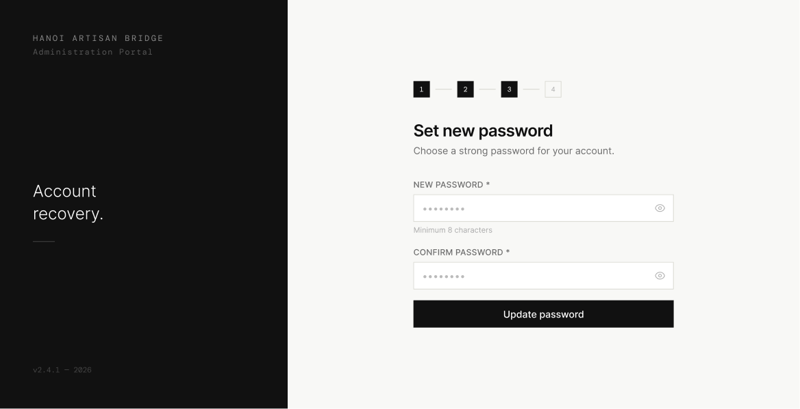

# Screen Spec: PAS142 Set New Password

| Field | Value |
|---|---|
| Screen ID | `PAS142` |
| Screen name | Set New Password |
| Actor | All Actors |
| Priority | Must |
| Belongs to module | `spec-AUT.md` |
| Mockup image | `img/PAS142.png` |
| Status | Draft |

## 1. Purpose

**Shown when:** The user clicks the password reset link from their email (or, in this mockup's flow, "I have the link — Continue" on PAS014).

**The user leaves this screen when:** They submit a valid, matching new password via "Update password".

## 2. Mockup

## 3. Element inventory

| # | Element | Type | Content / data source | Required | Validation |
|---|---|---|---|---|---|
| 1 | Left panel branding | Text | "HANOI ARTISAN BRIDGE", "Administration Portal", tagline "Account recovery.", version stamp | No | — |
| 2 | Step indicator (1–4) | Stepper | Steps 1–3 marked complete/active | No | — |
| 3 | Heading | Text | "Set new password" | No | — |
| 4 | Subheading | Text | "Choose a strong password for your account." | No | — |
| 5 | New Password | Input (masked) | New password value | Yes | Minimum 8 characters, must include uppercase, lowercase, a number, and a special character; spaces are not allowed |
| 6 | Show/hide (eye icon) | Toggle | Reveals/masks New Password | No | — |
| 7 | Password requirements checklist | Inline validation list | Live checklist showing each rule (≥8 characters, uppercase, lowercase, number, special character, no spaces) with a check/cross per item as the user types | No | Each item updates in real time against the New Password value |
| 8 | Confirm Password | Input (masked) | Repeated password value | Yes | Must exactly match New Password |
| 9 | Show/hide (eye icon) | Toggle | Reveals/masks Confirm Password | No | — |
| 10 | Update password | Button (primary) | Submits the new password | No | Disabled until both fields are valid and match |

## 4. States

| State | What the user sees | Trigger |
|---|---|---|
| Default | Both password fields empty with placeholder dots, Update password disabled | Screen load via a valid reset token |
| Empty (no data) | Same as default — no persisted data on this screen | N/A |
| Loading | Update password button shows spinner and is disabled while the request is sent | User taps Update password |
| Error | Inline error "Passwords do not match" or "Password does not meet complexity requirements"; banner "This reset link has expired or is invalid, please request a new one" if the token is bad | Client validation fails, or the reset token is expired/invalid |
| Success / confirmation | Navigates to Password Updated | New password saved successfully |

## 5. Interactions and navigation

| # | Element | User action | System response | Goes to screen |
|---|---|---|---|---|
| 1 | New Password / Confirm Password | type | Live validation of complexity and match | stays |
| 2 | Update password | tap | Validates and saves the new password | `PAS143` |

## 6. Screen-level rules

| Rule ID | Rule | Source |
|---|---|---|
| SR-001 | Update password stays disabled until New Password meets all complexity rules (≥8 characters, uppercase, lowercase, number, special character, no spaces) and Confirm Password matches exactly | Clarification |
| SR-003 | Password requirements are surfaced as a live inline checklist next to the New Password field, not just static helper text | Clarification |
| SR-002 | The reset link/token expires after a set window (30 minutes per PAS014); an expired token should route the user back to request a new link | PAS014 info box |
| SR-004 | The screen layout and field structure shown here (captured from [Actor X]'s view) is a shared template used by multiple actor roles. Role-specific differences (visible fields, permissions, labels) are not exhaustively illustrated by this single mockup and must be validated per actor before implementation. |

## 7. Linked requirements

| FR ID (from the module spec) | What this screen does for it |
|---|---|
| FR-PAS-03 | Lets the user set a new password after verifying identity via emailed link |

## 8. Responsive and accessibility notes

- Smallest supported width: 360px
- What collapses or stacks on a narrow screen: dark branding panel stacks above the form
- Text that must remain readable (contrast, minimum size): helper text ≥12px, input text ≥14px

## 9. Open questions

| # | Question | Blocking? | Status |
|---|---|---|---|
| 1 | Full password complexity ruleset beyond "minimum 8 characters" | Yes | Resolved — ≥8 chars, uppercase, lowercase, number, special character, no spaces; see SR-001 |

---

## Completion checklist

- [x] The mockup is a separate cropped image file, named with the Screen ID.
- [x] Every visible element in the mockup appears in the element inventory.
- [x] Every input element has a validation rule or an explicit "none".
- [x] All five states are filled in, or marked "not applicable" with a reason.
- [x] Every navigation target is a Screen ID that exists in the Screen List.
- [x] Every element that displays data names the field it displays, matching the module spec.
