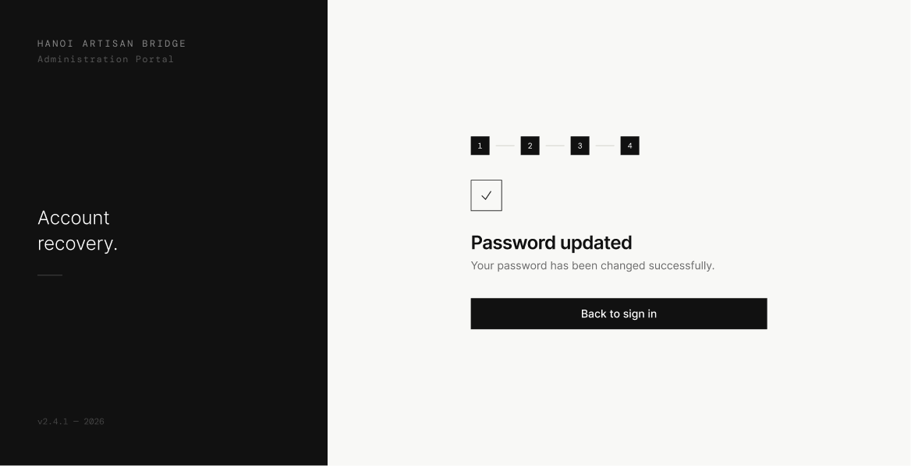

# Screen Spec: PAS143 Password Updated

| Field | Value |
|---|---|
| Screen ID | `PAS143` |
| Screen name | Password Updated |
| Actor | All Actors |
| Priority | Must |
| Belongs to module | `spec-PASSWORD.md` |
| Mockup image | `img/PAS143.png` |
| Status | Draft |

## 1. Purpose

**Shown when:** The user successfully submits a new password on Set New Password.

**The user leaves this screen when:** They click "Back to sign in".

## 2. Mockup

## 3. Element inventory

| # | Element | Type | Content / data source | Required | Validation |
|---|---|---|---|---|---|
| 1 | Left panel branding | Text | "HANOI ARTISAN BRIDGE", "Administration Portal", tagline "Account recovery.", version stamp | No | — |
| 2 | Step indicator (1–4) | Stepper | All four steps marked complete | No | — |
| 3 | Icon | Image | Checkmark glyph | No | — |
| 4 | Heading | Text | "Password updated" | No | — |
| 5 | Subheading | Text | "Your password has been changed successfully." | No | — |
| 6 | Back to sign in | Button (primary) | Navigates to login | No | — |

## 4. States

| State | What the user sees | Trigger |
|---|---|---|
| Default | Success confirmation as shown, with all steps marked complete | Screen load right after a successful password update |
| Empty (no data) | Not applicable — this screen has no data-dependent content | N/A |
| Loading | Not applicable — screen is static; no request is made here | N/A |
| Error | Not applicable — errors on this flow occur on the prior screen (PAS142), not here | N/A |
| Success / confirmation | This screen is itself the success/confirmation state | Password update succeeded |

## 5. Interactions and navigation

| # | Element | User action | System response | Goes to screen |
|---|---|---|---|---|
| 1 | Back to sign in | tap | Navigates to login | `AUT009` |

## 6. Screen-level rules

| Rule ID | Rule | Source |
|---|---|---|
| SR-001 | After any password reset/update via the forgot-password flow, the session is not automatically restored — the user must always sign in again with the new password. There is no "Back to Home" option; only "Back to sign in" is shown, for all users | Clarification |

## 7. Linked requirements

| FR ID (from the module spec) | What this screen does for it |
|---|---|
| FR-PAS-04 | Confirms the password change succeeded and returns the user to authentication |

## 8. Responsive and accessibility notes

- Smallest supported width: 360px
- What collapses or stacks on a narrow screen: dark branding panel stacks above the content
- Text that must remain readable (contrast, minimum size): heading ≥20px, body text ≥14px

## 9. Open questions

| # | Question | Blocking? | Status |
|---|---|---|---|
| 1 | Should an already-authenticated user see a "Back to Home" link here in addition to "Back to sign in"? | No | Resolved — no; all users must sign in again after a password reset, see SR-001 |

---

## Completion checklist

- [x] The mockup is a separate cropped image file, named with the Screen ID.
- [x] Every visible element in the mockup appears in the element inventory.
- [x] Every input element has a validation rule or an explicit "none".
- [x] All five states are filled in, or marked "not applicable" with a reason.
- [x] Every navigation target is a Screen ID that exists in the Screen List.
- [x] Every element that displays data names the field it displays, matching the module spec.
