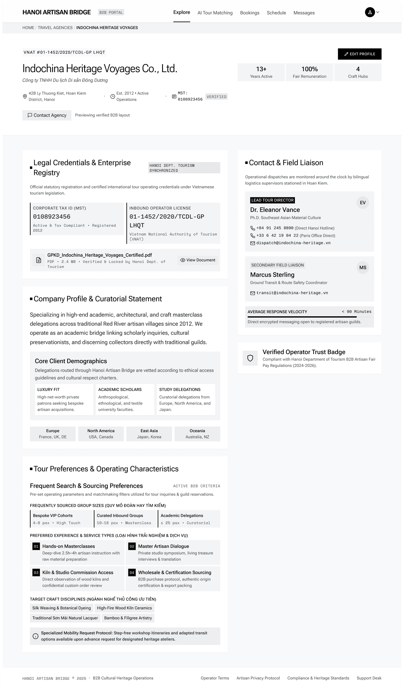

# Screen Spec: PRF019 Agency Profile

| Field | Value |
|---|---|
| Screen ID | `PRF019` |
| Screen name | Agency Profile |
| Actor | Tour Agency |
| Priority | Must |
| Belongs to module | `spec-PRF.md` |
| Mockup image | `img/PRF019.png` |
| Status | Draft |

## 1. Purpose

**Shown when:** A Tour Agency (or another permitted actor, per FR-001 visibility rules) opens the Agency's company profile to view legal, curatorial, contact and tour-preference information.

**The user leaves this screen when:** The user taps "Edit Profile" (own profile, highest-level user only), "Contact Agency," a nav item, or the avatar dropdown.

## 2. Mockup

## 3. Element inventory

| # | Element | Type | Content / data source | Required | Validation |
|---|---|---|---|---|---|
| 1 | Global nav (B2B Portal badge, Explore active, AI Tour Matching, Bookings, Schedule, Messages) | Header | Static links | Yes | — |
| 2 | Avatar / account menu icon | Header | Logged-in user | Yes | — |
| 3 | Breadcrumb (Home / Travel Agencies / [Agency Name]) | Navigation | `Agency Profile.company_name`; "Travel Agencies" segment links to the Travel Agencies directory screen, where users can browse/search verified Travel Agencies | Yes | — |
| 4 | License number line | Text | `agency_id`-adjacent license reference | No | — |
| 5 | Agency legal name (English) | Header | `company_name` | Yes | — |
| 6 | Agency legal name (Vietnamese) | Text | `company_name` (VN) | No | — |
| 7 | Location / established / Tax ID meta row | Text | `location`, established year, MST (Tax ID) | Yes | Tax ID visibility restricted per FR-001/BR-004 |
| 8 | Stat trio (Years Active, Fair Remuneration %, Craft Hubs) | Text | Derived/aggregated Agency metrics | No | — |
| 9 | "Edit Profile" button | Button | — | Yes | PRF019 is the Agency's own profile view: "Edit Profile" is shown only when the logged-in user is the authorized highest-level Agency user viewing its own profile. Other actors see the read-only profile view without this action |
| 10 | "Contact Agency" button | Button | — | No | — |
| 11 | "Previewing verified B2B layout" caption | Text | Static | No | — |
| 12 | "Legal Credentials & Enterprise Registry" card | Card | `Corporate Tax ID (MST)`, `Inbound Operator License` | Yes | Field visibility restricted per BR-004 |
| 13 | Registration document row + "View Document" | Button/File | Uploaded registration PDF | No | — |
| 14 | "Company Profile & Curatorial Statement" section | Text | `description` | Yes | — |
| 15 | "Core Client Demographics" sub-section (3 tiles + region chips) | Card | `tour_types`/target market attributes | No | `tour_types` visible only to the Agency itself and HDT per module spec Q3 |
| 16 | "Tour Preferences & Operating Characteristics" section | Card | Group sizes, preferred experience types, target craft disciplines, mobility protocol | No | — |
| 17 | "Contact & Field Liaison" card (Lead Tour Director) | Card | Name, title, phone(s), email | Yes | Visible to all authenticated actors per module spec Q4 |
| 18 | "Secondary Field Liaison" card | Card | Name, role, email | No | — |
| 19 | "Average Response Velocity" metric | Text | SLA metric | No | — |
| 20 | "Verified Operator Trust Badge" card | Card | Compliance badge text | No | — |
| 21 | Footer nav & legal links | Footer | Static | Yes | — |

## 4. States

| State | What the user sees | Trigger |
|---|---|---|
| Default | Fully populated Agency profile, as in the mockup | Agency profile exists and is loaded |
| Empty (no data) | Optional sections (Curatorial Statement, Tour Preferences, Secondary Liaison) show "Not provided yet" placeholders; if viewed by the owner, a prompt to complete the profile via Edit Profile | Newly registered Agency that hasn't completed optional fields |
| Loading | Skeleton blocks for header, stat trio and the main cards | Screen just opened |
| Error | Full-page error ("This Agency profile is unavailable") with link back | Agency not found or fetch fails |
| Success / confirmation | Toast "Profile updated" shown here immediately after redirect from `PRF021` | Returning from a successful Edit Profile save |

## 5. Interactions and navigation

| # | Element | User action | System response | Goes to screen |
|---|---|---|---|---|
| 1 | "Edit Profile" | tap | Opens the edit form, pre-filled | `PRF021` |
| 2 | "Contact Agency" | tap | Opens Chat with this Agency | Chat (`COM048`/`COM065` depending on viewer) |
| 3 | "View Document" | tap | Opens the registration PDF | stays (opens file) |
| 4 | Avatar | tap | Opens account dropdown | Account Dropdown (—) |
| 5 | Nav items | tap | Navigates to that module | `EXP017` / `AIT121` / `BKG137` / `SCH141` / Messages |
| 6 | Breadcrumb "Travel Agencies" | tap | Navigates to the Travel Agencies directory, where users can browse/search verified Travel Agencies | Travel Agencies directory |

## 6. Screen-level rules

| Rule ID | Rule | Source |
|---|---|---|
| SR-001 | PRF019 is the Agency's own profile view. "Edit Profile" is shown only when the logged-in user is viewing their own profile as the authorized highest-level Agency user; other actors see the read-only view. | Screen List (PRF019 overview), module spec Q7 |
| SR-002 | Fields shown differ by actor: Tax ID and other restricted fields follow BR-004 visibility rules; `tour_types` is visible only to the Agency itself and HDT. | BR-004, module spec Q3 |
| SR-003 | Agency contact information is visible to all authenticated actors (Provider, HDT, UBND). | Module spec Q4 |
| SR-004 | No user can edit the Agency profile from this screen; it is view-only. | BR-001, BR-003 |

## 7. Linked requirements

| FR ID (from the module spec) | What this screen does for it |
|---|---|
| FR-001 | Displays Agency profile information filtered to the viewing actor's permitted field set. |

## 8. Responsive and accessibility notes

- Smallest supported width: 360px
- What collapses or stacks on a narrow screen: the two-column layout (main content + Contact & Field Liaison sidebar) stacks to a single column, sidebar moving below the main content; the region/market chip rows wrap.
- Text that must remain readable (contrast, minimum size): "Verified"/"Locked" tags must remain legible against their pill backgrounds at minimum 12px.

## 9. Open questions

| # | Question | Blocking? | Status |
|---|---|---|---|
| 1 | PRF019 is the Agency's own profile view. "Edit Profile" is shown only when the logged-in user is viewing their own profile. Other actors see the read-only profile view without this action. | Yes | Closed |
| 2 | The "Travel Agencies" breadcrumb links to the Travel Agencies directory screen, where users can browse/search verified Travel Agencies. | No | Closed |

---

## Completion checklist

- [x] The mockup is a separate cropped image file, named with the Screen ID.
- [x] Every visible element in the mockup appears in the element inventory.
- [x] Every input element has a validation rule or an explicit "none" (screen is view-only).
- [x] All five states are filled in, or marked "not applicable" with a reason.
- [x] Every navigation target is a Screen ID that exists in the Screen List.
- [x] Every element that displays data names the field it displays, matching the module spec.
