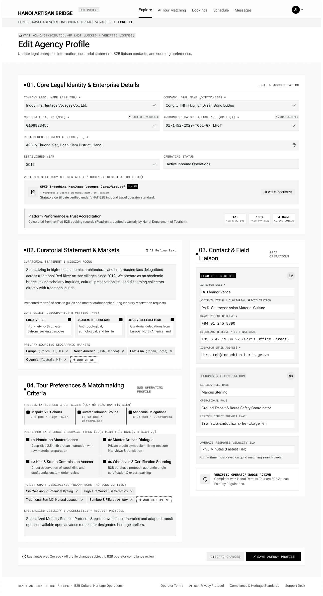

# Screen Spec: PRF021 Edit Agency Profile

| Field | Value |
|---|---|
| Screen ID | `PRF021` |
| Screen name | Edit Agency Profile |
| Actor | Tour Agency |
| Priority | Must |
| Belongs to module | `spec-PRF.md` |
| Mockup image | `img/PRF021.png` |
| Status | Revised — pending human approval |

## 1. Purpose

Allows the authorized highest-level Agency user to edit company information, tour preferences/characteristics, and contact information.

The controls and decisions below define the current screen specification.

## 2. Mockup

## 3. Element inventory

| # | Element | Type | Content / data source | Required | Validation |
|---|---|---|---|---|---|
| 1 | Edit Agency Profile | Heading | Edit Agency Profile | No | Static screen title |
| 2 | Agency id | Input | `agency_id` — F-PROFILE-02 | Yes | agency_id (ID; Required — own organization) |
| 3 | Company name | Input | `company_name` — F-PROFILE-02 | No | company_name (String, max 255; Optional) |
| 4 | Tax id | Input | `tax_id` — F-PROFILE-02 | No | tax_id (String, 10 or 13 numeric digits; Optional) |
| 5 | Location | Structured input | `location` — F-PROFILE-02 | No | location (Object{street, ward, district, city_province}; Optional) |
| 6 | Description | Input | `description` — F-PROFILE-02 | No | description (Text, max 1000; Optional) |
| 7 | Contact info | Structured input | `contact_info` — F-PROFILE-02 | No | contact_info (Object{contact_person_name, phone_number, business_email}; Optional) |
| 8 | Team size | Input | `team_size` — F-PROFILE-02 | No | team_size (Integer > 0; Optional) |
| 9 | Tour types | Structured input | `tour_types` — F-PROFILE-02 | No | tour_types (Array<Enum>; Optional) |
| 10 | Images | File input | `images` — F-PROFILE-02 | No | images (Array<Image: JPG/JPEG/PNG/WEBP, max 10MB, min 1280×720>; Optional) |
| 11 | Current approved legal information | Read-only panel | F-PROFILE-02 — permitted output fields only | No | Actor-specific field visibility; optional missing values omitted. Never expose tokens, password hashes, session values or internal delivery diagnostics. |
| 12 | Pending legal-change review status | Read-only panel | F-PROFILE-02 — permitted output fields only | No | Actor-specific field visibility; optional missing values omitted. Never expose tokens, password hashes, session values or internal delivery diagnostics. |
| 13 | Save | Button / navigation | Major legal changes enter HDT review; non-major changes apply immediately | No | Enabled only when the linked permission/validation guard succeeds |
| 14 | Discard | Button / navigation | No mutation | No | Enabled only when the linked permission/validation guard succeeds |

## 4. States

| State | What the user sees | Trigger |
|---|---|---|
| Default | Permitted data or a prefilled form; role-specific actions only | Authorized screen load |
| Empty | No records/optional values shown with explanatory text; never infer availability from absent bookings | Successful response with no data |
| Loading | Skeleton/progress; mutation actions disabled while their request is pending | Fetch/upload/save in progress |
| Error | Defined field errors or fetch failure with Retry; no successful transition or partial mutation is shown | Validation, permission or service failure |
| Success / confirmation | Refreshed read-only data or saved result; navigate only after successful linked action | Successful read/mutation |

## 5. Interactions and navigation

| # | Element | User action | System response | Goes to screen |
|---|---|---|---|---|
| 1 | Save | Select | Major legal changes enter HDT review; non-major changes apply immediately | PRF019 |
| 2 | Discard | Select | No mutation | PRF019 |

Shared avatar navigation for authenticated actors: My Account → ACC129; My Business → PRF019 (Agency) / PRF127 (Provider), omitted for Admin without a business; Logout → AUT026. Agency main navigation uses EXP017/AIT121/BKG137/SCH141/COM048; Provider uses DSH018/EXP067/BKG133/SCH139/COM065; Admin uses ADM079/ADM095. Guest has EXP120 and AUT009/REG003, with no AI navigation.

## 6. Screen-level rules

| Rule ID | Rule | Source |
|---|---|---|
| SR-001 | Check action permission and resource scope on every protected request; hiding a button alone is insufficient. Read-only screens have no mutation controls. | AUT FR-016 |
| SR-002 | Validate the inputs and render outputs exactly as the linked module contracts; server/context fields are not freely editable form controls. | Linked FR table |

## 7. Linked requirements

| Module | FR ID | Function ID | Screen responsibility |
|---|---|---|---|
| PRF | FR-002 | F-PROFILE-02 | Edit Agency Information |

## 8. Responsive and accessibility notes

- Smallest supported width: 360px
- What collapses or stacks on a narrow screen: the two-column section layout (01/02/04 main column vs. 03 sidebar) stacks to a single column; selectable-card grids drop to one card per row.
- Text that must remain readable (contrast, minimum size): "Locked" tags and the read-only Platform Performance box must be visually distinguishable from editable fields (e.g., muted background) at all widths.

## 9. Decisions and review

Use the approved Function List and [shared consistency contract](../docs/consistency-contract.md). No new feature is implied by decorative legacy mockup copy. Human approval of this revision is pending; technical Plan choices remain separately identified.

## Completion checklist

- [x] Linked functions have corresponding module FR and IO contracts.
- [x] Inputs name their validation and required/optional condition.
- [x] Default, empty, loading, error and success states are defined.
- [x] Navigation targets use existing Screen IDs.
- [ ] Human approval of the revised specification.
