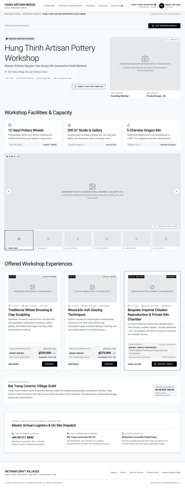

# Screen Spec: PRF127 Provider Profile

| Field | Value |
|---|---|
| Screen ID | `PRF127` |
| Screen name | Provider Profile |
| Actor | Local Provider |
| Priority | Must |
| Belongs to module | `spec-PRF.md` |
| Mockup image | `img/PRF127.png` |
| Status | Draft |

## 1. Purpose

**Shown when:** A Local Provider opens its own workshop profile (e.g. via "My Business" in the account menu, or the dashboard) to review business information, description, contact information, Experiences, and its associated Village, as the Provider itself sees it.

**The user leaves this screen when:** The Provider taps "Edit Provider Profile," opens the Village link, opens an Experience, or navigates via the top nav.

## 2. Mockup

## 3. Element inventory

| # | Element | Type | Content / data source | Required | Validation |
|---|---|---|---|---|---|
| 1 | Global nav (Dashboard, Experience Management, Bookings, Schedule, Messages) | Header | Static links | Yes | — |
| 2 | Workshop identity chip (verified check + role) | Header | `business_name`, role label | Yes | — |
| 3 | User avatar / name / role | Header | Logged-in Provider user | Yes | — |
| 4 | Breadcrumb (Provider Portal / Workshop Profile / [Workshop] (Lead Admin)) | Navigation | `business_name` | Yes | — |
| 5 | "Access Level: Full Management" label | Text | Session role/permission | No | — |
| 6 | "Provider Administration" label | Text | Static | Yes | — |
| 7 | "Edit Provider Profile" button | Button | — | Yes | — |
| 8 | Verified badge | Text | `verification_status = Verified` | Yes | — |
| 9 | Workshop title | Header | `business_name` | Yes | — |
| 10 | Master artisan / subtitle | Text | `artisan_names` | No | — |
| 11 | Location line | Text | `location` | Yes | — |
| 12 | Specialty tag chips (Est. year, craft tags) | Tag list | Craft specialty tags | No | — |
| 13 | "Direct Chat with Master" button | Button | — | No | Hidden on this screen: the button is only available when viewing another Provider's profile, not the profile owner's own view |
| 14 | Hero image | Image | Primary `profile_images` item | Yes | — |
| 15 | Guild Status / B2B Capacity info row | Text | Provider profile fields | No | — |
| 16 | "Workshop Facilities & Capacity" section (3 cards) | Card | Facility attributes | No | — |
| 17 | Gallery carousel + slide controls + thumbnail strip (6 items) | Image | `profile_images` array | Yes | BR-008 |
| 18 | "Offered Workshop Experiences" section (3 cards) | Card | `Experience` entities owned by this Provider | Yes | — |
| 19 | "View Details" link (per card) | Link | Navigates to owner Experience detail | Yes | — |
| 20 | Card CTA button, labeled "Edit" (replaces "Booking" shown in mockup) | Button | Opens the Experience editing flow for this Provider-owned Experience | Yes | — |
| 21 | "Village Affiliation" section | Card | `Village` entity | Yes | — |
| 22 | Registry number box | Text | `Village` registry data | No | — |
| 23 | "Master Artisan Logistics & On-Site Dispatch" box | Card | Dispatch contact fields (read-only here; editable via PRF128) | No | — |
| 24 | Footer nav & legal links | Footer | Static | Yes | — |

## 4. States

| State | What the user sees | Trigger |
|---|---|---|
| Default | Full Provider profile as the owner sees it, matching the mockup | Profile exists and has been completed at least once |
| Empty (no data) | A first-time Provider (post account creation, pre profile completion) sees a "Complete your profile" prompt in place of the populated sections, with a direct link to Edit Provider Profile | `verification_status` is not yet set / profile fields are unfilled (per module spec assumption: "Provider can log in while its business profile is not yet Verified") |
| Pending Verification | A status banner indicates the profile is under review; editing remains available via "Edit Provider Profile," but the profile cannot be listed until approved | `verification_status = Pending Verification` |
| Revision Required | A banner shows the revision feedback and provides an "Edit Profile" action to address the required changes and resubmit | `verification_status = Revision Required` |
| Loading | Skeleton blocks for header, hero image, facility cards, and Experience cards | Screen just opened |
| Error | Full-page error ("Couldn't load your profile — Retry") | Fetch fails |
| Success / confirmation | Toast "Profile updated" (or, on first-ever save, "Profile submitted for verification") shown here after redirect from `PRF128` | Returning from a successful Edit Provider Profile save |

## 5. Interactions and navigation

| # | Element | User action | System response | Goes to screen |
|---|---|---|---|---|
| 1 | "Edit Provider Profile" | tap | Opens the edit form, pre-filled | `PRF128` |
| 2 | Nav: Dashboard / Experience Management / Bookings / Schedule / Messages | tap | Navigates to that module | `DSH018` / `EXP067` / `BKG133` / `SCH139` / `COM065` |
| 3 | Carousel arrows / thumbnails | tap | Cycles/selects gallery image | stays |
| 4 | Experience "View Details" | tap | Opens this Provider's own Experience in owner view | `EXP068` |
| 4a | Experience card "Edit" button | tap | Opens the Experience editing flow | `EXP070` |
| 5 | "Bat Trang Ceramic Village Guild" title | tap | Opens the affiliated Village profile | `VIL030` |
| 6 | Avatar | tap | Opens account dropdown | Account Dropdown (—) |

## 6. Screen-level rules

| Rule ID | Rule | Source |
|---|---|---|
| SR-001 | This screen shows the same profile content the Provider itself owns and can only be reached by that Provider's authenticated session (or an Admin in read-only mode via a separate Admin screen). | BR-002, BR-003 |
| SR-002 | Editing happens exclusively via PRF128; this screen is view-only. | Consistent with the module's view/edit split |
| SR-003 | The verification badge reflects the Provider's actual `verification_status` (Verified / Pending Verification / Revision Required), not always "Verified" as shown in the mockup. | BR-006 |

## 7. Linked requirements

| FR ID (from the module spec) | What this screen does for it |
|---|---|
| FR-004 | Displays the Local Provider's own business profile, description, contact information, Experiences and associated Village. |

## 8. Responsive and accessibility notes

- Smallest supported width: 360px
- What collapses or stacks on a narrow screen: same stacking pattern as DSC122 (hero stacks, facility/Experience cards stack, thumbnail strip scrolls horizontally).
- Text that must remain readable (contrast, minimum size): verification status badge text must remain legible and distinguishable across all three possible states (Verified / Pending Verification / Revision Required), not color alone.

## 9. Open questions

| # | Question | Blocking? | Status |
|---|---|---|---|
| 1 | The "Direct Chat with Master" button is hidden when the viewer is the profile owner; it is only available when viewing another Provider's profile. | Yes | Closed |
| 2 | For the Provider's own Experience cards, "Booking" is replaced with "Edit." Clicking it opens the Experience editing flow in EXP070. | Yes | Closed |
| 3 | Pending Verification: a status banner indicates the profile is under review; editing remains available, but the profile cannot be listed until approved. Revision Required: a banner shows the revision feedback and provides an "Edit Profile" action to address the required changes and resubmit. | Yes | Closed |

---

## Completion checklist

- [x] The mockup is a separate cropped image file, named with the Screen ID.
- [x] Every visible element in the mockup appears in the element inventory.
- [x] Every input element has a validation rule or an explicit "none" (screen is view-only).
- [x] All five states are filled in, or marked "not applicable" with a reason.
- [x] Every navigation target is a Screen ID that exists in the Screen List.
- [x] Every element that displays data names the field it displays, matching the module spec.
