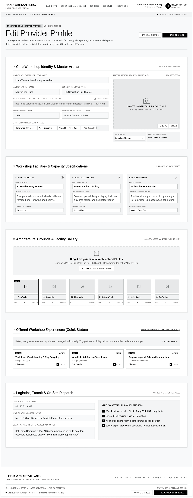

# Screen Spec: PRF128 Edit Provider Profile

| Field | Value |
|---|---|
| Screen ID | `PRF128` |
| Screen name | Edit Provider Profile |
| Actor | Local Provider |
| Priority | Must |
| Belongs to module | `spec-PRF.md` |
| Mockup image | `img/PRF128.png` |
| Status | Revised — pending human approval |

## 1. Purpose

Allows a Local Provider to edit its own business information. Uses the same field structure as Provider Profile, with inline AI Refine for the description.

The controls and decisions below define the current screen specification.

## 2. Mockup

## 3. Element inventory

| # | Element | Type | Content / data source | Required | Validation |
|---|---|---|---|---|---|
| 1 | Edit Provider Profile | Heading | Edit Provider Profile | No | Static screen title |
| 2 | Provider id | System context (not editable) | `provider_id` — F-PROFILE-04 | Yes | provider_id (ID; Required) |
| 3 | Business name | Input | `business_name` — F-PROFILE-04 | Conditional | business_name (String, max 255; Required for submission) |
| 4 | Craft type | Select | `craft_type` — F-PROFILE-04 | Conditional | craft_type (Enum[Ceramics, Silk/Textile, Woodcarving, Food/Culinary, Metalwork, Paper/Painting, Other]; Required for submission) |
| 5 | Artisan names | Structured input | `artisan_names` — F-PROFILE-04 | No | artisan_names (Array<String>; Optional) |
| 6 | Business registration number | Input | `business_registration_number` — F-PROFILE-04 | Conditional | business_registration_number (String; Required for submission) |
| 7 | Business registration certificate | File input | `business_registration_certificate` — F-PROFILE-04 | Conditional | business_registration_certificate (File[PDF/JPG/JPEG/PNG], max 10MB; Required for submission) |
| 8 | Location address | Input | `location_address` — F-PROFILE-04 | Conditional | location_address (String; Required for submission) |
| 9 | Description | Input | `description` — F-PROFILE-04 | No | description (Text, max 1000; Optional) |
| 10 | Operating hours | Structured input | `operating_hours` — F-PROFILE-04 | No | operating_hours ( Object{ Monday: Array<TimeRange> Optional, Tuesday: Array<TimeRange> Optional, Wednesday: Array<TimeRange> Optional, Thursday: Array<TimeRange> Optional, Friday: Array<TimeRange> Optional, Saturday: Array<TimeRange> Optional, Sunday: Array<TimeRange> Optional }; Optional — recurring weekly Provider operating hours used as the baseline availability source for F-SCHED-09 ) |
| 11 | Booking conditions | Structured input | `booking_conditions` — F-PROFILE-04 | No | booking_conditions (Object; Optional) |
| 12 | Profile images | File input | `profile_images` — F-PROFILE-04 | No | profile_images (Array<Image: JPG/JPEG/PNG/WEBP, max 10MB, min 1280×720>; Optional) |
| 13 | Description draft preview: Accept / Edit / Regenerate / Discard | Read-only panel | F-PROFILE-04, F-PROFILE-07 — permitted output fields only | No | Actor-specific field visibility; optional missing values omitted. Never expose tokens, password hashes, session values or internal delivery diagnostics. |
| 14 | Current profile review and published status | Read-only panel | F-PROFILE-04, F-PROFILE-07 — permitted output fields only | No | Actor-specific field visibility; optional missing values omitted. Never expose tokens, password hashes, session values or internal delivery diagnostics. |
| 15 | Save Changes | Button / navigation | Incomplete profile stays Draft; complete first save submits Pending Verification | No | Enabled only when the linked permission/validation guard succeeds |
| 16 | Discard | Button / navigation | No autosave | No | Enabled only when the linked permission/validation guard succeeds |
| 17 | AI Refine | Button / navigation | Accept/Edit/Regenerate/Discard before replacing description | No | Enabled only when the linked permission/validation guard succeeds |
| 18 | Manage Experiences | Button / navigation | Create/Update/Delete; no publish toggle | No | Enabled only when the linked permission/validation guard succeeds |

## 4. States

| State | What the user sees | Trigger |
|---|---|---|
| Default | Permitted data or a prefilled form; role-specific actions only | Authorized screen load |
| Empty | No records/optional values shown with explanatory text; never infer availability from absent bookings | Successful response with no data |
| Loading | Skeleton/progress; mutation actions disabled while their request is pending | Fetch/upload/save in progress |
| Error | Defined field errors or fetch failure with Retry; no successful transition or partial mutation is shown | Validation, permission or service failure |
| Success / confirmation | Refreshed read-only data or saved result; navigate only after successful linked action | Successful read/mutation |

## 5. Interactions and navigation

| # | Element | User action | System response | Goes to screen |
|---|---|---|---|---|
| 1 | Save Changes | Select | Incomplete profile stays Draft; complete first save submits Pending Verification | PRF127 |
| 2 | Discard | Select | No autosave | PRF127 |
| 3 | AI Refine | Select | Accept/Edit/Regenerate/Discard before replacing description | stay |
| 4 | Manage Experiences | Select | Create/Update/Delete; no publish toggle | EXP067 |

Shared avatar navigation for authenticated actors: My Account → ACC129; My Business → PRF019 (Agency) / PRF127 (Provider), omitted for Admin without a business; Logout → AUT026. Agency main navigation uses EXP017/AIT121/BKG137/SCH141/COM048; Provider uses DSH018/EXP067/BKG133/SCH139/COM065; Admin uses ADM079/ADM095. Guest has EXP120 and AUT009/REG003, with no AI navigation.

## 6. Screen-level rules

| Rule ID | Rule | Source |
|---|---|---|
| SR-001 | Check action permission and resource scope on every protected request; hiding a button alone is insufficient. Read-only screens have no mutation controls. | AUT FR-016 |
| SR-002 | Validate the inputs and render outputs exactly as the linked module contracts; server/context fields are not freely editable form controls. | Linked FR table |
| SR-003 | Incomplete Save Changes remains Draft; the first complete save submits Pending Verification. No autosave. A major revision of a Verified profile retains the previously published Verified version until approval. | Function List and shared consistency contract |
| SR-004 | Operating hours are optional weekly ranges; no configured ranges means no calculated available periods. Images <=10MB and >=1280×720; a portrait additionally needs height>=900, hence minimum1280×900. No independent six-photo submission requirement. | Function List and shared consistency contract |

## 7. Linked requirements

| Module | FR ID | Function ID | Screen responsibility |
|---|---|---|---|
| PRF | FR-004 | F-PROFILE-04 | Edit Local Provider Profile |
| PRF | FR-007 | F-PROFILE-07 | Generate Standardized Description |

## 8. Responsive and accessibility notes

- Smallest supported width: 360px
- What collapses or stacks on a narrow screen: the two-column layout within Section 01 (fields + archival photo) stacks; the 3 facility cards in Section 02 stack to one column; the gallery thumbnail grid in Section 03 drops from a 6-wide to a 2-wide grid.
- Text that must remain readable (contrast, minimum size): the "Locked/Certified" tag on the Village field and the "Cover" tag on the gallery must remain visible against thumbnail backgrounds at reduced widths.

## 9. Decisions and review

Use the approved Function List and [shared consistency contract](../docs/consistency-contract.md). No new feature is implied by decorative legacy mockup copy. Human approval of this revision is pending; technical Plan choices remain separately identified.

## Completion checklist

- [x] Linked functions have corresponding module FR and IO contracts.
- [x] Inputs name their validation and required/optional condition.
- [x] Default, empty, loading, error and success states are defined.
- [x] Navigation targets use existing Screen IDs.
- [ ] Human approval of the revised specification.
