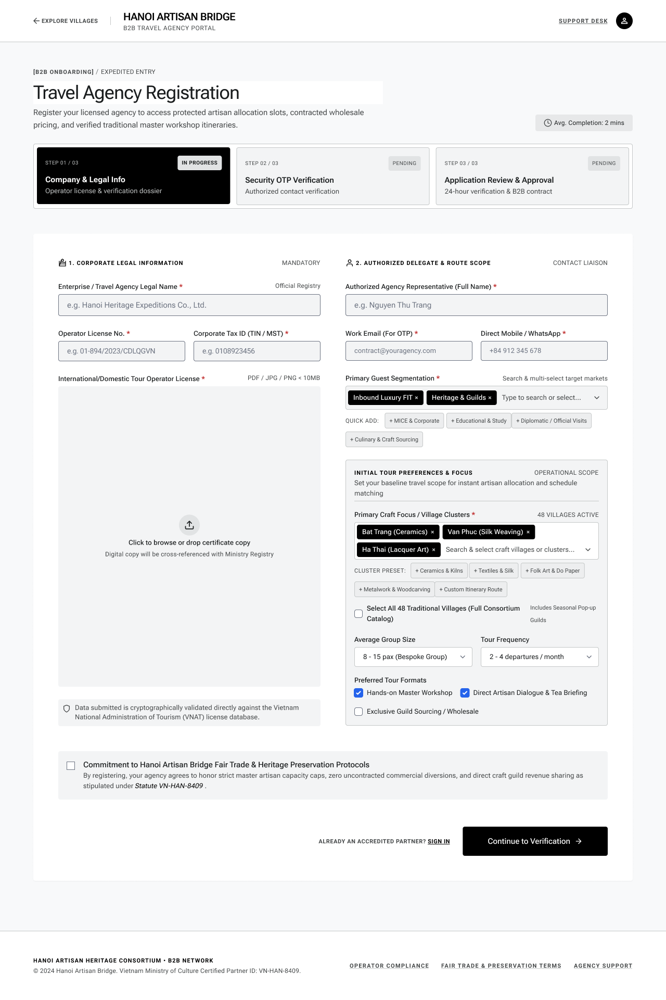

# Screen Spec: REG003 Agency Registration

| Field | Value |
|---|---|
| Screen ID | `REG003` |
| Screen name | Agency Registration |
| Actor | Guest |
| Priority | Must |
| Belongs to module | `spec-AUT.md` |
| Mockup image | `img/REG003.png` |
| Status | Revised — pending human approval |

## 1. Purpose

Agency creates an account and submits company/legal information for HDT verification. Registration is available only to Tour Agencies. The same screen also supports secure edit mode when a Guest opens the single-use link from an HDT Request More Information decision (F-AUTH-26); in that mode, existing request data is prefilled and the password/account-creation fields are not re-entered.

The controls and decisions below define the current screen specification.

## 2. Mockup

## 3. Element inventory

| # | Element | Type | Content / data source | Required | Validation |
|---|---|---|---|---|---|
| 1 | Agency Registration | Heading | Agency Registration | No | Static screen title |
| 2 | Full name | Input | `full_name` — F-AUTH-02 | Yes | full_name (String, max 100; Required) |
| 3 | Email | Input | `email` — F-AUTH-02 | Yes | email (Email, max 254; Required) |
| 4 | Password | Masked input | `password` — F-AUTH-02 | Yes | password (String, 8–64 characters; Required — must contain at least 1 uppercase letter, 1 lowercase letter, 1 number and 1 special character; whitespace not allowed) |
| 5 | Confirm password | Masked input | `confirm_password` — F-AUTH-02 | Yes | confirm_password (String; Required — must exactly match password) |
| 6 | Company name | Input | `company_name` — F-AUTH-02 | Yes | company_name (String, max 255; Required) |
| 7 | Company type | Select | `company_type` — F-AUTH-02 | Yes | company_type (Enum[Travel Agency, Tour Operator, TMC]; Required) |
| 8 | Tax id | Input | `tax_id` — F-AUTH-02 | Yes | tax_id (String; Required — 10 or 13 numeric digits) |
| 9 | Location | Structured input | `location` — F-AUTH-02 | Yes | location (Object{street: String, ward: String, district: String, city_province: String}; Required) |
| 10 | Contact information | Structured input | `contact_information` — F-AUTH-02 | Yes | contact_information (Object{contact_person_name: String, phone_number: String, business_email: Email Optional}; Required — phone accepts 10–15 digits with optional leading +) |
| 11 | Team size | Input | `team_size` — F-AUTH-02 | Yes | team_size (Integer > 0; Required — current Agency headcount) |
| 12 | Tour types | Structured input | `tour_types` — F-AUTH-02 | Yes | tour_types (Array<Enum[Cultural/Heritage, Craft Village/Experiential, Culinary, Educational/Study Tour, Corporate/MICE, Family/Leisure, Other]>; Required — at least 1 value) |
| 13 | Registration documents | File input | `registration_documents` — F-AUTH-02 | Yes | registration_documents (Array<File>; Required — at least Business Registration Certificate; Travel Service Business License required when applicable; allowed formats PDF/JPG/JPEG/PNG; max 10MB/file; max 5 files) |
| 14 | Continue to email verification | Button / navigation | Validate fields, reject duplicate email, create one server-side registration request, then issue OTP for its ID | No | Enabled only when the linked permission/validation guard succeeds |
| 15 | Sign in | Button / navigation | Open login | No | Enabled only when the linked permission/validation guard succeeds |
| 16 | Resubmit registration | Button / mutation | Submit the revised request version from secure edit mode | Yes in secure edit mode | Enabled only when the single-use `resubmission_token` is within its 24-hour validity period and required revised fields pass server validation |

## 4. States

| State | What the user sees | Trigger |
|---|---|---|
| Default | Permitted data or a prefilled form; role-specific actions only | Authorized screen load |
| Empty | No records/optional values shown with explanatory text; never infer availability from absent bookings | Successful response with no data |
| Loading | Skeleton/progress; mutation actions disabled while their request is pending | Fetch/upload/save in progress |
| Error | Defined field errors or fetch failure with Retry; no successful transition or partial mutation is shown | Validation, permission or service failure |
| Success / confirmation | Refreshed read-only data or saved result; navigate only after successful linked action | Successful read/mutation |

## 5. Interactions and navigation

| # | Element | User action | System response | Goes to screen |
|---|---|---|---|---|
| 1 | Continue to email verification | Select | Validate fields and duplicate email before issuing OTP | REG115 |
| 2 | Sign in | Select | Open login | AUT009 |
| 3 | Resubmit registration | Select in secure edit mode | Validate the revised request, create a new submission version, preserve review history and return the request to HDT review | REG116 |

Shared avatar navigation for authenticated actors: My Account → ACC129; My Business → PRF019 (Agency) / PRF127 (Provider), omitted for Admin without a business; Logout → AUT026. Agency main navigation uses EXP017/AIT121/BKG137/SCH141/COM048; Provider uses DSH018/EXP067/BKG133/SCH139/COM065; Admin uses ADM079/ADM095. Guest has EXP120 and AUT009/REG003, with no AI navigation.

## 6. Screen-level rules

| Rule ID | Rule | Source |
|---|---|---|
| SR-001 | Check action permission and resource scope on every protected request; hiding a button alone is insufficient. Read-only screens have no mutation controls. | AUT FR-016 |
| SR-002 | Validate the inputs and render outputs exactly as the linked module contracts; server/context fields are not freely editable form controls. | Linked FR table |
| SR-003 | Guest self-registers Agency only. Required fields, enums and files are exactly F-AUTH-02; no VNAT lookup, guest-segment or village-cluster registration requirement. | Function List and shared consistency contract |
| SR-004 | Secure edit mode is available only through the server-issued single-use `resubmission_token`, which expires 24 hours after issue. A newly issued token or successful resubmission invalidates older active tokens. The flow edits the existing registration request, does not create a second account, and returns the request to Pending Approval. | AUT FR-026 and shared consistency contract |

## 7. Linked requirements

| Module | FR ID | Function ID | Screen responsibility |
|---|---|---|---|
| AUT | FR-001 | F-AUTH-01 | Display registration form |
| AUT | FR-002 | F-AUTH-02 | Record and validate user input |
| AUT | FR-003 | F-AUTH-03 | Verify data and check for duplicates |
| AUT | FR-026 | F-AUTH-26 | Edit and resubmit a registration request after Request More Information |

## 8. Responsive and accessibility notes

- Smallest supported width: 768px (dense two-column form; a narrower breakpoint should be defined for full mobile support)
- What collapses or stacks on a narrow screen: the two-column layout (Corporate Legal Information / Authorized Delegate & Route Scope) stacks to a single column
- Text that must remain readable (contrast, minimum size): field labels ≥12px, input text ≥14px, required-field asterisks in a distinguishable color

## 9. Decisions and review

Use the approved Function List and [shared consistency contract](../docs/consistency-contract.md). No new feature is implied by decorative legacy mockup copy. Human approval of this revision is pending; technical Plan choices remain separately identified.

## Completion checklist

- [x] Linked functions have corresponding module FR and IO contracts.
- [x] Inputs name their validation and required/optional condition.
- [x] Default, empty, loading, error and success states are defined.
- [x] Navigation targets use existing Screen IDs.
- [ ] Human approval of the revised specification.
