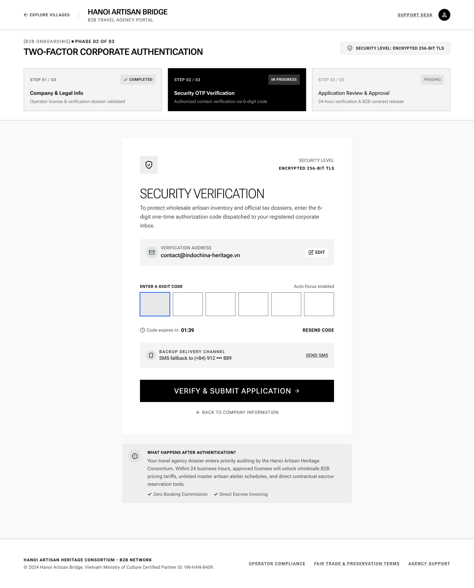

# Screen Spec: REG115 Two-Factor Corporate Authentication

| Field | Value |
|---|---|
| Screen ID | `REG115` |
| Screen name | Two-Factor Corporate Authentication (Security OTP Verification) |
| Actor | Tour Agency |
| Priority | Must |
| Belongs to module | `spec-AUT.md` |
| Mockup image | `img/REG115.png` |
| Status | Approved — confirmed correct Screen ID; see §9 |

## 1. Purpose

**Shown when:** The Agency submits Step 1 (Company & Legal Info) of registration by clicking "Continue to Verification" on REG003.

**The user leaves this screen when:** They enter a valid 6-digit code and click "Verify & Submit Application", or click "← Back to Company Information".

## 2. Mockup

## 3. Element inventory

| # | Element | Type | Content / data source | Required | Validation |
|---|---|---|---|---|---|
| 1 | Header | Header | "← Explore Villages" link, logo + "B2B Travel Agency Portal", "Support Desk" link, avatar icon | No | — |
| 2 | Breadcrumb | Text | "[B2B Onboarding] • Phase 02 of 03" | No | — |
| 3 | Page title | Header | "Two-Factor Corporate Authentication" | No | — |
| 4 | Security level badge | Badge | "Security Level: Encrypted 256-bit TLS" | No | — |
| 5 | Step tracker (3 steps) | Stepper | Step 01 Completed, Step 02 In Progress, Step 03 Pending | No | — |
| 6 | Panel icon | Image | Shield glyph | No | — |
| 7 | Security level (repeated, panel) | Badge | "Encrypted 256-bit TLS" | No | — |
| 8 | Heading | Text | "Security Verification" | No | — |
| 9 | Body copy | Text | Explains the purpose of the OTP | No | — |
| 10 | Verification Address row | Text | `agency.rep_email` (work email from Step 1) | No | — |
| 11 | Edit (verification address) | Button/link | Allows changing the email the OTP is sent to | No | — |
| 12 | 6-digit code input | Input (6 boxes) | `otp.code`, auto-focus enabled | Yes | Exactly 6 digits, must match the code sent |
| 13 | Code expiry countdown | Text (timer) | "Code expires in: 01:39" | No | — |
| 14 | Resend Code | Link | Requests a new OTP | No | Rate-limited (e.g. cooldown between resends) |
| 15 | Backup Delivery Channel row | Text | Masked phone number `agency.rep_phone` | No | — |
| 16 | Send SMS | Link | Sends the OTP via SMS instead of email | No | — |
| 17 | Verify & Submit Application | Button (primary) | Submits the entered code | No | Disabled until all 6 digits are entered |
| 18 | ← Back to Company Information | Link | Returns to Step 1 | No | — |
| 19 | "What happens after authentication?" info panel | Card | Explains next steps (audit, wholesale pricing unlock, etc.) | No | — |
| 20 | Footer | Text/Links | Copyright, Operator Compliance, Fair Trade & Preservation Terms, Agency Support | No | — |

## 4. States

| State | What the user sees | Trigger |
|---|---|---|
| Default | Empty 6-digit code boxes with the first box focused, countdown running | Screen load right after Step 1 submission |
| Empty (no data) | Same as default — code boxes always start empty | N/A |
| Loading | Verify & Submit Application shows spinner and is disabled while the code is checked | User taps Verify & Submit Application |
| Error | Code boxes outlined in red with inline text "Incorrect code, please try again"; "Code has expired, request a new one" if the timer runs out before submission | Entered code is wrong, or the countdown reaches 00:00 before submission |
| Success / confirmation | Navigates to Step 3 (Application Review & Approval / Registration Status) | Code verified successfully |

## 5. Interactions and navigation

| # | Element | User action | System response | Goes to screen |
|---|---|---|---|---|
| 1 | Code digit boxes | type | Auto-advances focus to next box; auto-submits or enables Verify button once all 6 are filled | stays |
| 2 | Edit (verification address) | tap | Allows entering a different email for OTP delivery | stays |
| 3 | Resend Code | tap | Sends a new code, restarts countdown | stays |
| 4 | Send SMS | tap | Sends the OTP to the backup phone number instead | stays |
| 5 | Verify & Submit Application | tap | Validates the code and submits the full application | `REG116` |
| 6 | ← Back to Company Information | tap | Returns to Step 1 form with previously entered data preserved | `REG003` |

## 6. Screen-level rules

| Rule ID | Rule | Source |
|---|---|---|
| SR-001 | Verify & Submit Application stays disabled until all 6 digits are entered | Mockup — 6 discrete input boxes |
| SR-002 | The OTP has a visible countdown and expires; an expired code must be re-requested | Mockup — "Code expires in: 01:39" and Resend Code |
| SR-003 | A backup SMS delivery channel is available if email OTP is not received | Mockup — Backup Delivery Channel panel |

## 7. Linked requirements

| FR ID (from the module spec) | What this screen does for it |
|---|---|
| F-AUTH-23 | Presents the OTP entry UI and captures/validates the 6-digit code the Guest enters to verify ownership of the submitted registration email. Successful verification here is the required precondition before F-AUTH-04 creates the Agency account |

## 8. Responsive and accessibility notes

- Smallest supported width: 768px (consistent with REG003's dense layout)
- What collapses or stacks on a narrow screen: the 6-digit boxes may shrink or wrap to two rows of 3; step tracker cards stack vertically
- Text that must remain readable (contrast, minimum size): countdown timer ≥14px and high-contrast so users notice urgency

## 9. Open questions

| # | Question | Blocking? | Status |
|---|---|---|---|
| 1 | The Screen List defines REG115 as "Attach Registration Document," but this mockup shows a Security OTP Verification screen instead. | Yes | Resolved — the original Screen List entry for REG115 was incorrect. REG115 is the Agency's OTP-entry screen for the email sent during registration/verification (Step 2 of the flow). Document/license upload is not a separate screen; it is handled inline on REG003 (Step 1). This spec's Screen name and content reflect the corrected purpose. |
| 2 | Module spec `spec-AUT.md` lists "OTP-based Agency registration" as explicitly **out of scope**, and its registration flow/sequence diagrams and FR-001–004 show no OTP step between registration submission and `Pending Approval` status. | Yes | Resolved — F-AUTH-23 (Verify Registration Email OTP) has been added to the module's function list, confirming this screen belongs in the Agency self-registration flow as the required gate before account creation (F-AUTH-04). See §7 and matching updates in `screen-spec-REG003.md` §9 and `screen-spec-REG116.md` §9. |

---

## Completion checklist

- [x] The mockup is a separate cropped image file, named with the Screen ID.
- [x] Every visible element in the mockup appears in the element inventory.
- [x] Every input element has a validation rule or an explicit "none".
- [x] All five states are filled in, or marked "not applicable" with a reason.
- [x] Every navigation target is a Screen ID that exists in the Screen List.
- [x] Every element that displays data names the field it displays, matching the module spec.
