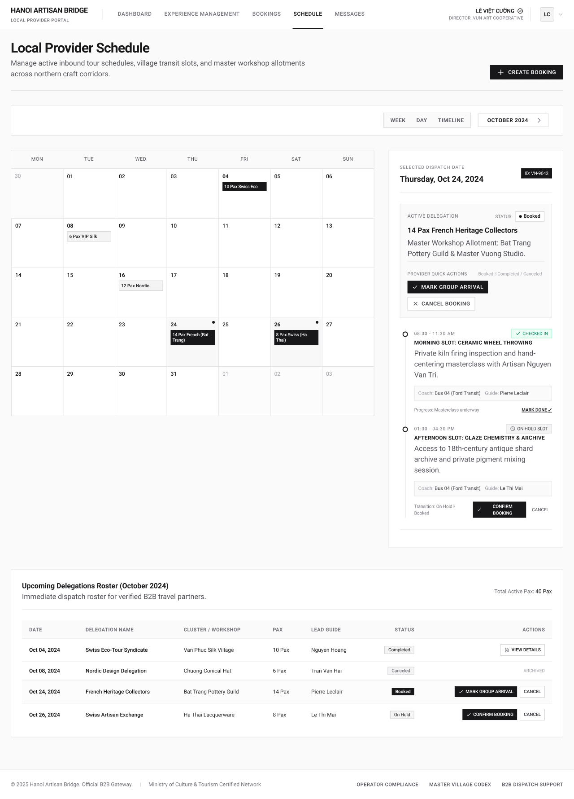

# Screen Spec: SCH139 Provider Schedule

| Field | Value |
|---|---|
| Screen ID | `SCH139` |
| Screen name | Provider Schedule |
| Actor | Local Provider |
| Priority | Must |
| Belongs to module | `spec-SCH.md` |
| Mockup image | `img/SCH139.png` |
| Status | Draft |

## 1. Purpose

**Shown when:** The Local Provider selects "Schedule" from the main navigation to view and manage their own booked/on-hold time slots.

**The user leaves this screen when:** They click "Create Booking" (→ BKG134), click "View Details" on a roster row (→ BKG135), or navigate away via the top nav (Dashboard, Experience Management, Booking, Messages) or avatar menu.

## 2. Mockup

## 3. Element inventory

| # | Element | Type | Content / data source | Required | Validation |
|---|---|---|---|---|---|
| 1 | Top nav bar | Header | Logo, nav links (Dashboard / Experience Management / Schedule active / Booking / Messages... note: order per mockup), user identity | Yes | — |
| 2 | Page title | Header | "Local Provider Schedule" | Yes | — |
| 3 | Page description | Text | Static subtitle | No | — |
| 4 | Create Booking button | Button | "+ Create Booking" | Yes | — |
| 5 | View toggle | Toggle | Week / Day / Timeline | Yes | Exactly one active; changes calendar granularity |
| 6 | Month navigator | Control | "October 2024" with prev/next chevrons | Yes | Changes the displayed month/period |
| 7 | Calendar grid | Calendar | 7-column (Mon–Sun) month grid; each day cell may show one or more booking chips (e.g. "10 Pax Swiss Eco", "14 Pax French (Bat Trang)") | Yes | Chips reflect only this provider's own bookings; no other agencies' data mixed in |
| 8 | Day cell indicator dot | Icon | Small dot on days with multiple/active items (e.g. Oct 24, Oct 26) | No | — |
| 9 | Selected day highlight | State | Border/highlight on the currently selected cell (Oct 24) | Yes | Exactly one cell selected at a time |
| 10 | Panel: Selected Dispatch Date | Card | Date label, Agency ID chip ("ID: VN-9042") | Yes | Reflects the selected calendar cell |
| 11 | Active Delegation card | Card | Delegation name/pax, Status badge ("Booked"), Master Workshop Allotment description | Yes | — |
| 12 | Provider Quick Actions | Button group | "Mark Group Arrival", "Cancel Booking", helper text "Booked ⇉ Completed / Canceled" | Yes | Enabled based on the delegation's current status |
| 13 | Time slot entry (Morning) | List item | Time range, status tag "Checked In", title, description, Coach/Guide info, progress note, "Mark Done" link | Yes | — |
| 14 | Time slot entry (Afternoon) | List item | Time range, status tag "On Hold Slot", title, description, Coach/Guide info (grayed), "Confirm Booking" / "Cancel" actions, transition helper text | Yes | Confirm/Cancel only available while On Hold |
| 15 | Panel: Upcoming Delegations Roster | Card | Month label, subtitle, "Total Active Pax" summary | Yes | — |
| 16 | Roster table header | Header | Columns: Date, Delegation Name, Cluster/Workshop, Pax, Lead Guide, Status, Actions | Yes | — |
| 17 | Roster row (repeating) | List item | Date; Delegation Name; Cluster/Workshop; Pax; Lead Guide; Status badge (Completed/Canceled/Booked/On Hold, with "Archived" note where relevant); Actions (View Details, Mark Group Arrival, Cancel, Confirm Booking depending on status) | Yes | Actions shown match the row's status |
| 18 | Footer | Footer | Company info, links, copyright | No | — |

## 4. States

| State | What the user sees | Trigger |
|---|---|---|
| Default | Calendar populated with booked/on-hold chips for the month; a day is pre-selected (today or nearest active day) with its detail panel and roster table shown | Screen load with existing bookings |
| Empty (no data) | Calendar shows no chips on any day; selected-day panel shows "No delegation scheduled for this date"; roster table shows "No upcoming delegations" with a prompt to Create Booking | Provider has no bookings in the displayed month |
| Loading | Calendar cells and the right-hand detail panel show skeleton placeholders; view toggle and month navigator remain interactive but data is stale until load completes | Screen mount, or after changing month/view |
| Error | Calendar and roster areas replaced by an inline error message ("Couldn't load your schedule") with a Retry action | API/network failure fetching schedule data |
| Success / confirmation | Toast confirming an action (e.g. "Booking confirmed", "Marked as arrived") and the relevant slot/roster row updates in place | After Confirm Booking, Mark Group Arrival, Mark Done, or Cancel Booking succeeds |

## 5. Interactions and navigation

| # | Element | User action | System response | Goes to screen |
|---|---|---|---|---|
| 1 | Create Booking | tap | Opens booking creation flow | `BKG134` |
| 2 | Day cell | tap | Selects that day; right panel and any relevant roster context update | stays on `SCH139` |
| 3 | View toggle (Week/Day/Timeline) | tap | Changes calendar layout granularity | stays on `SCH139` |
| 4 | Month navigator | tap | Moves the calendar to the previous/next month | stays on `SCH139` |
| 5 | Mark Group Arrival (panel or roster row) | tap | Opens confirmation modal; on confirmation, increments the booking's arrival progress (e.g. 1/2 slots) | `BKG136` |
| 6 | Cancel Booking | tap | Cancels the booking immediately; no confirmation step or reason is required | stays on `SCH139` |
| 7 | Confirm Booking (on-hold slot) | tap | Moves the slot from On Hold to Booked/Confirmed | stays on `SCH139` |
| 8 | Mark Done (time slot) | tap | Marks that specific slot/session as completed; this is an internal per-session marker only and does not by itself change the booking's overall Status | stays on `SCH139` |
| 9 | View Details (roster row) | tap | Loads the full booking record | `BKG135` |

## 6. Screen-level rules

| Rule ID | Rule | Source |
|---|---|---|
| SR-001 | Other Agencies' identities and booking details are never exposed on this screen — only this provider's own bookings, per the Screen List description | Explicit in Screen List: "Other Agencies' identities and booking details are not exposed" |
| SR-002 | Slot status can only move forward (On Hold → Booked/Confirmed → Completed, or → Canceled) | Consistency with booking lifecycle (BKG144) |
| SR-003 | Actions offered (Mark Group Arrival / Confirm Booking / Cancel / Mark Done) must always match the current status of that slot/delegation | Mockup: different action sets per status |
| SR-004 | Marking Group Arrival updates the booking's completion progress. If a booking has multiple operating slots, each marked slot counts toward the total (e.g. 1/2, 2/2); the booking's Status changes to Completed only once all booked slots have been marked as arrived | Clarification (Module 5) |
| SR-005 | Cancel Booking requires no confirmation step and no reason from the provider | Clarification (Module 5) |

## 7. Linked requirements

| FR ID (from the module spec) | What this screen does for it |
|---|---|
| FR-001 | Displays the Local Provider's own schedule with operating hours and time blocks with permitted status information (F-SCHED-01) |
| FR-005 | Provides the "Confirm Booking" and "Cancel Booking" quick actions to perform permitted status transitions (F-SCHED-05) |
| FR-006 | Provides the "Mark Group Arrival" quick action (F-SCHED-06) |

## 8. Responsive and accessibility notes

- Smallest supported width: 360px
- What collapses or stacks on a narrow screen: the month calendar grid and the right-hand detail panel stack vertically; the roster table becomes horizontally scrollable or collapses to stacked cards
- Text that must remain readable (contrast, minimum size): day-cell booking chips must remain legible at small size; status tags ("Checked In", "On Hold Slot") must not rely on color alone

## 9. Open questions

| # | Question | Blocking? | Status |
|---|---|---|---|
| 1 | [NEEDS CLARIFICATION: What confirmation, if any, is required before "Cancel Booking" takes effect, and does it require a reason?] **Resolved:** No confirmation and no reason are required; Cancel Booking takes effect immediately. | Yes | Resolved |
| 2 | [NEEDS CLARIFICATION: Does "Mark Done" on an individual time slot affect the overall booking Status shown in BKG135, or is it purely an internal schedule-progress marker?] **Resolved:** The overall booking Status is driven by Mark Group Arrival, not Mark Done. Mark Group Arrival updates completion progress per slot (e.g. 1/2, 2/2); the booking Status becomes "Completed" only once all booked slots have been marked as arrived. | Yes | Resolved |

---

## Completion checklist

- [x] The mockup is a separate cropped image file, named with the Screen ID.
- [x] Every visible element in the mockup appears in the element inventory.
- [x] Every input element has a validation rule or an explicit "none".
- [x] All five states are filled in, or marked "not applicable" with a reason.
- [x] Every navigation target is a Screen ID that exists in the Screen List.
- [x] Every element that displays data names the field it displays, matching the module spec.
