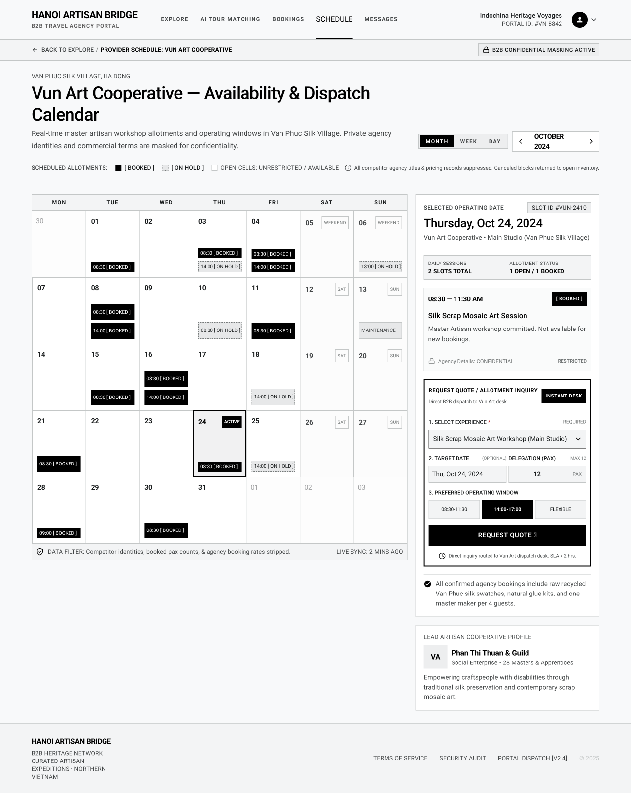

# Screen Spec: SCH140 Provider Schedule – Agency View

| Field | Value |
|---|---|
| Screen ID | `SCH140` |
| Screen name | Provider Schedule – Agency View |
| Actor | Tour Agency |
| Priority | Must |
| Belongs to module | `spec-SCH.md` |
| Mockup image | `img/SCH140.png` |
| Status | Draft |

## 1. Purpose

**Shown when:** A logged-in Tour Agency user navigates to a specific Local Provider's public schedule, typically from that provider's Village/Provider profile ("Back to Explore" trail) to check availability before requesting a quote.

**The user leaves this screen when:** They click "← Back to Explore" (returns to VIL030/discovery), submit "Request Quote" (triggers a Chat quote-request per the Quote Request action), or navigate away via the top nav.

## 2. Mockup

## 3. Element inventory

| # | Element | Type | Content / data source | Required | Validation |
|---|---|---|---|---|---|
| 1 | Top nav bar | Header | Logo, nav links (Explore / AI Tour Matching / Bookings / Schedule active / Messages), Agency identity | Yes | — |
| 2 | Breadcrumb | Link | "← Back to Explore / Provider Schedule: Vun Art Cooperative" | Yes | Navigates back |
| 3 | Confidentiality badge | Badge | "🔒 B2B Confidential Masking Active" | No | Indicates other agencies' data is hidden |
| 4 | Location subtitle | Text | "Van Phuc Silk Village, Ha Dong" | No | — |
| 5 | Page title | Header | "Vun Art Cooperative — Availability & Dispatch Calendar" | Yes | — |
| 6 | Page description | Text | Static subtitle explaining masking of identities/pricing | No | — |
| 7 | View toggle | Toggle | Month / Week / Day | Yes | Exactly one active |
| 8 | Month navigator | Control | "October 2024" with prev/next chevrons | Yes | Changes displayed month |
| 9 | Legend | Legend | Booked (filled), On Hold (dashed outline), Open cells (unrestricted/available), info tooltip on masking policy | No | — |
| 10 | Calendar grid | Calendar | 7-column month grid; each day cell shows only time + status chips (e.g. "08:30 [BOOKED]", "14:00 [ON HOLD]") with no agency names/pax counts; weekend/maintenance day labels shown | Yes | Never displays another agency's identity or booking details |
| 11 | Selected day highlight | State | "Active" tag + border on the currently selected cell (Oct 24) | Yes | Exactly one cell selected at a time |
| 12 | Panel: Selected Operating Date | Card | Date, Slot ID chip ("SLOT ID #VUN-2410"), provider/studio name | Yes | Reflects the selected calendar cell |
| 13 | Daily Sessions summary | Text | "2 Slots Total", "1 Open / 1 Booked" | Yes | Computed from the day's slots |
| 14 | Slot detail card | Card | Time range, status badge ("Booked"), session title, description, "Agency Details: CONFIDENTIAL / RESTRICTED" note | Yes | Never reveals the booking agency's identity |
| 15 | Panel: Request Quote / Allotment Inquiry | Card | "Instant Desk" tag, subtitle "Direct B2B dispatch to Vun Art desk" | Yes | — |
| 16 | Select Experience dropdown | Input (select, required) | Lists this provider's Experiences (e.g. "Silk Scrap Mosaic Art Workshop (Main Studio)") | Yes | Must select one Experience |
| 17 | Target Date input | Input (date, optional) | Pre-filled with the selected calendar day | No | Must be a valid date if provided |
| 18 | Delegation (Pax) input | Input (number) | Value 12, "MAX 12" helper | Yes | Must be > 0 and ≤ Experience max capacity |
| 19 | Preferred Operating Window | Button group (select-one) | 08:30–11:30 / 14:00–17:00 (selected) / Flexible | Yes | Exactly one selected |
| 20 | Request Quote button | Button | Primary CTA | Yes | Enabled once Experience and Pax are valid |
| 21 | SLA helper text | Text | "Direct inquiry routed to Vun Art dispatch desk. SLA < 2 hrs." — informational copy only, not a system-enforced SLA | No | — |
| 22 | Inclusions note | Text | Checkmark + static text on what confirmed bookings include | No | — |
| 23 | Panel: Lead Artisan Cooperative Profile | Card | Avatar initials, guild name, tagline ("Social Enterprise • 28 Masters & Apprentices"), short description | No | Read-only, from Provider Profile |
| 24 | Footer | Footer | Company info, links, copyright | No | — |

## 4. States

| State | What the user sees | Trigger |
|---|---|---|
| Default | Calendar populated with Booked/On Hold chips (masked) for the month; a day pre-selected with its detail and the Request Quote form ready | Screen load with an existing schedule for the provider |
| Empty (no data) | Calendar shows all cells as open/available; selected-day panel shows "No sessions scheduled — fully available"; Request Quote form remains usable | Provider has no bookings in the displayed month |
| Loading | Calendar cells and right-hand panels show skeleton placeholders; view toggle and month navigator remain interactive but stale until load completes | Screen mount, or after changing month/view |
| Error | Calendar area replaced by an inline error message ("Couldn't load this provider's schedule") with a Retry action | API/network failure fetching schedule data |
| Success / confirmation | After Request Quote submits, a confirmation state appears (e.g. toast "Quote request sent") and the button becomes disabled/relabeled, since the same Experience can only be requested once per the Quote Request rule | Request Quote submitted successfully |

## 5. Interactions and navigation

| # | Element | User action | System response | Goes to screen |
|---|---|---|---|---|
| 1 | Back to Explore | tap | Returns to provider/village discovery | `VIL030` |
| 2 | Day cell | tap | Selects that day; right panel updates; Target Date pre-fills | stays on `SCH140` |
| 3 | View toggle (Month/Week/Day) | tap | Changes calendar layout granularity | stays on `SCH140` |
| 4 | Month navigator | tap | Moves the calendar to the previous/next month | stays on `SCH140` |
| 5 | Preferred Operating Window buttons | tap | Selects the desired window for the quote request | stays on `SCH140` |
| 6 | Request Quote button | tap | Opens Chat and auto-sends the initial quote-request message for the selected Experience (per the Quote Request action) | Chat (`COM065`) |

## 6. Screen-level rules

| Rule ID | Rule | Source |
|---|---|---|
| SR-001 | Other Agencies' identities and booking details are never shown — only Booked/On-hold time slots are visible, with agency/pax/pricing masked | Explicit in Screen List description for SCH140 |
| SR-002 | Canceled blocks return to open inventory and are not shown as Booked/On Hold | Mockup legend note: "Canceled blocks returned to open inventory" |
| SR-003 | Request Quote can only be triggered once by the same Agency for the same Experience + Target Date combination; a repeat request for that same Experience and date does not create a duplicate quote request (a different date, or a different Experience, is allowed) | Cross-reference with "Request Quote - Action" row in the Screen List; Clarification (Module 5) |
| SR-004 | Delegation (Pax) cannot exceed the selected Experience's max capacity | Mockup: "MAX 12" helper text |

## 7. Linked requirements

| FR ID (from the module spec) | What this screen does for it |
|---|---|
| FR-001 | Displays the Local Provider's public schedule to the Tour Agency, showing only permitted availability/booking-block information with no other Agency's identity, price, or contact info exposed (F-SCHED-01) |

## 8. Responsive and accessibility notes

- Smallest supported width: 360px
- What collapses or stacks on a narrow screen: the calendar grid and the right-hand panels (selected date, request quote, cooperative profile) stack vertically; the Preferred Operating Window button group wraps or becomes a dropdown
- Text that must remain readable (contrast, minimum size): Booked vs. On Hold chip styling must remain distinguishable at small size and not rely on color alone (dashed vs. filled, per the legend)

## 9. Open questions

| # | Question | Blocking? | Status |
|---|---|---|---|
| 1 | [NEEDS CLARIFICATION: Does the "SLA < 2 hrs" figure reflect a real service-level commitment the system enforces, or is it purely informational copy?] **Resolved:** Purely informational copy; not system-enforced. | No | Resolved |
| 2 | [NEEDS CLARIFICATION: What exactly counts as "the same Experience/activity" for the one-time Request Quote restriction — same Experience only, or same Experience + date?] **Resolved:** Same Experience + Target Date combination. A repeat request for a different date (or a different Experience) is allowed. | Yes | Resolved |

---

## Completion checklist

- [x] The mockup is a separate cropped image file, named with the Screen ID.
- [x] Every visible element in the mockup appears in the element inventory.
- [x] Every input element has a validation rule or an explicit "none".
- [x] All five states are filled in, or marked "not applicable" with a reason.
- [x] Every navigation target is a Screen ID that exists in the Screen List.
- [x] Every element that displays data names the field it displays, matching the module spec.
